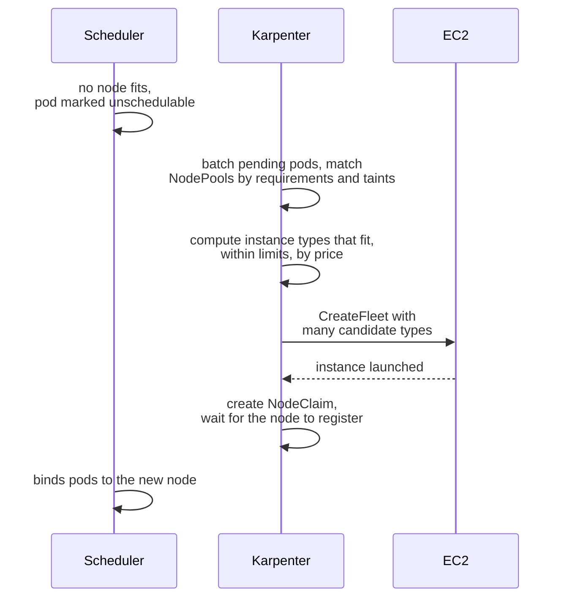

# Karpenter in depth

> **Status: AI draft, 2026-11-16.** Not yet verified by me. Written from the Karpenter documentation (`karpenter.sh/v1` and `karpenter.k8s.aws/v1` APIs); nothing was run.

## In one line

Karpenter launches EC2 instances to fit pending pods, guided by NodePools (what may be launched, limits, disruption rules) and EC2NodeClasses (how: AMI, subnets, security groups, role), and tracks each launch as a NodeClaim. It then disrupts nodes on purpose (consolidation, drift, expiration), rate-limited by disruption budgets and PDBs, and handles Spot interruptions from an SQS queue.

## The plain idea

Karpenter is a controller that turns "these pods cannot be scheduled" into "here is a machine shaped for them" ([Cluster Autoscaler vs Karpenter](cluster-autoscaler-vs-karpenter.md)). You do not list instance types one group at a time; you describe the space it may choose from ("compute or memory families, generation 5 or newer, Spot preferred, these three zones, at most 1000 CPUs in total") and it picks.

Because it chose every node, it also feels free to change its mind later: replace two half-empty nodes with one, swap an On-Demand node for a cheaper one, or retire nodes built from an old AMI. That continuous reshuffling is where the savings come from, and where most of the surprises come from.

## How it works

### The three objects

| Object | API | Purpose |
|---|---|---|
| **NodePool** | `karpenter.sh/v1` | What may be launched: requirements, taints, labels, `expireAfter`, limits, weight, disruption settings |
| **EC2NodeClass** | `karpenter.k8s.aws/v1` | How to launch on AWS: AMI selection (for example the `al2023@latest` alias), subnet and security group selectors (often by a discovery tag), IAM role, kubelet settings, block devices |
| **NodeClaim** | `karpenter.sh/v1` | One per node Karpenter launched: its chosen type, zone, capacity type and status |

```yaml
apiVersion: karpenter.sh/v1
kind: NodePool
metadata:
  name: general
spec:
  template:
    spec:
      nodeClassRef:
        group: karpenter.k8s.aws
        kind: EC2NodeClass
        name: default
      requirements:
        - key: karpenter.k8s.aws/instance-category
          operator: In
          values: ["c", "m", "r"]
        - key: karpenter.k8s.aws/instance-generation
          operator: Gt
          values: ["4"]
        - key: karpenter.sh/capacity-type
          operator: In
          values: ["spot", "on-demand"]
        - key: topology.kubernetes.io/zone
          operator: In
          values: ["ap-south-1a", "ap-south-1b", "ap-south-1c"]
      expireAfter: 720h
  limits:
    cpu: "1000"
    memory: 1000Gi
  disruption:
    consolidationPolicy: WhenEmptyOrUnderutilized
    consolidateAfter: 1m
    budgets:
      - nodes: "10%"
```

### From a pending pod to a node



- Karpenter respects the pods' **requests, nodeSelector, node affinity, tolerations, topology spread** and volume zones when choosing ([Scheduling](../kubernetes/scheduling.md)).
- Several NodePools may match a pod. Make them mutually exclusive (taints, labels), or give them a **weight**: the highest-weight NodePool that can be used wins, falling back when its limits are reached.
- **Limits** cap a NodePool's total CPU and memory; once reached, it launches nothing more.

### Disruption

Karpenter removes or replaces nodes in two ways:

| Kind | Methods | Respects NodePool budgets | Respects PDBs and `do-not-disrupt` |
|---|---|---|---|
| **Graceful** (voluntary) | Drift, consolidation (and node repair, if enabled) | Yes | Yes; replacement launched first when needed |
| **Forceful** | Expiration, Spot interruption, node deletion | No | PDBs only, and only until the termination grace period |

- **Consolidation**: `WhenEmpty` removes only nodes with no workload pods; `WhenEmptyOrUnderutilized` also removes or replaces underused nodes with cheaper ones; `Balanced` considers the same nodes but only acts when the saving is worth the disruption. `consolidateAfter` waits after pod changes before acting.
- **Drift**: a node whose NodePool or EC2NodeClass no longer matches it (new AMI, changed requirements) is replaced. This is how node upgrades happen ([EKS upgrades](upgrades.md)).
- **Expiration**: `expireAfter` (for example 720h) retires nodes older than that, whatever their state; changing it drifts existing nodes.
- **Budgets**: `spec.disruption.budgets` caps how many nodes may be voluntarily disrupted at once; if none is set, the default is one budget of `nodes: 10%`. Budgets can have schedules, for example no disruption during business hours.
- **Termination**: Karpenter taints the node `karpenter.sh/disrupted:NoSchedule`, evicts pods respecting PDBs ([Disruptions and PDBs](../kubernetes/disruptions-and-pdbs.md)), then terminates the instance. Its finalizer on the node makes this happen in order ([Finalizers and deletion](../kubernetes/finalizers-and-deletion.md)).

### Opting out

- On a **pod**: `karpenter.sh/do-not-disrupt: "true"` blocks voluntary disruption of its node while it runs; a duration such as `"30m"` protects it only for that long after start. Use it for jobs that cannot be restarted halfway ([Jobs and CronJobs](../kubernetes/jobs-and-cronjobs.md)).
- On a **node**: the same annotation blocks voluntary disruption of that node.
- Neither stops forceful methods such as expiration or Spot interruption.

### Spot interruptions

EC2 warns two minutes before reclaiming a Spot instance. Karpenter receives these warnings (and rebalance recommendations, scheduled maintenance and instance state changes) from an **SQS queue** fed by EventBridge rules, which you create when installing it. On a warning it cordons and drains the node and launches a replacement right away. Without the queue, the node simply disappears. Diversify: allowing many instance types and zones lowers the chance of interruptions and of `InsufficientInstanceCapacity`.

## A concrete example

A cluster with one `general` NodePool (above) and one `batch` NodePool.

1. `batch` allows only large sizes, carries a taint `workload=batch:NoSchedule`, and has `consolidationPolicy: WhenEmpty` so running jobs are never consolidated away.
2. Batch Job pods tolerate the taint and set `karpenter.sh/do-not-disrupt: "true"`.
3. `general` uses `WhenEmptyOrUnderutilized` with a budget of `nodes: "10%"`, plus a scheduled budget of `nodes: "0"` during business hours to avoid churn at peak.
4. EC2NodeClass `default` uses the `al2023@latest` AMI alias; when AWS publishes a new AMI, nodes drift and are replaced gradually within the budget.
5. Karpenter itself runs on a two-node managed node group ([EKS architecture and node options](architecture.md)).

## Why not just...?

- **...allow only one instance type, to keep things predictable?** Karpenter then cannot fall back when that type has no capacity in a zone, and Spot interruptions rise. Allow families and sizes, and constrain with requirements.
- **...turn consolidation off to stop churn?** Nodes then stay half-empty and cost grows. Keep it, and make workloads disruption-friendly, or use budgets and `WhenEmpty` where needed.
- **...set `do-not-disrupt` on everything?** Then drift and consolidation never happen, AMIs never update by drift, and only forceful expiration remains. Reserve it for work that cannot be interrupted.

## Commands to know

These were not run for this page.

| Command | What it does |
|---|---|
| `kubectl get nodepools` | Pools, their usage against limits, readiness. |
| `kubectl get nodeclaims -o wide` | Every node Karpenter launched: type, zone, capacity type, age. |
| `kubectl describe nodeclaim <name>` | Launch errors and disruption conditions (drifted, expired). |
| `kubectl get ec2nodeclasses` | Node classes and whether their AMIs, subnets and security groups resolved. |
| `kubectl logs -n <karpenter-namespace> deploy/karpenter` | Why it launched, did not launch, or disrupted a node. |
| `kubectl get events -A --field-selector source=karpenter` | Karpenter's events on pods and nodes. |
| `kubectl annotate pod <pod> karpenter.sh/do-not-disrupt=true` | Protect one running pod's node from voluntary disruption. |

## How it breaks

| Symptom | Layer | Check | Likely cause |
|---|---|---|---|
| Pods Pending, log says no instance type met the scheduling requirements | Requirements | Pod requests and constraints against NodePool requirements | Pod too large for allowed sizes, wrong arch, zone or taint mismatch |
| NodePool launches nothing | Limits or class | `kubectl get nodepools`, EC2NodeClass status | Limits reached; AMI, subnet or security group selectors match nothing |
| `InsufficientInstanceCapacity` in logs | EC2 capacity | Allowed types and zones | Too few instance types or zones allowed |
| Nodes replaced every few minutes | Consolidation | Disruption events | Aggressive policy with churning pods; tighten budgets or `consolidateAfter` |
| A long job was killed mid-run | Disruption | Pod annotation, node events | Consolidation or drift without `do-not-disrupt`, or expiration (forceful) |
| Spot nodes vanish without draining | Interruption handling | SQS queue setting, EventBridge rules | Interruption queue not configured |
| Nodes launch but never become Ready | Bootstrap | Node role access, subnets, AMI | Missing access entry for the node role, no route to the API server, wrong AMI |

## Interview questions

**1. What are NodePool, EC2NodeClass and NodeClaim?**

<details markdown="1">
<summary>Answer</summary>

- NodePool: what may be launched (requirements, taints, limits, disruption rules).
- EC2NodeClass: how to launch on AWS (AMI, subnets, security groups, role).
- NodeClaim: one launched node and its chosen type, zone and status.

</details>

**2. Walk through what happens when a pod is Pending in a Karpenter cluster.**

<details markdown="1">
<summary>Answer</summary>

- The scheduler marks it unschedulable; Karpenter batches pending pods.
- It matches NodePools by requirements and tolerations, finds instance types that fit within limits, and calls EC2 with many candidates.
- A NodeClaim tracks the launch; the node registers and the scheduler binds the pods.

</details>

**3. Explain consolidation, drift and expiration.**

<details markdown="1">
<summary>Answer</summary>

- Consolidation: remove empty or underused nodes, or replace with cheaper ones.
- Drift: replace nodes that no longer match their NodePool or EC2NodeClass, such as after an AMI change.
- Expiration: replace nodes older than `expireAfter`, forcefully.

</details>

**4. How do you stop Karpenter from disrupting a running batch job?**

<details markdown="1">
<summary>Answer</summary>

- `karpenter.sh/do-not-disrupt: "true"` on the pod, or a duration.
- A NodePool with `WhenEmpty` consolidation for batch nodes.
- It still cannot stop forceful events such as Spot interruption or expiration, so long jobs should checkpoint.

</details>

**5. How does Karpenter handle Spot interruptions?**

<details markdown="1">
<summary>Answer</summary>

- EventBridge rules send interruption warnings to an SQS queue that Karpenter reads.
- On a two-minute warning it cordons and drains the node and launches a replacement.
- Diversifying instance types and zones reduces interruptions.

</details>

**6. Karpenter keeps logging that no instance type meets the pod's requirements. What do you check?**

<details markdown="1">
<summary>Answer</summary>

- The pod: requests, nodeSelector, affinity, tolerations, volume zones.
- The NodePools: requirements, taints, limits; whether any allowed type is big enough in an allowed zone.
- The EC2NodeClass status and capacity errors in the logs.

</details>

**7. What protects production from Karpenter replacing too many nodes at once?**

<details markdown="1">
<summary>Answer</summary>

- NodePool disruption budgets (10% of nodes by default), optionally scheduled.
- PodDisruptionBudgets on the workloads, honoured during voluntary disruption.
- Replicas spread across nodes and zones, and graceful shutdown in the apps.

</details>

## Try it

Without AWS:

1. Write a NodePool for GPU jobs that allows only GPU instance categories, taints its nodes, and never consolidates non-empty nodes. Write the pod spec that would land there.
2. For the example cluster, list what happens step by step when AWS publishes a new AL2023 AMI.
3. Explain to a colleague, in three sentences, why a pod with `do-not-disrupt` can still be stopped.

## Zoom out

Karpenter is the reconcile loop applied to capacity: desired (pending pods) versus actual (nodes), corrected continuously ([Architecture and the reconcile loop](../kubernetes/architecture.md)). Its value is cost and speed; its price is frequent, controlled disruption, which only well-built workloads absorb ([Probes and graceful shutdown](../kubernetes/probes-and-graceful-shutdown.md)). EKS Auto Mode runs it for you ([EKS architecture and node options](architecture.md)).

## Sources

- [Karpenter documentation: NodePools](https://karpenter.sh/docs/concepts/nodepools/)
- [Karpenter documentation: NodeClasses](https://karpenter.sh/docs/concepts/nodeclasses/)
- [Karpenter documentation: NodeClaims](https://karpenter.sh/docs/concepts/nodeclaims/)
- [Karpenter documentation: scheduling](https://karpenter.sh/docs/concepts/scheduling/)
- [Karpenter documentation: disruption](https://karpenter.sh/docs/concepts/disruption/)
- [Karpenter documentation: troubleshooting](https://karpenter.sh/docs/troubleshooting/)
- [Amazon EC2 User Guide: Spot Instance interruption notices](https://docs.aws.amazon.com/AWSEC2/latest/UserGuide/spot-instance-termination-notices.html)
