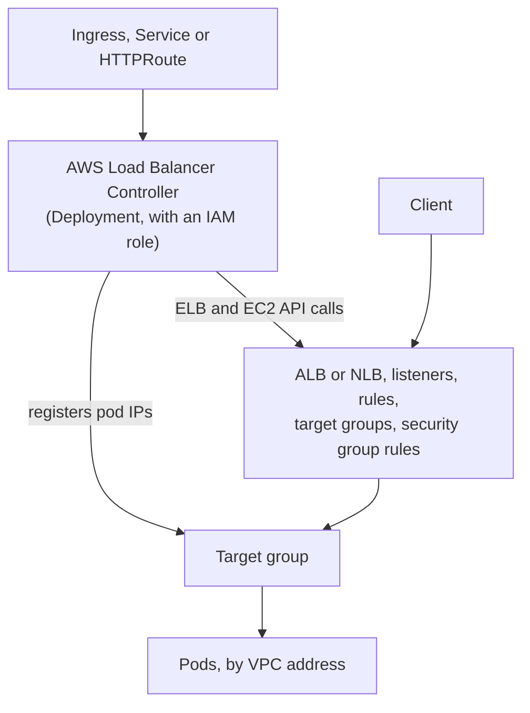

# AWS Load Balancer Controller

> **Status: AI draft, 2026-11-16.** Not yet verified by me. Written from the AWS and project documentation; no AWS commands were run, so the commands below have no sample output.

## In one line

The AWS Load Balancer Controller watches Ingress, Service and Gateway API objects and creates AWS load balancers for them: an ALB for an Ingress or HTTPRoute, an NLB for a `type: LoadBalancer` Service or TCP route. With `target-type: ip` it registers pod addresses directly; subnets are found by their role tags, and it needs its own IAM permissions.

## The plain idea

In a cloud, "expose this app" should produce a real cloud load balancer. Kubernetes leaves that to a controller ([Ingress and Gateway API](../kubernetes/ingress-and-gateway-api.md)). On EKS, the usual one is the **AWS Load Balancer Controller** (LBC): a Deployment in the cluster that turns Kubernetes objects into ALBs, NLBs, listeners, rules and target groups ([ALB and NLB](../aws-core/load-balancers.md)), and keeps the targets in step as pods come and go.

Unlike an in-cluster proxy such as NGINX, there is no extra hop: the ALB itself does the routing, TLS and health checks, and sends traffic straight to pods.

## How it works



### What it creates

| Kubernetes object | AWS result |
|---|---|
| `Ingress` with `ingressClassName: alb` | Application Load Balancer, a listener per port, a rule per host and path, a target group per Service |
| `Service` `type: LoadBalancer`, handled by the LBC | Network Load Balancer |
| Gateway API `HTTPRoute`, `GRPCRoute` | ALB |
| Gateway API `TCPRoute`, `UDPRoute`, `TLSRoute` | NLB |
| `TargetGroupBinding` (custom resource) | No load balancer: registers a Service's pods into an existing target group |

For a Service, the annotation `service.beta.kubernetes.io/aws-load-balancer-type: "external"` (or a `loadBalancerClass` for the LBC) makes the LBC, not the older built-in cloud provider code, create the NLB.

### Target types

| | `instance` (ALB default) | `ip` |
|---|---|---|
| Registered targets | Nodes, on the Service's NodePort | Pod addresses from the VPC CNI ([Networking with the VPC CNI](vpc-cni.md)) |
| Path | Load balancer, node port, kube-proxy, maybe another node, pod | Load balancer, pod |
| Health checks see | The node port | The actual pod |
| Needed for | | Fargate pods, sticky sessions to a pod, accurate health |
| Service type | NodePort or LoadBalancer | Any, including ClusterIP |

`ip` is the common choice on EKS.

### The annotations that matter (Ingress)

| Annotation | Meaning | Default |
|---|---|---|
| `alb.ingress.kubernetes.io/scheme` | `internet-facing` or `internal` | `internal` |
| `alb.ingress.kubernetes.io/target-type` | `instance` or `ip` | `instance` |
| `alb.ingress.kubernetes.io/certificate-arn` | ACM certificate(s) for HTTPS ([Route 53 and ACM](../aws-core/route53-and-acm.md)) | Certificate discovery by host |
| `alb.ingress.kubernetes.io/listen-ports` | e.g. `'[{"HTTP": 80}, {"HTTPS": 443}]'` | HTTP 80, or HTTPS 443 with a certificate |
| `alb.ingress.kubernetes.io/ssl-redirect` | Redirect HTTP to this HTTPS port | Off |
| `alb.ingress.kubernetes.io/healthcheck-path` | Target group health check path | `/` |
| `alb.ingress.kubernetes.io/group.name` | Join an IngressGroup | None |
| `alb.ingress.kubernetes.io/subnets` | Explicit subnets instead of discovery | Discovery by tags |

### Subnet discovery

Without explicit subnets, the controller picks subnets by tag:

| Tag | On | Used for |
|---|---|---|
| `kubernetes.io/role/elb` = `1` | Public subnets | `internet-facing` load balancers |
| `kubernetes.io/role/internal-elb` = `1` | Private subnets | `internal` load balancers |

A missing tag is one of the most common reasons an Ingress never gets an address.

### IngressGroup: one ALB for many Ingresses

Each Ingress normally gets its own ALB. Ingresses with the same `alb.ingress.kubernetes.io/group.name` share one: the controller merges their rules (ordered by `group.order`). It saves money and keeps one DNS name, but any team in the group can affect the shared ALB, so groups need agreed ownership.

### Readiness gates: safe rolling updates

With `target-type: ip`, a new pod can be Ready in Kubernetes before the ALB has registered it and seen it healthy. In a fast rollout with few replicas, all old pods may be gone before any new one receives traffic. Label the namespace `elbv2.k8s.aws/pod-readiness-gate-inject=enabled`, and the controller adds a readiness gate so a pod only counts as Ready once its target is healthy in the target group ([Probes and graceful shutdown](../kubernetes/probes-and-graceful-shutdown.md)).

### Permissions

The controller calls the Elastic Load Balancing and EC2 APIs, so it needs the IAM policy published by the project, given to its service account through IRSA or Pod Identity ([Cluster access, IRSA and Pod Identity](access-and-pod-identity.md)). In EKS Auto Mode, load balancing is built in and this controller is not installed separately ([EKS architecture and node options](architecture.md)).

## A concrete example

`sample-app` exposes a web front end and an API on `www.example.com`.

```yaml
apiVersion: networking.k8s.io/v1
kind: Ingress
metadata:
  name: sample-app
  namespace: team-a
  annotations:
    alb.ingress.kubernetes.io/scheme: internet-facing
    alb.ingress.kubernetes.io/target-type: ip
    alb.ingress.kubernetes.io/listen-ports: '[{"HTTP": 80}, {"HTTPS": 443}]'
    alb.ingress.kubernetes.io/ssl-redirect: "443"
    alb.ingress.kubernetes.io/certificate-arn: arn:aws:acm:ap-south-1:123456789012:certificate/<certificate-id>
    alb.ingress.kubernetes.io/healthcheck-path: /healthz
    alb.ingress.kubernetes.io/group.name: public-web
spec:
  ingressClassName: alb
  rules:
    - host: www.example.com
      http:
        paths:
          - path: /api
            pathType: Prefix
            backend:
              service: {name: sample-app-api, port: {number: 8080}}
          - path: /
            pathType: Prefix
            backend:
              service: {name: sample-app-web, port: {number: 80}}
```

Then: the namespace carries the readiness gate label, the public subnets carry `kubernetes.io/role/elb=1`, and a Route 53 alias record points `www.example.com` at the ALB's DNS name (by hand, or with ExternalDNS).

## Why not just...?

- **...run NGINX in the cluster behind one NLB?** That works and is portable, but it adds a hop and a component to scale and patch, and the community ingress-nginx controller has been retired ([Ingress and Gateway API](../kubernetes/ingress-and-gateway-api.md)). The ALB route keeps routing, TLS and WAF in managed AWS services.
- **...give every Ingress its own ALB?** Each ALB is billed by the hour. Group related Ingresses, but not unrelated teams who could break each other's rules.
- **...use `target-type: instance` because it is the default?** Traffic takes an extra hop through node ports, health checks test nodes rather than pods, and Fargate pods cannot be targeted. Use `ip` unless you have a reason not to.

## Commands to know

These were not run for this page.

| Command | What it does |
|---|---|
| `kubectl get ingress -A` | Each Ingress and its ALB DNS name in ADDRESS. |
| `kubectl describe ingress <name> -n <ns>` | Events from the controller, including errors such as missing subnets or certificates. |
| `kubectl logs -n kube-system deploy/aws-load-balancer-controller` | The controller's reconcile errors, often AWS `AccessDenied`. |
| `kubectl get targetgroupbindings -A` | The controller's link between each Service and its target group. |
| `aws elbv2 describe-target-health --target-group-arn <arn>` | Whether the ALB considers each pod healthy, and why not. |
| `aws ec2 describe-subnets --filters Name=tag:kubernetes.io/role/elb,Values=1` | Which subnets are tagged for public load balancers. |

## How it breaks

| Symptom | Layer | Check | Likely cause |
|---|---|---|---|
| Ingress has no ADDRESS | Controller | `describe ingress` events, controller logs | Wrong `ingressClassName`, controller not running, or no tagged subnets |
| Controller logs `AccessDenied` | IAM | Its service account's role | Missing or outdated IAM policy for the controller |
| ALB created but returns 503 | Targets | `describe-target-health` | No healthy targets: wrong health check path or port, failing pods, security group blocking the ALB |
| 502s during every rollout | Deregistration timing | Readiness gate, `preStop`, deregistration delay | Pods stop before the ALB stops sending to them |
| Internet-facing ALB was created as internal | Scheme | `scheme` annotation | Default is `internal` |
| HTTPS listener missing | Certificate | `certificate-arn`, ACM status | No certificate for the host, or one in another region |
| One team's change broke another team's routing | IngressGroup | `group.name` members | Shared ALB with conflicting rules or a broken annotation |

## Interview questions

**1. What does the AWS Load Balancer Controller do?**

<details markdown="1">
<summary>Answer</summary>

- Watches Ingress, Service (`type: LoadBalancer`) and Gateway API objects.
- Creates and updates ALBs or NLBs, listeners, rules and target groups, and registers targets.
- Needs IAM permissions through IRSA or Pod Identity.

</details>

**2. Explain `target-type: ip` versus `instance`.**

<details markdown="1">
<summary>Answer</summary>

- `instance`: nodes on the NodePort are targets; traffic hops through kube-proxy.
- `ip`: pod addresses are targets; the ALB sends straight to pods, health checks test pods, works for Fargate.
- `ip` relies on the VPC CNI giving pods VPC addresses.

</details>

**3. An Ingress was applied an hour ago and still has no address. What do you check?**

<details markdown="1">
<summary>Answer</summary>

- `kubectl describe ingress` events and the controller logs.
- `ingressClassName`, subnet tags for the scheme, IAM `AccessDenied` in the logs.
- The controller's own pods and webhook health.

</details>

**4. How do you share one ALB between several Ingresses, and what is the risk?**

<details markdown="1">
<summary>Answer</summary>

- Same `alb.ingress.kubernetes.io/group.name`; rules merge in `group.order`.
- Saves cost and DNS names.
- A bad annotation or conflicting rule from one Ingress affects all of them; limit groups to one owner.

</details>

**5. Users see 502 errors for a few seconds on every deploy. How do you fix it?**

<details markdown="1">
<summary>Answer</summary>

- Enable pod readiness gates so new pods count as Ready only when healthy in the target group.
- Add a `preStop` delay so old pods keep serving until the ALB has deregistered them, within the grace period.
- Check deregistration delay and health check settings.

</details>

**6. What is a TargetGroupBinding for?**

<details markdown="1">
<summary>Answer</summary>

- Registering a Service's pods into a target group created outside Kubernetes (Terraform, another team).
- The load balancer's life cycle stays outside the cluster; the controller only manages targets.
- Useful for blue-green across clusters, or when the ALB must survive cluster rebuilds.

</details>

## Try it

No free EKS lab, so practise reading:

1. Take the Ingress above and list every AWS resource the controller will create: load balancer, listeners, rules, target groups, and which security group rules.
2. Change it to `internal` for an internal tool. Which subnet tag must exist, and who can then reach it?
3. Rewrite it as a Gateway API `HTTPRoute` attached to a Gateway, using the pattern on [Ingress and Gateway API](../kubernetes/ingress-and-gateway-api.md).

## Zoom out

The controller is where Kubernetes networking meets AWS networking: it turns Ingress and Gateway API objects into ALBs and NLBs, and it relies on the VPC CNI to make pods addressable. The same load balancers front ECS and Lambda ([ECS and Fargate](../serverless/ecs-and-fargate.md)), and a service mesh takes over routing once traffic is inside the cluster ([Why a mesh](../mesh/why-a-mesh.md)).

## Sources

- [Amazon EKS User Guide: AWS Load Balancer Controller](https://docs.aws.amazon.com/eks/latest/userguide/aws-load-balancer-controller.html)
- [Amazon EKS User Guide: application load balancing (ALB) on EKS](https://docs.aws.amazon.com/eks/latest/userguide/alb-ingress.html)
- [Amazon EKS User Guide: network load balancing (NLB) on EKS](https://docs.aws.amazon.com/eks/latest/userguide/network-load-balancing.html)
- [AWS Load Balancer Controller documentation](https://kubernetes-sigs.github.io/aws-load-balancer-controller/latest/)
- [AWS Load Balancer Controller: Ingress annotations](https://kubernetes-sigs.github.io/aws-load-balancer-controller/latest/guide/ingress/annotations/)
- [AWS Load Balancer Controller: pod readiness gate](https://kubernetes-sigs.github.io/aws-load-balancer-controller/latest/deploy/pod_readiness_gate/)
- [AWS Load Balancer Controller: TargetGroupBinding](https://kubernetes-sigs.github.io/aws-load-balancer-controller/latest/guide/targetgroupbinding/targetgroupbinding/)
- [AWS Load Balancer Controller: Gateway API](https://kubernetes-sigs.github.io/aws-load-balancer-controller/latest/guide/gateway/gateway/)
