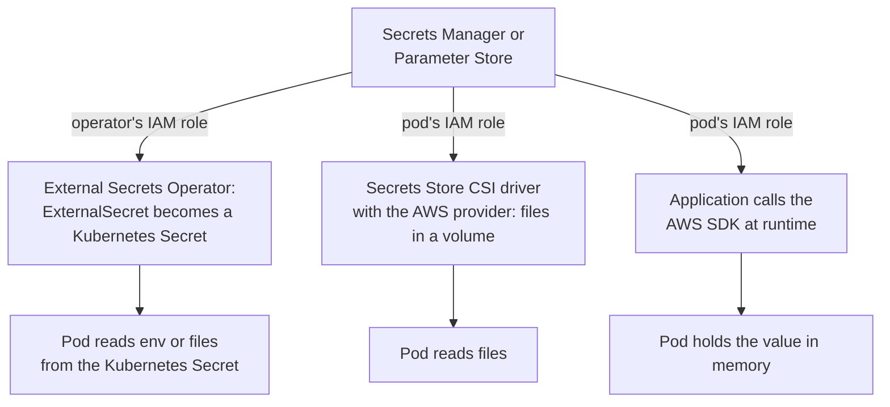

# Secrets from AWS into pods

> **Status: AI draft, 2026-11-16.** Not yet verified by me. Written from the AWS and project documentation; no AWS commands were run, so the commands below have no sample output.

## In one line

Keep secrets in Secrets Manager or Parameter Store and bring them in three ways: the External Secrets Operator copies them into Kubernetes Secrets, the Secrets Store CSI driver mounts them as files, or the app calls the AWS SDK. All use IRSA or Pod Identity, and how the pod reads the secret decides whether it sees a rotated value.

## The plain idea

A Kubernetes Secret is only base64 text in etcd; anyone who can read it, or the Git repo it came from, has the password ([ConfigMaps and Secrets](../kubernetes/configmaps-and-secrets.md)). Teams on AWS usually want one source of truth for secrets, with access control, audit and rotation: **AWS Secrets Manager** or **Systems Manager Parameter Store** ([KMS and secrets stores](../aws-services/kms-and-secrets.md)).

The question is how the value gets from there into the process that needs it. Something has to fetch it with an AWS identity and hand it over: an operator writing a Kubernetes Secret, a volume driver writing a file, or the application itself.

## How it works

### Three ways in



| | External Secrets Operator | Secrets Store CSI driver + AWS provider (ASCP) | SDK calls in the app |
|---|---|---|---|
| What the pod sees | A normal Kubernetes Secret (env or volume) | Files in a CSI volume (optionally also synced into a Kubernetes Secret) | Whatever the code fetches |
| Whose IAM identity | The operator's (one role, or per store) | The pod's own service account | The pod's own service account |
| Secret stored in etcd | Yes | Only if sync is enabled | No |
| Works with existing apps that read env vars | Yes | Only with sync | Needs code changes |
| Fargate | Yes (it is just a Kubernetes Secret) | No | Yes |
| Extra components | Operator and its CRDs | CSI driver DaemonSet and provider | None |

### External Secrets Operator (ESO)

- A **SecretStore** (namespaced) or **ClusterSecretStore** says where secrets live and how to authenticate, for example Secrets Manager in `ap-south-1` using a service account with IRSA or Pod Identity ([Cluster access, IRSA and Pod Identity](access-and-pod-identity.md)).
- An **ExternalSecret** names which remote secrets and keys to copy, into which Kubernetes Secret, and how often to check (`refreshInterval`).
- The operator is a controller with a reconcile loop ([CRDs, operators and admission webhooks](../kubernetes/crds-and-operators.md)): it keeps the Kubernetes Secret matching the source.

```yaml
apiVersion: external-secrets.io/v1
kind: ExternalSecret
metadata:
  name: sample-app-db
  namespace: team-a
spec:
  refreshInterval: 1h
  secretStoreRef:
    kind: ClusterSecretStore
    name: aws-secrets-manager
  target:
    name: sample-app-db
  data:
    - secretKey: password
      remoteRef:
        key: prod/sample-app/db
        property: password
```

### Secrets Store CSI driver with the AWS provider

- A **SecretProviderClass** (in the pod's namespace) lists which Secrets Manager secrets or Parameter Store parameters to mount and their file names.
- The pod mounts a CSI volume referring to it; when the pod starts, the provider fetches the values **with the pod's own IAM role** and writes them into the volume.
- Not available on Fargate. The VPC needs a path to STS and Secrets Manager (NAT or VPC endpoints, [NAT, endpoints and PrivateLink](../aws-core/nat-endpoints-privatelink.md)).

Because each pod uses its own role, access is per workload, and with sync turned off the value never sits in etcd.

### Rotation: does a running pod see the new value?

| How the pod reads it | Sees a rotated value? |
|---|---|
| Environment variable (from a Kubernetes Secret) | No, only after a restart |
| Kubernetes Secret mounted as a volume | Yes, after the kubelet's sync delay, unless mounted with `subPath` |
| CSI volume file | Only with the driver's rotation feature enabled (alpha in the driver, off by default; polls every 2 minutes by default), and only if the app re-reads the file |
| SDK call | Yes, the next time the code fetches it (use a cache with a short lifetime) |

ESO updates the Kubernetes Secret at its next refresh; after that, the same rules apply. Applications that read secrets once at start need a rolling restart, which tools such as Reloader can trigger when the Secret changes ([Deployments and rollouts](../kubernetes/deployments-and-rollouts.md)).

Database rotation adds a timing problem: during rotation both the old and new password must work for a while, or connections fail between the change and the pods picking it up. Secrets Manager's rotation strategies with two users handle this.

### Encryption of Kubernetes Secrets at rest

Whatever ends up as a Kubernetes Secret is stored in etcd. EKS clusters on Kubernetes 1.28 or later get envelope encryption of all Kubernetes API data by default, with an AWS-owned key; you can choose your own customer managed KMS key instead, which adds key policy control and CloudTrail records of its use ([etcd, backups and cluster upgrades](../kubernetes/etcd-backups-and-upgrades.md)). Encryption at rest does not limit who can read Secrets through the API: RBAC does that.

## A concrete example

`sample-app` needs a database password that Secrets Manager rotates every 30 days.

1. The secret `prod/sample-app/db` lives in Secrets Manager, encrypted with a KMS key.
2. Option chosen: ESO, because the app reads `DB_PASSWORD` from the environment and also runs some pods on Fargate.
3. A ClusterSecretStore uses ESO's own Pod Identity role, allowed `secretsmanager:GetSecretValue` only on `prod/sample-app/*` and decrypt on that key.
4. The ExternalSecret above refreshes hourly; Reloader restarts the Deployment when the Kubernetes Secret changes.
5. RBAC: only the app's service account and the platform team can read Secrets in `team-a`.

## Why not just...?

- **...commit the Secret YAML to Git?** Base64 is not encryption; anyone with repository access has the password, forever, in history. Commit the ExternalSecret (a reference), not the value.
- **...always use the CSI driver to keep secrets out of etcd?** It is the stronger isolation, but it needs code that reads files, does not work on Fargate, and rotation depends on an alpha feature. ESO is simpler for env-var apps; choose per workload.
- **...give ESO one role that can read every secret in the account?** One compromised operator, or one team's ExternalSecret pointing at another team's secret, then exposes everything. Scope stores per team or per path.

## Commands to know

These were not run for this page.

| Command | What it does |
|---|---|
| `kubectl get externalsecrets -A` | Each ExternalSecret and whether its last sync succeeded. |
| `kubectl describe externalsecret <name> -n <ns>` | Sync errors, such as `AccessDenied` or a missing key. |
| `kubectl get secretstores,clustersecretstores` | Stores and whether they are valid. |
| `kubectl get secretproviderclasses -n <ns>` | CSI driver configurations. |
| `kubectl describe pod <pod>` | CSI mount failures appear as `FailedMount` events. |
| `aws secretsmanager describe-secret --secret-id prod/sample-app/db` | Rotation settings and last rotation date. |
| `aws eks describe-cluster --name sample-cluster --query cluster.encryptionConfig` | Whether a customer managed key encrypts Secrets. |

## How it breaks

| Symptom | Layer | Check | Likely cause |
|---|---|---|---|
| ExternalSecret `SecretSyncedError` | ESO identity | `describe externalsecret`, store status | Role cannot read the secret or decrypt with its KMS key |
| Pod `ContainerCreating`, `FailedMount` for a CSI volume | CSI provider | Pod events | Pod's role lacks access, SecretProviderClass in another namespace, or no route to STS or Secrets Manager |
| App uses the old password after rotation | Consumption | Env var or file? | Env vars need a restart; `subPath` mounts never update; app reads once |
| Connections fail right after rotation | Rotation strategy | Rotation type | Single-user rotation invalidates the old password before pods switch |
| Secret readable by too many people | RBAC | Who can `get secrets` or create pods in the namespace | Broad roles; encryption at rest does not help here ([RBAC and service accounts](../kubernetes/rbac-and-service-accounts.md)) |

## Interview questions

**1. Compare the External Secrets Operator and the Secrets Store CSI driver.**

<details markdown="1">
<summary>Answer</summary>

- ESO copies values into Kubernetes Secrets using its own identity; apps use them as normal Secrets (env or files).
- The CSI driver mounts values as files using each pod's own identity; values stay out of etcd unless sync is on.
- ESO suits env-var apps and Fargate; CSI suits stricter per-pod isolation.

</details>

**2. A secret was rotated in Secrets Manager. Will running pods see it?**

<details markdown="1">
<summary>Answer</summary>

- Env vars: no, until restart.
- Kubernetes Secret volumes: yes after a delay (not with `subPath`); the app must re-read.
- CSI volumes only with rotation enabled; SDK calls on the next fetch. Plan a rolling restart or reload.

</details>

**3. How do pods authenticate to Secrets Manager on EKS?**

<details markdown="1">
<summary>Answer</summary>

- Through an IAM role tied to a service account: IRSA or Pod Identity.
- With ESO, the operator's service account; with the CSI provider or SDK, the application's.
- The role needs `GetSecretValue` on the specific secrets and decrypt on their KMS key.

</details>

**4. Are Kubernetes Secrets encrypted on EKS?**

<details markdown="1">
<summary>Answer</summary>

- At rest in etcd, yes: default envelope encryption for clusters on 1.28 or later, optionally with your own KMS key.
- Through the API, they are readable by anyone RBAC allows, decoded.
- So limit `get secrets` and pod creation in sensitive namespaces.

</details>

**5. Why commit an ExternalSecret instead of a Secret to Git?**

<details markdown="1">
<summary>Answer</summary>

- The ExternalSecret holds only a reference, so the repository holds no credentials.
- The value stays in one managed store with access control, audit and rotation.
- GitOps can then manage everything, including which secrets an app gets ([GitOps principles](../gitops/principles.md)).

</details>

**6. An ExternalSecret shows a sync error after someone added a KMS key to the secret. What happened?**

<details markdown="1">
<summary>Answer</summary>

- The secret is now encrypted with a customer managed key; reading it needs `kms:Decrypt` on that key.
- The operator's role and the key policy must both allow it.
- Check the error in `describe externalsecret` and the key policy.

</details>

## Try it

On a kind cluster, without AWS:

1. Create a Secret and mount it two ways in one pod: as an environment variable and as a volume. Change the Secret, wait a minute, and compare what the pod sees each way (`kubectl exec ... env` and `cat`).
2. Repeat with a `subPath` mount and explain the difference.
3. Write an ExternalSecret for a secret named `prod/reports/api-key`, and the IAM policy statement its store's role would need.

## Zoom out

Secrets on EKS combine three pages: a managed store ([KMS and secrets stores](../aws-services/kms-and-secrets.md)), workload identity ([Cluster access, IRSA and Pod Identity](access-and-pod-identity.md)) and Kubernetes' own Secret handling ([ConfigMaps and Secrets](../kubernetes/configmaps-and-secrets.md)). The general practice is on [Secrets management](../security/secrets-management.md).

## Sources

- [Amazon EKS User Guide: use AWS Secrets Manager secrets with EKS pods](https://docs.aws.amazon.com/eks/latest/userguide/manage-secrets.html)
- [AWS Secrets Manager User Guide: AWS Secrets and Configuration Provider with IRSA](https://docs.aws.amazon.com/secretsmanager/latest/userguide/integrating_ascp_irsa.html)
- [Amazon EKS User Guide: default envelope encryption for Kubernetes API data](https://docs.aws.amazon.com/eks/latest/userguide/envelope-encryption.html)
- [External Secrets Operator documentation](https://external-secrets.io/latest/)
- [External Secrets Operator: AWS Secrets Manager provider](https://external-secrets.io/latest/provider/aws-secrets-manager/)
- [Secrets Store CSI driver: secret auto rotation](https://secrets-store-csi-driver.sigs.k8s.io/topics/secret-auto-rotation.html)
- [Secrets Store CSI driver: sync as a Kubernetes Secret](https://secrets-store-csi-driver.sigs.k8s.io/topics/sync-as-kubernetes-secret.html)
