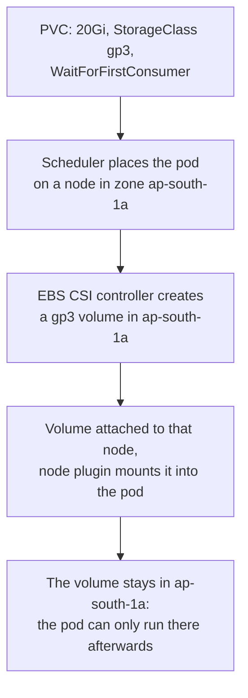

# EBS and EFS CSI drivers

> **Status: AI draft, 2026-11-16.** Not yet verified by me. Written from the AWS and driver documentation; no AWS commands were run, so the commands below have no sample output.

## In one line

On EKS, persistent volumes come from CSI drivers: the EBS CSI driver creates block volumes that live in one Availability Zone and attach to one node (ReadWriteOnce), and the EFS CSI driver mounts a shared NFS file system reachable from every zone (ReadWriteMany), usually through one access point per volume. Both drivers need their own IAM permissions.

## The plain idea

A pod asks for storage with a PersistentVolumeClaim, and a StorageClass says which driver creates the volume ([Storage](../kubernetes/storage.md)). On AWS there are two common answers:

- **EBS** is a network disk for one machine: fast, simple, and attached to one node at a time, in the zone where it was created ([EBS](../aws-services/ebs.md)).
- **EFS** is a shared network file system: many pods on many nodes in every zone can read and write the same files at once, at higher latency ([EFS](../aws-services/efs.md)).

Each is reached through a **CSI driver**, a controller plus a per-node DaemonSet that make AWS API calls to create, attach and mount volumes.

## How it works

### EBS: one disk, one zone



- **ReadWriteOnce**: one node at a time.
- **Zone-bound**: an EBS volume and its instance must be in the same Availability Zone. Once created, the PV carries a node affinity for that zone.
- **`volumeBindingMode: WaitForFirstConsumer`** delays creating the volume until the pod is scheduled, so the volume is created in the pod's zone. With `Immediate`, the volume may be created in a zone where the pod cannot then be scheduled.
- Not available to Fargate pods. In EKS Auto Mode, block storage is built in, with its own provisioner name (`ebs.csi.eks.amazonaws.com`), separate from the standalone driver (`ebs.csi.aws.com`).

A typical StorageClass:

```yaml
apiVersion: storage.k8s.io/v1
kind: StorageClass
metadata:
  name: gp3
provisioner: ebs.csi.aws.com
volumeBindingMode: WaitForFirstConsumer
allowVolumeExpansion: true
reclaimPolicy: Delete
parameters:
  type: gp3
  encrypted: "true"
```

### EFS: one file system, every zone

- **ReadWriteMany**: many pods on many nodes at once.
- **Multi-zone**: the file system has a mount target (a network interface) in each zone's subnet; nodes mount through the target in their zone over NFS.
- **Security groups**: the mount targets must allow inbound NFS (TCP 2049) from the nodes, and the nodes must be allowed outbound to them ([Security groups and NACLs](../aws-core/security-groups-and-nacls.md)).
- **Dynamic provisioning creates an access point per PVC** (`provisioningMode: efs-ap`): a directory in the file system with a fixed POSIX user and group, so each application gets its own directory and cannot see the others'. The file system itself must already exist.
- Fargate pods can mount EFS without installing the driver, but only with static provisioning.

```yaml
apiVersion: storage.k8s.io/v1
kind: StorageClass
metadata:
  name: efs-shared
provisioner: efs.csi.aws.com
parameters:
  provisioningMode: efs-ap
  fileSystemId: fs-<file-system-id>
  directoryPerms: "700"
  basePath: /apps
```

### Choosing

| | EBS (gp3) | EFS |
|---|---|---|
| Access | One node (RWO) | Many nodes (RWX) |
| Zones | One; the pod is pinned to it | All zones in the region |
| Latency | Low; block device | Higher; NFS over the network |
| Good for | Databases, queues, single-writer state on a StatefulSet ([StatefulSets and DaemonSets](../kubernetes/statefulsets-and-daemonsets.md)) | Shared uploads, content, home directories, files read by many pods |
| Bad for | Sharing between pods; moving between zones | Databases and heavy small random writes |
| Billing | Provisioned size | Data stored (and throughput mode) |
| Fargate | No | Yes (static) |

### IAM permissions

Both controllers call AWS APIs (create, attach, delete volumes; create access points), so each gets an IAM role through IRSA or Pod Identity ([Cluster access, IRSA and Pod Identity](access-and-pod-identity.md)). AWS publishes managed policies for them (`AmazonEBSCSIDriverPolicy`, and a scoped-down V2; `AmazonEFSCSIDriverPolicy`), or you can write narrower ones. Encrypted volumes with a customer-managed KMS key also need permissions in that key's policy ([KMS and secrets stores](../aws-services/kms-and-secrets.md)).

## A concrete example

`sample-app` has a PostgreSQL StatefulSet and a web tier that stores user uploads.

1. PostgreSQL: `volumeClaimTemplates` with the `gp3` class above. Each replica's volume is created in the zone where that replica was first scheduled and stays there. Spread replicas across zones with topology spread constraints ([Scheduling](../kubernetes/scheduling.md)), and remember a node failure only moves a replica to another node in the same zone.
2. Uploads: one EFS file system with mount targets in all three private subnets; a PVC with the `efs-shared` class (RWX) mounted by every web pod.
3. Backups: EBS snapshots for the database volumes (or the database's own backups), EFS backups through AWS Backup ([Backup and DR](../operations/backup-and-dr.md)).

## Why not just...?

- **...use EFS for the database too, to avoid zone pinning?** Databases need low-latency block I/O and strict locking behaviour; NFS gives neither reliably. Use EBS and handle zones with replication at the database level.
- **...use `Immediate` binding?** The volume may be created in a zone with no room for the pod, leaving it Pending forever. `WaitForFirstConsumer` creates the volume where the pod lands.
- **...store uploads on the pod's own disk or an `emptyDir`?** It disappears with the pod and is different on every replica. Use shared storage or, better for many apps, S3 ([S3](../aws-services/s3.md)).

## Commands to know

These were not run for this page.

| Command | What it does |
|---|---|
| `kubectl get storageclass` | Classes, provisioners and which is the default. |
| `kubectl get pvc,pv -n <ns>` | Claims, their status and bound volumes. |
| `kubectl describe pvc <name>` | Provisioning events and errors from the driver. |
| `kubectl get pv <pv> -o jsonpath='{.spec.nodeAffinity}'` | The zone an EBS-backed volume is pinned to. |
| `kubectl get csidrivers` | Installed CSI drivers. |
| `kubectl logs -n kube-system deploy/ebs-csi-controller -c ebs-plugin` | EBS driver errors, such as AWS `AccessDenied`. |
| `aws ec2 describe-volumes --filters Name=tag:kubernetes.io/created-for/pvc/name,Values=<pvc>` | The EBS volume behind a claim. |
| `aws efs describe-mount-targets --file-system-id <id>` | Mount targets per subnet and their state. |

## How it breaks

| Symptom | Layer | Check | Likely cause |
|---|---|---|---|
| Pod `Pending`: `volume node affinity conflict` | Zone | PV node affinity vs nodes available | EBS volume in a zone with no schedulable node |
| PVC `Pending`, `waiting for first consumer` | Binding mode | Is any pod using it? | Normal with `WaitForFirstConsumer` until a pod is scheduled |
| PVC `Pending`, provisioning failed | Driver or IAM | `describe pvc`, controller logs | Driver not installed, IAM missing, or KMS key policy |
| `Multi-Attach error` when a pod moves nodes | EBS attachment | Old node, `VolumeAttachment` objects | Volume still attached to the previous node |
| EFS pod `ContainerCreating`, mount timed out | Network | Mount target security group | TCP 2049 not allowed from the nodes, or no mount target in that zone |
| `Permission denied` writing to EFS | POSIX permissions | Access point uid and gid, container user | Container user differs from the access point's owner ([Pod security](../kubernetes/pod-security.md)) |
| Volume left behind after deleting a claim | Reclaim policy | PV `reclaimPolicy` | `Retain`, by design; delete the volume when sure |

## Interview questions

**1. When would you use EBS and when EFS on EKS?**

<details markdown="1">
<summary>Answer</summary>

- EBS: one writer, low latency, such as databases on StatefulSets; ReadWriteOnce, one zone.
- EFS: shared files across many pods and zones; ReadWriteMany, higher latency.
- S3 is often better than both for shared objects such as uploads.

</details>

**2. Why does `WaitForFirstConsumer` matter for EBS?**

<details markdown="1">
<summary>Answer</summary>

- EBS volumes live in one zone and can only attach to nodes there.
- Waiting until the pod is scheduled creates the volume in the pod's zone.
- `Immediate` can create it in a zone where the pod cannot run.

</details>

**3. A StatefulSet pod is stuck Pending with `volume node affinity conflict`. What happened?**

<details markdown="1">
<summary>Answer</summary>

- Its EBS volume is in a zone with no available node: the zone's nodes are full, cordoned, or the node group lost that zone.
- Add capacity in that zone (node group or Karpenter NodePool allowing that zone).
- Long term: spread replicas across zones and make sure each zone can always get nodes.

</details>

**4. An EFS mount times out. What do you check?**

<details markdown="1">
<summary>Answer</summary>

- A mount target exists in the node's zone and is available.
- The mount target's security group allows TCP 2049 from the nodes' security group.
- DNS resolution of the file system name, and NACLs on the subnets.

</details>

**5. What is an EFS access point and why use one per application?**

<details markdown="1">
<summary>Answer</summary>

- A named entry into the file system with a fixed root directory and POSIX user and group.
- Each application sees only its directory and writes with a known uid and gid.
- The EFS CSI driver creates one per PVC with `provisioningMode: efs-ap`.

</details>

**6. How do the CSI drivers get permission to create volumes?**

<details markdown="1">
<summary>Answer</summary>

- Each controller's service account gets an IAM role through IRSA or Pod Identity.
- AWS managed policies exist; narrower custom policies are better where possible.
- KMS-encrypted volumes also need the key policy to allow the role.

</details>

## Try it

On a kind cluster, the default StorageClass is local and has no zones, but the binding behaviour is the same:

1. `kubectl get storageclass -o yaml` and find `volumeBindingMode`.
2. Create a PVC with no pod using it, and check its status and events. Explain them with the `WaitForFirstConsumer` rule.
3. On paper: a three-replica database on EBS across three zones loses zone b. What happens to replica b, and what has to be true for it to come back?

## Zoom out

The CSI drivers are the EKS link between Kubernetes storage objects and AWS storage services. Zone pinning of EBS is the same constraint that shapes high availability on EC2 ([High availability](../operations/high-availability.md)), and node autoscalers must respect it when they choose zones ([Karpenter in depth](karpenter.md)).

## Sources

- [Amazon EKS User Guide: Amazon EBS CSI driver](https://docs.aws.amazon.com/eks/latest/userguide/ebs-csi.html)
- [Amazon EKS User Guide: Amazon EFS CSI driver](https://docs.aws.amazon.com/eks/latest/userguide/efs-csi.html)
- [Amazon EBS User Guide: Amazon EBS volumes (same Availability Zone)](https://docs.aws.amazon.com/ebs/latest/userguide/ebs-volumes.html)
- [Amazon EFS User Guide: security groups and NFS port 2049](https://docs.aws.amazon.com/efs/latest/ug/network-access.html)
- [Amazon EFS CSI driver: StorageClass parameters](https://github.com/kubernetes-sigs/aws-efs-csi-driver/blob/master/docs/parameters.md)
- [Kubernetes documentation: storage classes and volume binding mode](https://kubernetes.io/docs/concepts/storage/storage-classes/)
