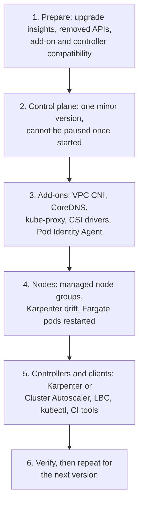

# EKS upgrades

> **Status: AI draft, 2026-11-16.** Not yet verified by me. Written from the AWS documentation; nothing was run.

## In one line

Upgrade EKS one minor version at a time: check insights and removed APIs, then the control plane, the add-ons and the nodes, with PDBs keeping workloads up. EKS can roll the control plane back one version within 7 days; add-ons and node groups you roll back yourself.

## The plain idea

Kubernetes releases about three minor versions a year ([etcd, backups and cluster upgrades](../kubernetes/etcd-backups-and-upgrades.md)). On EKS, a version gets **standard support for 14 months** after its EKS release, then **12 months of extended support** at an extra charge; if a cluster is still on that version when extended support ends, EKS upgrades it automatically to the oldest version still supported. Waiting costs money and turns one small upgrade into several in a row.

AWS upgrades the control plane when you ask. Everything that runs in your cluster (add-ons, nodes, controllers, your manifests) has to be compatible with the new version, and that is where the work is.

## How it works

### The order

- **One minor version at a time**, because the control plane is highly available and the skew policy allows only one version between API servers.
- **Nodes after the control plane**: kubelets may lag the API server, never lead it ([etcd, backups and cluster upgrades](../kubernetes/etcd-backups-and-upgrades.md)).
- The control plane update needs up to **five free IP addresses** in the cluster's subnets for new network interfaces. Once started it cannot be paused; if EKS's health checks fail, it reverts and the cluster stays on the old version.

### Preparing

| Check | How |
|---|---|
| Removed or deprecated APIs in use | EKS **upgrade insights** (cluster insights), the API server's deprecated API metric, and scans of manifests and Helm charts in Git |
| Add-on versions for the target | `aws eks describe-addon-versions --kubernetes-version <target>` |
| Third-party controllers | Each project's compatibility matrix: Karpenter, Load Balancer Controller, Argo CD, Istio, cert-manager |
| Node AMI | An AMI built for the target version (or an alias such as `al2023@latest` in Karpenter) |
| Disruption readiness | PDBs present and not blocking (`ALLOWED DISRUPTIONS` above 0), multiple replicas, graceful shutdown ([Disruptions and PDBs](../kubernetes/disruptions-and-pdbs.md)) |
| Rehearsal | Upgrade a non-production cluster first, with the same add-ons and charts |

### Upgrading nodes

**Managed node groups** (`aws eks update-nodegroup-version`) roll in four phases:

1. **Setup**: a new launch template version with the target AMI.
2. **Scale up**: the Auto Scaling group grows so new nodes start in the same zones as the old ones.
3. **Upgrade**: old nodes (up to `maxUnavailable` at a time, default one) are cordoned and drained, respecting PDBs. If pods do not leave a node within 15 minutes, the update fails with `PodEvictionFailure`, unless you pass `--force`, which deletes them regardless.
4. **Scale down**: the group returns to its original size.

**Karpenter** nodes are upgraded by **drift**: when the EC2NodeClass's AMI changes (or the alias resolves to a new AMI for the new version), nodes no longer match and are replaced gradually within disruption budgets ([Karpenter in depth](karpenter.md)).

**Fargate** pods keep their version until they are restarted; restart them (a rollout) after the control plane upgrade.

**Self-managed nodes**: new launch template or AMI, then replace instances yourself, draining each.

### Rolling back

EKS can roll back a cluster's Kubernetes version, with limits:

- Within **7 days** of an in-place upgrade, by **one minor version** only; a cluster created at its current version cannot be rolled back.
- Rolled back: the API server and control plane components, the platform version, and Auto Mode nodes. Clusters that EKS upgraded automatically at the end of extended support cannot be rolled back.
- **Not** rolled back: add-ons, managed node groups (roll those back separately), self-managed nodes, workloads and their data, etcd contents.
- After 7 days, the only way back is a new cluster on the older version and migrating the workloads ([Migration patterns](../operations/migration-patterns.md)).

So rollback is a safety net for the control plane, not an undo for the whole upgrade. The real protection is rehearsal and small steps.

### Blue-green clusters, the alternative

Instead of upgrading in place, build a new cluster on the new version, deploy everything through GitOps ([GitOps principles](../gitops/principles.md)), shift traffic (DNS weights or load balancer target groups), then delete the old one. It costs a second cluster for a while and needs stateless workloads or data that lives outside the cluster, but every step is reversible.

## A concrete example

Production runs 1.35 and must reach 1.37, the newest version.

1. Upgrade insights flag one Helm chart using an API version removed in 1.36: fix the chart and deploy it first.
2. Check compatibility: the Load Balancer Controller and Karpenter versions in use support 1.36 and 1.37; upgrade them now if not.
3. Staging: control plane 1.35 to 1.36, add-ons to their recommended versions, nodes via Karpenter drift and the system node group update. Run the smoke tests.
4. Production, same steps, during a quiet period, watching error rates and pending pods.
5. A week later, if all is well, repeat for 1.37. Within that week, a control plane rollback remained possible.

## Why not just...?

- **...upgrade straight from 1.35 to 1.37?** Not possible: one minor version at a time.
- **...upgrade nodes first, to get it over with?** Kubelets must not be newer than the API server. Control plane first, nodes after.
- **...use `--force` when a node group update fails with `PodEvictionFailure`?** It deletes pods regardless of their PDBs, which is the outage the PDB was protecting against. Find the blocking PDB or stuck pod first.
- **...stay on extended support indefinitely?** It costs extra per cluster-hour, ends after 12 months, and only defers a larger multi-version upgrade.

## Commands to know

These were not run for this page.

| Command | What it does |
|---|---|
| `aws eks list-insights --cluster-name sample-cluster` | Upgrade insights, including deprecated API usage. |
| `aws eks update-cluster-version --name sample-cluster --kubernetes-version <target>` | Starts the control plane upgrade. |
| `aws eks describe-update --name sample-cluster --update-id <id>` | Progress and errors of that update. |
| `aws eks describe-addon-versions --addon-name vpc-cni --kubernetes-version <target>` | Compatible add-on versions. |
| `aws eks update-addon --cluster-name sample-cluster --addon-name coredns --addon-version <version>` | Upgrade one add-on. |
| `aws eks update-nodegroup-version --cluster-name sample-cluster --nodegroup-name system` | Roll a managed node group to the cluster's version. |
| `kubectl get nodes -o wide` | Kubelet version per node, to see who is still old. |
| `kubectl get pdb -A` | PDBs and their allowed disruptions before draining. |

## How it breaks

| Symptom | Layer | Check | Likely cause |
|---|---|---|---|
| Apps fail to deploy after the upgrade: `no matches for kind` | Removed API | Manifests and charts | A resource uses a removed API version |
| Control plane update fails to start | Subnets | Free IPs in cluster subnets | Fewer than five free addresses |
| Node group update fails `PodEvictionFailure` | Disruption | PDBs, stuck pods | PDB allows 0 disruptions, or a pod ignores eviction |
| DNS or pod networking broken after the upgrade | Add-ons | Add-on versions | CNI, CoreDNS or kube-proxy left on an incompatible version |
| Ingresses stop updating | Controllers | Controller logs | Load Balancer Controller version does not support the new Kubernetes version |
| New nodes do not join | AMI | Launch template or EC2NodeClass AMI | AMI for the wrong version, or bootstrap changes in the new AMI family |

## Interview questions

**1. What is the order of an EKS upgrade?**

Answer

- Prepare (insights, removed APIs, compatibility), then the control plane by one minor version.
- Then add-ons (CNI, CoreDNS, kube-proxy, CSI), then nodes, then controllers and clients.
- Verify, then repeat for the next version.

**2. How do you find out whether workloads use APIs removed in the next version?**

Answer

- EKS upgrade insights flag deprecated API usage seen by the cluster.
- The API server's deprecated API metric, and scans of manifests and charts in Git (for jobs that ran long ago).
- Test in a non-production cluster on the target version.

**3. Can you roll back an EKS upgrade?**

Answer

- The control plane, yes: within 7 days, one minor version back, if it was upgraded in place.
- Add-ons, managed node groups and self-managed nodes must be rolled back separately; workloads and data are untouched.
- After 7 days, only a new cluster and migration.

**4. How does a managed node group update work, and what can make it fail?**

Answer

- New launch template, scale up in the same zones, drain old nodes up to `maxUnavailable`, scale back down.
- It respects PDBs; pods not evicted within 15 minutes fail it with `PodEvictionFailure`.
- `--force` deletes them anyway, at the cost of the protection PDBs give.

**5. How do Karpenter-managed nodes get upgraded?**

Answer

- Through drift: a new AMI for the new version makes existing nodes not match their EC2NodeClass.
- Karpenter replaces them gradually within disruption budgets, respecting PDBs.
- Expiration also cycles old nodes eventually.

**6. When would you choose a blue-green cluster upgrade over in-place?**

Answer

- Several versions behind, large risky changes, or a need for an instant way back.
- Requires GitOps or automation to rebuild everything, and state kept outside the cluster or migrated.
- Costs a second cluster during the switch.

**7. Why not stay on an old version with extended support?**

Answer

- Extended support costs extra and lasts 12 months after standard support's 14.
- When it ends, the upgrade spans several versions with several sets of removed APIs.
- Regular small upgrades are cheaper and lower risk.

## Try it

On a kind cluster:

1. Read `kubectl get --raw /metrics | grep apiserver_requested_deprecated_apis` ([etcd, backups and cluster upgrades](../kubernetes/etcd-backups-and-upgrades.md)) and explain each line.
2. Create a PDB with `maxUnavailable: 0` for a two-replica Deployment, then `kubectl drain` the node with `--dry-run=server`. What would a managed node group update do here?
3. Write your own pre-upgrade checklist for a cluster with Karpenter, the Load Balancer Controller and Argo CD.

## Zoom out

EKS upgrades are the managed version of the general Kubernetes upgrade process, with AWS doing the control plane and you doing everything that depends on it. They are a change like any other: planned, rehearsed, monitored, and reversible where possible ([Change management](../operations/change-management.md)).

## Sources

- [Amazon EKS User Guide: update a cluster to a new Kubernetes version](https://docs.aws.amazon.com/eks/latest/userguide/update-cluster.html)
- [Amazon EKS User Guide: roll back a cluster to a previous Kubernetes version](https://docs.aws.amazon.com/eks/latest/userguide/rollback-cluster.html)
- [Amazon EKS User Guide: Kubernetes version lifecycle (standard and extended support)](https://docs.aws.amazon.com/eks/latest/userguide/kubernetes-versions.html)
- [Amazon EKS User Guide: cluster insights](https://docs.aws.amazon.com/eks/latest/userguide/cluster-insights.html)
- [Amazon EKS User Guide: managed node group update phases](https://docs.aws.amazon.com/eks/latest/userguide/managed-node-update-behavior.html)
- [Amazon EKS Best Practices Guide: cluster upgrades](https://docs.aws.amazon.com/eks/latest/best-practices/cluster-upgrades.html)
