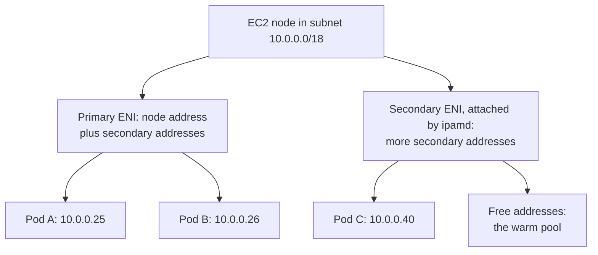

# Networking with the VPC CNI

> **Status: AI draft, 2026-11-16.** Not yet verified by me. Written from the AWS documentation; no AWS commands were run, so the commands below have no sample output.

## In one line

On EKS, the Amazon VPC CNI gives every pod a real IP address from your VPC subnet, taken from secondary addresses (or `/28` prefixes) on network interfaces attached to the node. That makes pods directly reachable in the VPC, but it ties pod density to the instance type's network interface limits and can exhaust subnet addresses.

## The plain idea

Most Kubernetes network plugins invent a private pod network (an overlay) on top of the real one, and translate addresses at the node ([Pod networking and NetworkPolicy](../kubernetes/pod-networking-and-network-policy.md)). The VPC CNI does something simpler: it asks EC2 for more addresses from the node's own subnet and hands them to pods. A pod's address is a normal VPC address, so security groups, route tables, VPC Flow Logs and load balancers see it directly ([VPC basics](../aws-core/vpc-basics.md)).

The cost of that simplicity: every pod consumes a subnet address, and every EC2 instance type can hold only so many network interfaces and addresses.

## How it works

### The pieces

The CNI runs as the `aws-node` DaemonSet. On each node it has two parts:

- **ipamd**, a long-running local address manager: attaches network interfaces (ENIs) to the node through EC2 API calls and keeps a **warm pool** of free addresses ready.
- **The CNI binary**, which the kubelet calls when a pod is created or deleted: it takes an address from the pool and wires the pod's network namespace to it.



### Warm pool settings

Environment variables on `aws-node` decide how many unused addresses each node holds:

| Variable | Meaning | Trade-off |
|---|---|---|
| `WARM_ENI_TARGET` | Keep this many whole unused ENIs attached (with all their addresses) | Fast pod starts; can reserve many addresses per node |
| `WARM_IP_TARGET` | Keep this many free addresses | Saves subnet space; more EC2 API calls |
| `MINIMUM_IP_TARGET` | Always have at least this many addresses on the node | Covers the usual pod count from boot |
| `WARM_PREFIX_TARGET` | In prefix mode, keep this many unused prefixes | Each prefix is 16 addresses |

With `WARM_ENI_TARGET=1`, a node whose first ENI is full keeps a whole second ENI attached and idle, holding every address on it. In a small subnet that shows up as "subnet out of addresses" while most addresses are unused.

### Max pods per node

The EKS AMI's default is equivalent to:

```text
maxPods = (number of ENIs × (IPs per ENI − 1)) + 2
```

- Each ENI's own primary address cannot be given to a pod, hence `− 1`.
- `+ 2` covers the VPC CNI and kube-proxy pods, which use the node's address (host network).
- Example: an instance type allowing 3 ENIs with 10 addresses each: `(3 × 9) + 2 = 29` pods, whatever its CPU and memory. The per-type limits are in the EC2 documentation.
- Managed node groups without a custom AMI cap `maxPods` at 110 for instances with fewer than 30 vCPUs and 250 above that.

Small instances can therefore run out of pod slots long before CPU or memory: pods stay `Pending` with "Too many pods".

### Prefix delegation

With `ENABLE_PREFIX_DELEGATION=true`, the CNI assigns `/28` prefixes (16 addresses) to each ENI slot instead of single addresses. The same instance can hold many more pods, and fewer EC2 calls are needed. It needs Nitro-based instances, a raised `maxPods`, and subnets with enough contiguous free `/28` blocks; a fragmented subnet can make prefix allocation fail.

### When the VPC runs out of addresses

AWS's best practice guide, in order:

1. **Size subnets for growth** from the start, or use **IPv6**, where pods get addresses from a huge range and are not translated.
2. **Add a secondary CIDR** to the VPC, preferably from the `100.64.0.0/10` shared address space, and use **custom networking**: an `ENIConfig` per zone tells the CNI to put pod ENIs in the new subnets, so pods stop using the routable node subnets.
3. **Tune the warm pool** (`WARM_IP_TARGET`, `MINIMUM_IP_TARGET`) so nodes do not hoard addresses.

### Leaving the VPC: SNAT

When a pod talks to an address outside the VPC's CIDR blocks, the CNI by default translates the pod's address to the node's primary address ([Routing and NAT](../networking/routing-and-nat.md)). Setting `AWS_VPC_K8S_CNI_EXTERNALSNAT=true` turns that off, for example so that traffic to a peered or on-premises network keeps the pod's address; the nodes must then be in private subnets with a NAT gateway for internet traffic.

### Security groups and policies for pods

- **Security groups for pods** give selected pods their own security groups through a separate branch network interface, matched with a `SecurityGroupPolicy`. Useful when a database's security group must allow only one application. Supported instance types are limited (no `t` family), and not on Windows or Auto Mode, which has its own resource ([Security groups and NACLs](../aws-core/security-groups-and-nacls.md)).
- **NetworkPolicy**: the VPC CNI can enforce Kubernetes NetworkPolicy itself once that feature is enabled.

### How this changes the usual picture

| Generic Kubernetes (overlay) | EKS with the VPC CNI |
|---|---|
| Pod addresses from a private cluster range | Pod addresses from your VPC subnets |
| Pod count limited by CPU and memory, and the kubelet's 110 default | Also limited by ENIs and addresses per instance type |
| Pods not reachable from outside the cluster | Pods reachable from the VPC and connected networks, if security groups allow |
| Load balancers reach pods through node ports | Load balancers can target pod addresses directly ([AWS Load Balancer Controller](load-balancer-controller.md)) |

## A concrete example

A team's cluster uses three `/24`-sized subnets for nodes. During a busy deploy, new pods fail with `failed to assign an IP address to container` while nodes have plenty of CPU free.

1. Check free addresses per subnet in the VPC console or CLI: nearly zero.
2. Check `aws-node` settings: `WARM_ENI_TARGET=1` on many nodes, each holding an idle ENI full of addresses.
3. Short term: set `WARM_IP_TARGET` and `MINIMUM_IP_TARGET` so nodes keep a few spare addresses instead of whole ENIs.
4. Long term: add a secondary CIDR such as `100.64.0.0/16`, create pod subnets per zone, enable custom networking, and roll the nodes.
5. Next cluster: larger subnets, or IPv6.

## Why not just...?

- **...install an overlay CNI to avoid all this?** You can, but the control plane cannot reach overlay pod addresses (webhooks and metrics need workarounds), load balancers cannot target pods directly, and you leave the AWS-supported path.
- **...always use the largest `maxPods`?** Pod slots also need addresses; without prefix delegation and enough subnet space, raising `maxPods` only moves the failure to address assignment.
- **...use small instances to save money?** Small instance types allow few ENIs and addresses, so they run few pods. Fewer, larger nodes often pack better ([Cluster Autoscaler vs Karpenter](cluster-autoscaler-vs-karpenter.md)).

## Commands to know

These were not run for this page.

| Command | What it does |
|---|---|
| `kubectl get daemonset aws-node -n kube-system -o yaml` | The CNI's version and environment settings. |
| `kubectl set env daemonset aws-node -n kube-system WARM_IP_TARGET=5 MINIMUM_IP_TARGET=10` | Tune the warm pool (prefer the EKS add-on configuration if the CNI is managed as an add-on). |
| `kubectl get node <node> -o jsonpath='{.status.allocatable.pods}'` | The node's maxPods. |
| `aws ec2 describe-subnets --subnet-ids <id> --query 'Subnets[].AvailableIpAddressCount'` | Free addresses left in a subnet. |
| `aws ec2 describe-instance-types --instance-types <type> --query 'InstanceTypes[].NetworkInfo.[MaximumNetworkInterfaces,Ipv4AddressesPerInterface]'` | ENI and address limits for a type. |
| `kubectl logs -n kube-system -l k8s-app=aws-node` | CNI errors, such as failed address assignment. |

## How it breaks

| Symptom | Layer | Check | Likely cause |
|---|---|---|---|
| Pods stuck `ContainerCreating`, `failed to assign an IP address` | Subnet addresses | Subnet free addresses; warm pool settings | Subnet exhausted, or nodes hoarding addresses |
| Pods `Pending`, "Too many pods" | maxPods | Node allocatable pods | Instance type's ENI and address limit reached |
| Prefix delegation enabled, still no addresses | Fragmentation | Contiguous `/28` blocks in the subnet | Subnet too fragmented for prefixes |
| Pods cannot reach an on-premises service that allow-lists pod addresses | SNAT | Source address seen remotely | Traffic is translated to the node address; consider external SNAT |
| A pod's own security group has no effect | Security groups for pods | Instance type, `SecurityGroupPolicy` match | Unsupported instance type or no matching policy |
| Node `NotReady` with a CNI message | `aws-node` | DaemonSet pods and their IAM permissions | CNI not running, or lacks EC2 permissions ([Cluster access, IRSA and Pod Identity](access-and-pod-identity.md)) |

## Interview questions

**1. How does the VPC CNI give pods IP addresses?**

<details markdown="1">
<summary>Answer</summary>

- ipamd attaches ENIs to the node and reserves secondary addresses (or `/28` prefixes) from the subnet.
- The CNI binary assigns one to each new pod from a warm pool.
- Pods get real VPC addresses, routable in the VPC.

</details>

**2. Why can a node with free CPU and memory not run more pods?**

<details markdown="1">
<summary>Answer</summary>

- maxPods is limited by ENIs and addresses per ENI: `(ENIs × (IPs per ENI − 1)) + 2` by default.
- Or the subnet has no free addresses to assign.
- Prefix delegation, larger instances, or more subnet space fix it.

</details>

**3. What does prefix delegation change?**

<details markdown="1">
<summary>Answer</summary>

- Each ENI slot holds a `/28` prefix of 16 addresses instead of one address.
- Many more pods per node and fewer EC2 API calls.
- Needs Nitro instances, a higher maxPods, and unfragmented subnets.

</details>

**4. The cluster's subnets are running out of addresses. What are your options?**

<details markdown="1">
<summary>Answer</summary>

- Tune the warm pool so nodes stop holding whole idle ENIs.
- Add a secondary CIDR (for example from `100.64.0.0/10`) and custom networking for pod subnets.
- Prefix delegation for density; for new clusters, bigger subnets or IPv6.

</details>

**5. Why is pod traffic to the internet seen with the node's address?**

<details markdown="1">
<summary>Answer</summary>

- The CNI translates (SNAT) traffic to destinations outside the VPC CIDRs to the node's primary address.
- Then the NAT gateway or internet gateway handles it as node traffic.
- External SNAT turns this off when remote systems need the pod's address.

</details>

**6. When would you use security groups for pods?**

<details markdown="1">
<summary>Answer</summary>

- When an AWS resource's security group must allow only specific pods, such as a database used by one app.
- Pods get a branch interface with their own security groups via a `SecurityGroupPolicy`.
- Limited to supported instance types; otherwise NetworkPolicy handles pod-to-pod rules.

</details>

## Try it

No free EKS lab, so work it on paper:

1. Look up two instance types in the EC2 documentation (network interfaces and IPv4 addresses per interface) and compute maxPods for each with the formula.
2. A subnet is a `/24` (251 usable addresses in AWS, since AWS reserves 5 per subnet). With `WARM_ENI_TARGET=1` and 10 addresses per ENI, how many nodes can join before pods run out of addresses, if each node runs 12 pods?
3. Draw the "How this changes the usual picture" table from memory.

## Zoom out

The VPC CNI is the EKS answer to "how do pods get an address", and it makes pods first-class VPC citizens at the cost of address planning. Subnet sizing, routing and NAT from the AWS pages decide how far a cluster can grow ([IP addresses and subnetting](../networking/ip-and-subnetting.md), [NAT, endpoints and PrivateLink](../aws-core/nat-endpoints-privatelink.md)).

## Sources

- [Amazon EKS Best Practices Guide: Amazon VPC CNI](https://docs.aws.amazon.com/eks/latest/best-practices/vpc-cni.html)
- [Amazon EKS Best Practices Guide: prefix mode for Linux](https://docs.aws.amazon.com/eks/latest/best-practices/prefix-mode-linux.html)
- [Amazon EKS Best Practices Guide: optimizing IP address utilization](https://docs.aws.amazon.com/eks/latest/best-practices/ip-opt.html)
- [Amazon EKS User Guide: choosing an instance type and how maxPods is determined](https://docs.aws.amazon.com/eks/latest/userguide/choosing-instance-type.html)
- [Amazon EKS User Guide: assign more IP addresses with prefixes](https://docs.aws.amazon.com/eks/latest/userguide/cni-increase-ip-addresses.html)
- [Amazon EKS User Guide: custom networking](https://docs.aws.amazon.com/eks/latest/userguide/cni-custom-network.html)
- [Amazon EKS User Guide: SNAT for pods](https://docs.aws.amazon.com/eks/latest/userguide/external-snat.html)
- [Amazon EKS User Guide: security groups for pods](https://docs.aws.amazon.com/eks/latest/userguide/security-groups-for-pods.html)
- [Amazon VPC User Guide: subnet CIDR blocks (the five reserved addresses)](https://docs.aws.amazon.com/vpc/latest/userguide/subnet-sizing.html)
