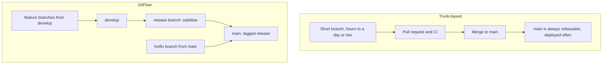

# Branching and release strategies

> **Status: AI draft, 2026-11-16.** Not yet verified by me.

## In one line

A branching strategy is the team's agreement on where work happens and how it reaches production. Trunk-based development (short branches merged to `main` daily, unfinished work hidden behind feature flags) suits continuous delivery; GitFlow (long-lived `develop` and release branches) suits scheduled, versioned releases at the cost of bigger merges.

## The plain idea

Git lets you branch any way you like, so a team has to agree how. The agreement answers a few practical questions: where do I start a change, how long can it live apart from everyone else, how does it get reviewed, which branch is deployed, and how do we ship an urgent fix?

The main trade-off is **integration frequency**. The longer work lives on its own branch, the further it drifts from everyone else's, and the more painful and risky the eventual merge. Strategies that merge small changes often make merges boring; strategies that keep long-lived branches give more control over what is in each release, and pay for it in merge effort.

## How it works

### Three common strategies

| | Trunk-based | GitHub flow | GitFlow |
|---|---|---|---|
| Long-lived branches | `main` only | `main` only | `main` and `develop`, plus release and hotfix branches |
| Feature branches live | Hours to a couple of days | Until the pull request merges | Often weeks |
| What gets deployed | `main`, continuously | `main`, after each merge | A release branch, then `main` |
| Unfinished features | Merged but switched off by **feature flags** | Kept on the branch until done | Kept on the branch until done |
| Merge pain | Low: small, frequent | Low to medium | High: long branches, back-merges |
| Fits | Continuous delivery, one deployed version, strong CI | Web services, small teams | Versioned products, several supported versions, scheduled releases |

**GitHub flow** is the simple middle ground: branch from `main`, open a pull request, merge when reviewed and green, deploy `main`.

### Feature flags

A **feature flag** is a switch in configuration that turns code on or off at run time. It separates **deploying** code from **releasing** a feature: half-finished work can be merged and deployed while switched off, then turned on for some users, then all. The cost: flags must be cleaned up, or the code fills with dead branches.

### Release branches and hotfixes

When several versions are supported, each release gets a branch (`release/1.4`) where only fixes go. A fix is made on `main` first and **cherry-picked** to the release branches that need it ([Daily workflow](daily-workflow.md)), or made on the oldest supported branch and merged forward. Whatever the rule, write it down: forgotten back-ports are a classic source of "fixed bugs" reappearing.

### Tags and versions

Releases are marked with annotated tags such as `v1.4.2`. **Semantic versioning** gives the number meaning: `MAJOR.MINOR.PATCH`, where a major bump means incompatible changes, a minor bump new compatible features, and a patch bump compatible fixes. CI pipelines often build release artifacts from tags ([Artifacts, registries and versioning](../cicd/artifacts-and-registries.md)).

### Monorepo or many repositories

| | Monorepo (many projects in one repository) | Polyrepo (one repository per project) |
|---|---|---|
| Changes across projects | One pull request, atomic | Several coordinated pull requests |
| CI | Must detect what changed and build only that | Simple per repository |
| Access control | Coarser; path-based owners help | Per repository |
| Versioning shared code | Everyone uses the latest | Explicit versions, possible drift |

### How the strategy shapes CI/CD

Trunk-based development only works with fast, trustworthy CI on every pull request, because `main` must always be deployable. GitFlow needs pipelines per branch type (feature, develop, release). In GitOps, the configuration repository usually follows trunk-based rules even when application repositories do not, so that `main` is the single source of truth for what runs ([GitOps principles](../gitops/principles.md)).

## A concrete example

A team on GitFlow ships every two weeks. Merges from `develop` into each release branch take a day of conflict fixing, and hotfixes are often missing from `develop` afterwards.

1. They move to trunk-based development: branches from `main`, reviewed and merged within a day or two.
2. Every merge runs the full test suite; `main` is deployed to staging automatically and to production on approval.
3. Large features are merged in small parts behind a feature flag, turned on when complete.
4. Hotfixes are ordinary small pull requests to `main`, deployed through the same pipeline, so nothing needs back-porting.
5. The release-merge day disappears. The cost is investment in CI speed, test coverage and flag hygiene.

## Why not just...?

- **...let everyone push straight to `main`?** With no review or checks, one mistake breaks the build for everyone. Short-lived branches with required checks keep `main` releasable at almost no cost in speed.
- **...keep a feature on its branch until it is completely finished?** For a big feature that can mean weeks of drift and a painful merge at the end. Merge small steps behind a flag.
- **...use GitFlow everywhere because it looks thorough?** Its ceremony pays off when you support several released versions at once. For a single web service deployed many times a day, it mostly adds merges.

## How it breaks

| Symptom | Layer | Check | Likely cause |
|---|---|---|---|
| Release merges take days of conflict fixing | Branch lifetime | Age of branches at merge time | Long-lived feature or release branches drifting apart |
| A fixed bug reappears in the next release | Back-ports | Is the fix commit on every supported branch? | Hotfix made on one branch and never merged or cherry-picked to the others |
| `main` is often broken | Integration rules | Branch protection and required checks | Direct pushes, or CI too slow or flaky to gate merges |
| Old feature flags everywhere, nobody sure what is live | Flag hygiene | Count of flags and their age | Flags never removed after full rollout |
| Nobody knows what is deployed | Release tracking | Tags, pipeline history | Deploys not tied to a tag or commit |

## Interview questions

**1. What is trunk-based development?**

Answer

- Everyone integrates small changes into one main branch (the trunk) very frequently, at least daily.
- Branches, if used, are short-lived and merged after review and CI.
- `main` is kept releasable; unfinished work is hidden behind feature flags.

**2. Compare GitFlow and trunk-based development.**

Answer

- GitFlow uses long-lived `develop` and release branches, with feature, release and hotfix branches; trunk-based uses only `main` and short branches.
- GitFlow suits scheduled, versioned releases and several supported versions; trunk-based suits continuous delivery.
- GitFlow costs bigger merges and back-ports; trunk-based needs strong CI and feature flags.

**3. What is a feature flag, and what problem does it solve?**

Answer

- A runtime switch that turns a piece of functionality on or off without a deploy.
- It separates deploying code from releasing a feature, so incomplete work can be merged safely.
- It also allows gradual rollouts and instant switch-off; flags must be removed when done.

**4. How do you ship an urgent fix to production under trunk-based development, and under GitFlow?**

Answer

- Trunk-based: a small pull request to `main`, fast-tracked through the normal pipeline; nothing to back-port.
- GitFlow: a hotfix branch from `main`, merged to `main` and tagged, and also merged back to `develop`.
- In both, the fix still goes through review and CI.

**5. What does semantic versioning mean by major, minor and patch?**

Answer

- MAJOR: incompatible changes.
- MINOR: new functionality that is backwards compatible.
- PATCH: backwards-compatible bug fixes.
- It lets consumers judge the risk of an upgrade from the number alone.

**6. Which strategy would you pick for a team deploying a web API many times a day, and what would you need in place?**

Answer

- Trunk-based development or GitHub flow.
- Fast, reliable CI on every pull request, and branch protection on `main`.
- Automated deployment with health checks and easy rollback, and feature flags for incomplete work.

## Try it

A paper exercise, about 10 minutes.

**Step 1.** Draw your last team's branches as boxes and arrows: which long-lived branches existed, where features started, and how a change reached production.

**Step 2.** Answer in one sentence each: how long did a typical feature branch live? How was an urgent fix shipped? Where did merge conflicts usually appear?

**Step 3.** Name the strategy closest to what you drew, and one change that would have shortened the time from commit to production. Say what it would have needed (tests, flags, pipeline changes).

This is also a common interview question, so the answer is worth saying aloud once.

## Zoom out

The branching strategy sets the shape of the delivery pipeline: which branches build, which deploy, and how a rollback works ([CI/CD concepts](../cicd/concepts.md), [Deployment strategies](../cicd/deployment-strategies.md)). It is a team agreement more than a Git feature, so write it down. The principle to carry: integrate small changes often, and keep the deployable branch always deployable.

## Sources

- [Pro Git: branching workflows](https://git-scm.com/book/en/v2/Git-Branching-Branching-Workflows)
- [Trunk-based development](https://trunkbaseddevelopment.com/)
- [GitHub documentation: GitHub flow](https://docs.github.com/en/get-started/using-github/github-flow)
- [Semantic Versioning 2.0.0](https://semver.org/)
- [Martin Fowler: feature toggles](https://martinfowler.com/articles/feature-toggles.html)
