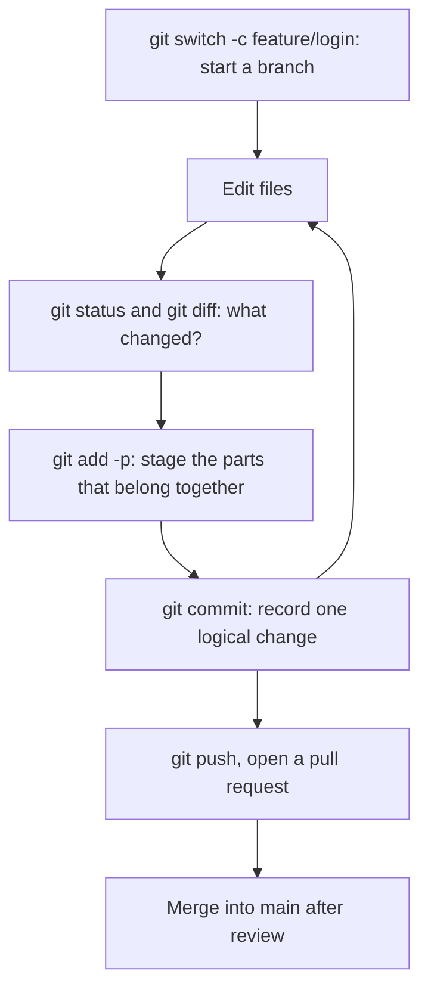
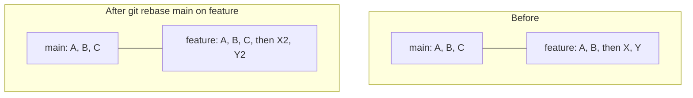

# Daily workflow

> **Status: AI draft, 2026-11-16.** Not yet verified by me. Commands and output were run in a throwaway container.

## In one line

Work on a short-lived branch, commit small logical changes, and bring them back with a merge or a rebase. A fast-forward merge just moves the branch pointer, a merge commit joins two histories, and a rebase replays your commits on top of the other branch; never rebase commits others already have.

## The plain idea

Most days with Git are the same loop: make a branch for one piece of work, change files, look at what changed, stage and commit, and eventually bring the work back into the main line. The commands are few. What matters is understanding what each one does to the commit graph ([How Git stores things](how-git-stores-things.md)), because that is what decides whether history stays readable and whether teammates can keep working on top of yours.

The main choice is how to combine two lines of work. You can tie them together with a **merge**, which keeps both histories as they happened, or you can **rebase**, which rewrites your commits as if you had started from the latest version of the other branch.

## How it works

### The loop



### Merging: fast-forward or merge commit

If `main` has not moved since you branched, merging is trivial: `main` is simply moved forward to your last commit. That is a **fast-forward**: no new commit is created.

If both branches have new commits, Git creates a **merge commit** with two parents, joining the histories. Git finds the common ancestor, compares both sides with it, and combines the changes. Where both sides changed the same lines differently, it stops with a **conflict** and asks you to decide.

`git merge --no-ff` forces a merge commit even when a fast-forward is possible, so the branch stays visible as a group in history. Many teams' pull request settings choose between merge commits, squash merges (all branch commits squeezed into one) and rebase merges.

### Rebasing



`git rebase main` (run on the feature branch) takes the commits that are on your branch but not on `main`, sets them aside, moves your branch to the tip of `main`, and replays them one by one. The replayed commits have new hashes, because their parent changed. History becomes a straight line, as if you had started your work from the latest `main`.

**The golden rule:** never rebase commits that someone else has already fetched. Their copies still have the old hashes, so the two histories diverge and somebody has to untangle duplicate commits. Rebase your own local or private branches; merge shared ones.

Interactive rebase, `git rebase -i HEAD~3`, lets you reorder, squash, reword or drop your last few commits before you share them.

### Smaller tools

| Command | What it does |
|---|---|
| `git stash` | Put uncommitted changes aside, leaving a clean working tree; `git stash pop` brings them back. |
| `git cherry-pick <commit>` | Copy one commit onto the current branch, for example a fix into a release branch. The copy gets a new hash. |
| `git tag v1.1.0` | A lightweight tag: just a name for a commit. |
| `git tag -a v1.1.0 -m "..."` | An annotated tag: a tag object with a message, author and date. Use these for releases. |
| `.gitignore` | Patterns for files Git should not track: build output, dependencies, local secrets. It does not untrack files that are already committed. |

### A good commit

One logical change per commit, with a message whose first line says what it does in under about 70 characters ("Add login rate limit"), and, where needed, a body explaining why. Reviewers, `git log`, `git blame` and `git bisect` ([Undoing and recovering](undo-and-recover.md)) all depend on it.

## A concrete example

You and a teammate both changed the greeting in `src/app.py`, on different branches. Merging stops with a conflict.

1. `git merge feature/greet` prints `CONFLICT (content): Merge conflict in src/app.py`.
2. `git status --short` shows `UU src/app.py`: unmerged, changed by both.
3. The file now contains both versions between markers: `<<<<<<< HEAD` (your branch), `=======`, and `>>>>>>> feature/greet` (theirs).
4. Edit the file to the correct result and remove the markers. Decide with the other author if the right answer is not obvious.
5. `git add src/app.py` marks it resolved, and `git commit` completes the merge.
6. Run the tests. A conflict-free merge can still be wrong if the two changes interact.

`git merge --abort` returns to the state before the merge if you want to start again.

## Why not just...?

- **...work directly on `main`?** Unreviewed changes go straight to the shared line, and a half-finished change blocks everyone else's releases. Branches keep work isolated until it is reviewed and tested.
- **...keep a feature branch for weeks?** The longer it lives, the more `main` moves, and the bigger and riskier the final merge. Merge small, often, behind a feature flag if needed ([Branching and release strategies](branching-strategies.md)).
- **...rebase the shared branch to tidy its history?** Everyone who pulled it now has commits that no longer exist upstream. Tidy before you share, with interactive rebase on your own branch.

## Commands to know

What changed, before and after staging:

```console
# git diff
diff --git a/src/app.py b/src/app.py
index c471b2f..3d6edeb 100644
--- a/src/app.py
+++ b/src/app.py
@@ -1 +1 @@
-print("v1")
+print("v2")
# git add src/app.py
# git diff --staged --stat
 src/app.py | 2 +-
 1 file changed, 1 insertion(+), 1 deletion(-)
```

A fast-forward merge:

```console
# git merge feature/login
Updating ae7f546..794ae51
Fast-forward
 src/login.py | 1 +
 1 file changed, 1 insertion(+)
 create mode 100644 src/login.py
```

A merge commit, after both branches moved:

```console
# git log --oneline --graph
*   be4fdc6 Merge branch 'feature/a'
|\
| * 86ffebc Add a
* | ed62f35 Add b
|/
* 794ae51 Add login stub
```

A conflict, as Git leaves it:

```console
# git merge feature/greet
Auto-merging src/app.py
CONFLICT (content): Merge conflict in src/app.py
Automatic merge failed; fix conflicts and then commit the result.
# git status --short
UU src/app.py
# cat src/app.py
<<<<<<< HEAD
print("hello from main")
=======
print("hello from feature")
>>>>>>> feature/greet
```

A rebase, before and after. The branch's commit `Add r` gets a new hash:

```console
# git log --oneline --graph --all -4
* 1388d46 Add r
| * 7962422 Merge branch 'feature/greet'
...
# git rebase main
Successfully rebased and updated refs/heads/feature/r.
# git log --oneline --graph -2
* ddaa42f Add r
*   7962422 Merge branch 'feature/greet'
```

Stash, cherry-pick and tags:

```console
# git stash
Saved working directory and index state WIP on main: 7962422 Merge branch 'feature/greet'
# git stash list
stash@{0}: WIP on main: 7962422 Merge branch 'feature/greet'
# git cherry-pick <hash of "Fix typo" on the hotfix branch>
[main 4e95a0e] Fix typo
# git tag v1.0.0; git tag -a v1.1.0 -m "Release 1.1.0"
# git cat-file -t v1.0.0; git cat-file -t v1.1.0
commit
tag
```

The lightweight tag points straight at a commit; the annotated tag is its own object.

| Command | What it does |
|---|---|
| `git switch <branch>`, `git switch -c <new>` | Change branch; create and change. (`git checkout` does both, plus restoring files.) |
| `git add -p` | Stage changes hunk by hunk, answering y or n for each. |
| `git commit --amend` | Replace the last commit, with staged changes or a new message. Only before pushing. |
| `git log --oneline --graph --all` | The whole graph. |
| `git merge --abort`, `git rebase --abort` | Back out of a merge or rebase in progress. |
| `git rebase --continue` | After fixing a conflict during a rebase, carry on with the next commit. |
| `git branch -d <branch>` | Delete a merged branch (`-D` forces it). |

## How it breaks

| Symptom | Layer | Check | Likely cause |
|---|---|---|---|
| `CONFLICT (content)` | Merge | `git status`, then the markers in each file | Both sides changed the same lines |
| A rebase stops at every commit with the same conflict | Rebase | How many commits touch that file | Many small commits each conflicting; consider merging instead, or squashing first |
| Teammates see duplicate commits after you pushed | Rewritten history | Compare `git log` with theirs | A rebase or amend of commits already shared, then a force push |
| `Your local changes would be overwritten` on switch or pull | Working tree | `git status` | Uncommitted changes conflict with the target; commit or stash first |
| A file keeps appearing in `git status` although it is in `.gitignore` | Tracking | `git ls-files <file>` | It was committed before the ignore rule; `git rm --cached <file>` |
| `git push` rejected after an amend | Diverged history | `git status -sb` | The remote has the pre-amend commit ([Remotes, pull requests and access](remotes-and-collaboration.md)) |

## Interview questions

**1. What is the difference between a fast-forward merge and a merge commit?**

<details markdown="1">
<summary>Answer</summary>

- Fast-forward: the target has not moved, so its pointer is moved to the branch tip; no new commit.
- Merge commit: both sides moved, so a new commit with two parents joins them.
- `--no-ff` forces a merge commit to keep the branch visible.

</details>

**2. Merge or rebase: what is the difference and when would you use each?**

<details markdown="1">
<summary>Answer</summary>

- Merge keeps history as it happened and adds a merge commit; safe on shared branches.
- Rebase replays your commits on the new base with new hashes, giving linear history.
- Rebase your own unshared branch to bring it up to date; never rebase commits others have.

</details>

**3. How do you resolve a merge conflict?**

<details markdown="1">
<summary>Answer</summary>

- `git status` lists the conflicted files.
- Edit each file to the correct combined result and remove the markers.
- `git add` each file, then `git commit` (or `git rebase --continue` during a rebase).
- Run the tests; `git merge --abort` to start again.

</details>

**4. What does `git stash` do, and when would you use it?**

<details markdown="1">
<summary>Answer</summary>

- It saves uncommitted changes (working tree and index) and leaves a clean working tree.
- Useful to switch branches quickly for an urgent fix, then `git stash pop` to resume.
- Stashes are local and easy to forget; commit to a branch for anything long-lived.

</details>

**5. What is cherry-pick, and what is a typical use?**

<details markdown="1">
<summary>Answer</summary>

- It applies the changes of one existing commit as a new commit on the current branch.
- Typical use: copying a bug fix from `main` to a release branch.
- The copy has a different hash; merging both branches later is usually fine but can show the change twice.

</details>

**6. What is the difference between a lightweight and an annotated tag?**

<details markdown="1">
<summary>Answer</summary>

- Lightweight: a name pointing directly at a commit.
- Annotated: a separate object with a message, tagger and date, which can be signed.
- Use annotated tags for releases.

</details>

## Try it

**Step 1.** Start a container with Git and a repository with one commit.

```bash
docker run --rm -it ubuntu:24.04 bash
apt-get update -qq && apt-get install -y -qq git
git config --global user.name "Dev One" && git config --global user.email dev1@example.com && git config --global init.defaultBranch main
mkdir demo && cd demo && git init -q && echo 'print("v1")' > app.py && git add . && git commit -q -m first
```

**Step 2.** Make two branches change the same line. Predict what the merge will do before running it.

```bash
git switch -q -c feature && echo 'print("from feature")' > app.py && git commit -qam feature
git switch -q main && echo 'print("from main")' > app.py && git commit -qam main
git merge feature
```

**Step 3.** Resolve it: edit `app.py` to one line of your choice, then finish.

```bash
echo 'print("from both")' > app.py && git add app.py && git commit -q --no-edit
git log --oneline --graph
```

**Step 4.** Type `exit`. The container is deleted.

## Zoom out

Branches and merges are the raw material of pull requests, CI runs on every branch, and GitOps, where a merge to `main` is itself a deploy ([CI/CD concepts](../cicd/concepts.md), [GitOps principles](../gitops/principles.md)). The habits on this page decide how readable and how revertible your history is. The principle to carry: small commits on short-lived branches, and never rewrite what others already have.

## Sources

- [Pro Git: basic branching and merging](https://git-scm.com/book/en/v2/Git-Branching-Basic-Branching-and-Merging)
- [Pro Git: rebasing, and the perils of rebasing](https://git-scm.com/book/en/v2/Git-Branching-Rebasing)
- [git-merge documentation](https://git-scm.com/docs/git-merge)
- [git-rebase documentation](https://git-scm.com/docs/git-rebase)
- [git-stash documentation](https://git-scm.com/docs/git-stash)
- [git-tag documentation](https://git-scm.com/docs/git-tag)
