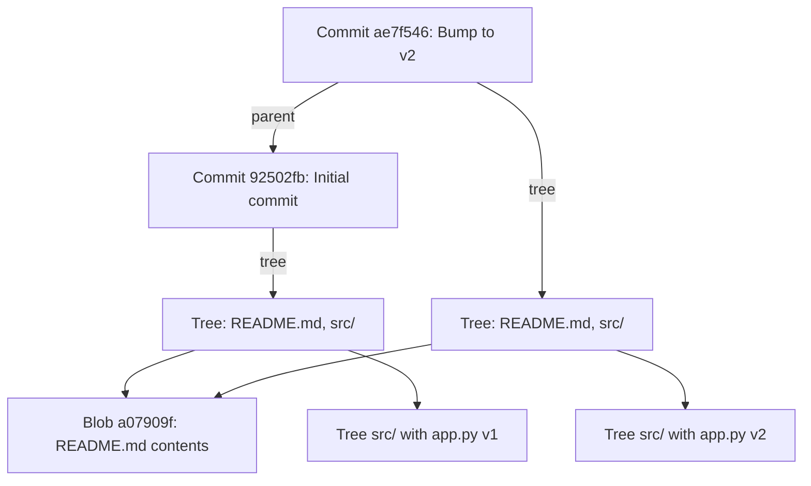
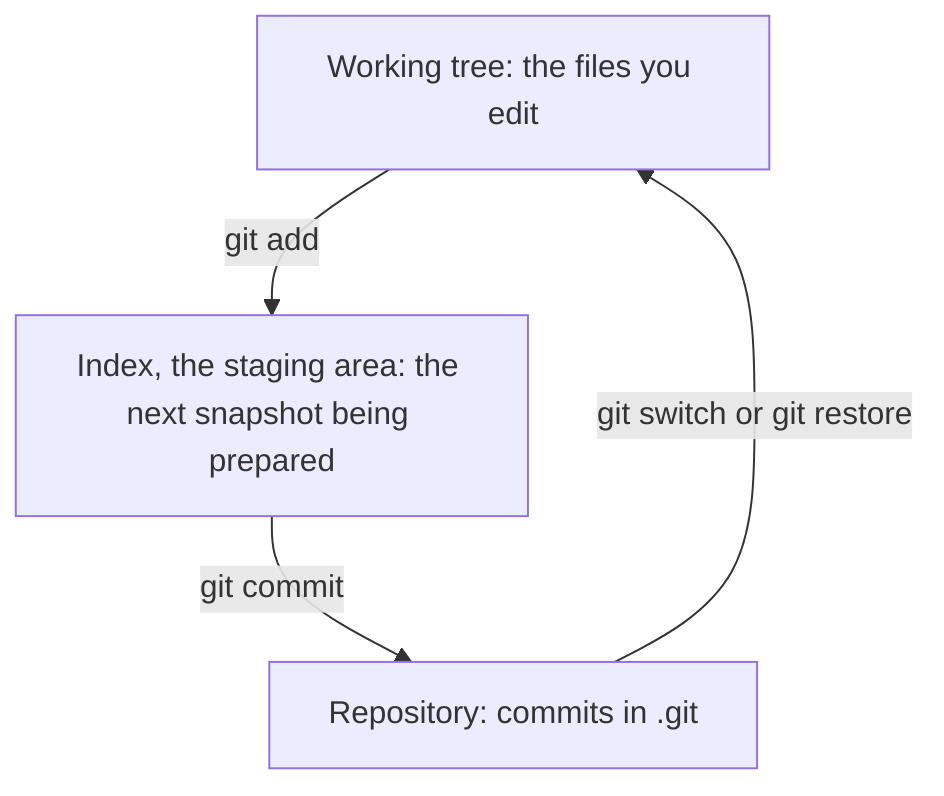

# How Git stores things

> **Status: AI draft, 2026-11-16.** Not yet verified by me. Commands and output were run in a throwaway container; the commit timestamp is replaced with a placeholder.

## In one line

Git stores snapshots, not diffs: every file version is a blob, every directory a tree, and every commit points at one tree and its parent commits, all named by the hash of their content. A branch is just a file holding one commit's hash, and HEAD says which branch you are on.

## The plain idea

Most people picture Git as a list of changes. It is closer to a photo album. Every commit is a full snapshot of the project at that moment, plus a note saying which snapshot came before it. Git saves space by never storing the same file contents twice: if a file did not change, the new snapshot simply points at the copy already stored.

Everything Git stores is labelled by a fingerprint of its own content, a **hash**. Same content, same label, always. That one design choice explains why Git is fast, why history cannot be changed without everyone noticing, and why "lost" work can almost always be found again ([Undoing and recovering](undo-and-recover.md)).

## How it works

### Four kinds of object

| Object | Holds | Named by |
|---|---|---|
| **Blob** | The contents of one file. No name, no permissions. | Hash of the contents |
| **Tree** | A directory listing: names, modes, and the blob or tree for each entry | Hash of the listing |
| **Commit** | One tree (the snapshot), zero or more parent commits, author, committer, message | Hash of all of that |
| **Tag** (annotated) | A pointer to a commit with a name, message and tagger | Hash of the tag |

They live in `.git/objects`. The hash is SHA-1 by default (40 hex characters); Git also supports SHA-256 repositories. You usually see only the first 7 characters, which is enough to be unique in most repositories.



`README.md` did not change between the two commits, so both trees point at the same blob. Only the changed file and the trees above it are new.

### Content addressing

Because a commit's hash covers its tree and its parent's hash, changing anything in the past (a file, a message, an author) changes that commit's hash, and therefore the hash of every commit after it. That is why rewriting published history is noticed immediately by everyone else: their copies have different hashes.

### Refs and HEAD

A **ref** is a name for a commit hash.

- A **branch** is a file in `.git/refs/heads/` containing one commit hash. Committing on a branch writes a new commit and moves the branch to it. Creating a branch is writing a 41-byte file, which is why branches are cheap.
- A **tag** is a ref that does not move.
- **HEAD** says what you have checked out. Usually it contains `ref: refs/heads/main`, meaning "the current branch is main". When it holds a commit hash directly, you are in **detached HEAD**: new commits belong to no branch and are easy to lose.
- **Remote-tracking branches** such as `origin/main` record where the remote's branches were at your last fetch ([Remotes, pull requests and access](remotes-and-collaboration.md)).

### Three places a file can be



| Place | What it is | See it with |
|---|---|---|
| **Working tree** | Ordinary files on disk | `git status`, `git diff` |
| **Index** (staging area) | The snapshot that the next commit will record | `git diff --staged` |
| **Repository** | Every commit, in `.git` | `git log` |

`git add` copies the current content of a file into the index. `git commit` turns the index into a tree and writes a commit pointing to it. That is why a file changed after `git add` must be added again: the index still holds the older content.

## A concrete example

A new repository with one commit, inspected from the inside.

1. `git cat-file -p HEAD` shows the commit: a `tree` line with the snapshot's hash, the author and committer, and the message. The first commit has no `parent` line.
2. `git cat-file -p HEAD^{tree}` shows the top-level tree: `README.md` as a blob, `src` as a tree.
3. `git cat-file -p HEAD:README.md` prints the blob's content.
4. `cat .git/HEAD` shows `ref: refs/heads/main`, and `cat .git/refs/heads/main` shows the commit hash: the branch is literally that file.
5. `echo "# sample-app" | git hash-object --stdin` computes the hash of that text without storing it, and it matches the README's blob hash. Identical content anywhere, in any repository, gets the same hash.

## Why not just...?

- **...store diffs, like older version-control systems?** Every checkout would replay a chain of diffs. Snapshots make switching branches, comparing any two versions and checking integrity simple and fast. Git compresses similar objects into **pack files** behind the scenes, so the space cost is small.
- **...treat a branch as a copy of the code?** It is a pointer to a commit. Deleting a branch deletes the pointer, not the commits, which is why a deleted branch can be recovered while its commits still exist.
- **...skip the staging area and commit everything that changed?** The index lets you build a commit from part of your changes (`git add -p`), so each commit can be one logical change. `git commit -a` skips it when you do want everything already tracked.

## Commands to know

The working tree and index, as files are added:

```console
# git status --short
?? README.md
?? src/
# git add README.md
# git status --short
A  README.md
?? src/
```

`??` is untracked. `A` in the first column is staged as added. The first column describes the index, the second the working tree.

A commit object, its tree, and a blob:

```console
# git cat-file -p HEAD
tree e213238...
author Dev One <dev1@example.com> <unix-time> +0530
committer Dev One <dev1@example.com> <unix-time> +0530

Initial commit
# git cat-file -p HEAD^{tree}
100644 blob a07909f...	README.md
040000 tree a14f10e...	src
# git cat-file -p HEAD:README.md
# sample-app
# git cat-file -t HEAD:README.md
blob
```

Full 40-character hashes are shortened to their first 7 characters here. `-p` pretty-prints an object, `-t` prints its type. `100644` is a normal file mode; `040000` is a directory.

A branch is a file holding a hash:

```console
# cat .git/HEAD
ref: refs/heads/main
# cat .git/refs/heads/main
92502fb...
# git rev-parse --short HEAD
92502fb
```

Same content, same hash:

```console
# echo "# sample-app" | git hash-object --stdin
a07909f...
# git rev-parse HEAD:README.md
a07909f...
```

| Command | What it shows |
|---|---|
| `git log --oneline --graph --all` | Every commit as a graph, with branch names. |
| `git show <commit>` | A commit's message and the changes against its parent. |
| `git rev-parse <name>` | The hash a branch, tag or expression points to. |
| `git ls-tree -r HEAD` | Every file in a commit's snapshot. |
| `git count-objects -v` | How many objects and pack files the repository holds. |

## How it breaks

| Symptom | Layer | Check | Likely cause |
|---|---|---|---|
| A commit misses a change you made | Index | `git status`, `git diff` | The file was edited after `git add`, so the index held the older content |
| `You are in 'detached HEAD' state` | HEAD | `cat .git/HEAD`, `git status` | A commit or tag was checked out directly; new commits are on no branch |
| Hashes of old commits differ from a colleague's | History | `git log` on both sides | History was rewritten (rebase, amend, filter) after being shared |
| The repository is huge | Objects | `git count-objects -vH`; find large blobs | Large binaries committed at some point stay in history even after deletion |
| `fatal: bad object` | Object store | `git fsck` | Corrupted or missing objects, often from an interrupted copy |

## Interview questions

**1. Does Git store diffs or snapshots? Explain.**

<details markdown="1">
<summary>Answer</summary>

- Snapshots: each commit points to a tree describing every file at that moment.
- Unchanged files are not copied; the new tree points at the existing blob.
- Pack files compress similar objects as deltas for storage, but the model is snapshots.

</details>

**2. What are blobs, trees and commits?**

<details markdown="1">
<summary>Answer</summary>

- A blob is a file's contents.
- A tree is a directory: names and modes mapped to blobs and subtrees.
- A commit points to one tree and its parent commits, with author, committer and message.
- Each is named by the hash of its content.

</details>

**3. What is a branch, technically? What is HEAD?**

<details markdown="1">
<summary>Answer</summary>

- A branch is a ref: a small file containing a commit hash, which moves forward as you commit.
- HEAD records what is checked out, normally a reference to the current branch.
- Detached HEAD means HEAD holds a commit hash directly, not a branch.

</details>

**4. What is the staging area for?**

<details markdown="1">
<summary>Answer</summary>

- It holds the snapshot the next commit will record.
- It lets you commit part of your changes, so each commit is one logical change.
- `git diff` compares the working tree with the index; `git diff --staged` compares the index with the last commit.

</details>

**5. Why does rewriting history cause trouble for collaborators?**

<details markdown="1">
<summary>Answer</summary>

- A commit's hash depends on its parent's hash, so changing an old commit changes every later hash.
- Others' branches still contain the old commits, so their history and yours diverge.
- That is why published history should not be rebased or amended.

</details>

**6. A large file was committed by mistake and deleted in the next commit. Is the repository smaller now?**

<details markdown="1">
<summary>Answer</summary>

- No: the old commit still points at the blob, so it stays in history and in every clone.
- Removing it requires rewriting history with a tool such as `git filter-repo`, then everyone re-cloning.
- If it was a secret, rotate the secret: rewriting history does not undo copies already fetched.

</details>

## Try it

**Step 1.** Start a container with Git and make a repository.

```bash
docker run --rm -it ubuntu:24.04 bash
apt-get update -qq && apt-get install -y -qq git
git config --global user.name "Dev One" && git config --global user.email dev1@example.com
mkdir demo && cd demo && git init -q && echo hello > a.txt && git add a.txt && git commit -q -m first
```

**Step 2.** Walk from the commit down to the file's content.

```bash
git cat-file -p HEAD
git cat-file -p HEAD^{tree}
git cat-file -p HEAD:a.txt
```

**Step 3.** Predict whether these two hashes match, then check.

```bash
echo hello | git hash-object --stdin
git rev-parse HEAD:a.txt
```

**Step 4.** Look at what a branch really is.

```bash
cat .git/HEAD; cat .git/refs/heads/*
```

**Step 5.** Type `exit`. The container is deleted.

## Zoom out

Every other Git operation is a move of pointers over this object graph: merging and rebasing make new commits ([Daily workflow](daily-workflow.md)), reset moves a branch pointer ([Undoing and recovering](undo-and-recover.md)), and push and fetch copy objects between repositories. The same idea of naming things by the hash of their content returns in container images, whose layers and digests are content-addressed too ([Images and Dockerfiles](../containers/images-and-dockerfiles.md)). The principle to carry: commits are immutable snapshots, and branches are just movable labels on them.

## Sources

- [Pro Git: Git internals, Git objects](https://git-scm.com/book/en/v2/Git-Internals-Git-Objects)
- [Pro Git: Git references](https://git-scm.com/book/en/v2/Git-Internals-Git-References)
- [git-cat-file documentation](https://git-scm.com/docs/git-cat-file)
- [git-hash-object documentation](https://git-scm.com/docs/git-hash-object)
- [Pro Git: Git basics, recording changes](https://git-scm.com/book/en/v2/Git-Basics-Recording-Changes-to-the-Repository)
