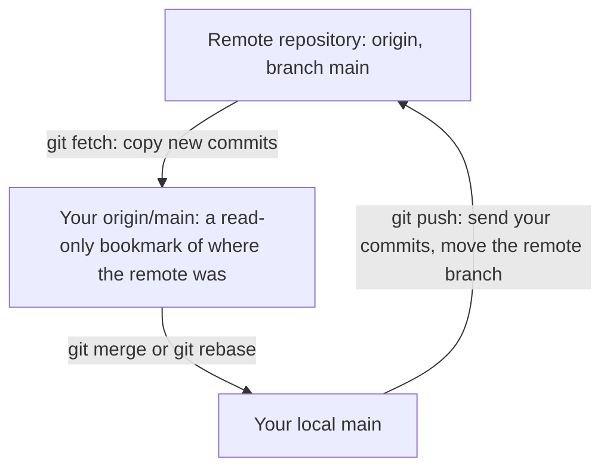

# Remotes, pull requests and access

> **Status: AI draft, 2026-11-16.** Not yet verified by me. Commands and output were run in a throwaway container, with a local bare repository playing the remote; hosting-platform features are from their documentation.

## In one line

A remote is another copy of the repository; `fetch` downloads its commits into remote-tracking branches such as `origin/main`, `pull` is fetch plus merge or rebase, and `push` uploads yours only if the remote has nothing you lack. Pull requests, branch protection and scoped credentials turn that into a reviewed, controlled workflow.

## The plain idea

Every clone is a complete repository. Nothing is "on the server" in a special way; the server just holds the copy everyone agrees to share. Collaboration is copying commits between these repositories.

Git never silently throws away someone else's work. If a teammate pushed while you were working, your push is refused until you have taken their commits into yours. On top of that plain mechanism, hosting platforms (GitHub, GitLab, Bitbucket) add **pull requests** for review, **branch protection** so nobody can bypass review on `main`, and **credentials** that decide who may push at all.

## How it works

### Remotes and remote-tracking branches



- `origin` is just the default name for the remote you cloned from. `git remote -v` lists remotes.
- `origin/main` is a **remote-tracking branch**: your record of where `main` was on the remote at the last fetch. You do not commit to it.
- A local branch usually **tracks** one remote branch (its upstream), which is what `git status` compares against when it says "ahead 1, behind 1".

| Command | Contacts the remote | Changes your branch |
|---|---|---|
| `git fetch` | Yes | No: only updates `origin/*` |
| `git pull` | Yes | Yes: fetch, then merge (or rebase with `--rebase`) |
| `git push` | Yes | Moves the remote branch to your commit |

### Why a push is rejected

A push is accepted only as a fast-forward: the remote branch's current commit must already be in your history. If a teammate pushed first, the remote has a commit you do not, and the push is rejected (`fetch first`). Fetch, combine their work with yours (merge or rebase), then push.

**Force pushing** replaces the remote branch with yours, discarding whatever is there that you do not have. `--force-with-lease` is the safe form: it only forces if the remote branch is still where your `origin/main` says it was, so it refuses when someone pushed in the meantime. On shared branches, do not force push at all; on your own pull-request branch after a rebase, use `--force-with-lease`.

### Pull requests

A **pull request** (merge request on GitLab) asks for a branch to be merged, with a diff, discussion, and automated checks. The usual flow:

1. Push a branch.
2. Open a pull request against `main`.
3. CI runs on the branch; reviewers comment.
4. Push fixes to the same branch; the pull request updates.
5. Merge (merge commit, squash, or rebase, as the repository allows), and delete the branch.

**Branch protection** (or rulesets) on `main` enforces the flow: require pull requests, a number of approvals, passing status checks, an up-to-date branch, and block force pushes and deletion. Some teams add **CODEOWNERS**, a file mapping paths to the people who must review changes to them.

### Credentials and access

| Method | How it works | Good for |
|---|---|---|
| HTTPS with a token | A personal access token instead of a password; fine-grained tokens can be limited to some repositories and permissions, with an expiry | People, and tools that speak HTTPS |
| SSH key | Your public key registered on your account ([SSH](../linux/ssh.md)) | People |
| Deploy key | An SSH key attached to **one** repository, read-only unless you allow writes | A server or job that needs one repository |
| CI token issued per run | The platform gives each pipeline run a short-lived token, scoped by settings | CI jobs ([GitHub Actions basics](../cicd/github-actions-basics.md)) |

Least privilege applies: a deploy job that only reads one repository should not hold a token that can push to every repository of a person.

### Hooks

**Hooks** are scripts Git runs at certain moments. Client-side hooks (in `.git/hooks`, or a directory set with `core.hooksPath`) run on your machine: `pre-commit` can run linters or secret scanners, `pre-push` can run tests. They are not enforced, because anyone can skip them with `--no-verify`. Rules that must hold go server-side: branch protection, required CI checks, and push rules on the platform.

**Submodules** pin another repository at a specific commit inside yours. They are useful for shared code, but every user must remember `git submodule update --init`, and changes need commits in both repositories.

## A concrete example

You committed locally; a teammate pushed to `main` before you.

1. `git push` is rejected: `! [rejected] main -> main (fetch first)`.
2. `git fetch`, then `git status -sb` shows `## main...origin/main [ahead 1, behind 1]`: you each have one commit the other lacks.
3. `git pull --rebase` replays your commit on top of theirs, giving a straight line.
4. `git push` now succeeds, as a fast-forward of the remote.

Later you amend that pushed commit locally (a mistake on a shared branch) and try `git push --force-with-lease`. Your teammate has pushed again, so the lease check fails with `(stale info)` and nothing is overwritten.

## Why not just...?

- **...use `git push --force` when a push is rejected?** It deletes the commits your teammates pushed. Fetch and integrate instead; if you must force your own branch, use `--force-with-lease`.
- **...give the CI system your personal access token?** It can then do anything you can, in every repository, until the token is revoked, and every action looks like you. Use deploy keys, platform-issued job tokens, or OIDC federation.
- **...enforce rules with client-side hooks?** They live on each laptop and can be bypassed. Server-side branch protection and required checks are the enforcement; local hooks are a convenience that catches problems earlier.

## Commands to know

A local bare repository as the remote, the first push, and tracking:

```console
# git init -q --bare /work/origin.git
# git remote add origin /work/origin.git
# git push -q -u origin main
# git remote -v
origin	/work/origin.git (fetch)
origin	/work/origin.git (push)
# git branch -vv
* main          fb2666a [origin/main] Add y
```

A **bare** repository has no working tree, only the contents of `.git`: that is what a server holds. `-u` sets `origin/main` as the upstream of the local `main`.

A rejected push, and why:

```console
# git push
 ! [rejected]        main -> main (fetch first)
hint: Updates were rejected because the remote contains work that you do not
# git fetch
# git status -sb
## main...origin/main [ahead 1, behind 1]
```

Integrating by rebase, then pushing:

```console
# git pull --rebase
# git log --oneline --graph -3
* 6286d42 My change
* fa1b101 Teammate change
* fb2666a Add y
# git push
```

A force push that is refused because the remote moved:

```console
# git commit --amend -m "My change, reworded"
# git push --force-with-lease
 ! [rejected]        main -> main (stale info)
```

| Command | What it does |
|---|---|
| `git clone <url>` | Copy a repository, set up `origin` and check out the default branch. |
| `git fetch --prune` | Fetch, and delete `origin/*` branches that no longer exist on the remote. |
| `git push -u origin feature/login` | Push a new branch and set its upstream. |
| `git push origin --delete feature/login` | Delete a remote branch. |
| `git log main..origin/main` | Commits on the remote that you do not have yet. |
| `git config core.hooksPath tools/githooks` | Use hooks stored in the repository instead of `.git/hooks`. |
| `gh pr create`, `gh pr checks`, `gh pr merge` | Pull requests from the GitHub command line. |

## How it breaks

| Symptom | Layer | Check | Likely cause |
|---|---|---|---|
| `! [rejected] (fetch first)` or `(non-fast-forward)` | History | `git status -sb` | The remote has commits you do not; fetch and integrate |
| `! [rejected] (stale info)` | Force with lease | `git fetch`, then compare | Someone pushed since your last fetch; the lease protected their work |
| `Permission denied (publickey)` | SSH auth | `ssh -T git@github.com` | Key not loaded or not registered |
| `Authentication failed` over HTTPS | Token | Token scopes and expiry | Expired token, or a password used where a token is required |
| `protected branch hook declined` | Branch protection | Repository rules | Direct push to a protected branch; open a pull request |
| Pull request cannot be merged | Checks | The pull request's checks and reviews | A required check failed, approvals missing, or the branch is out of date |
| Teammates' commits vanished from `main` | Force push | Platform audit log; teammates' reflogs | A plain `--force` overwrote them |

## Interview questions

**1. What is the difference between `git fetch` and `git pull`?**

<details markdown="1">
<summary>Answer</summary>

- `fetch` downloads new commits and updates remote-tracking branches like `origin/main`; your branches are untouched.
- `pull` is fetch followed by a merge (or rebase with `--rebase`) into the current branch.
- Fetch first when you want to see what changed before integrating.

</details>

**2. Why is a push rejected, and how do you fix it safely?**

<details markdown="1">
<summary>Answer</summary>

- The remote branch has commits your branch does not contain, so the push would not be a fast-forward.
- Fetch, then merge or rebase onto `origin/<branch>`, test, and push again.
- Do not force push a shared branch.

</details>

**3. What does `--force-with-lease` protect against?**

<details markdown="1">
<summary>Answer</summary>

- It forces only if the remote branch is still at the commit your remote-tracking branch recorded.
- If someone pushed since your last fetch, it refuses instead of deleting their commits.
- Use it after rebasing your own pull-request branch.

</details>

**4. What would you put in branch protection for `main`?**

<details markdown="1">
<summary>Answer</summary>

- Require pull requests with at least one approval, and code-owner review where it matters.
- Require passing CI checks, and an up-to-date branch.
- Block force pushes and deletion; restrict who can bypass.

</details>

**5. How should a deployment server or CI job authenticate to Git?**

<details markdown="1">
<summary>Answer</summary>

- With a credential scoped to what it needs: a deploy key for one repository, or a platform-issued per-run token.
- Read-only unless it must push; short-lived where possible.
- Not a person's account token, which is too broad and ties automation to an individual.

</details>

**6. Are Git hooks a good way to enforce that no secrets are committed?**

<details markdown="1">
<summary>Answer</summary>

- A `pre-commit` secret scanner is useful as an early warning on each laptop.
- It can be skipped with `--no-verify` or simply not installed, so it is not enforcement.
- Enforce with server-side scanning (push protection, CI checks); and if a secret lands anyway, rotate it.

</details>

## Try it

**Step 1.** Start a container with Git, a bare "server" repository and two clones.

```bash
docker run --rm -it ubuntu:24.04 bash
apt-get update -qq && apt-get install -y -qq git
git config --global user.name "Dev One" && git config --global user.email dev1@example.com && git config --global init.defaultBranch main
git init -q --bare /srv/origin.git
git clone -q /srv/origin.git alice && cd alice && echo a > a.txt && git add a.txt && git commit -q -m "First" && git push -q -u origin main && cd ..
git clone -q /srv/origin.git bob
```

**Step 2.** Both change the repository. Predict what Bob's push will do.

```bash
cd alice && echo more >> a.txt && git commit -qam "Alice change" && git push -q && cd ..
cd bob && echo b > b.txt && git add b.txt && git commit -q -m "Bob change" && git push
```

**Step 3.** Fix it the safe way and check the result.

```bash
git pull --rebase && git push && git log --oneline --graph
```

**Step 4.** Type `exit`. The container is deleted.

## Zoom out

Remotes, pull requests and protected branches are the front door of every delivery pipeline: CI runs on pushes and pull requests, and in GitOps the merged commit is what reaches the cluster ([CI/CD concepts](../cicd/concepts.md), [Pipeline security](../cicd/pipeline-security.md)). Credentials for Git are as sensitive as cloud credentials, because whoever can push to `main` can often deploy. The principle to carry: never overwrite others' history, and make the rules live on the server, not on laptops.

## Sources

- [Pro Git: working with remotes](https://git-scm.com/book/en/v2/Git-Basics-Working-with-Remotes)
- [git-push documentation: --force-with-lease](https://git-scm.com/docs/git-push)
- [git-fetch documentation](https://git-scm.com/docs/git-fetch)
- [githooks documentation](https://git-scm.com/docs/githooks)
- [GitHub documentation: about protected branches](https://docs.github.com/en/repositories/configuring-branches-and-merges-in-your-repository/managing-protected-branches/about-protected-branches)
- [GitHub documentation: managing deploy keys](https://docs.github.com/en/authentication/connecting-to-github-with-ssh/managing-deploy-keys)
- [GitHub documentation: about code owners](https://docs.github.com/en/repositories/managing-your-repositorys-settings-and-features/customizing-your-repository/about-code-owners)
