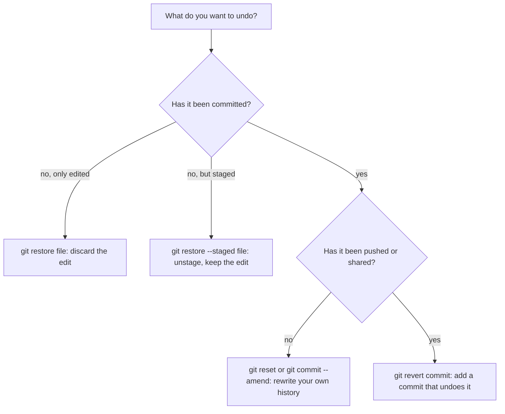

# Undoing and recovering

> **Status: AI draft, 2026-11-16.** Not yet verified by me. Commands and output were run in a throwaway container; some reflog lines produced by setting up the example are trimmed.

## In one line

`git restore` throws away file changes, `git reset` moves a branch pointer (`--soft` keeps changes staged, `--mixed` keeps them unstaged, `--hard` discards them), and `git revert` adds a new commit that undoes an old one, which is the only safe undo for shared history. The reflog remembers every place HEAD has been, so "lost" commits can almost always be found.

## The plain idea

Undo in Git depends on two questions: **where is the change** (only in your files, staged, committed locally, or already pushed), and **should history show that it happened**?

Changes that never reached a commit can be thrown away, and then they are really gone. Once something has been committed, Git keeps the commit object for a while even if no branch points to it any more. That is the safety net: as long as you can find the commit's hash, you can get the work back. The **reflog** is the diary that lets you find it.

For commits other people already have, you do not erase anything. You add a new commit that reverses the old one, so everyone's history stays consistent.

## How it works

### Choosing the right undo



### reset, in three strengths

`git reset <commit>` moves the current branch to `<commit>`. The options decide what happens to the index and the working tree:

| Mode | Branch pointer | Index (staged) | Working tree (your files) | Use it to |
|---|---|---|---|---|
| `--soft` | Moved | Kept | Kept | Undo the commit but keep everything staged, for example to recommit differently |
| `--mixed` (default) | Moved | Reset to the commit | Kept | Undo the commit and unstage, keeping your edits |
| `--hard` | Moved | Reset | **Reset: edits discarded** | Throw away commits and edits completely |

`--hard` is the only one that destroys uncommitted work. Committed work it moves away from can still be found in the reflog.

### revert

`git revert <commit>` creates a new commit with the opposite changes. History keeps both the original and its reversal, so nobody's copy is invalidated. It is the right undo on `main` after a bad merge or deploy. Reverting a merge commit needs `-m 1` to say which parent is the main line.

### The reflog

Every time HEAD moves (commit, reset, checkout, rebase, merge), Git writes a line in the **reflog**: `HEAD@{0}` is where it is now, `HEAD@{1}` where it was before the last move, and so on. Commits that no branch points to stay in the repository until garbage collection removes them, by default after about 30 days for unreachable reflog entries and 90 days for reachable ones. The reflog is local: it is not pushed and a fresh clone does not have yours.

### Finding the commit that broke something

`git bisect` does a binary search through history. You mark one commit as bad and an older one as good; Git checks out the midpoint and asks you, halving the range each time. With 1,000 commits between good and bad, it needs about 10 steps. `git bisect run <script>` automates it: the script's exit code says good (0) or bad (non-zero).

### What is truly gone

- Changes that were never staged or committed, after `git restore` or `git reset --hard`.
- Commits that were unreachable for longer than the expiry and then garbage-collected.
- Anything in a deleted clone that was never pushed.

Staged-but-uncommitted content becomes blob objects when you `git add`, so even that can sometimes be dug out with `git fsck --lost-found`, but do not count on it.

## A concrete example

You ran `git reset --hard HEAD~3` on your branch to drop one bad commit, and realised you dropped three, two of them good.

1. `git reflog` shows `HEAD@{0}: reset: moving to HEAD~3` and, on the line below, the commit you were on before: `HEAD@{1}`.
2. `git reset --hard HEAD@{1}` puts the branch back exactly where it was.
3. Now do what you meant: `git revert <bad-commit>` if the branch is shared, or `git rebase -i` to drop only that commit if it is not.

The same works for a deleted branch: `git branch -D experiment` prints the commit it pointed to, and the reflog has it too, so `git branch experiment <hash>` brings it back.

## Why not just...?

- **...`git reset --hard` and force-push to remove a bad commit from `main`?** Everyone who pulled it now has a history that no longer matches, and the next push from any of them brings the commit back. `git revert` undoes it with a new commit that everyone simply pulls.
- **...delete the folder and re-clone when Git gets confusing?** You lose every unpushed commit, branch, stash and the reflog. Almost every confusing state can be inspected with `git status`, `git log --graph` and `git reflog`.
- **...use `git checkout -- file` to undo changes?** It still works, but `git checkout` does two unrelated jobs. `git restore` (files) and `git switch` (branches) were added to make the intent explicit and harder to get wrong.

## Commands to know

The three resets, on a branch whose last two commits added lines to `notes.txt`:

```console
# git log --oneline -3
519fd3e Note 2
dd27df5 Note 1
4e95a0e Fix typo
# git reset --soft HEAD~1
# git status --short
M  notes.txt
# git log --oneline -1
dd27df5 Note 1
```

After `--soft`, the commit `Note 2` is gone from the branch but its change is still staged (`M` in the first column). Resetting again with the default `--mixed` unstages it:

```console
# git reset --mixed HEAD
# git status --short
 M notes.txt
```

Now the change is only in the working tree (`M` in the second column). `git restore notes.txt` then discards it.

Revert adds a new commit:

```console
# git revert --no-edit HEAD
[main 1637d7b] Revert "Note 1"
# git log --oneline -2
1637d7b Revert "Note 1"
dd27df5 Note 1
```

A hard reset too far, and the way back through the reflog:

```console
# git reset --hard HEAD~3
HEAD is now at 7962422 Merge branch 'feature/greet'
# git reflog -2
7962422 HEAD@{0}: reset: moving to HEAD~3
1637d7b HEAD@{1}: revert: Revert "Note 1"
# git reset --hard HEAD@{1}
# git log --oneline -1
1637d7b Revert "Note 1"
```

A deleted branch brought back:

```console
# git branch -D experiment
Deleted branch experiment (was b813962).
# git reflog | grep Experiment
b813962 HEAD@{1}: commit: Experiment
# git branch experiment b813962
# git log --oneline -1 experiment
b813962 Experiment
```

Finding the first bad commit automatically. Commits 6, 7 and 8 contain the fault; the test script passes when `state` says `passing`:

```console
# git bisect start
# git bisect bad HEAD
# git bisect good HEAD~7
Bisecting: 3 revisions left to test after this (roughly 2 steps)
# git bisect run sh -c "grep -q status=passing state"
a2ed08a... is the first bad commit
    Change 6
# git bisect reset
Switched to branch 'main'
```

| Command | What it does |
|---|---|
| `git restore <file>` | Discard working-tree changes to a file. |
| `git restore --staged <file>` | Unstage, keeping the change. |
| `git commit --amend` | Replace the last commit (message or content). Only before pushing. |
| `git revert -m 1 <merge-commit>` | Undo a whole merged branch on the main line. |
| `git log -S'text'` | Commits that added or removed `text`: find when something appeared. |
| `git blame -L 10,20 <file>` | Who last changed lines 10 to 20, and in which commit. |
| `git clean -nd`, then `git clean -fd` | List, then delete, untracked files and directories. `-n` first, always. |

## How it breaks

| Symptom | Layer | Check | Likely cause |
|---|---|---|---|
| Work disappeared after a reset | Branch pointer | `git reflog` | `reset --hard` to an older commit; recover with `reset --hard HEAD@{n}` |
| A branch was deleted by mistake | Refs | The `Deleted branch ... (was <hash>)` message, or the reflog | Recreate it with `git branch <name> <hash>` |
| A reverted change comes back after a merge | Revert of a merge | Was a merge commit reverted, then the branch merged again? | Git sees the branch's commits as already merged; revert the revert to bring them back deliberately |
| Uncommitted edits gone after `git checkout .` or `restore` | Working tree | Editor history or backups only | Never committed or stashed: Git cannot help |
| Force push overwrote a teammate's commits | Remote history | Their reflog, or the platform's event log | `--force` without `--force-with-lease`; restore from a clone that has them |
| `bisect` blames an unrelated commit | Test script | Run the script by hand on that commit | The test does not test the fault, or matches too broadly |

## Interview questions

**1. What is the difference between `git reset --soft`, `--mixed` and `--hard`?**

<details markdown="1">
<summary>Answer</summary>

- All three move the current branch to the given commit.
- `--soft` keeps the index and working tree, so the changes stay staged.
- `--mixed` (default) resets the index but keeps the working tree, so changes become unstaged.
- `--hard` resets both, discarding uncommitted changes.

</details>

**2. What is the difference between `git reset` and `git revert`?**

<details markdown="1">
<summary>Answer</summary>

- `reset` moves the branch back, removing commits from it: rewrites history.
- `revert` adds a new commit that undoes an old one: history is kept.
- Use revert for anything already pushed or shared.

</details>

**3. You ran `git reset --hard` and lost commits. How do you get them back?**

<details markdown="1">
<summary>Answer</summary>

- `git reflog` lists every position HEAD has had, with hashes.
- Find the entry from before the reset and `git reset --hard <hash>` or `HEAD@{n}`.
- It works while the commits have not been garbage-collected, normally weeks.

</details>

**4. A bad commit was merged to `main` and deployed. How do you undo it?**

<details markdown="1">
<summary>Answer</summary>

- `git revert <commit>` (with `-m 1` for a merge commit) and push it through the normal pipeline.
- Do not reset and force-push a shared branch.
- Investigate and fix forward afterwards; later, re-adding the change may need a revert of the revert.

</details>

**5. How would you find which of the last 200 commits introduced a bug?**

<details markdown="1">
<summary>Answer</summary>

- `git bisect start`, mark the current commit bad and a known good commit good.
- Git checks out midpoints; mark each good or bad, about 8 steps for 200 commits.
- Automate with `git bisect run <test-script>`, then `git bisect reset`.

</details>

**6. What can Git not recover?**

<details markdown="1">
<summary>Answer</summary>

- Changes never staged or committed, once discarded.
- Commits garbage-collected after their reflog entries expired.
- Unpushed work in a deleted clone; the reflog is local only.

</details>

## Try it

**Step 1.** Start a container with Git and a repository with three commits.

```bash
docker run --rm -it ubuntu:24.04 bash
apt-get update -qq && apt-get install -y -qq git
git config --global user.name "Dev One" && git config --global user.email dev1@example.com
mkdir demo && cd demo && git init -q
for i in 1 2 3; do echo $i >> f.txt; git add f.txt; git commit -q -m "Commit $i"; done
git log --oneline
```

**Step 2.** Reset too far on purpose, then predict which reflog entry gets the work back.

```bash
git reset --hard HEAD~2
git log --oneline
git reflog -3
git reset --hard HEAD@{1}
git log --oneline
```

**Step 3.** Undo the last commit the shared-history way and look at the result.

```bash
git revert --no-edit HEAD
git log --oneline
cat f.txt
```

**Step 4.** Type `exit`. The container is deleted.

## Zoom out

The same distinction between rewriting and reverting comes back in delivery: with GitOps, a `git revert` of a bad change is the rollback, and it is audited like any other change ([Promotion, rollback and troubleshooting](../gitops/promotion-and-rollback.md)). Knowing that committed work is recoverable takes the fear out of Git. The principle to carry: commit early so there is something to recover, and undo shared history only by adding to it.

## Sources

- [Pro Git: undoing things](https://git-scm.com/book/en/v2/Git-Basics-Undoing-Things)
- [Pro Git: reset demystified](https://git-scm.com/book/en/v2/Git-Tools-Reset-Demystified)
- [git-reset documentation](https://git-scm.com/docs/git-reset)
- [git-revert documentation](https://git-scm.com/docs/git-revert)
- [git-reflog documentation](https://git-scm.com/docs/git-reflog)
- [git-bisect documentation](https://git-scm.com/docs/git-bisect)
- [git-gc documentation: reflog expiry](https://git-scm.com/docs/git-gc)
