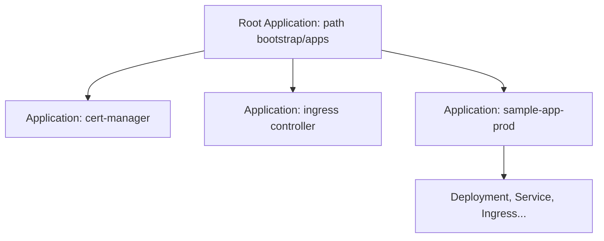

# App-of-apps and ApplicationSets

> **Status: AI draft, 2026-11-16.** Not yet verified by me. Written from the Argo CD documentation; nothing was run.

## In one line

To manage many Applications, keep their manifests in Git under one parent Application (app-of-apps), or generate them from a template with an ApplicationSet (per list item, cluster or Git folder). Both multiply one change, so stop the controller from deleting Applications.

## The plain idea

One Application per service per environment per cluster quickly means hundreds of Application objects. Creating them by hand, or with `argocd app create`, is exactly the non-Git, imperative work GitOps was meant to remove ([GitOps principles](principles.md)).

Two patterns put the Applications themselves under GitOps:

- **App-of-apps**: Applications are just YAML files in a folder; one "root" Application points at that folder, so syncing the root creates and updates all the children.
- **ApplicationSet**: write one template and a generator that produces parameters ("for each cluster", "for each folder"); the controller creates one Application per parameter set and keeps them up to date.

## How it works

### App-of-apps



- Bootstrapping a cluster is "create the root Application"; everything else follows from Git.
- Ordering between children uses sync waves on the child Application manifests ([Sync, hooks and waves](sync-hooks-waves.md)).
- Simple and explicit: every Application is a file you can read and review. Repetitive when many apps differ only by a few values.

### ApplicationSet

```yaml
apiVersion: argoproj.io/v1alpha1
kind: ApplicationSet
metadata:
  name: team-a-services
  namespace: argocd
spec:
  goTemplate: true
  generators:
    - git:
        repoURL: https://git.example.com/platform/config-repo.git
        revision: main
        directories:
          - path: apps/*/overlays/prod
  template:
    metadata:
      name: '{{index .path.segments 1}}-prod'
    spec:
      project: team-a
      source:
        repoURL: https://git.example.com/platform/config-repo.git
        targetRevision: main
        path: '{{.path.path}}'
      destination:
        server: https://kubernetes.default.svc
        namespace: team-a
  syncPolicy:
    applicationsSync: create-update
    preserveResourcesOnDeletion: true
```

Adding a folder `apps/new-service/overlays/prod` creates `new-service-prod` automatically.

| Generator | Produces one set of parameters per | Typical use |
|---|---|---|
| **List** | Item in a literal list | A fixed set of environments |
| **Cluster** | Cluster registered in Argo CD (filter by labels) | The same add-on on every cluster |
| **Git directory** | Matching folder | One Application per app folder |
| **Git file** | Matching JSON or YAML file | Per-cluster or per-app config files |
| **Matrix** | Combination of two generators | Every app on every cluster |
| **Merge** | Merged parameters from several generators | Overrides for some combinations |
| **SCM provider**, **Pull request** | Repository in an organisation, or open pull request | Discovering repositories; preview environments per pull request |

### Choosing

| | App-of-apps | ApplicationSet |
|---|---|---|
| Applications live as | Files in Git | Generated objects |
| Best for | A handful of distinct apps (cluster add-ons with different settings) | Many similar apps, many clusters, preview environments |
| Change to one app | Edit its file | Edit parameters or template |
| Risk | Root sync with prune can delete child Applications | A template or generator change touches every generated Application |

### Multi-cluster and multi-tenant layouts

- Cluster generator plus labels (`env: prod`, `region: ap-south-1`) deploys platform add-ons to the right clusters.
- Matrix of Git directories and clusters deploys each app to each cluster in a tier.
- Tenancy: one ApplicationSet per team, generating into that team's AppProject only; ApplicationSets themselves are created by the platform team, because a generator that can target any project can bypass project boundaries ([Argo CD architecture and Applications](argocd-architecture.md)).

### Containing the blast radius

A single edit to a template, or a generator suddenly matching nothing (a repository moved, a cluster label removed), can modify or delete every generated Application, and with a resources finalizer, all their workloads.

- `applicationsSync: create-only` or `create-update`: the controller never deletes Applications (and with `create-only`, never modifies them).
- `preserveResourcesOnDeletion: true`: if Applications are deleted, their workloads stay ([Deletion, finalizers and safe cleanup](deletion-and-finalizers.md)).
- Progressive syncs (RollingSync) roll a template change through groups of Applications (dev first, then prod) instead of all at once.
- Review ApplicationSet changes like infrastructure changes.

## A concrete example

A platform with 12 clusters:

1. A root Application per cluster (app-of-apps) installs the cluster add-ons, each with its own settings.
2. An ApplicationSet with a matrix generator (Git directories of services × clusters labelled `tier: prod`) deploys every service to every production cluster.
3. The ApplicationSet uses `create-update` and `preserveResourcesOnDeletion: true`.
4. A pull-request generator creates a preview environment per open pull request on a test cluster, deleted when the pull request closes.

## Why not just...?

- **...create Applications with the CLI?** They are not in Git, so rebuilding Argo CD or the cluster means recreating them from memory.
- **...one huge ApplicationSet for everything?** One mistake then affects everything. Split by team or purpose and limit each to its own project.
- **...allow ApplicationSets to delete Applications freely?** A generator that temporarily returns nothing deletes everything it generated. Use policies that forbid deletion unless you really need it.

## Commands to know

These were not run for this page.

| Command | What it does |
|---|---|
| `kubectl get applicationsets -n argocd` | ApplicationSets and their status. |
| `kubectl describe applicationset team-a-services -n argocd` | Conditions such as generator errors. |
| `argocd appset get team-a-services` | The ApplicationSet and the Applications it generated. |
| `argocd app list -l argocd.argoproj.io/application-set-name=team-a-services` | Applications generated by one set (a read-only label query). |
| `argocd app create root --repo <url> --path bootstrap/apps --dest-server https://kubernetes.default.svc --dest-namespace argocd` | Create the root of an app-of-apps (better kept as YAML in Git as well). |

## How it breaks

| Symptom | Layer | Check | Likely cause |
|---|---|---|---|
| Applications disappeared after a repository change | Generator | ApplicationSet conditions | Generator path or label no longer matches, and deletion was allowed |
| A template change rolled to production at once | Rollout | Progressive syncs, review | No staged rollout across Applications |
| Child Application not created | App-of-apps | Root app status, child YAML | Child manifest invalid or not in the root's path |
| Generated names collide | Template | Name expression | Two parameter sets render the same name |
| Team deployed outside its namespace | Tenancy | Template `project`, AppProject | ApplicationSet editable by the team, or project too broad |

## Interview questions

**1. What is the app-of-apps pattern?**

<details markdown="1">
<summary>Answer</summary>

- Application manifests stored in Git, synced by one root Application.
- Bootstrapping a cluster means creating the root; everything else follows.
- Simple and explicit; ordering between children with sync waves.

</details>

**2. What is an ApplicationSet and what are generators?**

<details markdown="1">
<summary>Answer</summary>

- A controller-managed template that produces Applications from parameter sets.
- Generators supply parameters: list, cluster, Git directories or files, matrix, merge, SCM provider, pull request.
- Adding a folder or registering a cluster creates Applications automatically.

</details>

**3. When would you use app-of-apps and when ApplicationSets?**

<details markdown="1">
<summary>Answer</summary>

- App-of-apps: a few distinct applications with their own settings, such as cluster add-ons.
- ApplicationSets: many similar applications across environments, clusters or pull requests.
- Many platforms use both: app-of-apps to bootstrap, ApplicationSets for services.

</details>

**4. How can one ApplicationSet change cause an outage, and how do you prevent it?**

<details markdown="1">
<summary>Answer</summary>

- A template or generator change applies to every generated Application; a generator matching nothing can delete them all, with their workloads.
- Use `create-only` or `create-update` policies, `preserveResourcesOnDeletion`, and progressive syncs.
- Review ApplicationSet changes carefully and split sets by team or tier.

</details>

**5. How do you deploy an add-on to every production cluster?**

<details markdown="1">
<summary>Answer</summary>

- An ApplicationSet with a cluster generator selecting clusters by label (`env: prod`).
- New clusters with the label get the add-on automatically.
- Use per-cluster values via labels, annotations or Git file generators.

</details>

**6. How do you build preview environments per pull request with Argo CD?**

<details markdown="1">
<summary>Answer</summary>

- A pull request generator against the repository, templating a namespace and image tag per pull request.
- Each open pull request gets an Application; closing it removes the Application.
- Limit them to a test cluster and project, with resource quotas.

</details>

## Try it

1. Write the root Application and two child Application files for an app-of-apps that installs a monitoring stack and `sample-app`.
2. Change the ApplicationSet above to a matrix of the Git directories and a list of two environments (`staging`, `prod`), naming Applications `<app>-<env>`.
3. Write down what would happen to each generated Application if someone renamed the `apps/` folder, with and without the safety settings.

## Zoom out

These patterns make the set of Applications itself declarative, which is what lets a platform team manage many clusters and teams with GitOps ([GitOps principles](principles.md)). Their power is also their risk, which connects to deletion and finalizers ([Deletion, finalizers and safe cleanup](deletion-and-finalizers.md)).

## Sources

- [Argo CD documentation: cluster bootstrapping (app of apps)](https://argo-cd.readthedocs.io/en/stable/operator-manual/cluster-bootstrapping/)
- [Argo CD documentation: ApplicationSet controller](https://argo-cd.readthedocs.io/en/stable/operator-manual/applicationset/)
- [Argo CD documentation: generators](https://argo-cd.readthedocs.io/en/stable/operator-manual/applicationset/Generators/)
- [Argo CD documentation: Git generator](https://argo-cd.readthedocs.io/en/stable/operator-manual/applicationset/Generators-Git/)
- [Argo CD documentation: matrix generator](https://argo-cd.readthedocs.io/en/stable/operator-manual/applicationset/Generators-Matrix/)
- [Argo CD documentation: controlling resource modification](https://argo-cd.readthedocs.io/en/stable/operator-manual/applicationset/Controlling-Resource-Modification/)
- [Argo CD documentation: progressive syncs](https://argo-cd.readthedocs.io/en/stable/operator-manual/applicationset/Progressive-Syncs/)
