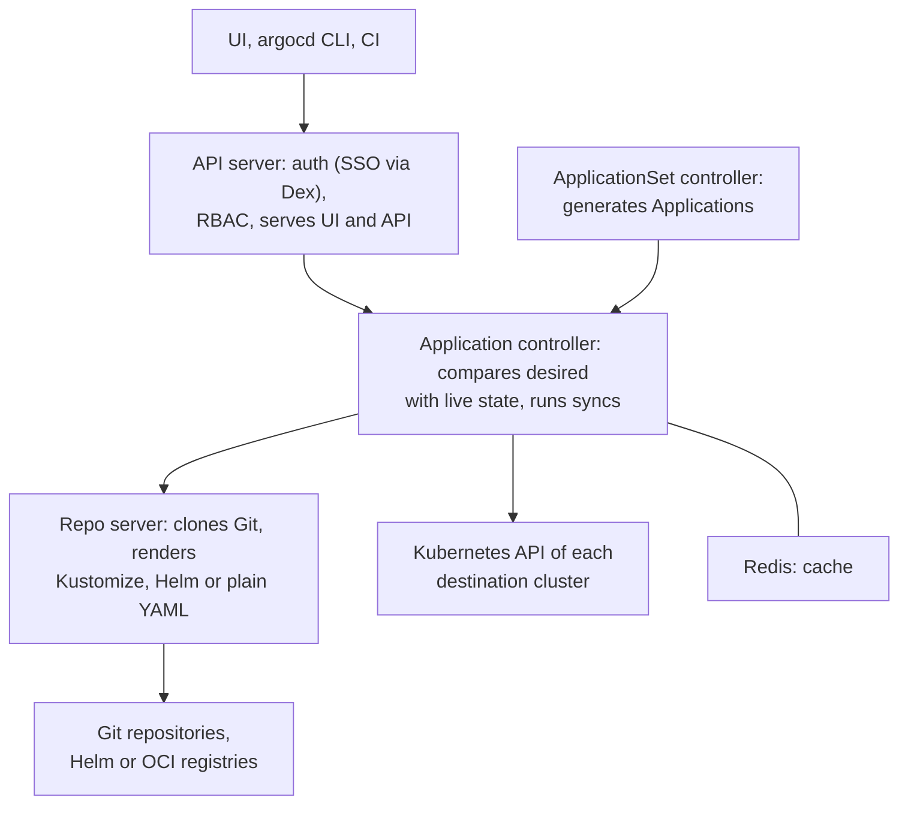
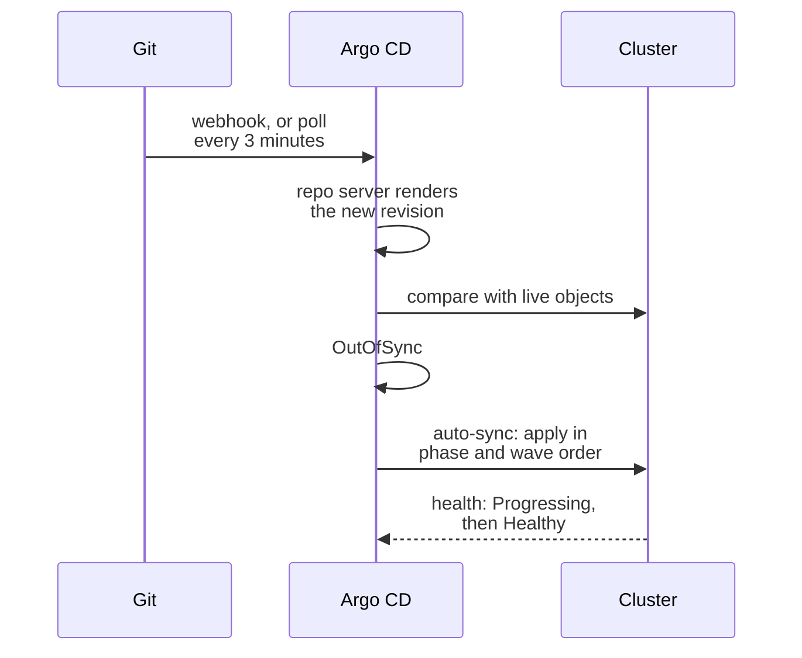

# Argo CD architecture and Applications

> **Status: AI draft, 2026-11-16.** Not yet verified by me. Written from the Argo CD documentation; Argo CD was not installed for these notes, so the commands have no sample output.

## In one line

Argo CD's repo server renders manifests from Git, its application controller compares them with the cluster and syncs differences, and its API server serves the UI and CLI. Each Application maps a Git path to a cluster namespace within an AppProject, and reports sync status and health separately.

## The plain idea

Argo CD is the in-cluster agent from [GitOps principles](principles.md). You tell it, with an **Application** object, "this path in this Git repository should be running in this namespace of this cluster". From then on it keeps comparing the two, shows you any difference, and (if you allow it) applies Git's version.

## How it works

### Components



| Component | Job |
|---|---|
| **API server** | gRPC and REST API behind the UI and CLI; authentication, RBAC, webhooks from Git providers |
| **Repo server** | Keeps a local cache of repositories and generates manifests for a given revision, path and tool settings |
| **Application controller** | A Kubernetes controller that watches Applications, compares desired and live state, syncs, and runs hooks |
| **ApplicationSet controller** | Generates Applications from templates ([App-of-apps and ApplicationSets](app-of-apps-and-applicationsets.md)) |
| **Redis** | Cache for rendered manifests and cluster state |
| **Dex** | Optional SSO connector (OIDC, SAML, GitHub, and others) |

By default Argo CD polls Git every 3 minutes (120 seconds plus up to 60 seconds of jitter); a webhook from the Git provider makes it react at once.

### The Application

```yaml
apiVersion: argoproj.io/v1alpha1
kind: Application
metadata:
  name: sample-app-prod
  namespace: argocd
  finalizers:
    - resources-finalizer.argocd.argoproj.io
spec:
  project: team-a
  source:
    repoURL: https://git.example.com/platform/config-repo.git
    targetRevision: main
    path: apps/sample-app/overlays/prod
  destination:
    server: https://kubernetes.default.svc
    namespace: team-a
  syncPolicy:
    automated:
      prune: true
      selfHeal: true
    syncOptions:
      - CreateNamespace=true
```

| Field | Meaning |
|---|---|
| `source` | Repository, revision (branch, tag or commit) and path; Helm or Kustomize settings when needed. `sources` allows several, such as a chart plus a values repository |
| `destination` | The cluster (by API URL or registered name) and namespace |
| `project` | The AppProject that limits what this Application may do |
| `syncPolicy` | Manual by default; `automated` with `prune` and `selfHeal` options ([Sync, hooks and waves](sync-hooks-waves.md)) |
| `finalizers` | Whether deleting the Application also deletes its resources ([Deletion, finalizers and safe cleanup](deletion-and-finalizers.md)) |

### Sync status vs health status

| Sync status | Meaning |
|---|---|
| `Synced` | Live resources match what Git renders |
| `OutOfSync` | Something differs: a new commit, or a change made in the cluster |
| `Unknown` | Argo CD could not compare (often a rendering or repository error) |

| Health status | Meaning |
|---|---|
| `Healthy` | Resources work as expected (Deployment fully rolled out, Service has endpoints) |
| `Progressing` | Not healthy yet but may become so (a rollout in progress) |
| `Degraded` | Failed: pods crash-looping, a Job failed |
| `Suspended` | Paused, such as a suspended CronJob or a paused rollout |
| `Missing` | Defined in Git but not present in the cluster |

The two are independent: an app can be `Synced` and `Degraded` (Git's version is applied and is broken) or `OutOfSync` and `Healthy` (someone scaled it by hand, and it works). Health is computed from built-in checks per kind, extendable with custom Lua health checks for CRDs.

### AppProjects as boundaries

An AppProject is the tenancy and safety boundary:

- `sourceRepos`: which repositories its Applications may use.
- `destinations`: which clusters and namespaces they may deploy to.
- Allowed or denied resource kinds, for example no cluster-scoped resources for application teams.
- `roles`: project-level RBAC for the UI and CLI, mapped to SSO groups.

The built-in `default` project allows everything; real teams get their own projects.

### From commit to cluster



## A concrete example

A platform team runs one Argo CD in a management cluster for three workload clusters:

1. Workload clusters are registered as destinations; Argo CD reaches each API server with credentials scoped to what it deploys.
2. Each team has an AppProject limiting it to its repository and its namespaces, and no cluster-scoped resources.
3. SSO through the company identity provider; project roles map groups to read-only or sync rights.
4. A Git webhook makes syncs start within seconds of a merge.

## Why not just...?

- **...give every team cluster-admin in Argo CD's `default` project?** Any team's Application could deploy anything anywhere, including over other teams' resources. AppProjects are the boundary.
- **...look only at the sync status?** `Synced` means "matches Git", not "works". Alert on health too.
- **...run one Argo CD per cluster?** That works and limits blast radius, but multiplies upgrades and dashboards. A central instance is easier to run but becomes a high-value target; choose deliberately.

## Commands to know

These were not run for this page.

| Command | What it does |
|---|---|
| `argocd login <server> --sso` | Log in to the API server. |
| `argocd app list` | Applications with sync and health status. |
| `argocd app get sample-app-prod` | Details, resources, conditions and last sync result. |
| `argocd app diff sample-app-prod` | Live vs desired differences. |
| `argocd app sync sample-app-prod` | Sync now. |
| `argocd proj get team-a` | A project's allowed sources, destinations and kinds. |
| `kubectl get applications -n argocd` | Applications as Kubernetes objects. |
| `kubectl logs -n argocd deploy/argocd-repo-server` | Rendering errors (Helm, Kustomize). |

## How it breaks

| Symptom | Layer | Check | Likely cause |
|---|---|---|---|
| Sync status `Unknown`, `ComparisonError` | Repo server | Application conditions, repo server logs | Rendering failed (Helm or Kustomize error), repository unreachable, bad credentials |
| Merge done, Argo CD shows the old revision | Polling | Webhook settings | No webhook; wait up to about 3 minutes, or refresh |
| `application destination ... is not permitted in project` | AppProject | Project destinations | Namespace or cluster not allowed for that project |
| `Synced` but `Degraded` | Workload | Resource tree, pod events | The deployed version itself is broken ([Troubleshooting playbook](../kubernetes/troubleshooting.md)) |
| Stuck `Progressing` | Health | Which resource | Rollout waiting, or a CRD without a health check |

## Interview questions

**1. Describe Argo CD's main components.**

<details markdown="1">
<summary>Answer</summary>

- API server: UI, CLI and API, auth and RBAC.
- Repo server: clones repositories and renders manifests with Helm, Kustomize or plain YAML.
- Application controller: compares desired and live state, syncs and runs hooks; plus the ApplicationSet controller, Redis and optional Dex.

</details>

**2. What does an Application define?**

<details markdown="1">
<summary>Answer</summary>

- Source: repository, revision and path (and Helm or Kustomize options).
- Destination: cluster and namespace.
- Project, sync policy, and optionally a finalizer for cascading deletion.

</details>

**3. What is the difference between sync status and health status?**

<details markdown="1">
<summary>Answer</summary>

- Sync: does the live state match what Git renders?
- Health: are the resources working (rolled out, ready)?
- They are independent; you need both to know a deploy succeeded.

</details>

**4. What is an AppProject for?**

<details markdown="1">
<summary>Answer</summary>

- A boundary for a team: allowed source repositories, destinations, and resource kinds.
- Project roles for RBAC, mapped to SSO groups.
- Prevents one team's Application deploying into another's namespace or creating cluster-wide objects.

</details>

**5. How does a commit reach the cluster, and how fast?**

<details markdown="1">
<summary>Answer</summary>

- Argo CD learns of the commit by webhook (seconds) or by polling (about every 3 minutes by default).
- The repo server renders the new revision; the controller finds it OutOfSync.
- With auto-sync it applies in phase and wave order; health then moves from Progressing to Healthy.

</details>

**6. An Application shows `Unknown` sync status with a comparison error. What do you check?**

<details markdown="1">
<summary>Answer</summary>

- The Application's conditions for the error text.
- Repo server logs: Helm or Kustomize rendering errors, missing values, bad chart versions.
- Repository access: credentials, network, the path and revision exist.

</details>

## Try it

Without installing Argo CD:

1. Write an Application for `apps/sample-app/overlays/staging` with manual sync, and an AppProject that only allows the config repository and the `team-a-staging` namespace.
2. For each of the four combinations of Synced/OutOfSync and Healthy/Degraded, write one real-world cause.
3. Draw the component diagram from memory and mark which component needs Git credentials and which needs cluster credentials.

## Zoom out

Argo CD is a Kubernetes controller like any other: custom resources, a reconcile loop, status conditions ([CRDs, operators and admission webhooks](../kubernetes/crds-and-operators.md)). The next pages cover how it orders a sync, how it manages many applications, and how deletion and rollback work.

## Sources

- [Argo CD documentation: architectural overview](https://argo-cd.readthedocs.io/en/stable/operator-manual/architecture/)
- [Argo CD documentation: core concepts](https://argo-cd.readthedocs.io/en/stable/core_concepts/)
- [Argo CD documentation: resource health](https://argo-cd.readthedocs.io/en/stable/operator-manual/health/)
- [Argo CD documentation: projects](https://argo-cd.readthedocs.io/en/stable/user-guide/projects/)
- [Argo CD documentation: FAQ (polling interval)](https://argo-cd.readthedocs.io/en/stable/faq/)
