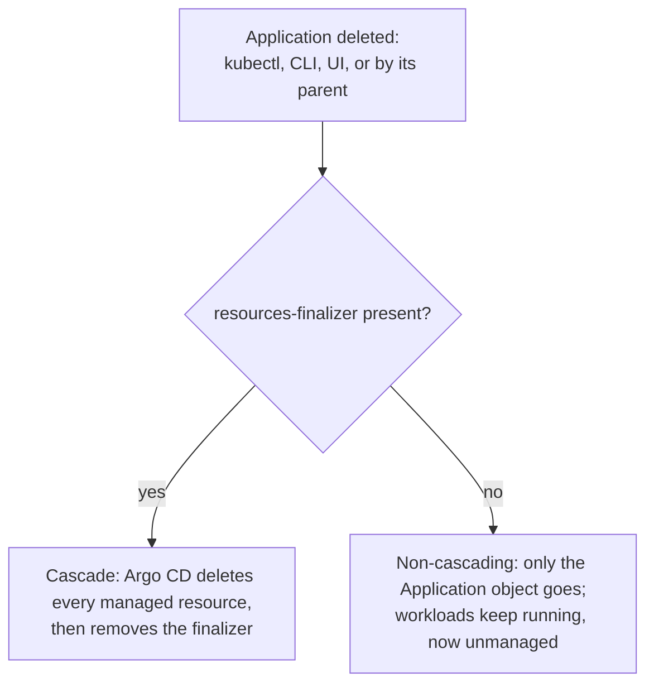

# Deletion, finalizers and safe cleanup

> **Status: AI draft, 2026-11-16.** Not yet verified by me. Written from the Argo CD documentation, building on the Kubernetes finalizer behaviour shown with real output on [Finalizers and deletion](../kubernetes/finalizers-and-deletion.md); nothing Argo CD-specific was run.

## In one line

Deleting an Argo CD Application deletes its workloads only if the Application carries the `resources-finalizer.argocd.argoproj.io` finalizer (cascading, foreground by default, or `/background`); without it, the resources are left running (non-cascading). Per-resource `Delete=false` and `Prune=false` (or `Prune=confirm`) protect critical objects, and ApplicationSet and app-of-apps settings stop one change from deleting many applications at once.

## The plain idea

An Application is a pointer: "this Git path should be in this namespace". Deleting the pointer raises a question: should the things it pointed at be deleted too? Sometimes yes (retiring a service), often no (moving the app to another Application, rebuilding Argo CD). Argo CD answers with a Kubernetes **finalizer** on the Application ([Finalizers and deletion](../kubernetes/finalizers-and-deletion.md)).

Because Applications can themselves be generated or synced by other Applications, one deletion can cascade through many levels: a root app, its children, every Deployment, every PVC.

## How it works

### With and without the finalizer

| Finalizer on the Application | Behaviour |
|---|---|
| `resources-finalizer.argocd.argoproj.io` | Cascading delete, foreground (the default) |
| `resources-finalizer.argocd.argoproj.io/background` | Cascading delete, background |
| None | Non-cascading: resources orphaned |

- `argocd app delete <app>` cascades by default; `argocd app delete <app> --cascade=false` does not.
- `kubectl delete application <app>` follows whatever the finalizer says, so check it first.
- If the controller cannot finish deleting resources (a stuck resource with its own finalizer, a destination cluster gone), the Application stays in deletion; the cause is in its conditions and in the stuck resources ([Finalizers and deletion](../kubernetes/finalizers-and-deletion.md)).

### Per-resource protection

| Annotation `argocd.argoproj.io/sync-options` | Effect |
|---|---|
| `Delete=false` | Keep this resource when the Application is deleted (for example PVCs, a namespace) |
| `Prune=false` | Never prune it during sync, even when removed from Git |
| `Prune=confirm` | Pruning waits for a manual confirmation (useful for namespaces) |

Both `Delete=false` and `Prune=false` can also be set application-wide in `syncOptions`.

### Many applications at once

- **App-of-apps**: if the root Application has the resources finalizer and is deleted (or its child manifests are removed from Git with prune on), every child Application is deleted, and each child's finalizer then deletes its workloads.
- **ApplicationSets**: when an ApplicationSet is deleted, or its generator stops producing an entry, the generated Applications are deleted. `preserveResourcesOnDeletion: true` keeps their workloads; `applicationsSync: create-only` or `create-update` stops the controller deleting Applications in the first place ([App-of-apps and ApplicationSets](app-of-apps-and-applicationsets.md)).

### Guardrails

1. Decide per Application whether cascade is wanted; production databases and stateful apps often should not cascade.
2. `Delete=false` on PVCs and anything holding data; backups regardless ([Backup and DR](../operations/backup-and-dr.md)).
3. ApplicationSets with deletion disabled and preserved resources.
4. RBAC: few people may delete Applications in production projects ([Argo CD architecture and Applications](argocd-architecture.md)).
5. Treat deletions in Git (removing a child Application file, a generator path) as high-risk changes in review.

## A concrete example

A team wants to move `sample-app` from a hand-written Application into an ApplicationSet without downtime:

1. Check the old Application's finalizers. It has `resources-finalizer.argocd.argoproj.io`.
2. Remove the finalizer (`kubectl patch app sample-app-prod --type json -p '[{"op":"remove","path":"/metadata/finalizers"}]'`), then delete the Application: the Deployment, Service and PVC keep running, unmanaged.
3. Add the app's folder to the ApplicationSet's path; it generates `sample-app-prod`, which adopts the running resources (same names and namespace) and shows Synced.
4. Had step 2 been skipped, deleting the old Application would have deleted the running service first.

## Why not just...?

- **...always set the resources finalizer, so nothing is left behind?** Then every mistaken deletion of an Application, by a person or a generator, is also an outage. Use cascade where cleanup matters, and protect data either way.
- **...never set it, to be safe?** Retired services then keep running forever, unmanaged and unpatched. Be deliberate, and audit for orphans.
- **...rely on Git history to restore deleted workloads?** Git restores manifests, not the data in deleted PVCs or databases. Protect data separately.

## Commands to know

These were not run for this page, except that the same Kubernetes patch pattern was run on a ConfigMap on [Finalizers and deletion](../kubernetes/finalizers-and-deletion.md).

| Command | What it does |
|---|---|
| `kubectl get application sample-app-prod -n argocd -o jsonpath='{.metadata.finalizers}'` | Will a delete cascade? |
| `argocd app delete sample-app-prod --cascade=false` | Delete only the Application. |
| `argocd app delete sample-app-prod` | Delete the Application and its resources. |
| `kubectl patch app sample-app-prod -n argocd --type merge -p '{"metadata":{"finalizers":["resources-finalizer.argocd.argoproj.io"]}}'` | Make a later delete cascade. |
| `kubectl get applicationset <name> -n argocd -o jsonpath='{.spec.syncPolicy}'` | Check deletion policies. |

## How it breaks

| Symptom | Layer | Check | Likely cause |
|---|---|---|---|
| Deleting an Application took down the service | Finalizer | Application finalizers | Resources finalizer present; cascade was not intended |
| Application stuck deleting | Finalizer | Application conditions, stuck resources | A managed resource has its own finalizer, or the destination cluster is unreachable |
| Workloads still running after their Application was deleted | Finalizer | Missing finalizer | Non-cascading delete; clean up or adopt them |
| Many services deleted after a repository change | ApplicationSet | Generator, sync policy | Generator stopped matching and deletion was allowed |
| PVC deleted with the app | Data protection | Annotations | No `Delete=false` on the claim |

## Interview questions

**1. What happens when you delete an Argo CD Application?**

Answer

- With the resources finalizer: Argo CD deletes all managed resources (foreground by default), then the Application.
- Without it: only the Application object is removed; workloads keep running unmanaged.
- `argocd app delete --cascade=false` forces the second behaviour.

**2. How do you protect a PVC from being deleted with its Application?**

Answer

- Annotate it `argocd.argoproj.io/sync-options: Delete=false`.
- Add `Prune=false` if it should also survive removal from Git.
- Keep backups or snapshots regardless.

**3. How do you move resources from one Application to another without downtime?**

Answer

- Remove the resources finalizer from the old Application, then delete it (non-cascading).
- Create the new Application pointing at the same manifests; it adopts the existing objects.
- Check sync status before re-enabling any cascading behaviour.

**4. How can a single change delete many applications in an app-of-apps or ApplicationSet setup?**

Answer

- Deleting a root with a cascade, or pruning child Application manifests, deletes every child and, through their finalizers, their workloads.
- An ApplicationSet generator that stops matching deletes generated Applications.
- Guardrails: deletion policies, preserved resources, `Delete=false` on data, reviews and RBAC.

**5. An Application has been "deleting" for an hour. What do you check?**

Answer

- The Application's conditions and which resources remain.
- Finalizers on those resources (PVC protection, operators, load balancer cleanup).
- Whether the destination cluster is reachable; remove finalizers only after handling what they protect.

**6. What does `Prune=confirm` do?**

Answer

- Pruning that resource waits for a manual confirmation instead of happening automatically.
- Suitable for critical objects such as namespaces.
- Complements `Prune=false` for objects that should eventually be removed, but carefully.

## Try it

On a kind cluster, without Argo CD, rehearse the Kubernetes half:

1. Repeat the finalizer exercise on [Finalizers and deletion](../kubernetes/finalizers-and-deletion.md) with the finalizer name `resources-finalizer.argocd.argoproj.io` on a ConfigMap, and note that nothing removes it because no controller owns it.
2. Write the annotations you would put on a production database's StatefulSet and its PVCs.
3. List three Git changes in a config repository that would delete workloads, and the reviewer question for each.

## Zoom out

Argo CD deletion is Kubernetes finalizers and owner references applied to whole applications ([Finalizers and deletion](../kubernetes/finalizers-and-deletion.md)). The general lesson matches the bulk-delete rule elsewhere in these notes: know exactly what a delete will cascade to before you run it ([Labels, selectors and namespaces](../kubernetes/labels-selectors-namespaces.md)).

## Sources

- [Argo CD documentation: app deletion](https://argo-cd.readthedocs.io/en/stable/user-guide/app_deletion/)
- [Argo CD documentation: sync options (Prune, Delete)](https://argo-cd.readthedocs.io/en/stable/user-guide/sync-options/)
- [Argo CD documentation: controlling ApplicationSet resource modification](https://argo-cd.readthedocs.io/en/stable/operator-manual/applicationset/Controlling-Resource-Modification/)
- [Kubernetes documentation: finalizers](https://kubernetes.io/docs/concepts/overview/working-with-objects/finalizers/)
