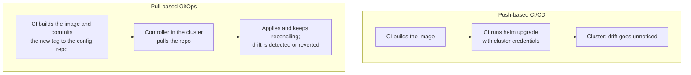

# GitOps principles

> **Status: AI draft, 2026-11-16.** Not yet verified by me. Written from the OpenGitOps principles and the Argo CD documentation; nothing was run.

## In one line

GitOps keeps the desired state of a system declaratively in Git, and an agent inside the environment pulls it and continuously reconciles reality to match; a deploy is a commit, a rollback is a revert, history is the audit log, and the pipeline no longer needs credentials to the cluster.

## The plain idea

In a classic pipeline, the last step **pushes**: CI runs `kubectl apply` or `helm upgrade` against the cluster, so CI holds cluster credentials, and nothing notices if someone changes the cluster by hand afterwards.

GitOps turns it around. A controller running **in** the cluster watches a Git repository and applies what it finds, again and again. Git becomes the one place where the desired state lives. Changing production means changing Git, through the same review as code. If someone edits the cluster directly, the controller sees the difference and (if allowed) puts it back.

## How it works

### The four principles (OpenGitOps)

| Principle | Meaning |
|---|---|
| **Declarative** | The desired state is expressed as data (manifests, charts, overlays), not as steps |
| **Versioned and immutable** | It is stored with full history and immutable versions: a Git repository |
| **Pulled automatically** | Agents fetch the desired state themselves |
| **Continuously reconciled** | Agents keep comparing actual with desired state and act on differences |

This is the Kubernetes reconcile loop ([Architecture and the reconcile loop](../kubernetes/architecture.md)) applied one level up: the desired state lives in Git instead of only in the API server.

### Push vs pull



| | Push | Pull (GitOps) |
|---|---|---|
| Who changes the cluster | The CI system | A controller inside the cluster |
| Cluster credentials in CI | Yes | No; CI only writes to Git |
| Drift after deploy | Unnoticed | Detected, optionally reverted |
| Audit trail | CI logs | Git history and reviews |
| Rollback | Re-run an old pipeline | Revert a commit |

### Repository layouts

- **Application repository vs config repository**: Argo CD's own best practices recommend keeping manifests in a separate repository from application source code. Config changes (a replica count) do not trigger application builds; access to production config can be limited; history shows deploys cleanly.
- **A folder per environment**, with Kustomize overlays or Helm values per environment ([Kustomize, and Helm vs Kustomize](../helm/kustomize-vs-helm.md)):

```text
config-repo/
├── apps/sample-app/
│   ├── base/
│   └── overlays/
│       ├── dev/        image tag 1.5.0-rc1
│       ├── staging/    image tag 1.4.2
│       └── prod/       image tag 1.4.2
└── platform/           ingress controller, cert-manager, monitoring
```

Branches per environment are possible but make promotions hard to review (merges between long-lived branches drift); folders are the common recommendation ([Branching and release strategies](../git/branching-strategies.md)).

### What GitOps does not solve

- **Secrets**: they must not sit in Git in plain text. Store references (External Secrets) or encrypted values (Sealed Secrets, SOPS) ([Secrets from AWS into pods](../eks/secrets.md)).
- **Ordering**: "migrate the database, then deploy" needs sync waves and hooks ([Sync, hooks and waves](sync-hooks-waves.md)).
- **Database and data changes**: a revert restores manifests, not data ([Deployment strategies](../cicd/deployment-strategies.md)).
- **Building and testing**: CI still builds, tests and scans; GitOps starts where CI ends.
- **Infrastructure outside the cluster**: Terraform still owns VPCs and databases, unless you use controllers that manage cloud resources from Kubernetes.

## A concrete example

`sample-app` moves from push to pull:

1. CI builds and pushes image `1.4.2`, then opens a pull request on the config repository changing `overlays/staging` to `1.4.2`.
2. Merging it is the staging deploy; Argo CD in the cluster syncs it.
3. Promotion to production is a second pull request changing `overlays/prod`, approved by the service owners ([Promotion and rollback](promotion-and-rollback.md)).
4. CI's AWS role loses its cluster access entry; only Argo CD can change the cluster.
5. An engineer's manual `kubectl scale` during an incident shows up as OutOfSync, and is reverted by self-heal unless the change is committed.

## Why not just...?

- **...keep `helm upgrade` in CI, since it works?** It needs cluster-admin-like credentials in CI, and the cluster can drift from what any repository says. GitOps removes both problems.
- **...store manifests in the application repository?** It works for small teams, but every config change looks like a code change, triggers builds, and mixes deploy history with code history. Separate repositories scale better.
- **...let GitOps manage everything, including databases?** Stateful changes need ordering, backups and sometimes manual steps. Manage the database's manifests with GitOps, but plan data changes separately.

## Commands to know

| Command | What it does |
|---|---|
| `git log --oneline -- apps/sample-app/overlays/prod` | Deploy history for production. |
| `git revert <commit>` | A rollback, as a reviewed change. |
| `argocd app diff sample-app-prod` | Difference between Git and the cluster. |
| `argocd app get sample-app-prod` | Sync and health status ([Argo CD architecture and Applications](argocd-architecture.md)). |
| `kubectl diff -k apps/sample-app/overlays/prod` | The same comparison with plain kubectl. |

## How it breaks

| Symptom | Layer | Check | Likely cause |
|---|---|---|---|
| Manual hotfix disappears minutes later | Reconciliation | Self-heal setting | Self-heal reverted a change not in Git; commit the fix |
| Change merged, nothing deployed | Sync | Application status, repository access | Auto-sync off, wrong path or branch, controller cannot read the repository |
| Secret visible in Git history | Secrets | Repository contents | Plain Secret committed; rotate it and use references or encryption |
| Environments drift apart | Layout | Diff between overlays | Changes applied to one environment's folder only |
| Database migration ran after the new pods started | Ordering | Hooks and waves | No PreSync hook or wave ordering |

## Interview questions

**1. What is GitOps?**

<details markdown="1">
<summary>Answer</summary>

- Desired state declared in Git, versioned and immutable.
- An agent in the environment pulls it and continuously reconciles reality to it.
- Deploys are commits; rollbacks are reverts; Git history is the audit log.

</details>

**2. Compare push-based CI/CD with pull-based GitOps.**

<details markdown="1">
<summary>Answer</summary>

- Push: CI applies changes with cluster credentials; drift goes unnoticed.
- Pull: an in-cluster controller applies from Git; CI only writes to Git.
- Pull removes cluster credentials from CI and detects drift.

</details>

**3. Why separate the config repository from the application repository?**

<details markdown="1">
<summary>Answer</summary>

- Config changes do not trigger builds, and deploy history stays clean.
- Different access rules: more people write code than change production config.
- Argo CD's own best practices recommend it.

</details>

**4. What does GitOps not solve by itself?**

<details markdown="1">
<summary>Answer</summary>

- Secrets (need references or encryption), ordering (hooks, waves), data migrations.
- Building and testing (still CI's job).
- Infrastructure outside the cluster (Terraform or cloud controllers).

</details>

**5. An engineer scaled a Deployment by hand during an incident; ten minutes later it went back. Why, and what should they have done?**

<details markdown="1">
<summary>Answer</summary>

- Auto-sync with self-heal reverted the change, because Git still said otherwise.
- Commit the change to Git (fast path for emergencies), or pause auto-sync for that app explicitly and record it.
- Afterwards, make sure Git reflects the intended state.

</details>

**6. How would you structure a config repository for three environments?**

<details markdown="1">
<summary>Answer</summary>

- A base plus one overlay or values file per environment, in folders on one main branch.
- Promotion is a pull request changing the next environment's folder.
- Platform components in their own folders or repository, with separate ownership.

</details>

## Try it

1. Draw the push and pull diagrams from memory, and mark where credentials live in each.
2. Using the Kustomize example ([Kustomize, and Helm vs Kustomize](../helm/kustomize-vs-helm.md)), write the one-line change that promotes `1.4.2` from staging to prod.
3. For a service you know, list everything that would still happen outside Git if you moved it to GitOps.

## Zoom out

GitOps is CI/CD where the last step is a Git commit and a controller does the deploy ([CI/CD concepts](../cicd/concepts.md)). Argo CD is the most common controller on EKS; the following pages cover how it works, how sync is ordered, how to manage many applications, how deletion works, and how to promote and roll back ([Argo CD architecture and Applications](argocd-architecture.md)).

## Sources

- [OpenGitOps: principles](https://opengitops.dev/)
- [Argo CD documentation: core concepts](https://argo-cd.readthedocs.io/en/stable/core_concepts/)
- [Argo CD documentation: best practices (separate config repositories)](https://argo-cd.readthedocs.io/en/stable/user-guide/best_practices/)
- [Argo CD documentation: automated sync policy](https://argo-cd.readthedocs.io/en/stable/user-guide/auto_sync/)
