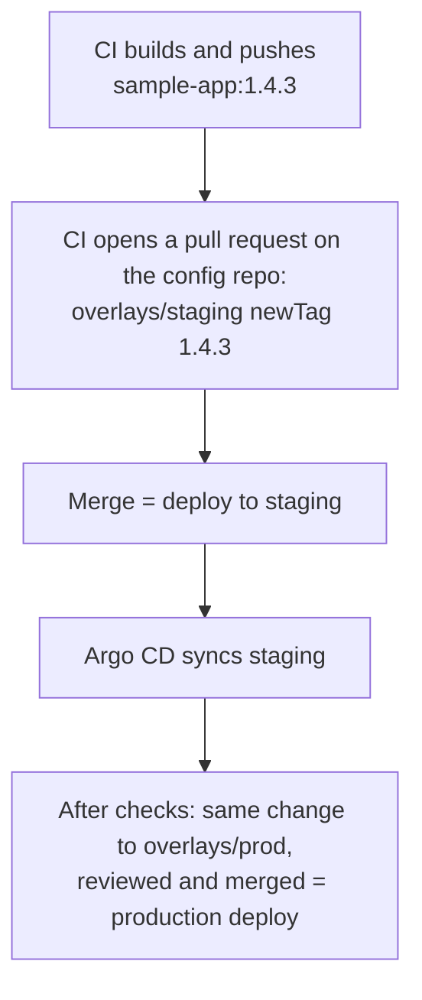

# Promotion, rollback and troubleshooting

> **Status: AI draft, 2026-11-16.** Not yet verified by me. Written from the Argo CD documentation; nothing was run.

## In one line

In GitOps a deploy is a commit changing a version in the config repository, promotion is the same change in the next environment's folder, and rollback is `git revert`. `argocd app rollback` is refused while auto-sync is on, because Git would win again.

## The plain idea

Everything in GitOps flows through Git ([GitOps principles](principles.md)). So the release questions get Git answers:

- **Deploy** a new version: change the version in Git.
- **Promote** it to production: make the same change in production's folder.
- **Roll back**: undo the change in Git.

The cluster follows. Doing anything directly in the cluster (a `kubectl set image`, an Argo CD rollback) is fighting the system unless you pause it first.

## How it works

### Bumping the image

Ways to make the change:

- **CI writes the commit** (with `kustomize edit set image`, `yq`, or a values file update) and opens a pull request, or commits directly for lower environments.
- **An image updater** (such as Argo CD Image Updater) watches the registry and writes the new tag back to Git under policy rules (semver ranges, digests).
- **By hand** for production, as a reviewed pull request.

Pin by immutable tag or digest so "what is in Git" is exactly "what runs" ([Artifacts and registries](../cicd/artifacts-and-registries.md)).

### Promotion between environments

| Approach | How | Trade-off |
|---|---|---|
| Folder per environment | Copy the version from `staging` to `prod` in one pull request | Clear diffs; easy to automate |
| Branch per environment | Merge `staging` into `prod` | Merges drag unrelated changes; diffs are hard to read |
| Separate repository per environment | Pull request to the prod repository | Strong access separation; more moving parts |

Promote **only versions**, not whole folders: environments legitimately differ (replicas, hostnames, sizes).

### Rollback

| Method | What happens | When |
|---|---|---|
| `git revert <commit>` in the config repo | Git returns to the previous version; auto-sync applies it | The normal way |
| `argocd app rollback <app> [history-id]` | Argo CD re-applies a previous sync from its history | Only with auto-sync off; Argo CD refuses a rollback while automated sync is enabled. Git still shows the newer version, so the app stays OutOfSync until Git matches |
| Disable auto-sync, then roll back in Argo CD | Fast, during an incident | Follow up with a Git revert, then re-enable auto-sync |

Rollbacks revert manifests, not data: database migrations and messages stay ([Deployment strategies](../cicd/deployment-strategies.md)).

### Triage checklist

**OutOfSync** (Git and cluster differ):

1. `argocd app diff`: which resources and fields?
2. Is it a new commit not yet synced (auto-sync off, sync failed), or a change in the cluster (manual edit, another controller)?
3. Fields owned by other controllers (HPA replicas, injected sidecars, webhook CA bundles): add `ignoreDifferences` ([Sync, hooks and waves](sync-hooks-waves.md)).
4. Last sync result: did it fail on a hook, a validation error, an AppProject rule?

**Degraded** (resources broken):

1. Open the resource tree: which resource is Degraded?
2. Then the normal Kubernetes path: pod events, logs, previous logs ([Troubleshooting playbook](../kubernetes/troubleshooting.md)).
3. Was it the last commit? Compare with `argocd app history` and the Git log; revert if so.

**A live change being reverted**: someone edited the cluster and self-heal put Git's version back. Either commit the change, or pause auto-sync explicitly for the incident and record it.

## A concrete example

Version `1.4.3` of `sample-app` reaches production and errors rise:

1. Health shows the Deployment `Degraded`: new pods crash-loop on a missing configuration key.
2. The on-call engineer opens a pull request reverting the production tag commit; it is approved and merged within minutes.
3. Auto-sync applies `1.4.2`; health returns to Healthy.
4. The fix (adding the key) goes through staging first; `1.4.3` is promoted again afterwards.
5. No one ran `kubectl` against production, and the incident timeline is in Git history.

## Why not just...?

- **...`kubectl set image` to roll back faster?** Self-heal reverts it, or without self-heal the cluster silently disagrees with Git. Revert in Git; the pipeline is the fast path.
- **...use `argocd app rollback` as the normal rollback?** It does not work with auto-sync on, and it leaves Git saying something else. Use it only as a break-glass step, followed by a Git revert.
- **...promote by merging branches?** Branch merges drag along unrelated changes and make it hard to see what changed in production. Promote versions between folders.

## Commands to know

These were not run for this page.

| Command | What it does |
|---|---|
| `kustomize edit set image registry.example.com/sample-app:1.4.3` | Bump an image tag in an overlay (standalone Kustomize). |
| `git revert <commit> && git push` | The GitOps rollback. |
| `argocd app history sample-app-prod` | Previous syncs with their revisions. |
| `argocd app rollback sample-app-prod <history-id>` | Break-glass rollback (auto-sync must be off). |
| `argocd app set sample-app-prod --sync-policy none` | Turn off auto-sync for an incident. |
| `argocd app diff sample-app-prod` | What differs between Git and cluster. |
| `argocd app get sample-app-prod --show-operation` | The last or current sync operation and its result. |

## How it breaks

| Symptom | Layer | Check | Likely cause |
|---|---|---|---|
| `argocd app rollback` refused | Sync policy | Auto-sync setting | Rollback is not allowed with automated sync enabled |
| Rolled back, then the new version came back | Git | Config repo | Rollback done in Argo CD only; Git still has the new version |
| Promotion changed more than the version | Layout | The diff | Branch merges or copying whole folders |
| Image updater wrote unexpected versions | Policy | Update strategy and constraints | Too loose a tag pattern |
| OutOfSync after every sync | Ownership | Diff fields | Another controller owns a field; ignore it |

## Interview questions

**1. How do you deploy a new version with GitOps?**

Answer

- CI builds and pushes an immutable image, then changes the tag in the config repository (commit or pull request).
- Argo CD detects the change and syncs.
- The commit is the record of the deploy.

**2. How do you promote from staging to production?**

Answer

- A pull request copying the tested version into the production folder or values file.
- Reviewed and approved by the owners; merge is the deploy.
- Only the version changes; environment-specific settings stay.

**3. How do you roll back, and why not with `argocd app rollback`?**

Answer

- `git revert` the change; auto-sync applies the previous version.
- `argocd app rollback` is refused while auto-sync is on, and leaves Git disagreeing with the cluster.
- Use it only as break glass with auto-sync paused, then revert in Git.

**4. An application is OutOfSync. Walk through your triage.**

Answer

- `argocd app diff` to see which fields differ.
- New commit not yet synced, a failed sync, or a change in the cluster?
- If another controller owns the field, `ignoreDifferences`; if a manual change, commit it or let self-heal revert it.

**5. Production is Degraded right after a deploy. What do you do?**

Answer

- Find the Degraded resource in the tree and read its events and logs.
- If the last commit caused it, revert it in Git right away; investigate after recovery.
- Check data changes the new version made, which a revert will not undo.

**6. Someone changed a Deployment by hand and it keeps reverting. Explain.**

Answer

- Auto-sync with self-heal restores the Git version whenever the live state differs.
- That is intended: Git is the source of truth.
- Put the change in Git, or pause auto-sync explicitly during an incident.

## Try it

1. Using the Kustomize overlays from [Kustomize, and Helm vs Kustomize](../helm/kustomize-vs-helm.md), write the commit that promotes the staging tag to prod, then the `git revert` that rolls it back.
2. Write a short incident runbook: steps from "error rate up after deploy" to "rolled back", using only Git and read-only Argo CD commands.
3. For an app with an HPA and an injected sidecar, list the `ignoreDifferences` entries you expect to need.

## Zoom out

Promotion and rollback are where GitOps pays off: every production change is a reviewed commit, and recovery is a revert ([CI/CD concepts](../cicd/concepts.md)). The same discipline drives incident handling and change management ([Incident response](../operations/incident-response.md), [Change management](../operations/change-management.md)).

## Sources

- [Argo CD documentation: automated sync policy (rollback restriction)](https://argo-cd.readthedocs.io/en/stable/user-guide/auto_sync/)
- [Argo CD documentation: argocd app rollback](https://argo-cd.readthedocs.io/en/stable/user-guide/commands/argocd_app_rollback/)
- [Argo CD documentation: argocd app history](https://argo-cd.readthedocs.io/en/stable/user-guide/commands/argocd_app_history/)
- [Argo CD documentation: argocd app diff](https://argo-cd.readthedocs.io/en/stable/user-guide/commands/argocd_app_diff/)
- [Argo CD documentation: diffing customization](https://argo-cd.readthedocs.io/en/stable/user-guide/diffing/)
- [Argo CD Image Updater documentation](https://argocd-image-updater.readthedocs.io/en/stable/)
