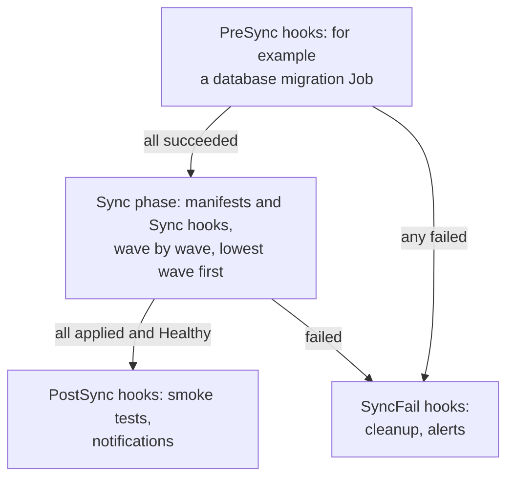

# Sync, hooks and waves

> **Status: AI draft, 2026-11-16.** Not yet verified by me. Written from the Argo CD documentation; nothing was run.

## In one line

A refresh re-reads Git and compares; a sync applies the difference. Sync manually or automatically, with `prune` to delete what Git no longer has and `selfHeal` to undo changes made in the cluster. Sync options tune how resources are applied, `ignoreDifferences` skips fields other controllers own, and hooks (PreSync, Sync, PostSync, SyncFail) plus sync waves order what happens.

## The plain idea

Argo CD knows what Git says and what the cluster has ([Argo CD architecture and Applications](argocd-architecture.md)). Two questions remain: **when** does it make the cluster match, and **in what order**? A database migration must finish before the new pods start; a CRD must exist before the objects that use it; a notification should go out after everything is healthy. Sync policies answer "when"; phases, hooks and waves answer "in what order".

## How it works

### Refresh vs sync

| Action | Does |
|---|---|
| **Refresh** | Re-reads Git and the cluster and recomputes sync status; changes nothing |
| **Hard refresh** | Same, but also discards the repo server's cached manifests (after a chart or plugin changed without a new commit) |
| **Sync** | Applies the rendered manifests to the cluster |

### Manual vs automated sync

```yaml
syncPolicy:
  automated:
    enabled: true
    prune: true
    selfHeal: true
  syncOptions:
    - CreateNamespace=true
    - ServerSideApply=true
```

| Setting | Default | Effect |
|---|---|---|
| `automated` | Off (manual) | Sync whenever Git changes |
| `prune` | `false` | Delete live resources that were removed from Git |
| `selfHeal` | `false` | Re-sync when the live state is changed in the cluster, not only when Git changes |
| `automated.enabled: false` | | Keep the other settings but pause auto-sync, for example during an incident |

Without `prune`, removing a file from Git leaves the object running and the app OutOfSync. Without `selfHeal`, a `kubectl edit` stays until the next Git change.

### Useful sync options

| Option | Use |
|---|---|
| `CreateNamespace=true` | Create the destination namespace if missing |
| `ServerSideApply=true` | Server-side apply: field ownership, large objects such as CRDs that exceed annotation limits |
| `Replace=true` | Delete and recreate instead of apply; for objects that cannot be patched (use sparingly) |
| `PruneLast=true` | Prune after everything else is applied and healthy |
| `ApplyOutOfSyncOnly=true` | Apply only changed objects, for apps with many resources |
| `RespectIgnoreDifferences=true` | Also skip ignored fields when syncing, not only when comparing |
| Per resource `argocd.argoproj.io/sync-options: Prune=false` | Never prune this object |
| Per resource `argocd.argoproj.io/sync-options: Delete=false` | Keep this object even when the Application is deleted ([Deletion, finalizers and safe cleanup](deletion-and-finalizers.md)) |

### ignoreDifferences

Some fields are owned by other controllers: an HPA sets `spec.replicas`, a webhook injects a CA bundle, a mutating admission adds defaults. Without telling Argo CD, the app is forever OutOfSync and self-heal fights the other controller.

```yaml
spec:
  ignoreDifferences:
    - group: apps
      kind: Deployment
      jsonPointers:
        - /spec/replicas
    - group: admissionregistration.k8s.io
      kind: MutatingWebhookConfiguration
      jqPathExpressions:
        - .webhooks[]?.clientConfig.caBundle
```

Better still, remove `replicas` from the manifest when an HPA owns it ([Autoscaling](../kubernetes/autoscaling.md)).

### Phases, hooks and waves



- **Hooks** are resources annotated `argocd.argoproj.io/hook: PreSync` (or `Sync`, `PostSync`, `SyncFail`, `Skip`, plus `PreDelete` and `PostDelete` around deletion). They are usually Jobs.
- **Hook delete policy** `argocd.argoproj.io/hook-delete-policy`: `HookSucceeded`, `HookFailed` or `BeforeHookCreation`.
- **Waves**: `argocd.argoproj.io/sync-wave: "-1"`. Everything is in wave 0 by default; lower waves are applied first, and Argo CD waits for a wave to be healthy before starting the next. Within a phase and wave, order is by kind (namespaces and CRDs before the objects that need them), then name.

```yaml
apiVersion: batch/v1
kind: Job
metadata:
  name: sample-app-migrate
  annotations:
    argocd.argoproj.io/hook: PreSync
    argocd.argoproj.io/hook-delete-policy: BeforeHookCreation
spec:
  backoffLimit: 1
  template:
    spec:
      restartPolicy: Never
      containers:
        - name: migrate
          image: registry.example.com/sample-app:1.4.2
          command: ["./migrate", "up"]
```

### Helm hooks under Argo CD

Argo CD renders Helm charts with `helm template`, not `helm install`, so there is no Helm release. It maps Helm hook annotations to its own: `pre-install` and `pre-upgrade` become PreSync, `post-install` and `post-upgrade` become PostSync, `pre-delete` becomes PreDelete; `pre-rollback` is not supported. The mapping is annotation compatibility, not identical behaviour, so test charts with hooks under Argo CD ([Releases, hooks and debugging](../helm/releases-hooks-debugging.md)).

## A concrete example

`sample-app`'s Application, in order:

1. Wave `-1`: the ConfigMap and ExternalSecret the app needs.
2. PreSync hook: the migration Job; a failure stops the sync before the new version starts.
3. Wave `0`: Deployment and Service.
4. Wave `1`: the Ingress, so traffic is routed only once pods are healthy.
5. PostSync hook: a smoke test Job against the Service.
6. SyncFail hook: a Job that posts to the team channel.
7. `ignoreDifferences` on `/spec/replicas` because an HPA scales it.

## Why not just...?

- **...turn on `prune` and `selfHeal` everywhere on day one?** Prune deletes anything removed from Git, including by a bad merge, and self-heal reverts emergency fixes. Turn them on per app once the repository is trusted, with protections on critical objects.
- **...order things with waves alone?** Waves wait for health, but a migration should be a hook: a Job whose failure stops the sync.
- **...silence OutOfSync with broad `ignoreDifferences`?** Real drift then goes unseen. Ignore the exact fields another controller owns.

## Commands to know

These were not run for this page.

| Command | What it does |
|---|---|
| `argocd app get sample-app-prod --refresh` | Refresh and show status. |
| `argocd app get sample-app-prod --hard-refresh` | Refresh without the manifest cache. |
| `argocd app sync sample-app-prod` | Sync now. |
| `argocd app sync sample-app-prod --resource apps:Deployment:sample-app` | Sync one resource (selective sync). |
| `argocd app set sample-app-prod --self-heal` | Turn on self-heal. |
| `argocd app diff sample-app-prod` | What a sync would change. |
| `argocd app terminate-op sample-app-prod` | Stop a running sync, for example one stuck on a hook. |

## How it breaks

| Symptom | Layer | Check | Likely cause |
|---|---|---|---|
| Always OutOfSync on one field | Ownership | Diff | Another controller (HPA, webhook, admission) changes it; ignore that field |
| Sync stuck in PreSync | Hook | Hook Job pods and logs | Migration Job hanging or failing; no `backoffLimit` or deadline |
| Old hook Job blocks the next sync | Hook cleanup | Delete policy | Missing `BeforeHookCreation` |
| Removed resource still running | Prune | Sync policy | `prune` is off (the default) |
| CRD too large to apply | Apply method | Error message about annotations | Use `ServerSideApply=true` |
| Emergency change reverted | Self-heal | Sync policy | Self-heal on; commit the change or pause auto-sync |

## Interview questions

**1. What is the difference between refresh, hard refresh and sync?**

<details markdown="1">
<summary>Answer</summary>

- Refresh: recompare Git and cluster.
- Hard refresh: the same, without the cached rendered manifests.
- Sync: apply the desired state to the cluster.

</details>

**2. What do `prune` and `selfHeal` do, and what are their defaults?**

<details markdown="1">
<summary>Answer</summary>

- `prune`: delete live objects removed from Git. Off by default.
- `selfHeal`: re-sync when the cluster is changed directly. Off by default.
- Both make Git authoritative; enable them deliberately.

</details>

**3. How do you run a database migration before the new version starts?**

<details markdown="1">
<summary>Answer</summary>

- A Job with `argocd.argoproj.io/hook: PreSync` and a delete policy.
- If it fails, the sync stops before the Deployment changes.
- Make the migration backward compatible, because a revert will not undo it.

</details>

**4. What are sync waves?**

<details markdown="1">
<summary>Answer</summary>

- An annotation with an integer; lower waves are applied first, default 0, negatives allowed.
- Argo CD waits for each wave to be healthy before the next.
- Used to order config before workloads, workloads before ingress.

</details>

**5. An app is always OutOfSync on `spec.replicas`. Why, and how do you fix it?**

<details markdown="1">
<summary>Answer</summary>

- An HPA changes the replica count; Git has a fixed value.
- Remove `replicas` from the manifest, or add `ignoreDifferences` for that field (and `RespectIgnoreDifferences`).
- Otherwise self-heal fights the HPA.

</details>

**6. How do Helm hooks behave under Argo CD?**

<details markdown="1">
<summary>Answer</summary>

- Argo CD renders the chart and maps Helm hook annotations to its phases: pre-install and pre-upgrade to PreSync, post-* to PostSync.
- `pre-rollback` is not supported; there is no Helm release history.
- Test charts with hooks under Argo CD rather than assuming Helm semantics.

</details>

## Try it

1. Annotate the Kustomize example's resources ([Kustomize, and Helm vs Kustomize](../helm/kustomize-vs-helm.md)) with waves so the ConfigMap comes first and the Service last.
2. Write a PostSync smoke test Job that runs `wget -qO- http://sample-app/healthz` and is deleted when it succeeds.
3. Decide `prune` and `selfHeal` for three apps: a stateless web app, a database operator, and the monitoring stack. Justify each.

## Zoom out

Sync policies decide how strictly Git rules the cluster; hooks and waves bring the ordering that plain declarative YAML lacks. They connect to Helm hooks, Kubernetes Jobs and deployment strategies ([Releases, hooks and debugging](../helm/releases-hooks-debugging.md), [Deployment strategies](../cicd/deployment-strategies.md)).

## Sources

- [Argo CD documentation: automated sync policy](https://argo-cd.readthedocs.io/en/stable/user-guide/auto_sync/)
- [Argo CD documentation: sync options](https://argo-cd.readthedocs.io/en/stable/user-guide/sync-options/)
- [Argo CD documentation: sync phases and waves](https://argo-cd.readthedocs.io/en/stable/user-guide/sync-waves/)
- [Argo CD documentation: resource hooks](https://argo-cd.readthedocs.io/en/stable/user-guide/resource_hooks/)
- [Argo CD documentation: diffing customization](https://argo-cd.readthedocs.io/en/stable/user-guide/diffing/)
- [Argo CD documentation: Helm (hook mapping)](https://argo-cd.readthedocs.io/en/stable/user-guide/helm/)
