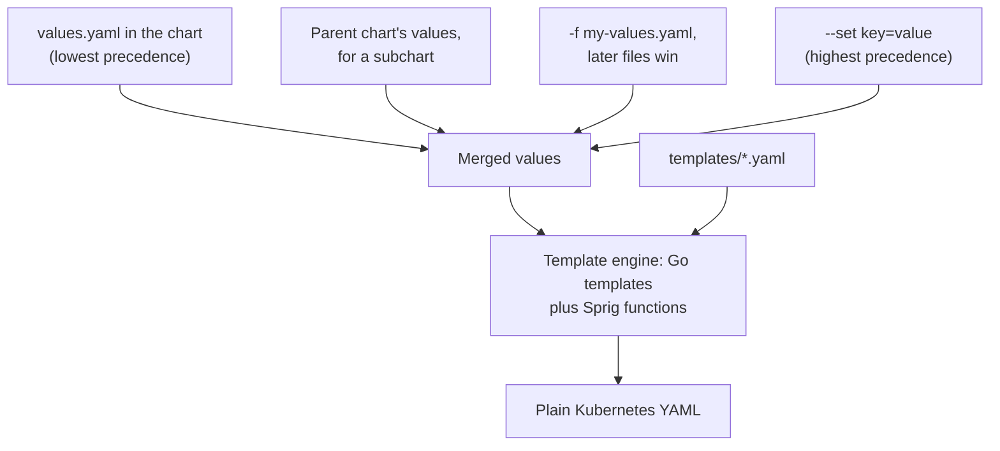

# Charts, templates and values

> **Status: AI draft, 2026-11-16.** Not yet verified by me. Written from the Helm documentation (Helm 4); the Helm commands were not run for this page, so they have no sample output. Run them on a chart from `helm create` to check.

## In one line

A Helm chart is a folder of Kubernetes manifest templates plus default values; `helm template` or `helm install` renders the Go templates with values merged from the chart's `values.yaml`, any `-f` files and any `--set` flags (later wins), producing plain YAML that Helm applies and tracks as a release.

## The plain idea

Plain YAML repeats itself. The same app in three environments needs three copies differing in a replica count, an image tag and a hostname, and copies drift. Helm treats the manifests as **templates** with holes, and fills the holes from **values**:

- the chart author writes `replicas: {{ .Values.replicaCount }}` once;
- each environment supplies its own values file;
- Helm renders, applies, and remembers what it applied as a **release**, so it can upgrade, roll back and uninstall as a unit ([Releases, hooks and debugging](releases-hooks-debugging.md)).

A chart is also a **package**: versioned, published to a repository or an OCI registry, and installable by others with their own values.

## How it works

### Chart layout

```text
sample-app/
├── Chart.yaml          name, version (the chart's), appVersion (the app's), dependencies
├── values.yaml         default values
├── charts/             dependency charts (subcharts)
├── templates/
│   ├── _helpers.tpl    named templates; files starting with _ render nothing themselves
│   ├── deployment.yaml
│   ├── service.yaml
│   ├── ingress.yaml
│   ├── NOTES.txt       printed after install
│   └── tests/          test pods run by helm test
└── .helmignore         files to leave out of the package
```

`apiVersion: v2` in `Chart.yaml` marks a chart that needs Helm 3 or later; `version` must be SemVer and changes with every chart change; `appVersion` is just a label for the application version.

### From values to YAML



### Template basics

| Construct | Meaning |
|---|---|
| `{{ .Values.image.tag }}` | A value |
| `{{ .Release.Name }}`, `{{ .Release.Namespace }}`, `{{ .Chart.Name }}`, `{{ .Chart.AppVersion }}` | Built-in objects |
| `{{ default .Chart.AppVersion .Values.tag }}` | A default when the value is empty |
| `{{ required "image.repository is required" .Values.image.repository }}` | Fail the render with a message if missing |
| `{{ quote .Values.name }}` | Wrap in quotes, so `yes` or `1.0` stay strings |
| `{{- if .Values.ingress.enabled }} ... {{- end }}` | Conditional block; `{{-` trims whitespace before |
| `{{- range $k, $v := .Values.env }} ... {{- end }}` | Loop over a list or map |
| `{{- with .Values.resources }} ... {{- end }}` | Change `.` to that value, and skip the block if it is empty |
| `{{- nindent 12 (toYaml .) }}` | Insert a value as YAML, indented 12 spaces on a new line |
| `{{ include "sample-app.labels" . }}` | Call a named template and get its output as a string, so it can be piped |

Functions are usually written with pipes, which pass the left side as the last argument: `{{ .Values.tag | default .Chart.AppVersion }}` is the same as `{{ default .Chart.AppVersion .Values.tag }}`, and `{{ toYaml . | nindent 12 }}` the same as `{{ nindent 12 (toYaml .) }}`.

A Deployment template fragment, in the style `helm create` generates:

```yaml
apiVersion: apps/v1
kind: Deployment
metadata:
  name: {{ include "sample-app.fullname" . }}
  labels:
    {{- include "sample-app.labels" . | nindent 4 }}
spec:
  {{- if not .Values.autoscaling.enabled }}
  replicas: {{ .Values.replicaCount }}
  {{- end }}
  selector:
    matchLabels:
      {{- include "sample-app.selectorLabels" . | nindent 6 }}
  template:
    metadata:
      labels:
        {{- include "sample-app.selectorLabels" . | nindent 8 }}
    spec:
      containers:
        - name: {{ .Chart.Name }}
          image: "{{ .Values.image.repository }}:{{ .Values.image.tag | default .Chart.AppVersion }}"
          {{- with .Values.resources }}
          resources:
            {{- toYaml . | nindent 12 }}
          {{- end }}
```

The `if not .Values.autoscaling.enabled` around `replicas` is the chart-side fix for the HPA fighting the manifest ([Autoscaling](../kubernetes/autoscaling.md)).

### Named templates

`_helpers.tpl` defines reusable snippets:

```yaml
{{- define "sample-app.selectorLabels" -}}
app.kubernetes.io/name: {{ include "sample-app.name" . }}
app.kubernetes.io/instance: {{ .Release.Name }}
{{- end }}
```

- Names are global across the chart and its subcharts, so prefix them with the chart name.
- Use `include` rather than `template`: `include` returns a string you can pipe into `nindent`.
- Pass the right scope (usually `.`); inside `range` or `with`, `.` has changed, and `$` still means the root.

### Values precedence, concretely

`values.yaml` says `replicaCount: 1`; `prod.yaml` says `replicaCount: 3`; the command adds `--set replicaCount=5`. The result is 5. Maps merge key by key; lists are replaced whole, so overriding one item of a list means repeating the full list.

## A concrete example

One chart for `sample-app`, three environments:

```text
values.yaml          image.repository, resources, probes: the shared defaults
values-dev.yaml      replicaCount: 1, ingress host dev.example.com
values-prod.yaml     replicaCount: 3, autoscaling.enabled: true, host www.example.com
```

```bash
helm lint ./sample-app -f values-prod.yaml
helm template sample-app ./sample-app -f values-prod.yaml --set image.tag=1.4.2 > rendered.yaml
helm upgrade --install sample-app ./sample-app -n team-a -f values-prod.yaml --set image.tag=1.4.2
```

CI renders with `helm template` and checks the YAML (policy, schema) before anything reaches a cluster ([Quality and security gates](../cicd/quality-and-security-gates.md)); a GitOps tool can render the same chart from Git instead of running `helm upgrade` ([Argo CD architecture](../gitops/argocd-architecture.md)).

## Why not just...?

- **...keep three copies of the YAML?** They drift: a probe fixed in one environment stays broken in the others. One template with per-environment values keeps the differences small and visible.
- **...template everything, every field a value?** Charts with hundreds of values are harder to read than the YAML they generate. Expose what really varies; for one-off changes, patch the output ([Kustomize, and Helm vs Kustomize](kustomize-vs-helm.md)).
- **...use `--set` for everything in CI?** Long `--set` lists are hard to review and escape (commas, dots and lists need special syntax). Put values in files under version control; use `--set` for the one thing that changes per build, such as the image tag.

## Commands to know

These were not run for this page.

| Command | What it does |
|---|---|
| `helm create sample-app` | A starter chart with the layout above. |
| `helm lint ./sample-app -f values-prod.yaml` | Checks chart structure and that templates render. |
| `helm template <release> ./sample-app -f values.yaml` | Renders locally to stdout; no cluster needed. |
| `helm template ... --show-only templates/deployment.yaml` | Renders one template. |
| `helm template ... --debug` | Shows the rendered output even when YAML parsing fails, to find the broken line. |
| `helm show values <chart>` | A published chart's default values. |
| `helm dependency update ./sample-app` | Downloads dependencies listed in `Chart.yaml` into `charts/`. |
| `helm package ./sample-app` | Builds the versioned `.tgz`. |

## How it breaks

| Symptom | Layer | Check | Likely cause |
|---|---|---|---|
| `error converting YAML to JSON` | Rendering | `helm template --debug` | Wrong indentation from `toYaml` without `nindent`, or a missing `{{-` |
| `nil pointer evaluating interface {}.tag` | Values | The values path | A parent key is missing; use `default` or check with `if` or `with` |
| A value like `yes` or `1.10` changes meaning | YAML typing | Rendered output | Not quoted; use `quote` |
| `--set` override ignored | Precedence or path | `helm get values` | Wrong key path, or a later `-f` file; lists replaced, not merged |
| Every environment got the prod setting | Values files | Order of `-f` | Later files win; the order on the command line matters |
| Template change has no effect in a subchart | Scope | Values nesting | Subchart values must sit under the subchart's name in the parent |

## Interview questions

**1. What problem does Helm solve, and what is a chart?**

<details markdown="1">
<summary>Answer</summary>

- Reusing manifests across environments and sharing applications as packages, and managing them as releases.
- A chart is a versioned folder of templates, default values and metadata.
- Helm renders templates with values into plain YAML and tracks the result.

</details>

**2. What is the order of values precedence?**

<details markdown="1">
<summary>Answer</summary>

- The chart's `values.yaml`, then a parent chart's values for a subchart, then `-f` files in order, then `--set`.
- Later sources override earlier ones.
- Maps merge; lists are replaced whole.

</details>

**3. What is the difference between `include` and `template`?**

<details markdown="1">
<summary>Answer</summary>

- Both call a named template.
- `include` returns the output as a string, so it can be piped to `nindent`, `quote` or `indent`.
- `template` writes it straight out, so it cannot be indented, which breaks YAML.

</details>

**4. How do you debug a chart that fails with a YAML parse error?**

<details markdown="1">
<summary>Answer</summary>

- `helm template --debug` to see the rendered output and the failing template.
- Look for indentation from `toYaml` without `nindent`, or whitespace trimming mistakes.
- Render a single file with `--show-only`.

</details>

**5. How would you make a value mandatory?**

<details markdown="1">
<summary>Answer</summary>

- `required "message" .Values.path` fails rendering when it is missing.
- Or a `values.schema.json` that validates types and required keys before rendering.
- Both fail early in CI instead of producing broken manifests.

</details>

**6. How do you stop a chart's replica count fighting an HPA?**

<details markdown="1">
<summary>Answer</summary>

- Render `replicas` only when autoscaling is disabled: `{{- if not .Values.autoscaling.enabled }}`.
- Otherwise every upgrade resets the count the HPA chose.
- The same applies to GitOps tools comparing the field.

</details>

## Try it

If you have Helm installed (it is not part of these notes' toolchain):

1. `helm create sample-app`, then `helm template demo ./sample-app | less`, and find where `replicaCount` appears.
2. Predict the replica count, then check: `helm template demo ./sample-app --set replicaCount=4 --show-only templates/deployment.yaml | grep replicas`.
3. Break `templates/deployment.yaml` by replacing an `nindent 12` with `indent 12`, and read the error from `helm template --debug`.

Without Helm, read the fragment above and write down the YAML it produces for `replicaCount: 2`, `autoscaling.enabled: false`, `image.tag` empty and `appVersion: "1.4.2"`.

## Zoom out

Helm is the packaging layer between your manifests and the cluster: templates and values on one side, releases on the other ([Releases, hooks and debugging](releases-hooks-debugging.md)). Kustomize solves the same multi-environment problem by patching instead of templating ([Kustomize, and Helm vs Kustomize](kustomize-vs-helm.md)), and GitOps tools can drive either ([GitOps principles](../gitops/principles.md)).

## Sources

- [Helm documentation: charts](https://helm.sh/docs/topics/charts/)
- [Helm documentation: chart template guide](https://helm.sh/docs/chart_template_guide/)
- [Helm documentation: values files](https://helm.sh/docs/chart_template_guide/values_files/)
- [Helm documentation: named templates](https://helm.sh/docs/chart_template_guide/named_templates/)
- [Helm documentation: helm install](https://helm.sh/docs/helm/helm_install/)
