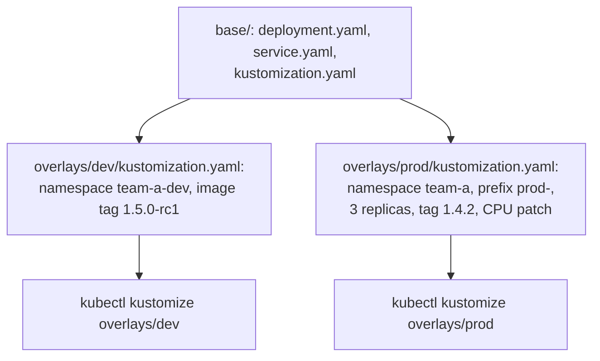

# Kustomize, and Helm vs Kustomize

> **Status: AI draft, 2026-11-16.** Not yet verified by me. The Kustomize commands were run with the Kustomize built into kubectl 1.37 (Kustomize 5.8) and a server dry run on a local kind cluster; the Helm side is from the documentation.

## In one line

Kustomize customises plain YAML without templates: a base holds normal manifests, and each overlay lists changes (namespace, name prefix, image tags, replica counts, generated ConfigMaps, patches) that `kubectl kustomize` applies to produce the final YAML. Helm templates and packages; Kustomize patches; many teams use Helm for third-party apps and Kustomize for their own, or both together.

## The plain idea

Helm says: write the YAML with holes in it, and fill the holes per environment ([Charts, templates and values](charts-and-templates.md)). **Kustomize** says: write ordinary, valid YAML once, and describe each environment as a set of edits on top of it. Nothing in the base is a placeholder; you can `kubectl apply` the base as it is.

It is built into kubectl (`kubectl kustomize`, `kubectl apply -k`), so there is nothing to install.

## How it works

### Base and overlays



```text
kustomize-demo/
├── base/
│   ├── deployment.yaml
│   ├── service.yaml
│   └── kustomization.yaml
└── overlays/
    ├── dev/kustomization.yaml
    └── prod/kustomization.yaml
```

### kustomization.yaml fields

| Field | What it does |
|---|---|
| `resources` | Files, directories or other kustomizations (a base) to include |
| `namespace` | Set the namespace on every object |
| `namePrefix`, `nameSuffix` | Rename every object, and update references to them |
| `labels` | Add labels; with `includeSelectors: true` also to selectors. Replaces the deprecated `commonLabels`, which always changed selectors |
| `commonAnnotations` | Add annotations to every object |
| `images` | Change image names, tags or digests without touching the Deployment |
| `replicas` | Change replica counts by object name |
| `configMapGenerator`, `secretGenerator` | Generate ConfigMaps or Secrets from literals or files, with a content hash in the name |
| `patches` | Strategic merge patches or JSON 6902 patches, optionally targeted by kind, name or label |
| `components` | Reusable groups of changes that several overlays can include |
| `helmCharts` | Render a Helm chart inside Kustomize (needs the Helm binary and `--enable-helm`) |

### Generated ConfigMaps roll the pods

`configMapGenerator` appends a hash of the content to the name (`sample-app-config-dfk4bdbtkk`) and rewrites every reference to it. When the content changes, the name changes, the Deployment's pod template changes, and the pods roll. This solves "I changed the ConfigMap but the pods still use the old values" ([ConfigMaps and Secrets](../kubernetes/configmaps-and-secrets.md)).

## A concrete example

The prod overlay used for the output below:

```yaml
apiVersion: kustomize.config.k8s.io/v1beta1
kind: Kustomization
namespace: team-a
namePrefix: prod-
resources:
  - ../../base
images:
  - name: registry.example.com/sample-app
    newTag: 1.4.2
replicas:
  - name: sample-app
    count: 3
configMapGenerator:
  - name: sample-app-config
    behavior: merge
    literals:
      - LOG_LEVEL=warn
patches:
  - target:
      kind: Deployment
      name: sample-app
    patch: |-
      - op: replace
        path: /spec/template/spec/containers/0/resources/requests/cpu
        value: 500m
```

The base Deployment has `replicas: 1`, image tag `1.0.0`, CPU request `100m`, and uses a ConfigMap from a generator with `LOG_LEVEL=info`; the base also adds the label `app.kubernetes.io/part-of: sample-app` with `labels`.

## Why not just...?

- **...use Helm for everything?** For your own services, a template language over YAML adds indirection: you read the template, the values and the helpers to know what will be applied. Kustomize keeps every file valid YAML. For third-party software published as charts, Helm is the natural choice.
- **...use Kustomize for everything?** It has no packaging, versioning, release history, rollback or hooks, and complex conditional logic ("add this sidecar only if...") is awkward as patches. Helm or a GitOps controller fills those gaps.
- **...patch with `sed` in CI?** Text substitution does not understand YAML structure, breaks on formatting changes, and is invisible in review. Kustomize's `images` and `patches` are explicit and checked.

## Commands to know

The prod overlay rendered, with the Kustomize built into kubectl:

```console
$ kubectl kustomize overlays/prod
apiVersion: v1
data:
  LOG_LEVEL: warn
kind: ConfigMap
metadata:
  labels:
    app.kubernetes.io/part-of: sample-app
  name: prod-sample-app-config-dfk4bdbtkk
  namespace: team-a
---
apiVersion: v1
kind: Service
metadata:
  labels:
    app.kubernetes.io/part-of: sample-app
  name: prod-sample-app
  namespace: team-a
spec:
  ports:
  - port: 80
    targetPort: 8080
  selector:
    app: sample-app
---
apiVersion: apps/v1
kind: Deployment
metadata:
  labels:
    app.kubernetes.io/part-of: sample-app
  name: prod-sample-app
  namespace: team-a
spec:
  replicas: 3
  selector:
    matchLabels:
      app: sample-app
  template:
    metadata:
      labels:
        app: sample-app
    spec:
      containers:
      - envFrom:
        - configMapRef:
            name: prod-sample-app-config-dfk4bdbtkk
        image: registry.example.com/sample-app:1.4.2
        name: app
        resources:
          requests:
            cpu: 500m
            memory: 128Mi
```

Every change is visible: the namespace and `prod-` prefix on all three objects, the reference to the renamed ConfigMap updated, the tag, the replica count and the patched CPU. The `labels` field added the label to metadata only, not to the selector, so the selector stays stable.

The dev overlay sets a different namespace and tag; its ConfigMap keeps the base content and so a different name:

```console
$ kubectl kustomize overlays/dev | grep -E 'namespace:|image:|name: sample-app-config'
  name: sample-app-config-hf678c7m2b
  namespace: team-a-dev
  namespace: team-a-dev
  namespace: team-a-dev
            name: sample-app-config-hf678c7m2b
        image: registry.example.com/sample-app:1.5.0-rc1
```

Applying, checked by the API server without changing anything:

```console
$ kubectl apply -k overlays/prod --dry-run=server
configmap/prod-sample-app-config-dfk4bdbtkk created (server dry run)
service/prod-sample-app created (server dry run)
deployment.apps/prod-sample-app created (server dry run)
```

| Command | What it does |
|---|---|
| `kubectl kustomize <dir>` | Render to stdout. |
| `kubectl apply -k <dir>` | Render and apply. |
| `kubectl diff -k <dir>` | What would change in the cluster. |
| `kubectl delete -k <dir>` | Delete exactly the rendered objects; review the render first. |
| `kubectl kustomize <dir> --enable-helm` | Allow `helmCharts` (needs Helm installed). |

### Helm vs Kustomize

| | Helm | Kustomize |
|---|---|---|
| Approach | Templates with values | Plain YAML plus patches |
| Files | Templates are not valid YAML until rendered | Every file is valid YAML |
| Packaging and versions | Charts, repositories, OCI registries | None; Git directories or remote bases |
| Release tracking, rollback | Yes | No (kubectl, or a GitOps tool) |
| Hooks, ordering | Hooks | None (GitOps sync waves can do it) |
| Conditionals and loops | Yes | Patches and components only |
| Installing | Separate binary | Built into kubectl |
| Best at | Distributing software with many options | Your own apps across a few environments |

Using both: render a vendor chart with Helm (or `helmCharts`), then patch the output with Kustomize for the things the chart does not expose. Argo CD supports both natively ([Argo CD architecture](../gitops/argocd-architecture.md)).

## How it breaks

| Symptom | Layer | Check | Likely cause |
|---|---|---|---|
| Patch has no effect | Targeting | `target` kind and name against the base | Name matched after a prefix, or wrong kind; patches match original names |
| `no matches for Id ...` | Patch target | Rendered base | The object does not exist in the resources |
| Selector changed, apply fails `field is immutable` | Labels | `commonLabels` or `includeSelectors` | Labels were added to selectors of an existing Deployment |
| Old ConfigMaps pile up | Generators | Hash-named ConfigMaps | Each change makes a new one; prune with your apply tool |
| `security; file ... is not in or below ...` | Load restrictor | Paths in `resources` | Referring to files outside the kustomization root |
| `helmCharts` ignored or error | Helm support | Flags | `--enable-helm` not set, or Helm not installed |

## Interview questions

**1. What is the core idea of Kustomize?**

<details markdown="1">
<summary>Answer</summary>

- A base of plain, valid YAML and overlays that describe changes per environment.
- No templating: changes are declarative transformations and patches.
- Built into kubectl as `kubectl kustomize` and `kubectl apply -k`.

</details>

**2. Why do generated ConfigMaps have a hash suffix?**

<details markdown="1">
<summary>Answer</summary>

- The name changes when the content changes, and references are updated.
- So the pod template changes and the Deployment rolls new pods with the new config.
- Without it, pods keep using old values until restarted.

</details>

**3. When would you choose Helm and when Kustomize?**

<details markdown="1">
<summary>Answer</summary>

- Helm: distributing or consuming packaged software with many options, release history, hooks.
- Kustomize: your own services across environments, keeping YAML readable and diffable.
- Both: Helm for vendor charts, Kustomize patches on top.

</details>

**4. Why is `labels` preferred over `commonLabels`?**

<details markdown="1">
<summary>Answer</summary>

- `commonLabels` (deprecated) also adds labels to selectors.
- Selectors of Deployments and Services cannot be changed once applied, so adding a label later breaks the apply.
- `labels` adds to metadata only unless `includeSelectors` is set.

</details>

**5. A patch in the prod overlay does nothing. How do you debug it?**

<details markdown="1">
<summary>Answer</summary>

- Render with `kubectl kustomize` and check the object.
- Check the patch target's kind and original name, and the JSON path or merge structure.
- Render the base alone to see what the patch is applied to.

</details>

**6. How do you change the image tag per environment with Kustomize?**

<details markdown="1">
<summary>Answer</summary>

- The `images` field in the overlay: `name` of the image and `newTag` (or `digest`).
- CI can set it with `kustomize edit set image` and commit the change for GitOps.
- No edits to the base Deployment.

</details>

## Try it

On any machine with kubectl:

1. Recreate the base and the two overlays above in a scratch folder.
2. Before rendering, predict the name of the prod ConfigMap's prefix and the Deployment's replica count; then run `kubectl kustomize overlays/prod`.
3. Change `LOG_LEVEL` in the prod overlay to `error` and render again. Which names changed, and why does that matter for running pods?
4. Add `includeSelectors: true` under `labels` in the base and render; compare the selector.

## Zoom out

Kustomize and Helm are two answers to one question: how to keep one set of manifests for many environments. GitOps tools render either from Git and apply the result ([GitOps principles](../gitops/principles.md)), and promotion between environments becomes a change to an overlay or a values file ([Promotion and rollback](../gitops/promotion-and-rollback.md)).

## Sources

- [Kubernetes documentation: declarative management with Kustomize](https://kubernetes.io/docs/tasks/manage-kubernetes-objects/kustomization/)
- [Kustomize reference: kustomization file](https://kubectl.docs.kubernetes.io/references/kustomize/kustomization/)
- [Kustomize reference: labels](https://kubectl.docs.kubernetes.io/references/kustomize/kustomization/labels/)
- [Kustomize reference: configMapGenerator](https://kubectl.docs.kubernetes.io/references/kustomize/kustomization/configmapgenerator/)
- [Kustomize reference: helmCharts](https://kubectl.docs.kubernetes.io/references/kustomize/kustomization/helmcharts/)
- [Helm documentation: charts](https://helm.sh/docs/topics/charts/)
