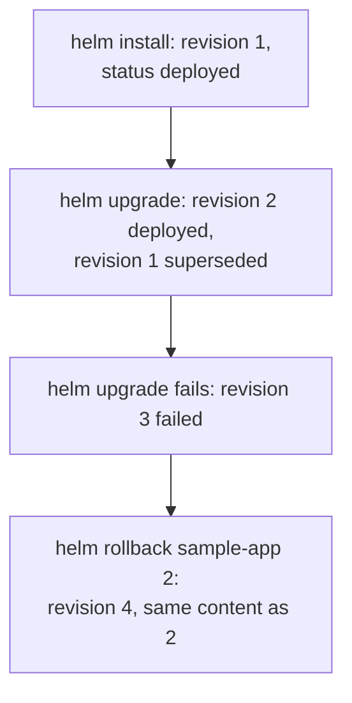

# Releases, hooks and debugging

> **Status: AI draft, 2026-11-16.** Not yet verified by me. Written from the Helm 4 documentation; the Helm commands were not run for this page, so they have no sample output.

## In one line

Every `helm install` or `upgrade` creates a numbered revision of a release, stored by default as a Secret in the release's namespace; `helm rollback` re-applies an earlier revision. Hooks run Jobs or other resources at set points (before or after install, upgrade, delete), and `helm template`, `--dry-run`, `helm get manifest` and `helm history` are the main debugging tools.

## The plain idea

`kubectl apply` forgets: it does not know which objects belonged to last week's version of your app. Helm remembers. A **release** is one installation of a chart under a name (`sample-app` in namespace `team-a`), and each change creates a new **revision** recording the chart, the values and the rendered manifest. That record is what lets Helm upgrade cleanly (delete what the new version no longer has), show history, and roll back.

Some steps do not fit "apply these objects": run a database migration before the new version starts, or a smoke test after. **Hooks** are templates marked to run at those points.

## How it works

### Releases and revisions



- **Where state lives**: by default in Secrets in the release's namespace, one per revision (named like `sh.helm.release.v1.sample-app.v2`). The `HELM_DRIVER` environment variable can switch to ConfigMaps or SQL.
- **History**: `--history-max` keeps 10 revisions by default on upgrade; older ones are pruned.
- **Status values** include `deployed`, `superseded`, `failed`, `pending-install`, `pending-upgrade`, `pending-rollback` and `uninstalled`.
- **Rollback** is a new revision with an old revision's content, not a time machine: data changes made by migrations stay changed.

### Install and upgrade flags that matter (Helm 4)

| Flag | Meaning |
|---|---|
| `upgrade --install` | Install if the release does not exist, else upgrade: one command for CI |
| `--wait` | Wait until resources are ready, up to `--timeout`; strategies `watcher` (the default when given alone), `hookOnly`, `legacy` |
| `--timeout` | Per-operation limit, default 5 minutes |
| `--rollback-on-failure` | On failure, roll back to the last successful revision (Helm 3 called this `--atomic`); implies `--wait` |
| `--cleanup-on-fail` | Delete resources this failed upgrade created |
| `--server-side` | `true`, `false` or `auto`: use server-side apply ([kubectl fluency](../kubernetes/kubectl.md)) |
| `--force-replace` | Delete and recreate resources that cannot be updated in place (Helm 3 called this `--force`); causes downtime |
| `--create-namespace` | Create the release namespace if missing |
| `--reset-values`, `--reuse-values`, `--reset-then-reuse-values` | How values from the previous revision are treated on upgrade |

### Hooks

A hook is any template with the annotation `helm.sh/hook`:

| Hook | Runs |
|---|---|
| `pre-install`, `post-install` | Before any resources are created, or after all are loaded |
| `pre-upgrade`, `post-upgrade` | Around an upgrade |
| `pre-delete`, `post-delete` | Around uninstall |
| `pre-rollback`, `post-rollback` | Around rollback |
| `test` | When `helm test` is run |

```yaml
apiVersion: batch/v1
kind: Job
metadata:
  name: {{ .Release.Name }}-migrate
  annotations:
    "helm.sh/hook": pre-upgrade,pre-install
    "helm.sh/hook-weight": "-5"
    "helm.sh/hook-delete-policy": before-hook-creation,hook-succeeded
spec:
  backoffLimit: 1
  template:
    spec:
      restartPolicy: Never
      containers:
        - name: migrate
          image: "{{ .Values.image.repository }}:{{ .Values.image.tag }}"
          command: ["./migrate", "up"]
```

- **Weights** (strings, may be negative) order hooks of the same type; lower runs first. Helm waits for each hook (Jobs until they complete) before moving on, so a failing migration fails the upgrade before the new pods start.
- **Delete policies**: `before-hook-creation` (the default: delete the old one before creating the new), `hook-succeeded`, `hook-failed`.
- Hook resources are **not part of the release**: `helm uninstall` does not delete them, so set a delete policy or a Job TTL ([Jobs and CronJobs](../kubernetes/jobs-and-cronjobs.md)).
- GitOps tools map Helm hooks to their own sync phases ([Sync, hooks and waves](../gitops/sync-hooks-waves.md)).

### Dependencies and OCI charts

- `dependencies` in `Chart.yaml` lists subcharts with versions and repositories; `helm dependency update` downloads them into `charts/`. A `condition` such as `postgresql.enabled` switches one on or off.
- Charts can be stored in OCI registries such as ECR ([ECR](../aws-services/ecr.md)): `helm package` then `helm push sample-app-1.4.2.tgz oci://<registry>/charts`, and install with `helm install sample-app oci://<registry>/charts/sample-app --version 1.4.2`.

### Debugging

| Question | Command |
|---|---|
| What would this render to? | `helm template sample-app ./chart -f values-prod.yaml` |
| Would the cluster accept it? | `helm upgrade --install ... --dry-run=server` |
| What is deployed right now? | `helm get manifest sample-app -n team-a` |
| With which values? | `helm get values sample-app -n team-a` (add `--all` for computed values) |
| What happened over time? | `helm history sample-app -n team-a` |
| What changed between revisions? | Diff `helm get manifest --revision N` against `--revision M` |
| What do the hooks look like? | `helm get hooks sample-app -n team-a` |

## A concrete example

CI deploys `sample-app` on every merge:

```bash
helm upgrade --install sample-app oci://<registry>/charts/sample-app --version 1.4.2 \
  -n team-a --create-namespace \
  -f values-prod.yaml --set image.tag=1.4.2 \
  --rollback-on-failure --timeout 10m
```

1. The `pre-upgrade` migration Job runs first; if it fails, the upgrade fails and nothing else changes.
2. Then the Deployment rolls out ([Deployments and rollouts](../kubernetes/deployments-and-rollouts.md)); Helm waits until it is ready.
3. If readiness does not arrive within 10 minutes, Helm rolls back to the last good revision and the pipeline fails, with `helm history` showing both revisions.
4. The migration is not undone by the rollback, so migrations must be backwards compatible with the previous version (expand first, contract later).

## Why not just...?

- **...`kubectl apply` the output of `helm template`?** That works, and GitOps tools often do the equivalent, but you lose Helm's release history, rollback, pruning of removed objects and hooks, unless the GitOps tool provides its own.
- **...rely on `helm rollback` to undo a bad release?** It reverts manifests, not data or external side effects. Database migrations, messages sent and files written stay. Design changes to be backward compatible.
- **...use `--force-replace` when an upgrade fails on an immutable field?** It deletes and recreates the object, causing downtime, and for some objects (a Service's ClusterIP, a StatefulSet) changes identity. Understand which field is immutable first.

## Commands to know

These were not run for this page.

| Command | What it does |
|---|---|
| `helm list -n team-a` (or `-A`) | Releases, revision, status, chart and app version. |
| `helm status sample-app -n team-a` | Current status and notes. |
| `helm history sample-app -n team-a` | Every revision with status and description. |
| `helm rollback sample-app 2 -n team-a` | Re-apply revision 2 as a new revision. |
| `helm uninstall sample-app -n team-a` | Delete the release's resources (not hook resources, not PVCs created by StatefulSets). |
| `helm test sample-app -n team-a` | Run the chart's test hooks. |
| `kubectl get secrets -n team-a -l owner=helm` | The stored revisions. |

## How it breaks

| Symptom | Layer | Check | Likely cause |
|---|---|---|---|
| `another operation (install/upgrade/rollback) is in progress` | Release state | `helm history`: last status `pending-upgrade` | A previous run was killed mid-way; roll back to the last deployed revision |
| `field is immutable` on upgrade | Kubernetes | Which field | Changed a Deployment selector, a Job template, a StatefulSet's volume claims |
| `rendered manifests contain a resource that already exists` | Ownership | Object annotations | Object created outside Helm or by another release |
| Upgrade timed out, pods look fine | Waiting | Hook Jobs, `--timeout` | A hook Job still running or failing, or readiness slower than the timeout |
| Old hook Job blocks the next upgrade | Hook cleanup | Delete policy | No `before-hook-creation` policy and the Job still exists |
| Uninstall left resources behind | Ownership | What remains | Hook resources, `helm.sh/resource-policy: keep`, PVCs from StatefulSets |

## Interview questions

**1. What is a Helm release, and where is its state stored?**

<details markdown="1">
<summary>Answer</summary>

- One installation of a chart under a name in a namespace, with numbered revisions.
- Each revision stores the chart, values and rendered manifest.
- By default in Secrets in the release's namespace; ConfigMap or SQL backends are options.

</details>

**2. How does `helm rollback` work, and what does it not undo?**

<details markdown="1">
<summary>Answer</summary>

- It re-applies an earlier revision's manifest as a new revision.
- It does not undo data changes, migrations, external side effects or hook results.
- So changes must be backward compatible.

</details>

**3. A deploy fails with "another operation is in progress". What happened and how do you fix it?**

<details markdown="1">
<summary>Answer</summary>

- A previous Helm run stopped mid-way and left the release `pending-upgrade` (or install or rollback).
- `helm history` shows it; `helm rollback` to the last deployed revision clears it.
- Prevent it with timeouts and `--rollback-on-failure`, and by not cancelling CI jobs mid-deploy.

</details>

**4. How would you run a database migration with Helm?**

<details markdown="1">
<summary>Answer</summary>

- A Job with `helm.sh/hook: pre-upgrade,pre-install`, a weight, and a delete policy.
- Helm waits for it; failure stops the upgrade before new pods start.
- Make migrations backward compatible, because rollback will not undo them.

</details>

**5. What does `--rollback-on-failure` do (formerly `--atomic`)?**

<details markdown="1">
<summary>Answer</summary>

- Waits for the release to become ready and, on failure or timeout, rolls back to the last successful revision.
- Keeps the cluster on a working version after a failed CI deploy.
- Helm 4 renamed the flag; Helm 3 used `--atomic`.

</details>

**6. How do you see exactly what is deployed and with which values?**

<details markdown="1">
<summary>Answer</summary>

- `helm get manifest` and `helm get values` (with `--all` for merged values), optionally `--revision N`.
- `helm history` for the sequence of changes.
- Compare with `helm template` of the new version before upgrading.

</details>

## Try it

If you have Helm and a kind cluster (Helm is not part of these notes' toolchain):

1. Install a chart from `helm create` twice with different `replicaCount` values; run `helm history`, then `kubectl get secrets -l owner=helm`.
2. Roll back to revision 1 and predict the revision number of the result.
3. Add a `pre-upgrade` Job that runs `exit 1`, upgrade, and read `helm history` and `helm status`.

Without Helm: write the hook annotations for a smoke test that runs after every install and upgrade and is deleted when it succeeds.

## Zoom out

Releases, hooks and rollback are what Helm adds beyond templating ([Charts, templates and values](charts-and-templates.md)). In GitOps setups the GitOps controller takes over release tracking and sync order, and Helm becomes a renderer ([Sync, hooks and waves](../gitops/sync-hooks-waves.md), [Promotion and rollback](../gitops/promotion-and-rollback.md)).

## Sources

- [Helm documentation: helm upgrade](https://helm.sh/docs/helm/helm_upgrade/)
- [Helm documentation: helm rollback](https://helm.sh/docs/helm/helm_rollback/)
- [Helm documentation: chart hooks](https://helm.sh/docs/topics/charts_hooks/)
- [Helm documentation: advanced topics, storage backends](https://helm.sh/docs/topics/advanced/)
- [Helm documentation: OCI-based registries](https://helm.sh/docs/topics/registries/)
