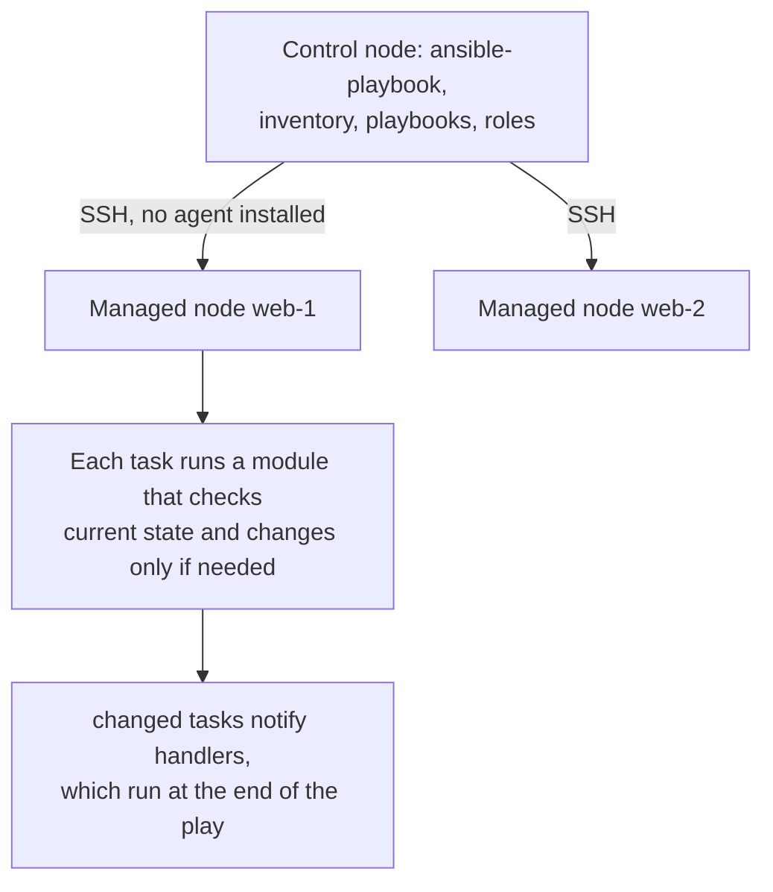

# Ansible and configuration management

> **Status: AI draft, 2026-11-16.** Not yet verified by me. Written from the Ansible documentation; nothing was run.

## In one line

Terraform provisions infrastructure (create the server); configuration management sets up what runs on it (packages, files, services). Ansible does that agentless over SSH: playbooks of tasks, each calling an idempotent module, run against hosts from an inventory, with roles for reuse, handlers for "restart only if something changed", and Vault for encrypted secrets.

## How it works



| Concept | What it is |
|---|---|
| **Control node** | The machine where Ansible runs |
| **Inventory** | The managed hosts and groups: a static INI or YAML file, or a dynamic inventory plugin that asks a cloud API (for example EC2 tags) |
| **Playbook** | A YAML file of plays: which hosts, which tasks, in what order |
| **Task** | One call to a module with arguments |
| **Module** | The unit of work: `ansible.builtin.package`, `template`, `service`, `user`, `copy` |
| **Role** | A reusable folder of tasks, handlers, templates, defaults and variables |
| **Handler** | A task that runs only when notified by a changed task, by default after all tasks in the play |
| **Vault** | Encrypts variables or files so secrets can live in the repository |

A small playbook:

```yaml
- name: Configure web servers
  hosts: web
  become: true
  tasks:
    - name: Install nginx
      ansible.builtin.package:
        name: nginx
        state: present

    - name: Deploy site configuration
      ansible.builtin.template:
        src: site.conf.j2
        dest: /etc/nginx/conf.d/site.conf
      notify: Reload nginx

  handlers:
    - name: Reload nginx
      ansible.builtin.service:
        name: nginx
        state: reloaded
```

**Idempotency**: `state: present` means "make sure it is installed", not "install it". The second run reports `ok` instead of `changed` and the handler does not fire. Shell commands are not idempotent by themselves, so prefer modules, or guard `command` tasks with `creates` or `changed_when`. `--check` (dry run) and `--diff` show what would change.

**Mutable vs immutable**: configuration management changes long-lived servers in place, so they can drift apart over time ([Bash scripting](../linux/bash-scripting.md) is the even more manual version). The immutable alternative bakes everything into an image (an AMI or a container image) and replaces servers instead of changing them ([Auto Scaling and AMIs](../aws-services/auto-scaling-and-amis.md), [Images and Dockerfiles](../containers/images-and-dockerfiles.md)). On container platforms, Ansible's role shrinks to building images, bootstrapping hosts, or managing the odd stateful or legacy server.

| | Terraform | Ansible | Container images |
|---|---|---|---|
| Main job | Create cloud resources | Configure hosts | Package an application and its dependencies |
| State | State file | None; checks each host live | The image itself |
| Model | Declarative plan, then apply | Ordered tasks of declarative modules | Build once, run anywhere |

## Interview questions

**1. What is the difference between provisioning and configuration management?**

<details markdown="1">
<summary>Answer</summary>

- Provisioning creates infrastructure: VPCs, instances, databases (Terraform, CloudFormation).
- Configuration management sets up the software and settings on hosts (Ansible, Chef, Puppet).
- Immutable images reduce the need for the second.

</details>

**2. What does "agentless" mean for Ansible?**

<details markdown="1">
<summary>Answer</summary>

- Nothing has to be installed and kept running on managed hosts beyond SSH and Python.
- The control node connects, pushes small module programs, runs them, and collects results.
- Less to maintain, but every run needs network access and credentials to every host.

</details>

**3. What makes an Ansible task idempotent?**

<details markdown="1">
<summary>Answer</summary>

- Modules that describe a desired state and change only when the host differs.
- A second run reports `ok`, not `changed`.
- Raw `shell` or `command` tasks need `creates`, `removes` or `changed_when` to behave the same way.

</details>

**4. What are handlers for?**

<details markdown="1">
<summary>Answer</summary>

- Actions that should happen only if something changed, such as reloading a service after its config file changed.
- Tasks `notify` them; they run once at the end of the play even if notified many times.
- Avoids needless restarts.

</details>

**5. Where does Ansible fit in a Kubernetes and Terraform world?**

<details markdown="1">
<summary>Answer</summary>

- Building golden images, bootstrapping hosts, managing legacy or stateful servers outside the cluster, network devices.
- Not for creating cloud resources (Terraform) or deploying apps to Kubernetes (Helm, GitOps).
- Prefer immutable images over configuring running servers where possible.

</details>

## Sources

- [Ansible documentation: getting started](https://docs.ansible.com/projects/ansible/latest/getting_started/index.html)
- [Ansible documentation: introduction (agent-less architecture)](https://docs.ansible.com/projects/ansible/latest/getting_started/introduction.html)
- [Ansible documentation: inventory](https://docs.ansible.com/projects/ansible/latest/inventory_guide/intro_inventory.html)
- [Ansible documentation: playbooks](https://docs.ansible.com/projects/ansible/latest/playbook_guide/playbooks_intro.html)
- [Ansible documentation: handlers](https://docs.ansible.com/projects/ansible/latest/playbook_guide/playbooks_handlers.html)
- [Ansible documentation: roles](https://docs.ansible.com/projects/ansible/latest/playbook_guide/playbooks_reuse_roles.html)
- [Ansible documentation: check mode and diff mode](https://docs.ansible.com/projects/ansible/latest/playbook_guide/playbooks_checkmode.html)
- [Ansible documentation: Vault](https://docs.ansible.com/projects/ansible/latest/vault_guide/index.html)
