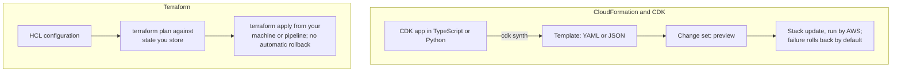

# CloudFormation and CDK vs Terraform

> **Status: AI draft, 2026-11-16.** Not yet verified by me. Written from the AWS and Terraform documentation; nothing was run.

## In one line

CloudFormation is AWS's own infrastructure as code service: you submit a template, AWS creates a stack and keeps its state, previews changes as change sets, rolls back failed updates, and detects drift. CDK lets you write that template in a programming language. Terraform keeps state yourself, plans locally, works across many providers, and does not roll back on failure.

## How it works

**CloudFormation** in a few terms:

- **Template**: resources, parameters, outputs, conditions, in YAML or JSON.
- **Stack**: one deployed template. AWS stores its state; there is no state file to protect or lock.
- **Change set**: a preview of what an update will add, modify or replace, the equivalent of a plan ([Reading a plan](reading-a-plan.md)).
- **Rollback**: by default a failed create or update rolls back to the last good state; you can instead keep successfully created resources and retry after fixing the failure.
- **Drift detection**: compares stack resources with their real configuration on request.
- **Nested stacks** and **StackSets** (one template across many accounts and regions, often with Organizations).

**CDK**: you write classes in a general-purpose language; `cdk synth` produces a CloudFormation template and `cdk deploy` deploys it. Constructs come in levels: L1 maps one-to-one to CloudFormation resources, L2 adds sensible defaults and helper methods, L3 patterns compose many resources.

| | CloudFormation (and CDK) | Terraform |
|---|---|---|
| State | Managed by AWS in the stack | Your file in a backend you secure and lock ([Terraform state](state.md)) |
| Preview | Change sets | `plan` |
| Failure handling | Automatic rollback by default | Stops; partial changes remain; fix and re-apply |
| Providers | AWS (plus registry extensions) | Any provider: AWS, Kubernetes, GitHub, Datadog, Cloudflare |
| Reuse | Nested stacks, modules, CDK constructs | Modules |
| Drift | On-demand drift detection | Every plan refreshes and shows drift |
| Language | YAML or JSON, or real code with CDK | HCL |
| New AWS features | Often supported on launch day | Depends on the provider release |

**What to say in an interview**: both are declarative; choose CloudFormation or CDK when everything is AWS and you want AWS to hold state and roll back; choose Terraform for multi-provider estates, one tool across clouds and SaaS, and a large module ecosystem. Teams often use both, for example Terraform for the platform and CDK inside an application team's repository.

## Interview questions

**1. What is a CloudFormation change set, and how does it compare to a Terraform plan?**

Answer

- A preview of the actions an update will take, including replacements.
- Like a plan, it is reviewed before executing.
- Unlike a plan, it is computed and executed by AWS against the stack it manages.

**2. What happens when a CloudFormation update fails, compared with Terraform?**

Answer

- CloudFormation rolls the stack back to its last stable state by default (or keeps successful resources if you choose).
- Terraform stops; resources created before the failure stay in state; you fix and apply again.
- Neither undoes data changes made by applications.

**3. What does CDK add on top of CloudFormation?**

Answer

- Real programming languages: loops, types, tests, IDE support.
- Higher-level constructs (L2, L3) with secure defaults.
- It still synthesises to CloudFormation, so stacks, change sets and rollback apply.

**4. When would you choose Terraform over CloudFormation?**

Answer

- Several clouds or SaaS providers managed together.
- A team already skilled in Terraform with existing modules.
- When you want local plans and fine control of state layout.

**5. How do you deploy the same infrastructure to many AWS accounts with each tool?**

Answer

- CloudFormation: StackSets, often driven by Organizations.
- Terraform: a root module or Terragrunt unit per account, with roles per account ([Terragrunt](terragrunt.md)).
- Both need pipeline credentials per account and a promotion order.

## Sources

- [AWS CloudFormation User Guide: what is CloudFormation](https://docs.aws.amazon.com/AWSCloudFormation/latest/UserGuide/Welcome.html)
- [AWS CloudFormation User Guide: change sets](https://docs.aws.amazon.com/AWSCloudFormation/latest/UserGuide/using-cfn-updating-stacks-changesets.html)
- [AWS CloudFormation User Guide: handling provisioning failures](https://docs.aws.amazon.com/AWSCloudFormation/latest/UserGuide/stack-failure-options.html)
- [AWS CloudFormation User Guide: drift detection](https://docs.aws.amazon.com/AWSCloudFormation/latest/UserGuide/using-cfn-stack-drift.html)
- [AWS CloudFormation User Guide: StackSets](https://docs.aws.amazon.com/AWSCloudFormation/latest/UserGuide/what-is-cfnstacksets.html)
- [AWS CDK Developer Guide](https://docs.aws.amazon.com/cdk/v2/guide/home.html)
- [AWS CDK Developer Guide: constructs](https://docs.aws.amazon.com/cdk/v2/guide/constructs.html)
