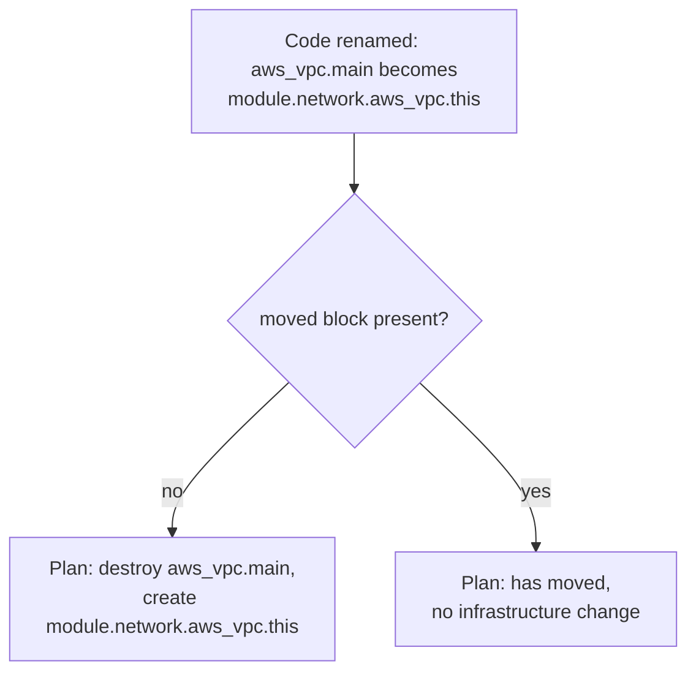

# Import, moved and drift

> **Status: AI draft, 2026-11-16.** Not yet verified by me. Written from the Terraform documentation; nothing was run.

## In one line

Use `import` blocks to bring existing resources under Terraform (optionally generating their configuration with `plan -generate-config-out`), `moved` blocks to rename or restructure without destroying, and `removed` blocks to stop managing something without deleting it; detect drift with scheduled plans using `-detailed-exitcode`, then decide per change whether to adopt it into code, revert it, or ignore that attribute.

## The plain idea

Real infrastructure and code drift apart in three ways:

- **Things exist that Terraform does not know about**: built by hand before Terraform, or by another team. To manage them, Terraform must *import* them into state.
- **The code changes shape but the infrastructure should not**: a resource renamed, moved into a module, switched from `count` to `for_each`. Terraform sees a new address and would destroy the old one, unless you tell it the two are the same with `moved`.
- **The infrastructure changes but the code does not**: someone edits a security group in the console during an incident. That is **drift**, and the next plan will propose to undo it.

All three used to need hand-run `terraform state` commands. Today they can be written as code, reviewed in a pull request, and planned before they happen.

## How it works

### Import blocks

```hcl
import {
  to = aws_s3_bucket.uploads
  id = "sample-app-uploads"
}

resource "aws_s3_bucket" "uploads" {
  bucket = "sample-app-uploads"
}
```

- `plan` shows `will be imported`; `apply` records the bucket in state. Nothing is created.
- Unsure what the resource block should contain? Write only the `import` block and run `terraform plan -generate-config-out=generated.tf`: Terraform writes a starting resource block from the real object. Review and tidy it (generated code includes every attribute), then plan until it shows no changes.
- The old `terraform import <address> <id>` command still exists, but runs immediately against state with no plan and no review.

### Moved blocks

```hcl
moved {
  from = aws_subnet.by_count[1]
  to   = aws_subnet.private["private-b"]
}

moved {
  from = aws_vpc.main
  to   = module.network.aws_vpc.this
}
```



Keep `moved` blocks until every environment's state has been applied with them; removing them early makes an environment that missed the change plan a destroy.

### Removed blocks

```hcl
removed {
  from = aws_db_instance.legacy
  lifecycle {
    destroy = false
  }
}
```

Terraform forgets the database but leaves it running: handing it to another team's state, or out of Terraform altogether. The older equivalent is `terraform state rm`.

### Detecting drift

- `terraform plan -detailed-exitcode` exits `0` for no changes, `1` for an error, `2` when changes are present. A scheduled pipeline runs it per state and alerts on `2`.
- `terraform plan -refresh-only` shows only how reality differs from state, without your configuration changes mixed in.
- AWS Config and CloudTrail tell you who changed what, and when ([CloudTrail, Athena and Config](../aws-services/cloudtrail-and-config.md)).

### Deciding what to do with drift

| Situation | Decision | How |
|---|---|---|
| A manual fix during an incident that should stay | Adopt | Change the code to match; plan shows no changes |
| An unapproved or mistaken change | Revert | Apply the plan as is; Terraform restores the code's version |
| An attribute owned by another system (autoscaler counts, tags added by scanners) | Ignore | `lifecycle { ignore_changes = [...] }` for that attribute only ([Terraform language](language.md)) |
| Resources nobody manages | Import or delete | `import` block, or remove them after checking who owns them |

## A concrete example

A team inherits a hand-built production setup and must bring it under Terraform without downtime:

1. Inventory: list the VPC, subnets, security groups, the RDS instance and the S3 buckets with their IDs.
2. Write `import` blocks for them, run `plan -generate-config-out=generated.tf`, and turn the generated code into clean resources and module calls.
3. Iterate until `plan` shows only `will be imported` and no changes or replacements. Any `# forces replacement` here means the code does not yet match reality.
4. Apply: the state now maps everything; no infrastructure changed.
5. Later refactors into modules use `moved` blocks; a nightly drift job runs `plan -detailed-exitcode`.

## Why not just...?

- **...let Terraform recreate the hand-built resources?** Recreating a database or subnet means downtime and data loss. Import adopts them as they are.
- **...fix renames with `terraform state mv` on each environment?** It works, but it is manual, invisible in review, and easy to forget in one environment. `moved` blocks travel with the code to every environment.
- **...ban the console entirely?** Read-only console access is sensible, but incidents happen. Make drift visible and cheap to resolve instead of pretending it cannot occur.

## Commands to know

These were not run for this page.

| Command | What it does |
|---|---|
| `terraform plan -generate-config-out=generated.tf` | Write resource blocks for `import` blocks that have none. |
| `terraform plan` | Shows `will be imported`, `has moved`, and removals before anything happens. |
| `terraform plan -detailed-exitcode` | Drift check: exit code 2 means changes. |
| `terraform plan -refresh-only` | Only the differences between real resources and state. |
| `terraform import <address> <id>` | Older, immediate import without a plan. |
| `terraform state mv`, `terraform state rm` | Older, immediate equivalents of `moved` and `removed`. |

## How it breaks

| Symptom | Layer | Check | Likely cause |
|---|---|---|---|
| After import, plan wants to change or replace it | Configuration | Diff in the plan | The resource block does not match the real object yet |
| `Resource already managed by Terraform` | State | `state list` | Already imported, possibly under another address |
| Refactor plans destroy and create | Addresses | Old and new addresses | Missing `moved` block |
| An environment plans a destroy months later | Moved blocks | Git history | `moved` blocks deleted before that environment applied them |
| Drift job alerts every night on the same attribute | Ownership | Which attribute | Another system owns it; ignore that attribute, or stop the other system |

## Interview questions

**1. How do you bring an existing resource under Terraform?**

<details markdown="1">
<summary>Answer</summary>

- An `import` block with the target address and the real ID, plus a matching resource block (or generate one with `plan -generate-config-out`).
- Plan until it shows only the import and no changes; then apply.
- The older `terraform import` command does the same without a plan.

</details>

**2. You renamed a resource and the plan wants to destroy and recreate it. Fix it.**

<details markdown="1">
<summary>Answer</summary>

- Add a `moved` block from the old address to the new one.
- Plan shows "has moved" with no infrastructure change.
- Keep the block until all environments have applied it.

</details>

**3. How do you stop managing a resource without deleting it?**

<details markdown="1">
<summary>Answer</summary>

- A `removed` block with `lifecycle { destroy = false }`.
- Or `terraform state rm`, which is immediate and unreviewed.
- Then remove its resource block from the code.

</details>

**4. How do you detect drift automatically?**

<details markdown="1">
<summary>Answer</summary>

- A scheduled pipeline runs `terraform plan -detailed-exitcode` per state.
- Exit code 2 means changes: alert with the plan attached.
- Use AWS Config and CloudTrail to find who made the change.

</details>

**5. Someone changed a security group in the console during an incident. What do you do?**

<details markdown="1">
<summary>Answer</summary>

- Find out why, then decide: adopt it into code, or revert it with an apply.
- Never leave it: the next unrelated apply would silently revert it.
- If another system owns that attribute, ignore it specifically.

</details>

**6. What are the risks of `-generate-config-out`?**

<details markdown="1">
<summary>Answer</summary>

- Generated code includes every attribute, including defaults and computed values that may not belong in configuration.
- It may not use your modules, variables or naming.
- Treat it as a draft: clean it up and plan until there are no changes.

</details>

## Try it

Without Terraform:

1. Write the `moved` blocks needed to change `aws_subnet.private[0..2]` (count) into `aws_subnet.private["private-a"]`, `["private-b"]`, `["private-c"]`.
2. Write a shell snippet that runs `terraform plan -detailed-exitcode` and prints "no drift", "drift" or "error" for exit codes 0, 2 and 1.
3. For three kinds of drift you have seen, decide adopt, revert or ignore, and say why.

## Zoom out

Import, moved and removed blocks turn state surgery into reviewed code changes; drift detection keeps code and reality honest. Together with plan review they are what lets a team change long-lived infrastructure safely ([Reading a plan](reading-a-plan.md), [Terraform state](state.md)).

## Sources

- [Terraform documentation: import](https://developer.hashicorp.com/terraform/language/import)
- [Terraform documentation: generating configuration](https://developer.hashicorp.com/terraform/language/import/generating-configuration)
- [Terraform documentation: refactoring with moved blocks](https://developer.hashicorp.com/terraform/language/modules/develop/refactoring)
- [Terraform documentation: removed block](https://developer.hashicorp.com/terraform/language/block/removed)
- [Terraform documentation: terraform import command](https://developer.hashicorp.com/terraform/cli/commands/import)
- [Terraform documentation: terraform plan](https://developer.hashicorp.com/terraform/cli/commands/plan)
