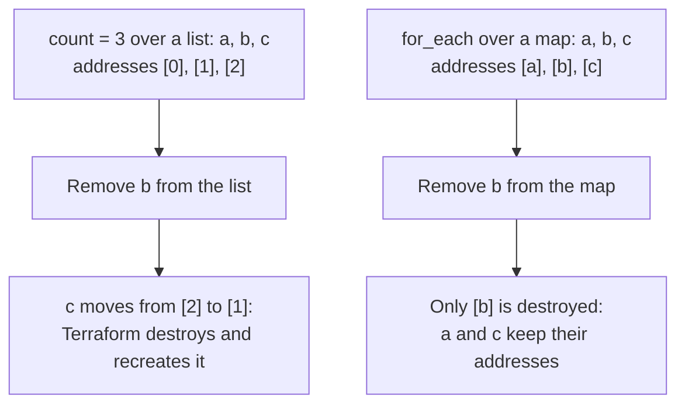

# Terraform language

> **Status: AI draft, 2026-11-16.** Not yet verified by me. Written from the Terraform documentation; nothing was run. The `cidrsubnet` results were computed with Python's `ipaddress` module, which follows the same arithmetic.

## In one line

HCL gives you typed input variables with validation, locals for computed names, outputs, `count` and `for_each` to make many copies (prefer `for_each`, keyed by name, so removing one item does not renumber the rest), dynamic blocks for repeated nested blocks, built-in functions, and `lifecycle` rules that change how Terraform replaces or protects a resource.

## The plain idea

A Terraform configuration is a description, not a script, but it still needs a few programming ideas: parameters (variables), named intermediate values (locals), results (outputs), "one of these per item" (`for_each`), and some functions to compute addresses and names. The language keeps these declarative: no loops that run step by step, only expressions that produce values Terraform can plan with.

## How it works

### Variables, locals, outputs

```hcl
variable "environment" {
  type        = string
  description = "Deployment environment"
  validation {
    condition     = contains(["dev", "staging", "prod"], var.environment)
    error_message = "environment must be dev, staging or prod."
  }
}

variable "subnets" {
  type = map(object({
    zone    = string
    newbits = number
    netnum  = number
  }))
}

locals {
  name_prefix = "sample-app-${var.environment}"
  common_tags = {
    Environment = var.environment
    ManagedBy   = "terraform"
  }
}

output "vpc_id" {
  value       = aws_vpc.main.id
  description = "Used by the cluster stack"
}
```

| Concept | Purpose | Notes |
|---|---|---|
| `variable` | Input, set by `-var`, `.tfvars` files, `TF_VAR_` environment variables or module callers | `type`, `default`, `validation`, `sensitive`, `nullable` |
| `locals` | Named expressions inside a module | Avoid repeating the same expression |
| `output` | Values exposed to callers, the CLI, or other states | `sensitive = true` hides them from CLI output only |

### count vs for_each

```hcl
# count: instances are numbered 0, 1, 2
resource "aws_subnet" "by_count" {
  count      = 3
  vpc_id     = aws_vpc.main.id
  cidr_block = cidrsubnet("10.0.0.0/16", 2, count.index)
}

# for_each: instances are keyed by name
resource "aws_subnet" "private" {
  for_each          = var.subnets
  vpc_id            = aws_vpc.main.id
  availability_zone = each.value.zone
  cidr_block        = cidrsubnet("10.0.0.0/16", each.value.newbits, each.value.netnum)
}
```



Use `count` for "zero or one" (`count = var.enabled ? 1 : 0`) or truly identical copies; use `for_each` whenever items have identities.

### Dynamic blocks

Some resources take repeated nested blocks, such as security group rules. `dynamic` generates them from a collection:

```hcl
resource "aws_security_group" "web" {
  name   = "${local.name_prefix}-web"
  vpc_id = aws_vpc.main.id

  dynamic "ingress" {
    for_each = var.allowed_ports
    content {
      from_port   = ingress.value
      to_port     = ingress.value
      protocol    = "tcp"
      cidr_blocks = ["10.0.0.0/16"]
    }
  }
}
```

Use them for genuinely repeated blocks; a page of nested `dynamic` blocks is harder to review than the plain blocks would be.

### Useful functions

| Function | Example | Result |
|---|---|---|
| `cidrsubnet(prefix, newbits, netnum)` | `cidrsubnet("10.0.0.0/16", 2, 1)` | `"10.0.64.0/18"` |
| | `cidrsubnet("10.0.0.0/16", 8, 2)` | `"10.0.2.0/24"` |
| `merge(map1, map2)` | `merge(local.common_tags, { Name = "web" })` | Later keys win |
| `lookup(map, key, default)` | `lookup(var.sizes, var.environment, "small")` | Default if the key is missing |
| `try(expr, fallback)` | `try(var.config.port, 8080)` | Fallback if the expression errors |
| `templatefile(path, vars)` | `templatefile("${path.module}/user-data.sh.tftpl", { env = var.environment })` | Rendered file content |
| `jsonencode(value)` | IAM policies built from HCL objects | Valid JSON, no hand escaping ([IAM policies and how they are evaluated](../aws-core/iam-policies.md)) |

`cidrsubnet` adds `newbits` to the prefix length and picks block number `netnum`: a `/16` plus 2 bits gives four `/18`s (`10.0.0.0`, `10.0.64.0`, `10.0.128.0`, `10.0.192.0`) ([IP addresses and subnetting](../networking/ip-and-subnetting.md)).

### lifecycle

| Setting | Effect | Typical use |
|---|---|---|
| `create_before_destroy = true` | When a replacement is needed, create the new one first | Launch templates, certificates, anything referenced by name |
| `prevent_destroy = true` | Any plan that would destroy it fails | Databases, state buckets. It does not help if the block itself is deleted from the code |
| `ignore_changes = [tags["LastScanned"]]` | Do not propose updates for these attributes | Values changed by another system, such as an autoscaler's desired count |
| `replace_triggered_by = [aws_launch_template.app.latest_version]` | Replace when another resource changes | Forcing a rollout |
| `precondition`, `postcondition` | Assertions checked at plan or apply | "This AMI must be from our account" |

`depends_on` adds dependencies that references do not show ([Terraform workflow](terraform-workflow.md)).

## A concrete example

Subnets for `sample-app` from one map variable:

```hcl
subnets = {
  private-a = { zone = "ap-south-1a", newbits = 2, netnum = 0 }   # 10.0.0.0/18
  private-b = { zone = "ap-south-1b", newbits = 2, netnum = 1 }   # 10.0.64.0/18
  private-c = { zone = "ap-south-1c", newbits = 2, netnum = 2 }   # 10.0.128.0/18
}
```

The addresses are `aws_subnet.private["private-a"]` and so on. Removing `private-b` later destroys only that subnet; with `count`, `private-c` would have been renumbered and recreated, taking down everything in it.

## Why not just...?

- **...use `count` everywhere because it is simpler?** Indexes shift when the list changes, so Terraform destroys and recreates resources that did not really change. Keys from `for_each` are stable.
- **...use `ignore_changes = all` to stop noisy diffs?** Terraform then never corrects drift on that resource, and real changes in your code are ignored too. Ignore only the specific attributes another system owns.
- **...rely on `prevent_destroy` for the production database?** It only blocks plans that destroy the resource while its block exists. Also use deletion protection on the resource itself and IAM limits on who can apply.

## Commands to know

These were not run for this page.

| Command | What it does |
|---|---|
| `terraform console` | An interactive prompt to evaluate expressions against the current configuration and state. |
| `terraform plan -var-file=prod.tfvars` | Plan with an environment's variable file. |
| `terraform validate` | Catches type errors and failed validation blocks early. |
| `terraform fmt` | Canonical formatting. |

To evaluate one expression without the prompt, pipe it in: `echo 'cidrsubnet("10.0.0.0/16", 2, 1)' | terraform console`.

## How it breaks

| Symptom | Layer | Check | Likely cause |
|---|---|---|---|
| Removing one item recreates others | `count` | Instance addresses in the plan | Indexes shifted; switch to `for_each` (with `moved` blocks) |
| `Invalid for_each argument ... known only after apply` | `for_each` keys | Where the keys come from | Keys computed from resources not yet created; use static keys |
| Plan shows changes on every run | Ownership | Which attribute | Another system changes it; use `ignore_changes` for that attribute only |
| `Error: Instance cannot be destroyed` | `prevent_destroy` | Plan reason | A change forces replacement of a protected resource |
| Validation error on apply in CI | Variables | Which value | Missing or invalid `.tfvars` for that environment |

## Interview questions

**1. What is the difference between `count` and `for_each`?**

<details markdown="1">
<summary>Answer</summary>

- `count` makes numbered instances; `for_each` makes instances keyed by map keys or set values.
- Removing an item in the middle of a `count` list renumbers and recreates the rest.
- `for_each` keys stay stable; use `count` for "zero or one".

</details>

**2. When would you use `create_before_destroy`?**

<details markdown="1">
<summary>Answer</summary>

- When a change forces replacement and the old object must stay until the new one exists, avoiding downtime.
- Common for launch templates, certificates, security groups referenced elsewhere.
- Names must allow both to exist at once (use name prefixes).

</details>

**3. What does `ignore_changes` do and what is the risk?**

<details markdown="1">
<summary>Answer</summary>

- Terraform stops proposing updates for the listed attributes.
- Useful when another system owns them (autoscaler counts, tags added by scanners).
- Too broad, and real drift and real code changes are silently ignored.

</details>

**4. What does `cidrsubnet("10.0.0.0/16", 8, 3)` return?**

<details markdown="1">
<summary>Answer</summary>

- `10.0.3.0/24`: 8 new bits make `/24`s, and block number 3.
- Useful to compute subnet ranges from a VPC range instead of hard-coding them.
- Check with `terraform console`.

</details>

**5. Why might `for_each` fail with "known only after apply"?**

<details markdown="1">
<summary>Answer</summary>

- Keys must be known at plan time to name instances.
- If keys come from attributes of resources not yet created (IDs), Terraform cannot plan.
- Use static keys (names) and put computed values in the instance arguments instead.

</details>

**6. Does `prevent_destroy` protect a resource if someone deletes its block?**

<details markdown="1">
<summary>Answer</summary>

- No. Without the block, the lifecycle rule is gone too, and the plan destroys the resource.
- Combine it with deletion protection on the resource, plan review, and backups.
- Use `removed` blocks to stop managing a resource without destroying it ([Import, moved and drift](import-and-drift.md)).

</details>

## Try it

Without Terraform, use Python to check subnet arithmetic the way `cidrsubnet` does it:

```bash
python3 -c "import ipaddress; print(list(ipaddress.ip_network('10.0.0.0/16').subnets(new_prefix=18)))"
```

Then answer: which `cidrsubnet` call gives the fourth `/18`? (Answer: `cidrsubnet("10.0.0.0/16", 2, 3)`, which is `10.0.192.0/18`.)

With Terraform installed: open `terraform console` in an empty folder and evaluate `merge({a=1}, {a=2, b=3})`, `lookup({dev="s"}, "prod", "m")` and `cidrsubnet("10.0.0.0/16", 4, 15)`.

## Zoom out

The language is small on purpose: enough to describe many similar resources safely, not a general-purpose program. Modules package it for reuse ([Modules and environments](modules-and-environments.md)), and reading the plan is how you check what the expressions actually produced ([Reading a plan](reading-a-plan.md)).

## Sources

- [Terraform documentation: input variables](https://developer.hashicorp.com/terraform/language/values/variables)
- [Terraform documentation: local values](https://developer.hashicorp.com/terraform/language/values/locals)
- [Terraform documentation: output values](https://developer.hashicorp.com/terraform/language/values/outputs)
- [Terraform documentation: count](https://developer.hashicorp.com/terraform/language/meta-arguments/count)
- [Terraform documentation: for_each](https://developer.hashicorp.com/terraform/language/meta-arguments/for_each)
- [Terraform documentation: dynamic blocks](https://developer.hashicorp.com/terraform/language/expressions/dynamic-blocks)
- [Terraform documentation: lifecycle](https://developer.hashicorp.com/terraform/language/meta-arguments/lifecycle)
- [Terraform documentation: cidrsubnet](https://developer.hashicorp.com/terraform/language/functions/cidrsubnet)
- [Terraform documentation: terraform console](https://developer.hashicorp.com/terraform/cli/commands/console)
