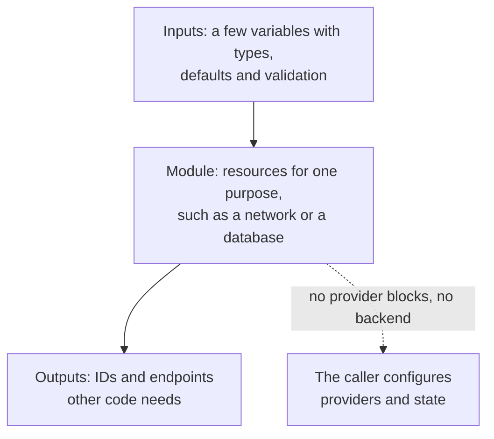

# Modules and environments

> **Status: AI draft, 2026-11-16.** Not yet verified by me. Written from the Terraform documentation; nothing was run.

## In one line

A module is a folder of Terraform code with inputs and outputs that other code calls like a function. Pin module versions, give each environment its own root module and state, and promote a change by moving the same module version from dev to prod.

## The plain idea

Every directory of `.tf` files is a module. The one you run `terraform plan` in is the **root module**; the ones it calls with `module` blocks are **child modules**. A child module is like a function: inputs (variables) in, resources inside, results (outputs) out.

Modules give you two things: **reuse** (the same VPC design in every account) and **an interface** (callers set ten inputs instead of reading two hundred lines). Environments are the other half of the question: how to run the same design as dev, staging and prod without them sharing state or credentials.

## How it works

### Calling a module

```hcl
module "network" {
  source  = "git::https://git.example.com/platform/terraform-modules.git//network?ref=v1.4.0"

  name        = "sample-app-prod"
  cidr_block  = "10.0.0.0/16"
  zones       = ["ap-south-1a", "ap-south-1b", "ap-south-1c"]
}

resource "aws_eks_cluster" "main" {
  # ...
  vpc_config {
    subnet_ids = module.network.private_subnet_ids
  }
}
```

| Source | Form | Versioning |
|---|---|---|
| Local path | `./modules/network` | Same commit as the caller |
| Terraform Registry (public or private) | `terraform-aws-modules/vpc/aws` | `version = "~> 6.0"` argument |
| Git | `git::https://...//path?ref=v1.4.0` | A tag or commit in `ref` |
| S3 and others | `s3::https://...` | The object you point at |

`terraform init` downloads modules into `.terraform/modules`; rerun it after changing a source or version.

### What makes a good module



- **One purpose**: "a VPC with subnets and NAT", not "the whole platform".
- **Small interface**: expose what callers really vary; hard-code your organisation's standards (encryption on, public access blocked).
- **No provider or backend configuration inside**: the root module decides region, account and state.
- **Outputs for everything callers wire up**: subnet IDs, security group IDs, endpoints.
- **Versioned and changelogged**, so a change reaches environments one at a time.

### Structuring environments

Two common layouts:

```text
Directory per environment              One directory, CLI workspaces
envs/                                  network/
├── dev/      main.tf, backend.tf      ├── main.tf
├── staging/  main.tf, backend.tf      └── backend.tf
└── prod/     main.tf, backend.tf      terraform workspace select prod
modules/network/                       (state stored per workspace name)
```

| | Directory per environment | CLI workspaces |
|---|---|---|
| State | Separate backend config per directory | Separate state per workspace, same backend |
| Credentials | Each directory can use a different account and role | Same backend and usually the same credentials; HashiCorp recommends other approaches when environments need separate credentials and access controls |
| Differences between environments | Explicit in each directory's files | Hidden in `terraform.workspace` conditionals or variable files |
| Risk | Some repetition | Running `apply` in the wrong selected workspace |
| Fits | Separate accounts per environment, which is the AWS norm ([Organizations, SCPs and multi-account](../aws-core/organizations-and-scps.md)) | Short-lived copies of the same stack, such as a test environment per branch |

Terragrunt is a third option that removes the repetition of the directory approach ([Terragrunt](terragrunt.md)).

### Promotion

1. Change the module, tag `v1.5.0`.
2. Bump `ref=v1.5.0` in `envs/dev`; plan, review, apply.
3. When dev has run well, the same bump in staging, then prod, each with its own plan and approval ([Testing and CI for Terraform](testing-and-ci.md)).

Each environment's directory records exactly which module version it runs, and rolling back is reverting that one line (and applying).

## A concrete example

A platform team provides `network`, `eks-cluster` and `rds-postgres` modules in one Git repository, tagged together. Application teams' root modules in `envs/<account>/<environment>/` call them:

- dev pins `network` at `v1.5.0` while prod stays at `v1.4.0` until the change is proven.
- The prod directory uses a role in the prod account and its own state key; nobody's dev credentials can touch it.
- A team that needs one more security group rule does it in their root module, next to the module call, rather than adding a variable for a one-off.

## Why not just...?

- **...point modules at the `main` branch?** Every `init` can pull different code, and a module change reaches production on its next unrelated apply. Pin tags.
- **...write a module for every resource?** A module wrapping a single resource with every argument passed through adds a layer and gives nothing. Write modules for patterns you repeat, with opinions built in.
- **...use workspaces for dev and prod in different AWS accounts?** The backend and credentials are shared, and the selected workspace is easy to get wrong. Separate directories (or Terragrunt units) per account are clearer.

## Commands to know

These were not run for this page.

| Command | What it does |
|---|---|
| `terraform init` | Downloads modules; needed after a source or version change. |
| `terraform get -update` | Re-download modules to pick up changes at the same source. |
| `terraform workspace list`, `select`, `new` | Manage CLI workspaces. |
| `terraform output -json` | Outputs as JSON, for scripts or other stacks. |
| `terraform plan -var-file=prod.tfvars` | Plan with an environment's variables. |

## How it breaks

| Symptom | Layer | Check | Likely cause |
|---|---|---|---|
| `Module not installed` | Init | `.terraform/modules` | Source or version changed without `terraform init` |
| A module change reached prod unexpectedly | Versioning | Module `source` | Not pinned, or pinned to a branch |
| Prod apply changed dev resources | Environments | Selected workspace, backend key | Wrong workspace or copy-pasted backend configuration |
| Refactoring into a module plans destroy and create | Addresses | Old vs new addresses | Missing `moved` blocks for the new `module.x.` addresses ([Import, moved and drift](import-and-drift.md)) |
| Callers cannot get a value they need | Interface | Module outputs | Output not exposed |

## Interview questions

**1. What is a Terraform module, and what is the root module?**

<details markdown="1">
<summary>Answer</summary>

- Any folder of `.tf` files with inputs and outputs is a module.
- The root module is where you run Terraform; it calls child modules with `module` blocks.
- The root configures providers and the backend; child modules should not.

</details>

**2. How do you version modules, and why?**

<details markdown="1">
<summary>Answer</summary>

- Registry modules with `version` constraints; Git modules with `?ref=` tags or commits.
- So each environment changes only when you bump its reference.
- It enables promotion dev, then staging, then prod, and simple rollback.

</details>

**3. Directories per environment or workspaces? Defend a choice.**

<details markdown="1">
<summary>Answer</summary>

- Directories (or Terragrunt units) when environments live in separate accounts with separate credentials: explicit, reviewable, hard to confuse.
- Workspaces for short-lived copies of one stack with the same credentials, such as per-branch test environments.
- HashiCorp itself recommends other approaches than workspaces when environments need separate credentials and access controls.

</details>

**4. How do you move resources into a module without recreating them?**

<details markdown="1">
<summary>Answer</summary>

- `moved` blocks from the old addresses to `module.<name>.<address>`.
- Plan shows moves, not destroy and create.
- Apply in each environment's state.

</details>

**5. What makes a module well designed?**

<details markdown="1">
<summary>Answer</summary>

- One clear purpose, a small typed interface with validation, sensible secure defaults.
- Outputs for everything callers wire up; no providers or backend inside.
- Versioned, documented, tested ([Testing and CI for Terraform](testing-and-ci.md)).

</details>

**6. How would you roll out a risky change to a shared VPC module across ten accounts?**

<details markdown="1">
<summary>Answer</summary>

- Release a new tag; bump it in one non-production account first and read the plan carefully.
- Then a few more, then production accounts one at a time, each with plan review and approval.
- Keep the previous tag available for a quick revert.

</details>

## Try it

Without Terraform:

1. Sketch a `network` module's interface: list its variables (with types) and outputs.
2. Write the `module` block for prod that pins it at `v1.4.0` from Git.
3. Draw the directory tree for two accounts (non-prod with dev and staging, prod with prod) and mark where each backend key would be.

## Zoom out

Modules are Terraform's unit of reuse and of change; environments are its unit of isolation. Get both right and promotion is a one-line diff per environment. Terragrunt automates the repetition ([Terragrunt](terragrunt.md)); CloudFormation and CDK have their own equivalents, nested stacks and constructs ([CloudFormation and CDK vs Terraform](cloudformation-vs-terraform.md)).

## Sources

- [Terraform documentation: modules overview](https://developer.hashicorp.com/terraform/language/modules)
- [Terraform documentation: use modules in your configuration](https://developer.hashicorp.com/terraform/language/modules/configuration)
- [Terraform documentation: develop modules](https://developer.hashicorp.com/terraform/language/modules/develop)
- [Terraform documentation: module composition](https://developer.hashicorp.com/terraform/language/modules/develop/composition)
- [Terraform documentation: CLI workspaces](https://developer.hashicorp.com/terraform/cli/workspaces)
