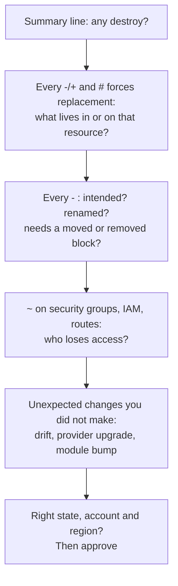

# Reading a plan

> **Status: AI draft, 2026-11-16.** Not yet verified by me. Written from the Terraform documentation and tutorials. The plan below is an illustration assembled in Terraform's documented output format, not output captured from a real run.

## In one line

A plan lists every action Terraform will take, marked `+` create, `~` update in place, `-` destroy, `-/+` replace (destroy first) or `+/-` replace (create first), and `<=` read a data source; read the summary line, then hunt for every `-` and every `# forces replacement`, because those are the changes that lose data or cause downtime.

## The plain idea

`terraform apply` will do exactly what the plan says. The plan is your last chance to catch "change one tag" turning into "replace the production database". Reviewing it is a skill: most lines are noise, a few lines matter enormously, and you learn to find those few fast.

## How it works

### The symbols

| Symbol | Heading text | Meaning |
|---|---|---|
| `+` | `will be created` | New resource |
| `~` | `will be updated in-place` | Same resource, some attributes change |
| `-` | `will be destroyed` | Resource deleted |
| `-/+` | `must be replaced` | Destroy, then create a new one (new ID) |
| `+/-` | `must be replaced` | Create the new one first, then destroy (`create_before_destroy`) |
| `<=` | `will be read during apply` | Data source that can only be read at apply time |

Inside a resource, attributes carry the same marks, and `"old" -> "new"` shows a change. `(known after apply)` means the value will exist only once the resource is created, such as an ID or an address. `# forces replacement` marks the attribute that cannot be changed in place and is the reason for a `-/+`.

### An annotated plan (illustration)

```text
Terraform will perform the following actions:

  # aws_security_group_rule.web_ingress will be updated in-place
  ~ resource "aws_security_group_rule" "web_ingress" {
        id          = "sgrule-<id>"
      ~ cidr_blocks = [
          - "10.0.0.0/16",
          + "10.0.0.0/18",
        ]
    }

  # aws_subnet.private["private-b"] must be replaced
-/+ resource "aws_subnet" "private" {
      ~ arn        = "arn:aws:ec2:ap-south-1:123456789012:subnet/subnet-<id>" -> (known after apply)
      ~ cidr_block = "10.0.64.0/18" -> "10.0.64.0/19" # forces replacement
      ~ id         = "subnet-<id>" -> (known after apply)
        tags       = { "Name" = "private-b" }
    }

  # aws_db_instance.legacy will be destroyed
  # (because aws_db_instance.legacy is not in configuration)
  - resource "aws_db_instance" "legacy" {
      - identifier = "sample-app-legacy" -> null
    }

Plan: 1 to add, 1 to change, 2 to destroy.
```

Reading it:

1. **Summary first**: `1 to add, 1 to change, 2 to destroy`. Any destroy in a change you thought was additive is a red flag. A replacement counts as one add and one destroy.
2. **The update** narrows a security group rule from the whole VPC to one `/18`. In place, but it can cut off traffic from the other subnets: check who uses it.
3. **The replacement**: shrinking the subnet's `cidr_block` cannot be done in place (`# forces replacement`), so Terraform deletes the subnet and creates a new one. Everything with an interface in that subnet (instances, pods, load balancer nodes, databases) blocks or breaks the deletion. This one line is the most dangerous in the plan.
4. **The destroy** says why: the block is "not in configuration". Was it removed on purpose, renamed (needs a `moved` block), or deleted by a bad merge? A database deletion needs a definite yes and a recent snapshot.

### Plan options that change the meaning

| Option | Effect | When |
|---|---|---|
| `-out=tfplan` | Save the plan; `apply tfplan` runs exactly it | Always in CI |
| `-refresh-only` | Only update state to match reality; no configuration changes | After a known manual change, to accept it into state |
| `-replace=ADDRESS` | Force replacement of one instance | A broken instance that must be rebuilt (replaces `taint`) |
| `-target=ADDRESS` | Plan only that resource and its dependencies | Exceptional recovery only; the docs warn against routine use |
| `-destroy` | Plan to destroy everything | Tearing down an environment |
| `-detailed-exitcode` | Exit 0 no changes, 1 error, 2 changes present | Drift detection in scheduled jobs |

`terraform show -json tfplan` gives the plan as JSON for policy tools and scripts, for example to fail a pipeline if any `delete` action touches a database ([Testing and CI for Terraform](testing-and-ci.md)).

### A review checklist



## A concrete example

A pull request "add tags to subnets" shows `Plan: 0 to add, 3 to change, 0 to destroy` in dev, but in prod `3 to add, 3 to change, 3 to destroy`. The prod plan has three `-/+` NAT gateways with `# forces replacement` on `subnet_id`, because a module upgrade changed how the public subnets are keyed. The reviewer stops the apply: replacing NAT gateways changes their public IPs and breaks partners' allow-lists. The fix is `moved` blocks for the new keys ([Import, moved and drift](import-and-drift.md)), after which the prod plan shows only the tag changes.

## Why not just...?

- **...trust the plan because dev looked fine?** Each environment has its own state, history and drift; read each environment's plan.
- **...use `-target` to apply just my change?** It skips everything else, including dependencies' changes, and leaves state partly converged. The docs reserve it for exceptional cases.
- **...skim long plans?** Long plans hide the one dangerous line. Use the JSON plan with a policy check for deletes and replacements, and keep changes small.

## Commands to know

These were not run for this page.

| Command | What it does |
|---|---|
| `terraform plan -out=tfplan` | Save a plan for review and exact apply. |
| `terraform show tfplan` | Human-readable view of a saved plan. |
| `terraform show -json tfplan` | Machine-readable plan for policy checks. |
| `terraform plan -refresh-only` | Show only differences between state and reality. |
| `terraform plan -replace='aws_instance.bastion'` | Plan a forced replacement. |
| `terraform plan -detailed-exitcode` | Exit code 2 when there are changes. |

## How it breaks

| Symptom | Layer | Check | Likely cause |
|---|---|---|---|
| Unexpected `-/+` | Immutable attribute | The `# forces replacement` line | Changed a field that cannot be updated, such as a subnet CIDR or a database identifier |
| Unexpected `-` "not in configuration" | Addresses | Renames, `count` to `for_each` changes | Missing `moved` block, or a block deleted by mistake |
| Changes you did not make | Drift or upgrades | `-refresh-only` plan, lock file, module refs | Manual change, provider default change, module version bump |
| `Saved plan is stale` on apply | Saved plan | Time since plan | State changed after the plan; plan again |
| Plan differs between runs with no code change | Data sources, `timestamp()` | Values computed at plan time | Non-deterministic expressions |

## Interview questions

**1. What do `~`, `-/+` and `+/-` mean in a plan?**

<details markdown="1">
<summary>Answer</summary>

- `~`: update in place.
- `-/+`: replace by destroying first, then creating.
- `+/-`: replace by creating first, then destroying (`create_before_destroy`).

</details>

**2. What does `# forces replacement` tell you, and why does it matter?**

<details markdown="1">
<summary>Answer</summary>

- That attribute cannot be updated in place, so the resource gets a new identity.
- For stateful or referenced resources (databases, subnets, NAT gateways), that can mean data loss, new IPs or downtime.
- Check what depends on it before approving.

</details>

**3. Why apply a saved plan file in CI?**

<details markdown="1">
<summary>Answer</summary>

- The apply then does exactly what was reviewed.
- If state changed since, the saved plan is rejected as stale instead of doing something different.
- The file is an audit record of what was approved.

</details>

**4. When is `-target` acceptable?**

<details markdown="1">
<summary>Answer</summary>

- Exceptional recovery: breaking a dependency cycle, fixing one broken resource during an incident.
- Not as a routine way to apply part of a change: it leaves the rest unconverged.
- Follow it with a full plan.

</details>

**5. How would you automatically block plans that delete databases?**

<details markdown="1">
<summary>Answer</summary>

- `terraform show -json` the saved plan and check `resource_changes` for `delete` actions on database types.
- Run it as a policy step (OPA, Sentinel, a script) that fails the pipeline or requires extra approval.
- Plus `prevent_destroy` and deletion protection on the resources themselves.

</details>

**6. A plan for a tags-only change wants to replace three NAT gateways. What do you do?**

<details markdown="1">
<summary>Answer</summary>

- Stop: read the `# forces replacement` lines and what changed in the module or keys.
- Usually an address or key change: add `moved` blocks, or fix the argument that changed.
- Re-plan until only the intended changes remain.

</details>

## Try it

Without Terraform:

1. In the illustrated plan, mark each line you would need to understand before approving, and write one question for the author per line.
2. Write the `-detailed-exitcode` handling for a nightly drift job in a shell `case` statement (0, 1, 2).
3. Which attributes of `aws_db_instance`, `aws_subnet` and `aws_security_group` would you expect to force replacement? Check one of them in the AWS provider documentation.

## Zoom out

Reading plans well is the core safety skill of infrastructure as code; everything else (state locking, CI approvals, policy checks) exists so that a reviewed plan is what runs ([Testing and CI for Terraform](testing-and-ci.md)). The same habit applies to `kubectl diff` and Helm diffs ([Releases, hooks and debugging](../helm/releases-hooks-debugging.md)).

## Sources

- [Terraform tutorial: create a Terraform plan](https://developer.hashicorp.com/terraform/tutorials/cli/plan)
- [Terraform documentation: terraform plan](https://developer.hashicorp.com/terraform/cli/commands/plan)
- [Terraform documentation: terraform show](https://developer.hashicorp.com/terraform/cli/commands/show)
- [Terraform documentation: JSON output format](https://developer.hashicorp.com/terraform/internals/json-format)
