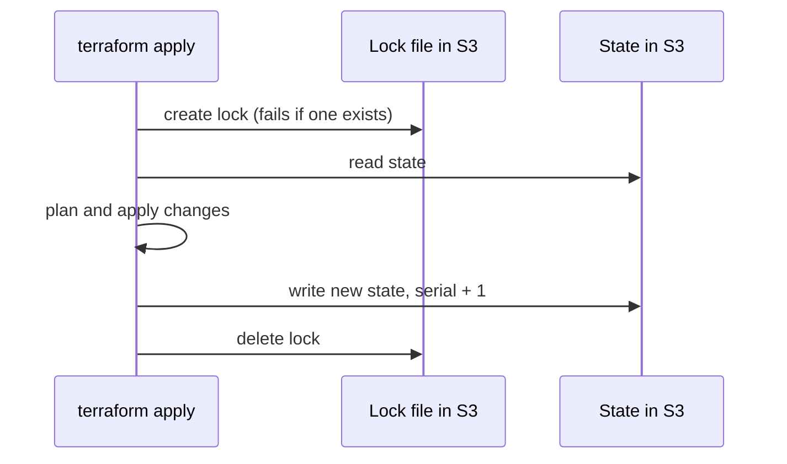

# Terraform state

> **Status: AI draft, 2026-11-16.** Not yet verified by me. Written from the Terraform documentation; nothing was run, so the commands have no sample output.

## In one line

State records which real resource each block in your code manages. Keep it in a remote backend such as S3 with locking (`use_lockfile`; DynamoDB locking is deprecated) and versioning, treat it as a secret, and split it to limit what one apply can break.

## The plain idea

Your code says `resource "aws_vpc" "main"`. AWS knows a VPC called `vpc-0abc...`. Nothing in AWS says "this VPC is the one Terraform calls `main`". The **state** file is that mapping, plus a cached copy of each resource's attributes.

Without it, Terraform could not tell whether to create the VPC or whether it already exists, and could not delete things you removed from the code, because it would not know they were ever its own.

## How it works

### What is in it

- The format version, Terraform version, and a **serial** number that increases with every write.
- For each resource instance: its address (`module.network.aws_subnet.private["a"]`), its provider, its ID, and every attribute the provider returned, including generated passwords, private keys and connection strings.
- Outputs, and dependency information used for correct delete order.

### Local vs remote state

| | Local `terraform.tfstate` | Remote backend (S3, HCP Terraform and others) |
|---|---|---|
| Team use | One person; easily lost or conflicting | Shared, one source of truth |
| Locking | Only on that machine | Prevents two applies at once |
| History | None unless you copy it | Bucket versioning keeps every version |
| Security | Plain text on a laptop | Encryption, IAM, audit |

### The S3 backend

```hcl
terraform {
  backend "s3" {
    bucket       = "sample-org-terraform-state"
    key          = "prod/network/terraform.tfstate"
    region       = "ap-south-1"
    encrypt      = true
    use_lockfile = true
  }
}
```

- `use_lockfile = true` locks with a lock file stored next to the state in the same bucket. It defaults to `false`.
- **DynamoDB locking** (`dynamodb_table`) is deprecated and will be removed in a future version; both can be set together during a migration.
- Turn on **bucket versioning** (the documentation strongly recommends it) so a bad state write or deletion can be undone, block public access, encrypt (ideally with a KMS key), and limit the bucket to the roles that run Terraform ([S3 security](../aws-services/s3-security.md)).



### State commands

| Command | Use | Risk |
|---|---|---|
| `terraform state list` | Every address in state | None |
| `terraform state show <address>` | One resource's recorded attributes | Shows secrets |
| `terraform state mv <from> <to>` | Rename an address without destroying (prefer `moved` blocks) | Wrong target means a later destroy |
| `terraform state rm <address>` | Forget a resource; the real one stays (prefer `removed` blocks) | It becomes unmanaged |
| `terraform state pull` / `push` | Download or upload raw state | `push` can overwrite good state |
| `terraform force-unlock <LOCK_ID>` | Remove a stale lock | Breaking a lock of a run still in progress corrupts state |

Since configuration-based `import`, `moved` and `removed` blocks exist, most state surgery can be done in code, reviewed and planned like any change ([Import, moved and drift](import-and-drift.md)).

### Sensitive values

- State and plan files contain secrets in plain text: an RDS master password set in the configuration, a TLS private key generated by Terraform. Marking a variable or output `sensitive` only hides it from CLI output, not from state.
- Newer Terraform versions add **ephemeral** values and **write-only** arguments that are never stored in state or plan.
- Better still: let the service generate and store the secret (for example RDS managing the master password in Secrets Manager) and give Terraform only a reference ([KMS and secrets stores](../aws-services/kms-and-secrets.md)).

### Splitting state by blast radius

One state for everything means every plan touches everything, every apply locks everyone, and one mistake can reach production networking. Split by:

- **Environment**: dev, staging and prod never share a state.
- **Layer and change rate**: network (rarely changes), data stores, clusters, applications.
- **Team ownership**.

Pass values between states with outputs read by `terraform_remote_state` data sources, SSM parameters, or Terragrunt dependencies ([Terragrunt](terragrunt.md)). More states mean more wiring: aim for units a team can reason about.

## A concrete example

An apply in CI was cancelled midway and every later run fails with `Error acquiring the state lock`.

1. Read the lock details in the error: who holds it, which operation, when.
2. Confirm no run is still in progress (CI job list, the person named).
3. Run `terraform force-unlock <LOCK_ID>`.
4. Run `terraform plan`: resources the cancelled apply created before it was killed may be in state (fine) or created but missing from state (they show as to-be-created, and creation then fails with "already exists"; import them).
5. If the state itself was damaged, restore the previous object version from the versioned bucket.

## Why not just...?

- **...commit `terraform.tfstate` to Git?** It holds secrets, it conflicts on every parallel change, and Git cannot lock it. Use a remote backend.
- **...keep using DynamoDB for locks because it works?** It is deprecated; new configurations should use `use_lockfile`. Existing ones can set both while moving over.
- **...edit the state JSON by hand?** One typo and Terraform loses track of resources or plans to destroy them. Use `moved`, `removed`, `import` blocks or the state commands, with a backup.

## Commands to know

These were not run for this page.

| Command | What it does |
|---|---|
| `terraform init -migrate-state` | Move existing state to a newly configured backend. |
| `terraform state list` | Addresses managed in this state. |
| `terraform state show 'aws_subnet.private["a"]'` | Attributes of one instance (quote the address in the shell). |
| `terraform state pull > backup.tfstate` | A local backup before any surgery. |
| `terraform plan -refresh-only` | Show what changed in the real world without proposing configuration changes. |
| `terraform force-unlock <LOCK_ID>` | Remove a stale lock after confirming nothing is running. |
| `aws s3api list-object-versions --bucket <bucket> --prefix prod/network/` | Previous state versions, for recovery. |

## How it breaks

| Symptom | Layer | Check | Likely cause |
|---|---|---|---|
| `Error acquiring the state lock` | Locking | Lock info in the error | Another run, or a crashed run left the lock |
| Plan wants to create things that exist | State mapping | `state list` | Wrong backend `key` or workspace, or resources created outside Terraform |
| Plan wants to destroy and recreate after a refactor | Addresses | Renamed blocks | Address changed without a `moved` block |
| `state serial ... is older than` or similar conflict | Concurrency | Who wrote last | Two runs without locking, or a `state push` of old state |
| Secrets found in a leaked file | Sensitive data | Where state was copied | State or plan files in Git, CI artifacts or logs |
| `AccessDenied` reading state | Backend IAM | Bucket and KMS key policies | Role lacks S3 or KMS permissions for the state |

## Interview questions

**1. Why does Terraform need state?**

<details markdown="1">
<summary>Answer</summary>

- To map each resource in code to a real resource ID.
- To know what it created, so it can update or delete it, and to plan without querying everything from scratch.
- It also records dependencies for correct delete order.

</details>

**2. How do you set up remote state on AWS today?**

<details markdown="1">
<summary>Answer</summary>

- S3 backend with `use_lockfile = true` for locking, encryption, versioning on the bucket, public access blocked.
- DynamoDB locking is deprecated.
- IAM limited to the roles that run Terraform; one key per environment and component.

</details>

**3. What sensitive data can end up in state, and how do you protect it?**

<details markdown="1">
<summary>Answer</summary>

- Generated passwords, private keys, connection strings: any attribute a provider returns, in plain text.
- Protect the backend: encryption, tight IAM, no copies in Git or CI artifacts.
- Avoid putting secrets there: ephemeral values, write-only arguments, or services that manage their own secrets.

</details>

**4. A pipeline was killed during apply and now the state is locked. What do you do?**

<details markdown="1">
<summary>Answer</summary>

- Confirm no run is still going, then `terraform force-unlock` with the lock ID from the error.
- Plan to see whether anything was created but not recorded; import those.
- Restore the previous state version from S3 only if the state is damaged.

</details>

**5. How do you rename a resource without destroying it?**

<details markdown="1">
<summary>Answer</summary>

- A `moved` block from the old address to the new one; plan shows a move, not destroy and create.
- Or `terraform state mv`, which is not reviewed in code.
- Prefer `moved` so every environment gets the same change.

</details>

**6. How would you split state for a company with several environments and teams?**

<details markdown="1">
<summary>Answer</summary>

- Separate states per environment, and per layer: network, data, clusters, apps.
- Align with team ownership so locks and permissions match.
- Share outputs through remote state data, parameters or Terragrunt dependencies; avoid one giant state.

</details>

## Try it

Without Terraform installed:

1. Write the backend block for a staging network state in your own naming scheme, with locking and encryption.
2. List what you would check before running `force-unlock`, in order.
3. Name three resources whose attributes would put a secret in state, and how to avoid each.

With Terraform or OpenTofu installed: apply the `random`/`local` example from [Terraform workflow](terraform-workflow.md), open `terraform.tfstate`, and find the `random_pet` ID and the `serial`.

## Zoom out

State is what makes Terraform declarative in practice, and also its main operational risk: a single file that holds the map of your infrastructure and its secrets. The rest of the Terraform pages build on it: refactoring with `moved`, adopting resources with `import`, and protecting applies in CI ([Import, moved and drift](import-and-drift.md), [Testing and CI for Terraform](testing-and-ci.md)).

## Sources

- [Terraform documentation: state](https://developer.hashicorp.com/terraform/language/state)
- [Terraform documentation: state locking](https://developer.hashicorp.com/terraform/language/state/locking)
- [Terraform documentation: S3 backend](https://developer.hashicorp.com/terraform/language/backend/s3)
- [Terraform documentation: manage sensitive data](https://developer.hashicorp.com/terraform/language/manage-sensitive-data)
- [Terraform documentation: terraform state mv](https://developer.hashicorp.com/terraform/cli/commands/state/mv)
- [Terraform documentation: terraform state rm](https://developer.hashicorp.com/terraform/cli/commands/state/rm)
- [Terraform documentation: terraform force-unlock](https://developer.hashicorp.com/terraform/cli/commands/force-unlock)
