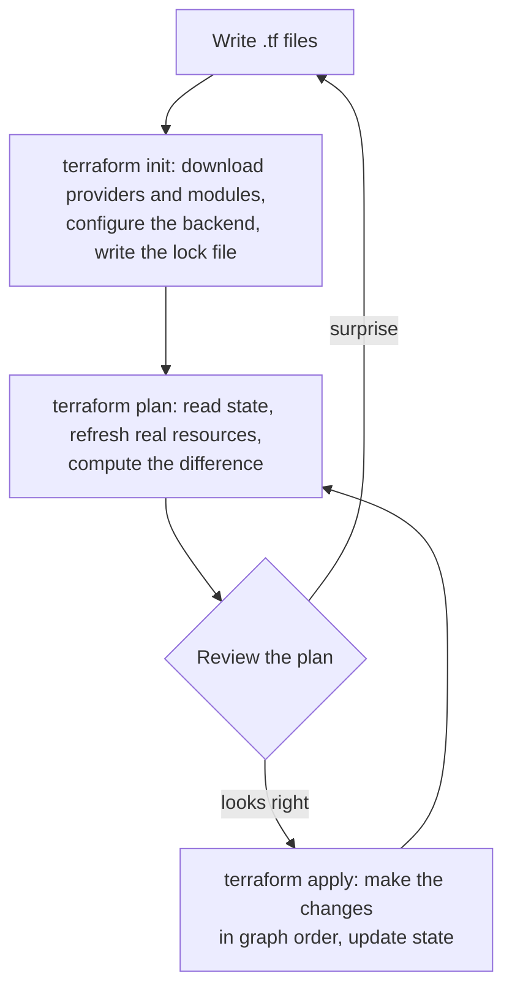

# Terraform workflow

> **Status: AI draft, 2026-11-16.** Not yet verified by me. Written from the Terraform documentation; Terraform is not part of these notes' toolchain and nothing was run, so the commands have no sample output.

## In one line

You declare the infrastructure you want in HCL; `terraform init` downloads providers and sets up the backend, `plan` compares the configuration with the recorded state and the real resources and shows the difference, and `apply` makes those changes in dependency order, updating the state. Pin provider versions and commit the lock file so every run uses the same providers.

## The plain idea

Clicking in a console or running CLI commands is **imperative**: "create this subnet". Do it twice and you get two subnets; forget a step and nobody knows. Terraform is **declarative**: you write down what should exist ("this VPC, these three subnets"), and the tool works out what to create, change or delete to get there. Run it again with nothing changed, and it does nothing (idempotent).

To know what "there" already looks like, Terraform keeps a **state** file mapping each block in your code to a real resource ID ([Terraform state](state.md)).

## How it works

### The building blocks

| Block | What it is | Example |
|---|---|---|
| `terraform` | Settings: required Terraform and provider versions, backend | `required_providers { aws = { source = "hashicorp/aws", version = "~> 6.0" } }` |
| `provider` | A plugin that talks to one API, with its configuration | `provider "aws" { region = "ap-south-1" }` |
| `resource` | Something Terraform creates and manages | `resource "aws_vpc" "main" { cidr_block = "10.0.0.0/16" }` |
| `data` | Something Terraform only reads | `data "aws_availability_zones" "available" {}` |
| `variable`, `locals`, `output` | Inputs, computed names, results ([Terraform language](language.md)) | |
| `module` | A reusable group of the above ([Modules and environments](modules-and-environments.md)) | |

### The commands



| Command | Reads | Changes |
|---|---|---|
| `init` | Configuration, backend settings, lock file | `.terraform/` folder, `.terraform.lock.hcl` |
| `validate` | Configuration | Nothing |
| `plan` | Configuration, state, real resources (refresh) | Nothing (optionally a saved plan file with `-out`) |
| `apply` | The same, or a saved plan | Real resources and state |
| `destroy` | State | Deletes every managed resource |

`apply` without a saved plan makes a new plan and asks for confirmation; in automation, save the reviewed plan with `plan -out=tfplan` and run `apply tfplan`, so what runs is exactly what was reviewed ([Reading a plan](reading-a-plan.md)).

### The dependency graph

Terraform builds a graph from references between blocks:

```hcl
resource "aws_vpc" "main" {
  cidr_block = "10.0.0.0/16"
}

resource "aws_subnet" "private_a" {
  vpc_id            = aws_vpc.main.id      # implicit dependency on the VPC
  cidr_block        = "10.0.0.0/18"
  availability_zone = "ap-south-1a"
}
```

- **Implicit dependencies** come from references (`aws_vpc.main.id`): the subnet waits for the VPC. Independent resources are created in parallel.
- **Explicit dependencies** with `depends_on` are for relations Terraform cannot see, such as an IAM policy that must exist before an application starts using it. Use them sparingly; they make plans more conservative.
- Deletion runs in reverse order.

### Versions and the lock file

- `required_version` pins Terraform itself; `required_providers` pins each provider, usually with `~>` ("this minor or patch range").
- `terraform init` records the exact provider versions and their checksums in `.terraform.lock.hcl`. **Commit it**, so every machine and CI run uses the same providers and checks the downloads.
- `terraform init -upgrade` picks newer versions within the constraints and updates the lock file; review that change like code.

### Terraform and OpenTofu

After HashiCorp moved Terraform to the Business Source License in 2023, the community forked it as **OpenTofu**, now a Linux Foundation project. The language and workflow are the same (`tofu init`, `tofu plan`), with some features diverging; check which one a team uses.

## A concrete example

A new VPC for `sample-app` in account `123456789012`, region `ap-south-1`:

1. `versions.tf`: Terraform and AWS provider constraints, and an S3 backend with locking ([Terraform state](state.md)).
2. `main.tf`: the VPC (`10.0.0.0/16`), three private subnets (`/18`s), route tables, a NAT gateway ([VPC basics](../aws-core/vpc-basics.md)).
3. `terraform init`, then `terraform plan -out=tfplan`: the plan shows `Plan: 9 to add, 0 to change, 0 to destroy`.
4. A reviewer reads the plan in the pull request; on merge, CI runs `terraform apply tfplan` with a role assumed through OIDC ([Testing and CI for Terraform](testing-and-ci.md)).
5. Running `plan` again shows no changes. Any later difference is drift or someone's edit ([Import, moved and drift](import-and-drift.md)).

## Why not just...?

- **...use the AWS CLI in a script?** A script runs actions; run it twice and it fails or duplicates. It does not know what exists, what to delete when you remove a line, or what changed since last time.
- **...skip `plan` and run `apply -auto-approve`?** The plan is the only place a deletion or replacement shows up before it happens. Auto-approve belongs only in pipelines that apply a plan already reviewed.
- **...leave provider versions unpinned?** A new major provider version can change defaults or rename arguments, and the next run in CI quietly picks it up. Pin and upgrade on purpose.

## Commands to know

These were not run for this page.

| Command | What it does |
|---|---|
| `terraform init` | Prepare the working directory; rerun after changing providers, modules or backend. |
| `terraform fmt -recursive` | Format all files. |
| `terraform validate` | Check syntax and internal consistency. |
| `terraform plan -out=tfplan` | Compute and save the plan. |
| `terraform show tfplan` | Read a saved plan; `-json` for tools. |
| `terraform apply tfplan` | Apply exactly that plan. |
| `terraform output` | Read outputs, for example a VPC ID. |
| `terraform graph` | The dependency graph in DOT format. |
| `terraform providers lock -platform=linux_amd64 -platform=darwin_arm64` | Record checksums for several platforms in the lock file. |

## How it breaks

| Symptom | Layer | Check | Likely cause |
|---|---|---|---|
| `Inconsistent dependency lock file` | Providers | `.terraform.lock.hcl` vs constraints | Constraints changed without `init -upgrade`, or lock file not committed |
| Checksum mismatch on init in CI | Lock file platforms | Lock file entries | Lock created on another OS or CPU; add platforms with `providers lock` |
| Error creating a resource that "already exists" | State | Is it in state? | Created outside Terraform; import it ([Import, moved and drift](import-and-drift.md)) |
| Resources created in the wrong order and fail | Graph | References, `depends_on` | A hidden dependency Terraform cannot see |
| `Error acquiring the state lock` | Backend | Who holds the lock | Another run in progress, or a crashed run ([Terraform state](state.md)) |
| `AccessDenied` from the provider | Credentials | `aws sts get-caller-identity` | Wrong profile or role ([Least privilege and AccessDenied](../aws-core/least-privilege-and-accessdenied.md)) |

## Interview questions

**1. What happens during `terraform init`, `plan` and `apply`?**

<details markdown="1">
<summary>Answer</summary>

- `init`: downloads providers and modules, configures the backend, writes the lock file.
- `plan`: reads state, refreshes real resources, computes the difference with the configuration.
- `apply`: makes the changes in dependency order and updates the state.

</details>

**2. What is the difference between a resource and a data source?**

<details markdown="1">
<summary>Answer</summary>

- A resource is created, updated and deleted by Terraform.
- A data source is only read: an existing AMI, a VPC managed elsewhere, the current account ID.
- Deleting a data block never deletes the real object.

</details>

**3. How does Terraform decide the order of operations?**

<details markdown="1">
<summary>Answer</summary>

- From a dependency graph built from references between blocks (implicit) and `depends_on` (explicit).
- Independent resources run in parallel; deletions run in reverse.
- `depends_on` is for dependencies Terraform cannot infer.

</details>

**4. Why commit `.terraform.lock.hcl`?**

<details markdown="1">
<summary>Answer</summary>

- It records exact provider versions and checksums.
- Every developer and CI run then uses the same providers and verifies the downloads.
- Upgrades happen deliberately with `init -upgrade`, reviewed like code.

</details>

**5. Why save a plan in CI instead of running `apply` directly?**

<details markdown="1">
<summary>Answer</summary>

- `apply` alone recomputes the plan, which may differ from what was reviewed if anything changed in between.
- `plan -out` then `apply <file>` applies exactly the reviewed changes, or fails if the state moved on.
- It also gives an artifact for audit.

</details>

**6. A colleague changed a security group in the console. What happens on the next plan?**

<details markdown="1">
<summary>Answer</summary>

- The refresh sees the real rules differ from the configuration.
- The plan proposes to change them back to what the code says.
- Decide: adopt the change into code, let Terraform revert it, or ignore that attribute ([Import, moved and drift](import-and-drift.md)).

</details>

## Try it

Terraform is not installed for these notes. If you install it (or OpenTofu) yourself:

1. Write a configuration using only the `random` and `local` providers (no cloud account): a `random_pet` name written into a file with `local_file`.
2. Run `init`, look inside `.terraform.lock.hcl`, then `plan` and `apply`. Run `plan` again and confirm "No changes".
3. Change the file's content in the configuration and read the plan symbol for that change ([Reading a plan](reading-a-plan.md)). Then `destroy`.

## Zoom out

The workflow is the same reconcile idea as Kubernetes controllers: desired state in code, actual state in the world, a tool that computes and applies the difference ([Architecture and the reconcile loop](../kubernetes/architecture.md)). What makes it safe in a team is state handling, review of plans, and CI with short-lived credentials ([Terraform state](state.md), [Testing and CI for Terraform](testing-and-ci.md)).

## Sources

- [Terraform documentation: resources](https://developer.hashicorp.com/terraform/language/resources)
- [Terraform documentation: data sources](https://developer.hashicorp.com/terraform/language/data-sources)
- [Terraform documentation: terraform init](https://developer.hashicorp.com/terraform/cli/commands/init)
- [Terraform documentation: terraform plan](https://developer.hashicorp.com/terraform/cli/commands/plan)
- [Terraform documentation: dependency lock file](https://developer.hashicorp.com/terraform/language/files/dependency-lock)
- [Terraform documentation: version constraints](https://developer.hashicorp.com/terraform/language/expressions/version-constraints)
- [Terraform documentation: depends_on](https://developer.hashicorp.com/terraform/language/meta-arguments/depends_on)
- [OpenTofu documentation](https://opentofu.org/docs/)
