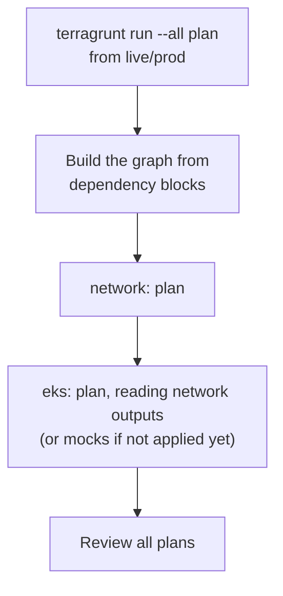

# Terragrunt

> **Status: AI draft, 2026-11-16.** Not yet verified by me. Written from the Terragrunt documentation (now at docs.terragrunt.com); nothing was run. Terragrunt's CLI was redesigned recently, so older blog posts use command names that are now deprecated.

## In one line

Terragrunt wraps Terraform or OpenTofu to remove repetition across many small states: a shared `root.hcl` defines the remote state and generated provider files once, each unit (a folder with `terragrunt.hcl`) points at a versioned module and sets its `inputs`, `dependency` blocks pass outputs between units, and `terragrunt run --all plan` runs every unit in dependency order.

## The plain idea

Good Terraform practice splits infrastructure into many small states: per account, region, environment and component ([Terraform state](state.md), [Modules and environments](modules-and-environments.md)). Done by hand, every one of those folders repeats the same backend block (only the key differs), the same provider block (only the account and region differ), and wires outputs from one state to another with `terraform_remote_state`.

Terragrunt is a thin wrapper that removes the repetition: write the backend and provider once at the top of the tree, let each folder inherit it, and let Terragrunt work out the order to run folders in.

## How it works

### Units, stacks and the folder layout

- A **unit** is a folder with a `terragrunt.hcl`: one instance of one module, with its own state.
- A **stack** is a group of units managed together: implicitly, a directory tree of units; explicitly, a `terragrunt.stack.hcl` that generates units.

```text
live/
├── root.hcl                         remote_state and generate "provider", once
├── non-prod/
│   ├── account.hcl                  account_id = "111122223333"
│   └── ap-south-1/
│       ├── region.hcl
│       └── dev/
│           ├── network/terragrunt.hcl
│           └── eks/terragrunt.hcl   dependency on ../network
└── prod/
    ├── account.hcl                  account_id = "123456789012"
    └── ap-south-1/
        └── prod/
            ├── network/terragrunt.hcl
            └── eks/terragrunt.hcl
```

### The root configuration

```hcl
# root.hcl
remote_state {
  backend = "s3"
  generate = {
    path      = "backend.tf"
    if_exists = "overwrite_terragrunt"
  }
  config = {
    bucket       = "sample-org-terraform-state"
    key          = "${path_relative_to_include()}/terraform.tfstate"
    region       = "ap-south-1"
    encrypt      = true
    use_lockfile = true
  }
}

generate "provider" {
  path      = "provider.tf"
  if_exists = "overwrite_terragrunt"
  contents  = <<EOF
provider "aws" {
  region = "ap-south-1"
}
EOF
}
```

- `path_relative_to_include()` makes each unit's state key its path in the tree: unique keys without copy-paste.
- `generate` writes files (backend, provider, version constraints) into the unit's working directory before Terraform runs.

### A unit

```hcl
# live/prod/ap-south-1/prod/eks/terragrunt.hcl
include "root" {
  path = find_in_parent_folders("root.hcl")
}

terraform {
  source = "git::https://git.example.com/platform/terraform-modules.git//eks-cluster?ref=v2.3.0"
}

dependency "network" {
  config_path = "../network"
  mock_outputs = {
    vpc_id             = "vpc-mock"
    private_subnet_ids = ["subnet-mock-a", "subnet-mock-b"]
  }
}

inputs = {
  cluster_name = "sample-cluster"
  vpc_id       = dependency.network.outputs.vpc_id
  subnet_ids   = dependency.network.outputs.private_subnet_ids
}
```

| Block | Purpose |
|---|---|
| `include` | Pull in `root.hcl` (and others) so the unit inherits remote state and generated files |
| `terraform { source }` | The module and version this unit deploys |
| `inputs` | Values for the module's variables |
| `dependency` | Read another unit's outputs, and run that unit first |
| `mock_outputs` | Placeholder outputs so `plan` and `validate` work before the dependency has been applied |
| `dependencies` | Ordering only, without reading outputs |
| `locals` | Read `account.hcl`, `region.hcl` and compute values |

### Running many units



- `terragrunt run --all plan` (formerly `run-all plan`) runs the command in every unit below the current folder, in dependency order (reverse order for destroy).
- `terragrunt plan` in one unit runs just that unit.
- Environment variables now use the `TG_` prefix instead of `TERRAGRUNT_`.

## A concrete example

Promoting a new EKS module version:

1. Bump `ref=v2.4.0` in `live/non-prod/ap-south-1/dev/eks/terragrunt.hcl`; CI runs `terragrunt plan` in that unit; review and apply.
2. After a soak period, the same one-line bump in `prod/.../eks`, with its own plan and approval.
3. The backend, provider and network outputs did not need touching: they come from `root.hcl` and the `dependency` block.

## Why not just...?

- **...copy the backend and provider blocks into every folder?** Possible for ten folders; with fifty, keys collide, a region gets mistyped, and a provider change needs fifty edits. Terragrunt generates them.
- **...use `terraform_remote_state` between states?** It works, but couples one state to another state's storage details and needs the dependency to be applied first. `dependency` blocks also give ordering and mocks.
- **...adopt Terragrunt for a single small project?** It adds a tool and a layer of indirection. For a handful of states, plain Terraform with a directory per environment is simpler. Terragrunt pays off with many accounts, regions and components.
- **...`run --all apply` across production?** One command changing many states at once is a large blast radius. Apply production units one at a time from reviewed plans.

## Commands to know

These were not run for this page; names follow the redesigned CLI.

| Command | What it does |
|---|---|
| `terragrunt plan` | Plan one unit (Terragrunt passes the command to Terraform or OpenTofu). |
| `terragrunt run --all plan` | Plan every unit below the current folder in dependency order. |
| `terragrunt run --all plan --queue-include-dir <dir>` | Limit a run to some units (check the CLI reference for current flag names). |
| `terragrunt run --graph plan` | Run a unit and everything that depends on it. |
| `terragrunt dag graph` | Print the dependency graph. |
| `terragrunt render --json` | Show the fully resolved configuration of a unit. |
| `terragrunt hcl fmt` | Format Terragrunt files. |

## How it breaks

| Symptom | Layer | Check | Likely cause |
|---|---|---|---|
| Plan fails: dependency has no outputs | Dependency | Is the dependency applied? | Missing `mock_outputs` for plan, or the dependency was never applied |
| Mock values reach a real apply | Mocks | `mock_outputs_allowed_terraform_commands` | Mocks allowed for `apply`; restrict them to `validate` and `plan` |
| Two units write the same state | Remote state key | `path_relative_to_include()` usage | Hard-coded key copied between units |
| Deprecated command warnings | CLI version | Command names | Scripts still use `run-all` or `TERRAGRUNT_` variables |
| Changing `root.hcl` affects every unit | Blast radius | What includes it | Expected: plan every affected unit before applying |

## Interview questions

**1. What problem does Terragrunt solve?**

<details markdown="1">
<summary>Answer</summary>

- Repetition across many small Terraform states: backend, provider and variable boilerplate.
- Wiring outputs between states and running them in the right order.
- It keeps configuration DRY while state stays split by account, region, environment and component.

</details>

**2. How do `include`, `remote_state` and `generate` work together?**

<details markdown="1">
<summary>Answer</summary>

- A root file defines `remote_state` and `generate` blocks once.
- Each unit `include`s it; Terragrunt writes the backend and provider files into the unit before running Terraform.
- `path_relative_to_include()` gives each unit a unique state key.

</details>

**3. What are `dependency` blocks and `mock_outputs` for?**

<details markdown="1">
<summary>Answer</summary>

- `dependency` reads another unit's outputs and makes it run first.
- `mock_outputs` provide placeholders so plan and validate work before the dependency exists.
- Restrict mocks to plan and validate so they never reach an apply.

</details>

**4. How do you run Terragrunt across many units, and what changed recently?**

<details markdown="1">
<summary>Answer</summary>

- `terragrunt run --all <command>` runs it in dependency order; it replaced the deprecated `run-all`.
- Environment variables moved to the `TG_` prefix, and some commands were renamed.
- Check the current CLI reference rather than old examples.

</details>

**5. When would you not use Terragrunt?**

<details markdown="1">
<summary>Answer</summary>

- Few states, one account: plain Terraform directories are simpler.
- If the team uses a platform that already handles backends and orchestration (HCP Terraform, Spacelift and similar).
- When the extra layer would confuse more than it saves.

</details>

**6. How do you promote a module change through environments with Terragrunt?**

<details markdown="1">
<summary>Answer</summary>

- Each unit pins the module version in `terraform { source = ...?ref= }`.
- Bump dev, plan and apply; then staging and prod, each reviewed.
- Rollback is reverting the ref and applying.

</details>

## Try it

Without Terragrunt installed:

1. Draw the `live/` tree for two accounts and two regions with `network` and `eks` units, and mark which file holds the account ID and which holds the backend.
2. Write the `terragrunt.hcl` for an `rds` unit that depends on `network`, with mocks for plan.
3. Write down the state key each unit would get from `path_relative_to_include()`.

## Zoom out

Terragrunt is orchestration over Terraform: it does not change what Terraform does, only how many states you can manage without repetition. The principles underneath (small states, pinned modules, reviewed plans, CI with OIDC) are on the other IaC pages ([Testing and CI for Terraform](testing-and-ci.md)).

## Sources

- [Terragrunt documentation: quick start](https://docs.terragrunt.com/getting-started/quick-start/)
- [Terragrunt documentation: units](https://docs.terragrunt.com/features/units/)
- [Terragrunt documentation: includes](https://docs.terragrunt.com/features/units/includes/)
- [Terragrunt documentation: stacks](https://docs.terragrunt.com/features/stacks/)
- [Terragrunt documentation: HCL blocks reference](https://docs.terragrunt.com/reference/hcl/blocks/)
- [Terragrunt documentation: the run command](https://docs.terragrunt.com/reference/cli/commands/run/)
- [Terragrunt documentation: CLI redesign migration](https://docs.terragrunt.com/migrate/cli-redesign/)
