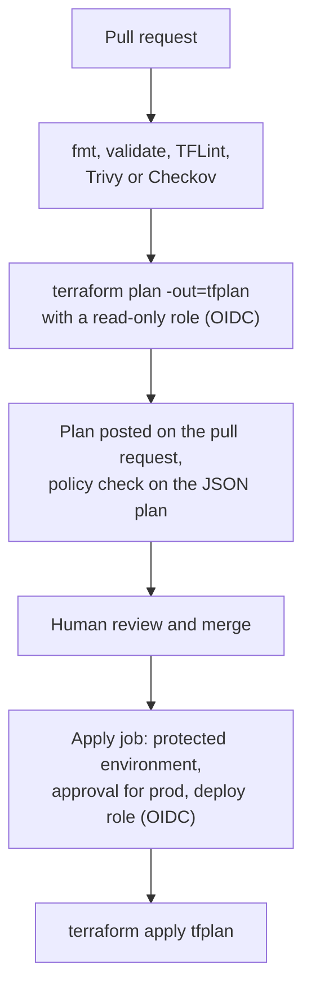

# Testing and CI for Terraform

> **Status: AI draft, 2026-11-16.** Not yet verified by me. Written from the Terraform and tool documentation; nothing was run.

## In one line

Check Terraform in layers: `fmt` and `validate`, a linter (TFLint), a misconfiguration scanner (Trivy or Checkov), `terraform test` and preconditions for logic, then in CI plan on every pull request, review the plan, and apply only the saved plan on merge, with a protected environment, approval for production, and short-lived OIDC credentials instead of stored keys.

## The plain idea

Infrastructure code fails in expensive ways: a wrong CIDR, a public bucket, a database replaced. Each kind of mistake is cheapest to catch at a different point:

- **Typos and syntax**: before the commit.
- **Bad practice and insecure settings**: in the pull request, without touching AWS.
- **What will actually change**: the plan, read by a person.
- **Who may change production**: the pipeline's permissions and approvals.

## How it works

### The checks, cheapest first

| Check | Catches | Needs AWS? |
|---|---|---|
| `terraform fmt -check -recursive` | Formatting drift | No |
| `terraform validate` | Syntax, wrong types, missing arguments | No (after `init -backend=false`) |
| **TFLint** with the AWS ruleset | Invalid instance types, deprecated syntax, unused declarations | No |
| **Trivy** (`trivy config`) or **Checkov** | Misconfigurations: public S3, unencrypted volumes, open security groups ([Quality and security gates](../cicd/quality-and-security-gates.md)) | No |
| Variable `validation`, `precondition`, `postcondition` | Bad inputs and broken assumptions, at plan or apply | Partly |
| `terraform test` | Module logic: run blocks with assertions, `command = plan` (no resources) or `apply` (real, temporary resources), optional mocked providers | Only for `apply` runs |
| `terraform plan` | The real difference against real state | Yes (read) |
| Policy on the JSON plan (OPA, Sentinel, a script) | Forbidden actions: deleting databases, opening `0.0.0.0/0` | No (reads the plan) |

A `terraform test` file, using a plan-only run:

```hcl
# tests/naming.tftest.hcl
variables {
  environment = "dev"
}

run "bucket_name_has_environment" {
  command = plan

  assert {
    condition     = aws_s3_bucket.uploads.bucket == "sample-app-dev-uploads"
    error_message = "Bucket name must include the environment."
  }
}
```

### The pipeline



- **Plan on pull request, apply on merge**: reviewers approve a specific plan, and only the main branch can change infrastructure.
- **Apply the saved plan**: if the state changed since, apply fails as stale instead of doing something unreviewed. If the plan was made before the merge, many teams re-plan after merge and require approval of that plan for production.
- **Credentials**: the pipeline assumes IAM roles through OIDC; the plan role can only read, the apply role can write, and only jobs from the protected branch and environment can assume it ([OIDC from pipelines to AWS](../cicd/oidc-to-aws.md)).
- **One state at a time**: a concurrency group per state stops two pipelines racing for the lock ([GitHub Actions in depth](../cicd/github-actions-in-depth.md)).
- **Protect the state**: only the apply role can write the state bucket; versioning on ([Terraform state](state.md)).

### pre-commit hooks

The `pre-commit` framework runs checks before each commit on the developer's machine; the community `pre-commit-terraform` hooks wrap `fmt`, `validate`, TFLint, Trivy and docs generation. They are a convenience: CI must run the same checks, because hooks can be skipped.

## A concrete example

A GitHub Actions setup for `envs/prod/network`:

1. On pull request: `fmt -check`, `validate`, TFLint, `trivy config .`; then `plan -out=tfplan` with role `terraform-plan` (read-only) via OIDC; `terraform show -no-color tfplan` posted as a comment; a script fails the job if the JSON plan deletes any `aws_db_instance`.
2. On merge to `main`: the apply job targets the `production` environment, which requires a platform engineer's approval, assumes `terraform-apply`, plans again, and applies that saved plan.
3. Nightly: `plan -detailed-exitcode` per state for drift ([Import, moved and drift](import-and-drift.md)).

## Why not just...?

- **...let engineers apply from laptops?** No review, no audit trail, credentials with write access on many machines, and the plan they saw may not match the code in Git. Laptops plan; the pipeline applies.
- **...rely on the scanner alone?** Scanners catch known bad settings, not "this replaces the NAT gateways". Plans still need a human or a policy that looks at actions.
- **...run `terraform test` with `apply` for every module on every pull request?** Real resources cost time and money and can leak if a run fails mid-way. Use `command = plan` and mocks for most tests; run `apply` tests on a schedule in a sandbox account with cleanup.

## Commands to know

These were not run for this page.

| Command | What it does |
|---|---|
| `terraform fmt -check -recursive` | Fails if any file is not formatted. |
| `terraform init -backend=false && terraform validate` | Validate without touching the real backend. |
| `tflint --init && tflint` | Install the configured rule plugins, then lint. |
| `trivy config .` | Scan the folder's IaC for misconfigurations. |
| `checkov -d .` | The same with Checkov. |
| `terraform test` | Run `.tftest.hcl` files in the module. |
| `terraform show -json tfplan` | The plan as JSON, for policy checks. |
| `pre-commit run --all-files` | Run the configured hooks on everything. |

## How it breaks

| Symptom | Layer | Check | Likely cause |
|---|---|---|---|
| Apply job fails `Saved plan is stale` | Saved plan | Time between plan and apply | Another apply changed the state; plan again |
| Two pipelines fail on the state lock | Concurrency | Pipeline runs | No concurrency limit per state |
| Plan works in CI, apply fails `AccessDenied` | IAM | Which role the job assumed | Apply job used the read-only role, or the trust policy rejects the branch or environment |
| Scanner blocks a deliberate setting | Policy | Rule ID | Allowed exception not documented; add an inline skip with a reason |
| `terraform test` leaves resources behind | Test cleanup | Sandbox account | An `apply` run failed mid-way; run tests in a sandbox with periodic cleanup |

## Interview questions

**1. Describe a CI/CD pipeline for Terraform.**

<details markdown="1">
<summary>Answer</summary>

- Pull request: format, validate, lint, security scan, plan with a read-only role, plan posted for review, policy checks.
- Merge: apply the reviewed (or re-planned and approved) saved plan with a write role, in a protected environment with approval for production.
- Credentials through OIDC; one concurrent run per state.

</details>

**2. Why apply a saved plan, and what if it is stale?**

<details markdown="1">
<summary>Answer</summary>

- It guarantees the apply does what was reviewed.
- If the state changed since, Terraform refuses it as stale.
- Plan again and review again; do not fall back to a fresh unreviewed apply.

</details>

**3. What do TFLint, Trivy and Checkov each add over `terraform validate`?**

<details markdown="1">
<summary>Answer</summary>

- `validate`: syntax and types only.
- TFLint: provider-aware mistakes (invalid instance types) and style rules.
- Trivy and Checkov: security misconfigurations against known rules, such as public buckets or open ports.

</details>

**4. What is `terraform test` and when would you use `command = plan`?**

<details markdown="1">
<summary>Answer</summary>

- Test files with run blocks and assertions against a module.
- `command = plan` checks logic without creating anything: fast and free.
- `apply` runs create real resources and clean them up; keep them for scheduled tests in a sandbox.

</details>

**5. How do you make sure only reviewed code can change production?**

<details markdown="1">
<summary>Answer</summary>

- Only the pipeline's apply role can write to production and to the state bucket.
- That role trusts only jobs from the protected branch and environment through OIDC conditions.
- Production environment requires approval; laptops have read-only access.

</details>

**6. A plan in CI shows changes nobody made in this pull request. What do you do?**

<details markdown="1">
<summary>Answer</summary>

- It is drift, a provider or module change, or someone else's merged change not yet applied.
- Run a refresh-only plan and check the lock file and module refs.
- Resolve it separately before approving this pull request's apply.

</details>

## Try it

Without Terraform:

1. Write the GitHub Actions job list for the pipeline above, with which role each job assumes and which branch or environment it may run from ([GitHub Actions basics](../cicd/github-actions-basics.md)).
2. Write a `.tftest.hcl` that checks a subnet module returns three subnets when given three zones.
3. List five Trivy or Checkov findings you would expect in a first scan of a hand-written S3 bucket resource.

## Zoom out

Terraform CI is the general pipeline pattern (build, test, scan, review, deploy with approval) applied to infrastructure, with the plan as the artifact under review ([Concepts](../cicd/concepts.md)). The same OIDC and environment protections secure application deploys ([Pipeline security](../cicd/pipeline-security.md)).

## Sources

- [Terraform documentation: tests](https://developer.hashicorp.com/terraform/language/tests)
- [Terraform documentation: mocking in tests](https://developer.hashicorp.com/terraform/language/tests/mocking)
- [Terraform documentation: custom conditions (validation, preconditions)](https://developer.hashicorp.com/terraform/language/validate)
- [Terraform tutorial: running Terraform in automation](https://developer.hashicorp.com/terraform/tutorials/automation/automate-terraform)
- [TFLint](https://github.com/terraform-linters/tflint)
- [Trivy documentation: misconfiguration scanning](https://trivy.dev/docs/latest/guide/scanner/misconfiguration/)
- [Checkov documentation](https://www.checkov.io/)
- [pre-commit-terraform hooks](https://github.com/antonbabenko/pre-commit-terraform)
