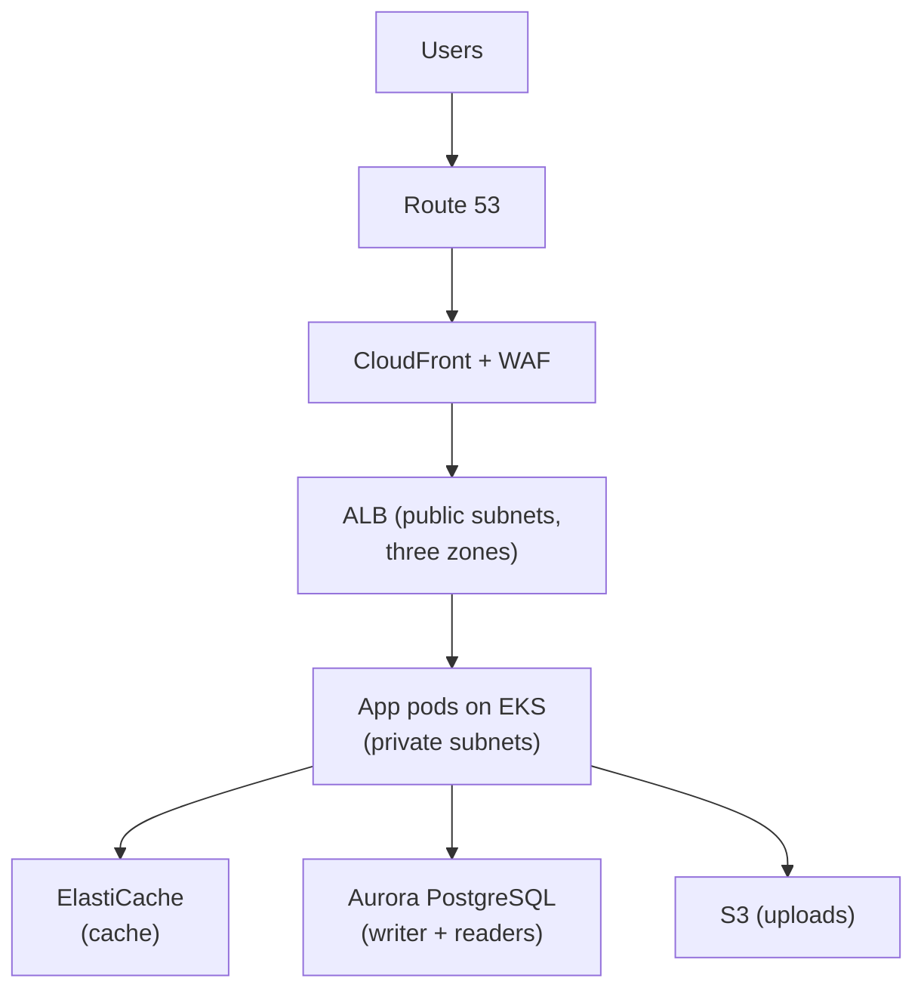
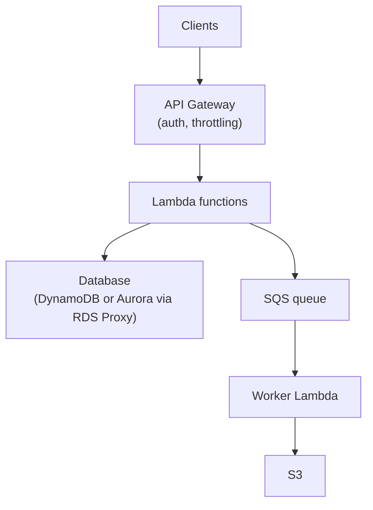
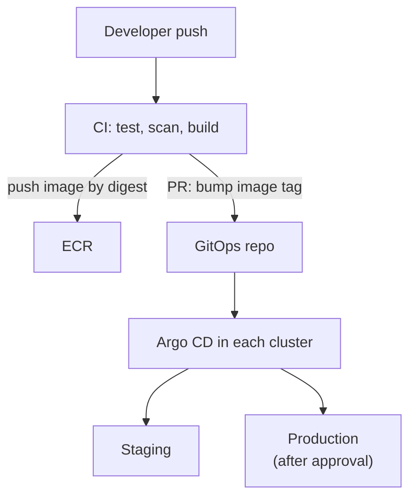

# System design on a whiteboard

> **Status: AI draft, 2026-11-16.** Not yet verified by me. Generic reference designs built from the linked pages; no real system is described.

## In one line

Design out loud in a fixed order: requirements, the request path, the delivery path, where state lives, failure modes, security, and cost. Draw boxes and arrows as you go, state each trade-off as a choice with a reason, and leave room for "what if traffic grows ten times?"

## The method

| Step | Questions to ask or answer |
|---|---|
| 1. Requirements | Users and traffic (requests per second, peaks), latency target, availability target, data size, regions, compliance, team size |
| 2. Request path | DNS, CDN, load balancer, compute, cache, database: draw it left to right |
| 3. Delivery path | How code gets from a commit to production, and how it rolls back |
| 4. State | Where data lives, how it is backed up, how it fails over, what is cached |
| 5. Failure modes | What happens when a zone, a node, a dependency or a deploy fails |
| 6. Security | Identity, network boundaries, secrets, encryption, audit |
| 7. Cost | The biggest line items and how they scale |
| 8. Operations | Metrics, logs, traces, alerts, runbooks |

Spend the first few minutes on requirements: a design is only right for its requirements. Write the numbers on the board so later choices can point at them ([High availability](../operations/high-availability.md)).

## Design 1: a web application on EKS

- **Request path:** Route 53 → CloudFront (static assets, TLS, WAF) → ALB created by the AWS Load Balancer Controller → pods spread across three zones ([AWS Load Balancer Controller](../eks/load-balancer-controller.md)).
- **Compute:** Deployments with HPA on CPU or requests; Karpenter adds nodes for pending pods; PDBs and topology spread keep zones balanced ([Autoscaling](../kubernetes/autoscaling.md), [Karpenter in depth](../eks/karpenter.md)).
- **State:** Aurora with readers in other zones; ElastiCache for hot reads with cache-aside; S3 for files ([RDS and Aurora](../aws-services/rds-and-aurora.md), [Redis and caching patterns](../data/redis-and-caching.md)).
- **Security:** pods use Pod Identity or IRSA for AWS access; secrets from Secrets Manager; security groups allow only the path shown ([Cluster access, IRSA and Pod Identity](../eks/access-and-pod-identity.md)).
- **Failure modes:** a zone loss leaves two thirds of pods and a reader to promote; a bad deploy is caught by readiness and canary steps; a cache failure falls back to the database (check it can take the load).
- **Trade-offs to say:** EKS gives control and portability but costs operational effort; ECS or serverless would be simpler for a small team ([ECS and Fargate](../serverless/ecs-and-fargate.md)).

## Design 2: a serverless API

- **Request path:** API Gateway handles TLS, authorization (Cognito or JWT authorizer) and throttling; Lambda runs the handlers ([API Gateway](../serverless/api-gateway.md), [Cognito](../serverless/cognito.md)).
- **Asynchronous work:** slow tasks go to SQS and a worker function with a dead-letter queue ([SQS, SNS and EventBridge](../aws-services/messaging.md)).
- **State:** DynamoDB fits key-value access at any scale; a relational database needs RDS Proxy to survive Lambda's connection fan-out.
- **Limits to mention:** API Gateway integration timeouts, Lambda's maximum duration and concurrency, payload sizes ([Lambda](../serverless/lambda.md)).
- **Trade-offs to say:** no servers to patch and cost scales to zero; cold starts, per-request cost at high steady traffic, and harder local testing.

## Design 3: a CI/CD pipeline with GitOps

- **CI:** tests, linting, dependency and image scanning, build once, push by digest, sign; CI authenticates to AWS with OIDC, not stored keys ([OIDC from pipelines to AWS](../cicd/oidc-to-aws.md), [Pipeline security](../cicd/pipeline-security.md)).
- **CD:** the pipeline changes Git, not the cluster; Argo CD pulls and syncs; promotion is a pull request from staging to production values ([Principles](../gitops/principles.md), [Promotion and rollback](../gitops/promotion-and-rollback.md)).
- **Safety:** required reviews, protected branches, canary or blue/green in production, automated rollback on error-rate alerts ([Deployment strategies](../cicd/deployment-strategies.md)).
- **Trade-offs to say:** GitOps gives an audit trail and drift correction, but adds a repository and a controller to run; a push-based pipeline is simpler for one cluster.

## Questions interviewers add, and how to handle them

| Follow-up | What to talk about |
|---|---|
| "Traffic grows ten times" | Which component saturates first: database connections and writes, then cache, then compute; read replicas, caching, queues, sharding |
| "Make it multi-region" | Active-passive versus active-active, data replication lag, DNS failover, cost doubling ([Backup and DR](../operations/backup-and-dr.md)) |
| "Cut the cost in half" | Right-sizing, Spot for stateless pods, Savings Plans, storage tiers, NAT and data transfer ([Cost optimisation](../operations/cost-optimisation.md)) |
| "How do you know it works?" | SLOs, golden-signal dashboards, alerts on symptoms, synthetic checks ([SLOs](../observability/slos.md)) |
| "A whole zone fails" | Spread across three zones, health checks, failover of the database, capacity headroom |

## Habits

- Say numbers out loud and use them: "1,000 requests per second at 100 KB each is about 100 MB per second."
- Name the trade-off for every box: why this and not the obvious alternative.
- Keep it simple first, then evolve when asked; a design with fewer moving parts is easier to defend.
- Admit what you would look up: exact quotas and prices change ([How to answer technical questions](how-to-answer.md)).
