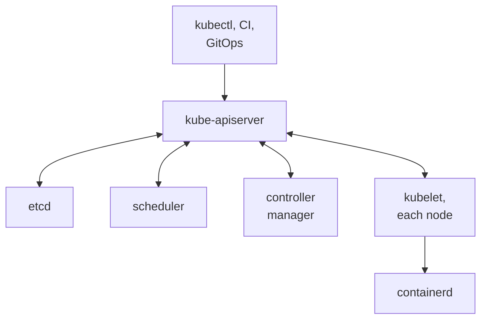
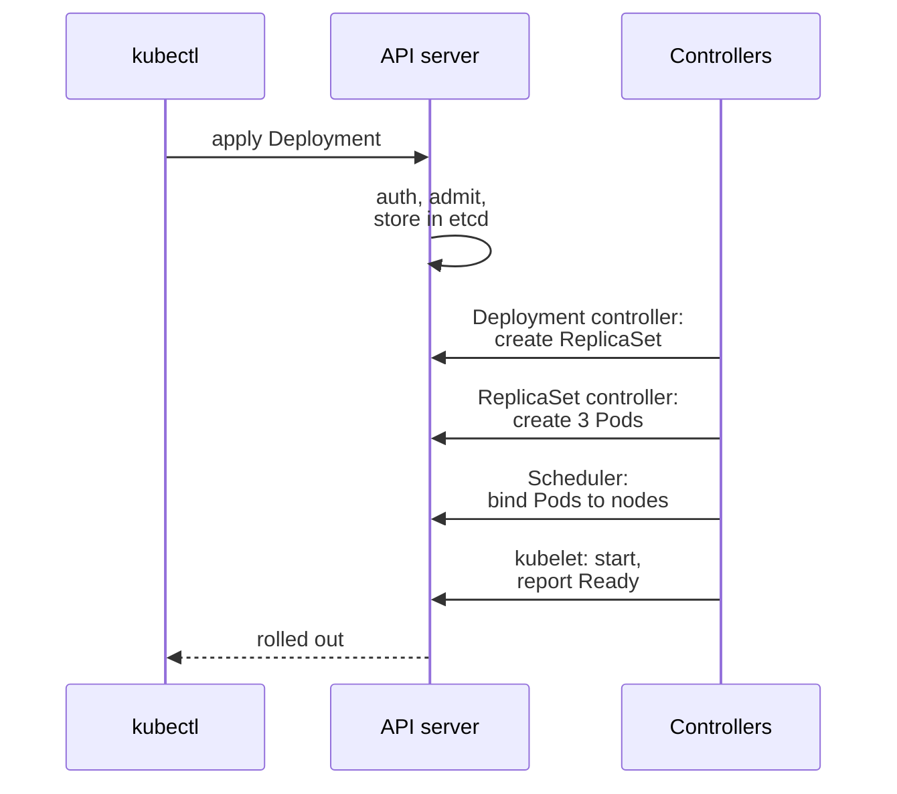

# Architecture and the reconcile loop

> **Status: AI draft, 2026-11-16.** Not yet verified by me. Commands and output were run on a local kind cluster (Kubernetes 1.37); addresses are rewritten to example ranges.

## In one line

Kubernetes stores the desired state of everything in etcd behind the API server, and controllers keep comparing it with the actual state and acting to close the gap. The control plane (API server, etcd, scheduler, controller manager) decides; on each node the kubelet, the container runtime, kube-proxy and the CNI plugin carry it out.

## The plain idea

With plain servers, you give orders: "start this process", "copy that file". If the process dies at 3 a.m., nothing restarts it unless you wrote something to.

Kubernetes works the other way round. You write down what you want ("three copies of sample-app, version 1.0.2, each with 256 MiB"), and Kubernetes keeps comparing that wish with reality. A copy crashed? Reality is two, the wish is three: start one. A node vanished? Its pods are gone: recreate them elsewhere. That endless compare-and-fix cycle is the **reconcile loop**, and almost every part of Kubernetes is a small program running one.

## How it works

### The parts



Every arrow goes through the API server: components watch it and write back to it. kube-proxy and the CNI plugin also run on each node (table below).

**Control plane**

| Component | Job |
|---|---|
| **kube-apiserver** | The front door. Authenticates and authorises every request ([RBAC and service accounts](rbac-and-service-accounts.md)), runs admission checks ([CRDs, operators and admission webhooks](crds-and-operators.md)), validates objects, and stores them in etcd. Every other component talks only to it. |
| **etcd** | A consistent, replicated key-value store holding every object. The cluster's only memory ([etcd, backups and cluster upgrades](etcd-backups-and-upgrades.md)). |
| **kube-scheduler** | Watches for pods with no node, picks the best node by filtering and scoring, and writes the choice back ([Scheduling](scheduling.md)). |
| **kube-controller-manager** | Runs the built-in controllers: Deployment, ReplicaSet, StatefulSet, Job, Node, EndpointSlice, garbage collector and more. |
| **cloud-controller-manager** | Talks to the cloud: creates load balancers for Services, labels nodes with zones, removes nodes whose instances are gone. |

**Each node**

| Component | Job |
|---|---|
| **kubelet** | Watches for pods assigned to its node, asks the runtime to start them, runs probes, mounts volumes, reports status ([Probes and graceful shutdown](probes-and-graceful-shutdown.md)). |
| **Container runtime** | containerd or CRI-O, through the CRI ([Container runtimes](../containers/runtimes.md)). |
| **kube-proxy** | Programs iptables, IPVS or nftables rules so Service addresses reach pods ([Services and DNS](services-and-dns.md)). Some network plugins replace it. |
| **CNI plugin** | Gives each pod a network interface and address ([Pod networking and NetworkPolicy](pod-networking-and-network-policy.md)). |

On a managed service such as EKS, the provider runs the control plane for you; you see only the API endpoint and your nodes ([EKS architecture and node options](../eks/architecture.md)).

### Objects: spec and status

Every object has a **spec** (what you want) and a **status** (what is true now, written by controllers). You write the spec; you never write the status. `kubectl get` and `describe` show both. Objects also carry **metadata**: name, namespace, labels, annotations, and owner references.

### What happens after `kubectl apply` of a Deployment



1. The API server checks who you are, whether you may do this, runs admission (defaults, policies), and stores the Deployment.
2. The **Deployment controller** sees a Deployment with no matching ReplicaSet and creates one.
3. The **ReplicaSet controller** sees zero pods for a ReplicaSet that wants three, and creates three pod objects with no node.
4. The **scheduler** sees unscheduled pods, picks a node for each, and records it.
5. The **kubelet** on that node sees pods assigned to it, pulls images, starts containers through the runtime, runs probes, and reports status.

No component calls another directly. Each one **watches** the API server for the objects it cares about and writes its results back. That is why the system keeps working when any single component restarts: when it comes back, it reads the current state and continues.

## A concrete example

A node in a three-node cluster loses power.

1. Its kubelet stops reporting. After a grace period the **node controller** marks the node `NotReady` and taints it.
2. Pods on the node are eventually marked for eviction (by default after about five minutes of the node being unreachable, through a toleration Kubernetes adds to pods).
3. Each pod's ReplicaSet now counts fewer ready replicas than desired and creates replacements.
4. The scheduler places the new pods on the two healthy nodes, if they have room.
5. Nobody ran a command. The desired state (three replicas) never changed; the controllers closed the gap.

If the pods had been created bare, with no controller, step 3 would never happen: nothing owns them, so nothing replaces them ([Pods](pods.md)).

## Why not just...?

- **...run containers with a script that starts them on servers?** It works until a server dies, a container crashes, or you need to change the version on fifty machines at once. The reconcile loop handles all three with the same mechanism.
- **...let components talk to each other directly?** Every pair would need to know about every other. With everything going through the API server, each component only watches objects, and new controllers (yours included) plug in the same way.
- **...edit the running state by hand (`kubectl edit`, `kubectl scale`) in production?** It works, until the next deploy or GitOps sync puts back what is written in Git ([GitOps principles](../gitops/principles.md)). Change the declared state, not the live one.

## Commands to know

The node and the control plane, which on kind runs as pods on the same node:

```console
$ kubectl get nodes -o wide
NAME                      STATUS   ROLES           VERSION   INTERNAL-IP   CONTAINER-RUNTIME
notes-lab-control-plane   Ready    control-plane   v1.37.0   172.18.0.2    containerd://...
$ kubectl get pods -n kube-system -o custom-columns=NAME:.metadata.name,STATUS:.status.phase
NAME                                              STATUS
coredns-559f6c778d-dz9l7                          Running
coredns-559f6c778d-p79mw                          Running
etcd-notes-lab-control-plane                      Running
kindnet-jzwmm                                     Running
kube-apiserver-notes-lab-control-plane            Running
kube-controller-manager-notes-lab-control-plane   Running
kube-proxy-z9rd4                                  Running
kube-scheduler-notes-lab-control-plane            Running
```

Columns trimmed. kindnet is kind's CNI plugin. On managed services you do not see the control-plane pods.

The chain of owners the controllers created:

```console
$ kubectl apply -f deploy.yaml
deployment.apps/sample-app created
$ kubectl get pod <a sample-app pod> -n demo -o jsonpath='{.metadata.ownerReferences[0].kind}/{.metadata.ownerReferences[0].name}'
ReplicaSet/sample-app-dcc66c4d7
$ kubectl get rs sample-app-dcc66c4d7 -n demo -o jsonpath='{.metadata.ownerReferences[0].kind}/{.metadata.ownerReferences[0].name}'
Deployment/sample-app
```

| Command | What it shows |
|---|---|
| `kubectl get <kind> <name> -o yaml` | The full object: spec, status, metadata. |
| `kubectl get events -n <ns> --sort-by=.lastTimestamp` | What controllers and the kubelet did, in order. |
| `kubectl get --raw /readyz?verbose` | The API server's own health checks. |
| `kubectl api-resources` | Every object type the API server knows, including custom ones. |
| `kubectl get <kind> -w` | Watch changes live, as the controllers do. |

## How it breaks

| Symptom | Layer | Check | Likely cause |
|---|---|---|---|
| `kubectl` times out or `connection refused` | API server | Endpoint, network path, credentials | API server down, wrong context, network blocked |
| Pods created but stay `Pending` | Scheduler | `kubectl describe pod` events | No node fits ([Scheduling](scheduling.md)) |
| Pods scheduled but stay `ContainerCreating` | kubelet, runtime, CNI | Pod events; kubelet and runtime logs on the node | Image pull, volume mount or network setup failing |
| Deployment exists but no pods appear | Controllers | `kubectl get rs`; events | Controller manager unhealthy, or admission rejecting pods (quota, policy) |
| Node `NotReady` | kubelet | `kubectl describe node` conditions | kubelet stopped, runtime down, disk or memory pressure, network partition |
| Manual changes keep reverting | Reconciliation | Who owns the object? | A controller or GitOps tool restoring the declared state |

## Interview questions

**1. Name the control-plane components and what each does.**

<details markdown="1">
<summary>Answer</summary>

- kube-apiserver: the only entry point; authenticates, authorises, admits, validates and stores objects.
- etcd: the consistent key-value store holding all cluster state.
- kube-scheduler: assigns pods to nodes.
- kube-controller-manager: runs controllers that reconcile desired and actual state; cloud-controller-manager talks to the cloud.

</details>

**2. What runs on every worker node?**

<details markdown="1">
<summary>Answer</summary>

- The kubelet, which runs the pods assigned to the node and reports status.
- A container runtime such as containerd, used through the CRI.
- kube-proxy (or a replacement) for Service routing, and the CNI plugin for pod networking.

</details>

**3. What is a reconcile loop?**

<details markdown="1">
<summary>Answer</summary>

- A controller repeatedly compares the desired state (spec) with the actual state (status and the world).
- It takes the smallest action to close the difference, then checks again.
- It makes the system self-healing and lets components restart safely.

</details>

**4. Walk me through what happens when you apply a Deployment.**

<details markdown="1">
<summary>Answer</summary>

- The API server authenticates, authorises, admits and stores it in etcd.
- The Deployment controller creates a ReplicaSet; the ReplicaSet controller creates pods.
- The scheduler binds each pod to a node; that node's kubelet starts the containers and reports Ready.

</details>

**5. A node goes down. What does Kubernetes do, and what does it not do?**

<details markdown="1">
<summary>Answer</summary>

- The node controller marks it NotReady; after a timeout its pods are evicted.
- Controllers (ReplicaSets, StatefulSets) create replacements, which the scheduler places on healthy nodes.
- Bare pods with no controller are not replaced; and volumes tied to that node or zone may block StatefulSet pods.

</details>

**6. Why does every component talk only to the API server?**

<details markdown="1">
<summary>Answer</summary>

- One place for authentication, authorisation, validation and auditing.
- Components stay decoupled: each watches objects and writes results, so they can restart or be replaced independently.
- Custom controllers and operators plug in the same way.

</details>

## Try it

**Step 1.** Create a kind cluster, or use an existing one, and look at the control plane.

```bash
kind create cluster --name arch-demo
kubectl get pods -n kube-system
```

**Step 2.** Create a Deployment, then delete one of its pods. Predict what happens before you run the last command.

```bash
kubectl create deployment web --image=nginx:1.27 --replicas=3
kubectl rollout status deployment/web
kubectl delete pod $(kubectl get pods -l app=web -o jsonpath='{.items[0].metadata.name}')
kubectl get pods -l app=web
```

**Step 3.** Read the events to see which controller did what, then delete the cluster.

```bash
kubectl get events --sort-by=.lastTimestamp | tail -10
kind delete cluster --name arch-demo
```

## Zoom out

Every Kubernetes topic is a variation on this page: an object type with a spec, and a controller that reconciles it, whether it is a Deployment, a Service, a Karpenter NodePool or an Argo CD Application ([CRDs, operators and admission webhooks](crds-and-operators.md)). The same desired-state idea drives GitOps one level up ([GitOps principles](../gitops/principles.md)). The principle to carry: change the declared state and let controllers do the work, and when something is wrong, ask which controller should have acted and why it did not.

## Sources

- [Kubernetes documentation: cluster architecture](https://kubernetes.io/docs/concepts/architecture/)
- [Kubernetes documentation: Kubernetes components](https://kubernetes.io/docs/concepts/overview/components/)
- [Kubernetes documentation: controllers](https://kubernetes.io/docs/concepts/architecture/controller/)
- [Kubernetes documentation: objects, spec and status](https://kubernetes.io/docs/concepts/overview/working-with-objects/)
- [Kubernetes documentation: nodes and the node controller](https://kubernetes.io/docs/concepts/architecture/nodes/)
- [Kubernetes documentation: taint-based evictions](https://kubernetes.io/docs/concepts/scheduling-eviction/taint-and-toleration/)
