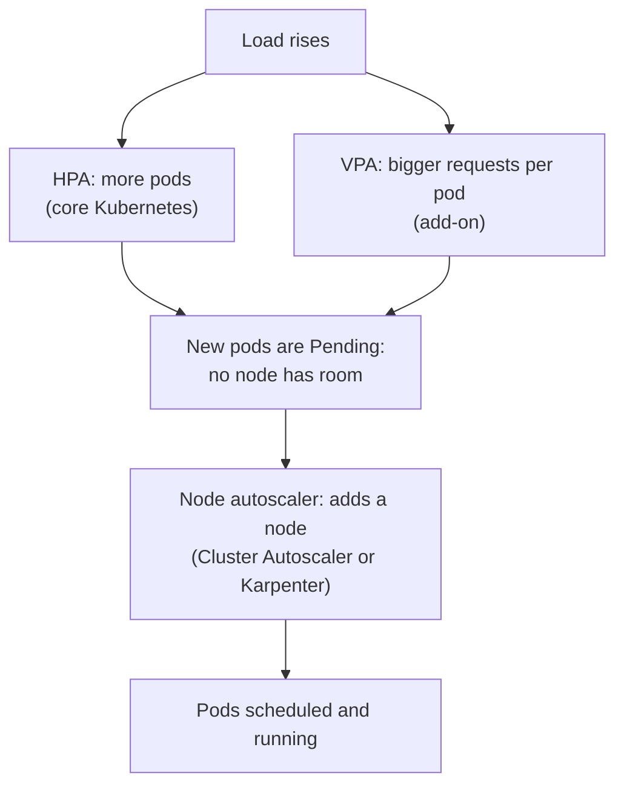

# Autoscaling

> **Status: AI draft, 2026-11-16.** Not yet verified by me. The HPA commands were run on a local kind cluster (Kubernetes 1.37) that has no metrics server, so they show the failure case; scaling behaviour is from the documentation.

## In one line

Kubernetes scales on three levers: the HorizontalPodAutoscaler changes how many pods run, the VerticalPodAutoscaler changes how big each pod's requests are, and a node autoscaler (Cluster Autoscaler or Karpenter) adds nodes when pods cannot be scheduled. The HPA computes `ceil(current replicas × current metric / target)` every 15 seconds, and CPU targets are percentages of requests.

## The plain idea

When load rises, you can run more copies of the app, give each copy more CPU and memory, or buy more machines to put them on. Kubernetes has one automatic controller for each:



They chain: the pod autoscalers create demand, and the node autoscaler supplies capacity ([Cluster Autoscaler vs Karpenter](../eks/cluster-autoscaler-vs-karpenter.md)). Each one needs measurements to decide, and that is where most autoscaling problems start.

## How it works

### Where the numbers come from

| API | Serves | Provided by |
|---|---|---|
| `metrics.k8s.io` (resource metrics) | CPU and memory per pod and node | metrics-server, an add-on; stable `v1` since Kubernetes 1.37 |
| `custom.metrics.k8s.io` | Metrics about Kubernetes objects, such as requests per second per pod | An adapter, for example Prometheus Adapter |
| `external.metrics.k8s.io` | Metrics from outside the cluster, such as queue length | An adapter or KEDA |

`kubectl top` reads the same resource metrics API. If `kubectl top` fails, a CPU-based HPA cannot work either.

### The HPA loop

Every 15 seconds (the controller manager's default sync period) the HPA controller:

1. Reads the target's pods through the Deployment's selector, and their metric values.
2. Computes `desiredReplicas = ceil(currentReplicas × currentMetricValue / desiredMetricValue)`.
3. Skips the change if the ratio is within the tolerance (0.1 by default) of 1.0.
4. Applies its `behavior` rules (below) and writes the new count to the Deployment's `scale` subresource. The Deployment then does the rest ([Deployments and rollouts](deployments-and-rollouts.md)).

**Utilisation is relative to requests.** `averageUtilization: 60` means 60% of each pod's CPU request, not of a core and not of the limit ([Requests, limits and QoS](resources-and-qos.md)). A pod with no CPU request cannot be measured as a percentage.

Pods that are not ready yet, or are missing metrics, are set aside and treated conservatively, so a slow-starting app does not trigger runaway scaling.

### behavior: how fast it may move

The default rules, from the documentation:

```yaml
behavior:
  scaleDown:
    stabilizationWindowSeconds: 300
    policies:
      - type: Percent
        value: 100
        periodSeconds: 15
  scaleUp:
    stabilizationWindowSeconds: 0
    policies:
      - type: Percent
        value: 100
        periodSeconds: 15
      - type: Pods
        value: 4
        periodSeconds: 15
    selectPolicy: Max
```

- **Scale up at once**: double, or add 4 pods, whichever is more, every 15 seconds.
- **Scale down carefully**: use the highest recommendation of the last 5 minutes, which stops flapping when load is spiky.
- `selectPolicy: Disabled` turns off scaling in one direction, for example never scaling down automatically.

### Scaling to zero

CPU and memory can only be measured on running pods, so a CPU-based HPA cannot scale to zero. Since Kubernetes 1.37, an HPA with an object or external metric (a queue length, for example) may set `minReplicas: 0`; the `HPAScaleToZero` feature is beta and on by default. While at zero, a Service has no endpoints and does not hold requests, so this suits queue workers, not request-driven web apps.

**KEDA** is an add-on built for event-driven scaling: a `ScaledObject` names a source (a queue, a stream, a Prometheus query, a cron schedule), and KEDA creates and drives an HPA for it, including scaling to and from zero.

### VPA in brief

The VerticalPodAutoscaler is an add-on (a CRD and three components: recommender, updater, admission controller). It watches real usage and recommends requests. Its `updateMode`:

| Mode | What it does |
|---|---|
| `Off` | Only writes recommendations to `.status`. A safe way to right-size by hand. |
| `Initial` | Applies requests only when pods are created. |
| `Recreate` | Evicts pods whose requests are far off, so they come back resized. |
| `InPlaceOrRecreate` | Resizes running pods in place where possible, otherwise evicts. |
| `InPlace` | Only resizes in place, behind a feature gate; defers when it cannot. |

The VPA project warns against using VPA and HPA on the same metric (CPU or memory): VPA raises requests, which lowers utilisation, which makes the HPA scale in, and the two fight.

## A concrete example

`sample-app` has a CPU request of `250m`, an HPA targeting 60% average utilisation, `minReplicas: 2`, `maxReplicas: 10`.

1. 4 pods are running, averaging 90% of their request (225m each).
2. `ceil(4 × 90 / 60) = ceil(6.0) = 6`. The ratio 1.5 is outside the tolerance, so the HPA sets 6 replicas.
3. Two new pods are Pending because the nodes are full. Karpenter sees unschedulable pods and launches a node ([Karpenter in depth](../eks/karpenter.md)); about a minute later they run.
4. Load drops to 30%. The HPA would now want `ceil(6 × 30 / 60) = 3`, but the 5-minute scale-down window holds 6 until the lower recommendation has lasted that long.
5. Total reaction time to a spike is metric lag plus pod startup plus, if needed, node startup. For sudden traffic, keep headroom (a higher `minReplicas` or a lower target) rather than relying on autoscaling alone.

## Why not just...?

- **...set a high fixed replica count?** It works, and for small, steady services it is often the right answer. It costs money at night and still runs out at an unusual peak.
- **...scale on CPU for everything?** A queue worker can be idle on CPU with a million messages waiting, and a web app can be limited by a database while its CPU is low. Scale on the signal that measures the work: queue length, requests per second, or latency.
- **...use the HPA and keep `replicas:` in the Deployment manifest?** Every apply or GitOps sync resets the count, fighting the HPA. Remove `spec.replicas` from the manifest once an HPA owns it ([Sync, hooks and waves](../gitops/sync-hooks-waves.md)).

## Commands to know

An HPA on a cluster without a metrics server:

```console
$ kubectl autoscale deployment hpa-demo -n demo --min=1 --max=5 --cpu=50%
horizontalpodautoscaler.autoscaling/hpa-demo autoscaled
$ kubectl get hpa hpa-demo -n demo
NAME       REFERENCE             TARGETS              MINPODS   MAXPODS   REPLICAS   AGE
hpa-demo   Deployment/hpa-demo   cpu: <unknown>/50%   1         5         1          0s
$ kubectl describe hpa hpa-demo -n demo
...
Conditions:
  Type           Status  Reason                   Message
  ----           ------  ------                   -------
  AbleToScale    True    SucceededGetScale        the HPA controller was able to get the target's current scale
  ScalingActive  False   FailedGetResourceMetric  the HPA was unable to compute the replica count: failed to get cpu utilization: unable to get metrics for resource cpu: unable to fetch metrics from resource metrics API: the server could not find the requested resource (get pods.metrics.k8s.io)
$ kubectl top pods -n demo
error: Metrics API not available
```

`<unknown>` in TARGETS and `ScalingActive False` mean the HPA has no numbers and will not scale. `--cpu=50%` is the current flag; it writes `type: Utilization, averageUtilization: 50`. The generated spec:

```yaml
spec:
  maxReplicas: 5
  metrics:
    - type: Resource
      resource:
        name: cpu
        target:
          type: Utilization
          averageUtilization: 50
  minReplicas: 1
  scaleTargetRef:
    apiVersion: apps/v1
    kind: Deployment
    name: hpa-demo
```

| Command | What it does |
|---|---|
| `kubectl get hpa -A` | Every HPA, its current and target values, and replica counts. |
| `kubectl get hpa <name> -w` | Watch decisions as load changes. |
| `kubectl describe hpa <name>` | Conditions (`AbleToScale`, `ScalingActive`, `ScalingLimited`) and events with the reason for each change. |
| `kubectl top pods -n <ns>` | Current CPU and memory from the metrics API. |
| `kubectl get apiservice v1.metrics.k8s.io` | Whether the metrics API is registered and available. |
| `kubectl get --raw /apis/metrics.k8s.io/v1/namespaces/<ns>/pods` | The raw numbers the HPA sees. |

## How it breaks

| Symptom | Layer | Check | Likely cause |
|---|---|---|---|
| TARGETS shows `<unknown>` | Metrics | `kubectl top`, `kubectl get apiservice` | No metrics-server, or its APIService is unavailable |
| Events say a container has no CPU request | Pod spec | Container `resources.requests` | Utilisation target on a container with no request |
| Replica count jumps back after every deploy | Ownership | Manifest `spec.replicas`, GitOps diffs | Manifest and HPA both set replicas |
| At `maxReplicas`, still slow | Bottleneck elsewhere | `ScalingLimited` condition, database, dependencies | Limit too low, or the app is not CPU-bound |
| New pods stay Pending | Nodes | `kubectl describe pod` events | Node autoscaler missing, at its limit, or no instance type fits |
| Replicas flap up and down | Behaviour | HPA events over time | Short scale-down window, or a noisy metric |
| VPA and HPA keep changing the same app | Conflict | Both objects' targets | Both acting on CPU or memory |

## Interview questions

**1. How does the HPA decide how many replicas to run?**

<details markdown="1">
<summary>Answer</summary>

- `desired = ceil(current × currentMetric / targetMetric)`, every 15 seconds by default.
- Skips changes within a 10% tolerance; ignores or discounts not-ready pods and missing metrics.
- Applies `behavior` limits, then sets the target's scale subresource.

</details>

**2. An HPA shows `<unknown>` for its target. What do you check?**

<details markdown="1">
<summary>Answer</summary>

- `kubectl top pods`: if it fails, metrics-server or the metrics APIService is the problem.
- `kubectl describe hpa`: the condition message names the failure.
- Container CPU requests: utilisation targets need them.

</details>

**3. Why does a CPU utilisation target depend on requests?**

<details markdown="1">
<summary>Answer</summary>

- Utilisation is usage divided by the pod's request.
- No request means no denominator, so the HPA cannot compute it.
- Requests that are far too high or low make the same target mean very different real loads.

</details>

**4. What are the differences between HPA, VPA and a node autoscaler?**

<details markdown="1">
<summary>Answer</summary>

- HPA: number of pods; core Kubernetes.
- VPA: requests per pod; an add-on with Off, Initial, Recreate and in-place modes.
- Node autoscaler: number of nodes, reacting to unschedulable pods (Cluster Autoscaler, Karpenter).

</details>

**5. Why is scale-down slower than scale-up by default?**

<details markdown="1">
<summary>Answer</summary>

- Scale-down uses a 300-second stabilisation window: the highest recommendation of the last 5 minutes.
- It prevents flapping when load is spiky; removing capacity too early causes the next spike to hurt.
- Scale-up has no window, and can double or add 4 pods every 15 seconds.

</details>

**6. A queue worker should scale on queue length, including down to zero. How?**

<details markdown="1">
<summary>Answer</summary>

- Expose queue length as an external metric (an adapter, or KEDA, which manages the HPA for you).
- An HPA with an external metric may use `minReplicas: 0`, beta and on by default since 1.37; KEDA has supported it longer.
- Accept the cold start: the first message waits for a pod to start.

</details>

**7. Traffic spiked, the HPA scaled out, but users still saw errors for three minutes. Why, and what would you change?**

<details markdown="1">
<summary>Answer</summary>

- Reaction time adds up: metric collection, 15-second loop, pod startup and readiness, possibly a new node.
- Keep headroom: a higher `minReplicas` or a lower target, faster startup, and scheduled pre-scaling before known peaks.
- Make sure readiness probes keep traffic off pods until they can serve ([Probes and graceful shutdown](probes-and-graceful-shutdown.md)).

</details>

## Try it

**Step 1.** On a kind cluster (no metrics server by default), create a Deployment with a CPU request and an HPA.

```bash
kubectl create namespace hpa-try
kubectl create deployment w -n hpa-try --image=busybox:1.36 -- sleep 3600
kubectl set resources deployment w -n hpa-try --requests=cpu=100m
kubectl autoscale deployment w -n hpa-try --min=1 --max=5 --cpu=50%
```

**Step 2.** Predict what TARGETS shows and which condition is false, then check.

```bash
kubectl get hpa w -n hpa-try
kubectl describe hpa w -n hpa-try | grep -A4 Conditions
```

**Step 3.** On paper: 3 pods at 80% of request with a 50% target. How many replicas? (Answer: `ceil(3 × 80 / 50) = ceil(4.8) = 5`.) Then clean up.

```bash
kubectl delete namespace hpa-try
```

## Zoom out

Autoscaling is a feedback loop like every controller in Kubernetes ([Architecture and the reconcile loop](architecture.md)), and it is only as good as its inputs: correct requests, a meaningful metric, and fast startup. The node layer is where the cost is ([Cost optimisation](../operations/cost-optimisation.md)), and the metric layer is where observability comes in ([Prometheus on Kubernetes](../observability/prometheus-on-kubernetes.md)).

## Sources

- [Kubernetes documentation: horizontal pod autoscaling](https://kubernetes.io/docs/concepts/workloads/autoscaling/horizontal-pod-autoscale/)
- [Kubernetes documentation: vertical pod autoscaling](https://kubernetes.io/docs/concepts/workloads/autoscaling/vertical-pod-autoscale/)
- [Kubernetes documentation: autoscaling workloads](https://kubernetes.io/docs/concepts/workloads/autoscaling/)
- [Kubernetes blog: v1.37, scale workloads to zero with the HPA](https://kubernetes.io/blog/2026/09/02/kubernetes-v1-37-hpa-scale-to-zero-beta/)
- [Kubernetes blog: v1.37, Metrics API graduates to stable](https://kubernetes.io/blog/2026/08/27/kubernetes-v1-37-metrics-api-ga/)
- [Kubernetes autoscaler project: VPA known limitations](https://github.com/kubernetes/autoscaler/blob/master/vertical-pod-autoscaler/docs/known-limitations.md)
- [KEDA documentation: concepts](https://keda.sh/docs/2.21/concepts/)
