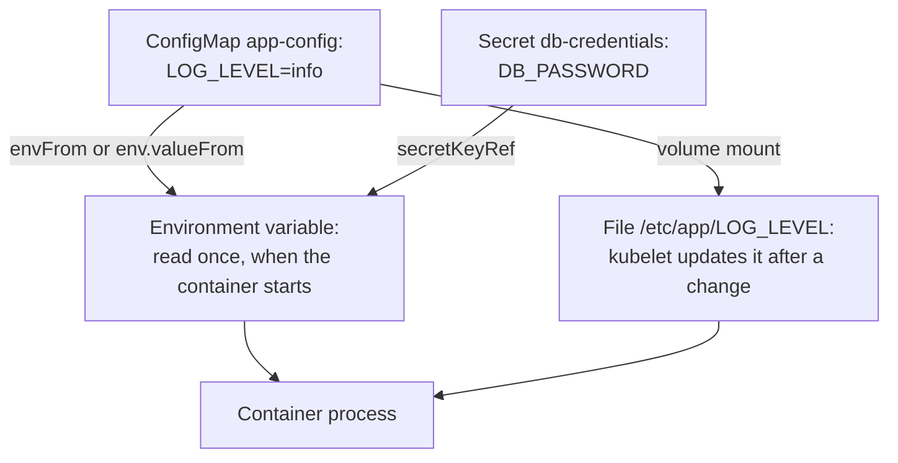

# ConfigMaps and Secrets

> **Status: AI draft, 2026-11-16.** Not yet verified by me. Commands and output were run on a local kind cluster (Kubernetes 1.37); generated names are replaced with placeholders.

## In one line

ConfigMaps hold configuration and Secrets hold sensitive values, both outside the image; pods read them as environment variables (fixed at container start) or as mounted files (updated in place after a delay). Secret values are only base64-encoded, so protect them with RBAC, encryption at rest, and often an external secret store.

## The plain idea

The same image should run in development, staging and production; only its settings differ: log level, feature switches, database address, credentials. Baking those into the image means one build per environment and secrets inside image layers ([Images and Dockerfiles](../containers/images-and-dockerfiles.md)). Kubernetes keeps them in separate objects and hands them to the container when it starts.

A **ConfigMap** is for ordinary settings. A **Secret** is for passwords, tokens and keys. They work almost identically; the differences are in how carefully the cluster treats Secrets, and that care is less than many people assume.

## How it works

### Two ways to consume them



| Method | Updates when the ConfigMap changes? | Notes |
|---|---|---|
| `env` with `configMapKeyRef` or `secretKeyRef` | No: only when the container restarts | One key at a time |
| `envFrom` | No | Every key becomes a variable |
| Volume mount | Yes, after a delay (the kubelet's sync period plus caching; about a minute in practice) | Each key is a file. Not updated if mounted with `subPath` |

Even when files update, the application must re-read them. Many applications read configuration only at start-up, so a restart is still needed. A common pattern puts a hash of the configuration in a pod-template annotation, so any configuration change changes the template and triggers a rolling update ([Deployments and rollouts](deployments-and-rollouts.md)). Helm charts often do this with a `checksum/config` annotation ([Charts, templates and values](../helm/charts-and-templates.md)).

### Secrets: what is and is not protected

- In the API, Secret values are **base64-encoded**. That is an encoding for binary data, not encryption: anyone who can read the Secret can decode it in one command.
- In etcd, Secrets are stored **unencrypted unless** the API server is configured with **encryption at rest**, ideally with a KMS provider. Managed services such as EKS offer envelope encryption with a cloud KMS key.
- Anyone who can **create a pod** in a namespace can mount any Secret in it and read it from inside the pod. RBAC on `get secrets` is not the only door ([RBAC and service accounts](rbac-and-service-accounts.md)).
- Secrets used as environment variables can leak into crash dumps, debug pages and logs of `env`. Files are somewhat safer.
- Secret types tell tools what to expect: `Opaque` (generic), `kubernetes.io/tls` (certificate and key), `kubernetes.io/dockerconfigjson` (registry credentials for image pulls).

Many teams keep the real secret in an external store and sync or mount it into the cluster ([Secrets from AWS into pods](../eks/secrets.md), [Secrets management](../security/secrets-management.md)). Never commit a plain Secret manifest to Git.

### Immutable ConfigMaps and Secrets

Setting `immutable: true` forbids changes to the data. It protects against accidental edits that would roll into every pod, and it lets the kubelet stop watching the object, which reduces load on large clusters. To change it, create a new one with a new name and point the workload at it.

## A concrete example

A service needs a log level and a database password.

```yaml
apiVersion: v1
kind: Pod
metadata:
  name: config-demo
  namespace: demo
spec:
  containers:
    - name: app
      image: busybox:1.36
      command: ["sh", "-c", "sleep 3600"]
      envFrom:
        - configMapRef:
            name: app-config
      env:
        - name: DB_PASSWORD
          valueFrom:
            secretKeyRef:
              name: db-credentials
              key: DB_PASSWORD
      volumeMounts:
        - name: config
          mountPath: /etc/app
          readOnly: true
  volumes:
    - name: config
      configMap:
        name: app-config
```

1. The pod reads `LOG_LEVEL` both ways, as a variable and as `/etc/app/LOG_LEVEL`.
2. The ConfigMap is changed from `info` to `debug`.
3. About 75 seconds later, the file says `debug`; the variable still says `info` and will until the container restarts.
4. The application only reads its configuration at start-up, so the team adds a checksum annotation; configuration changes now roll the pods automatically and visibly.

## Why not just...?

- **...bake configuration into the image?** One image per environment, rebuilds for every setting change, and secrets inside layers anyone can pull. Configuration belongs to the environment, not the build.
- **...trust base64 as protection?** It is reversible by anyone. Protection comes from RBAC, encryption at rest, limiting who can create pods, and external secret stores.
- **...expect a ConfigMap edit to reach running pods?** Variables never change in a running container, and many apps never re-read files. Plan a rollout for every configuration change.

## Commands to know

Create from literals (or `--from-file`, `--from-env-file`):

```console
$ kubectl create configmap app-config -n demo --from-literal=LOG_LEVEL=info --from-literal=FEATURE_X=off
$ kubectl create secret generic db-credentials -n demo --from-literal=DB_USER=app --from-literal=DB_PASSWORD=example-password
```

The same value read both ways, and how a mounted ConfigMap looks on disk:

```console
$ kubectl exec -n demo config-demo -- sh -c 'echo "env LOG_LEVEL=$LOG_LEVEL"; echo "file LOG_LEVEL=$(cat /etc/app/LOG_LEVEL)"; ls -la /etc/app'
env LOG_LEVEL=info
file LOG_LEVEL=info
drwxrwxrwx    3 root     root          4096 Nov 16 04:54 .
drwxr-xr-x    1 root     root          4096 Nov 16 04:54 ..
drwxr-xr-x    2 root     root          4096 Nov 16 04:54 ..<timestamp>
lrwxrwxrwx    1 root     root            32 Nov 16 04:54 ..data -> ..<timestamp>
```

The files live in a timestamped directory behind a `..data` symlink. An update writes a new directory and swaps the symlink, so readers never see a half-written file.

base64 is not encryption:

```console
$ kubectl get secret db-credentials -n demo -o jsonpath='{.data.DB_PASSWORD}'
ZXhhbXBsZS1wYXNzd29yZA==
$ kubectl get secret db-credentials -n demo -o jsonpath='{.data.DB_PASSWORD}' | base64 -d
example-password
```

After changing the ConfigMap:

```console
$ kubectl patch configmap app-config -n demo -p '{"data":{"LOG_LEVEL":"debug"}}'
# mounted file updated after about 75s
$ kubectl exec -n demo config-demo -- sh -c 'echo "env LOG_LEVEL=$LOG_LEVEL"; echo "file LOG_LEVEL=$(cat /etc/app/LOG_LEVEL)"'
env LOG_LEVEL=info
file LOG_LEVEL=debug
```

A pod that references a key that does not exist:

```console
$ kubectl get pod missing-key -n demo
NAME          READY   STATUS                       RESTARTS   AGE
missing-key   0/1     CreateContainerConfigError   0          6s
$ kubectl get pod missing-key -n demo -o jsonpath='{.status.containerStatuses[0].state.waiting.message}'
couldn't find key API_KEY in Secret demo/db-credentials
```

An immutable ConfigMap refuses changes:

```console
$ kubectl patch configmap frozen -n demo -p '{"data":{"A":"2"}}'
The ConfigMap "frozen" is invalid: data: Forbidden: field is immutable when `immutable` is set
```

| Command | What it does |
|---|---|
| `kubectl create configmap <name> --from-file=app.properties` | One key per file, named after the file. |
| `kubectl create secret tls <name> --cert=tls.crt --key=tls.key` | A TLS Secret, as used by Ingress ([TLS and certificates](../networking/tls.md)). |
| `kubectl create secret docker-registry <name> --docker-server=... ` | Registry credentials for image pulls. |
| `kubectl create configmap <name> --from-literal=... --dry-run=client -o yaml` | Generate a manifest. |
| `kubectl rollout restart deploy/<d>` | Make every pod re-read configuration. |
| `kubectl auth can-i get secrets -n <ns> --as=<user>` | Who can read Secrets. |

## How it breaks

| Symptom | Layer | Check | Likely cause |
|---|---|---|---|
| `CreateContainerConfigError` | Reference | `describe pod` message | ConfigMap, Secret or key does not exist (or is in another namespace) |
| Pod stuck `ContainerCreating` with mount errors | Volume | Pod events | Mounted ConfigMap or Secret missing |
| Change made, app still uses the old value | Consumption | Variable or file? Does the app re-read? | Variables fixed at start; app reads config once; `subPath` mounts do not update |
| A Secret leaked | Access paths | Who can `get secrets` or create pods; logs and dumps | RBAC too broad, env vars printed, Secret committed to Git |
| Secrets readable in an etcd backup | Encryption at rest | API server encryption configuration | No encryption provider configured |
| Configuration change rolled to every pod at once and broke them | Rollout | How changes were applied | Unversioned shared config; use versioned or immutable ConfigMaps and a rollout |

## Interview questions

**1. What is the difference between a ConfigMap and a Secret?**

<details markdown="1">
<summary>Answer</summary>

- Both store key-value data consumed by pods as variables or files.
- Secrets are meant for sensitive data: separate RBAC, optional encryption at rest, typed variants, kept in memory on nodes.
- Secret values are only base64-encoded, not encrypted, in the API.

</details>

**2. Is a Kubernetes Secret secure? What makes it more secure?**

<details markdown="1">
<summary>Answer</summary>

- By default it is base64 in the API and may be plaintext in etcd.
- Enable encryption at rest with a KMS provider, restrict `get` on Secrets and who can create pods, and audit access.
- Use an external secret store, never commit Secrets to Git, and prefer files over variables.

</details>

**3. You updated a ConfigMap, but the application still uses the old value. Why?**

<details markdown="1">
<summary>Answer</summary>

- If consumed as environment variables, values are fixed when the container starts.
- Mounted files update after a delay, but not with `subPath`, and only if the app re-reads them.
- Restart the pods (`rollout restart`) or use a checksum annotation so changes roll out.

</details>

**4. What does `CreateContainerConfigError` mean?**

<details markdown="1">
<summary>Answer</summary>

- The kubelet could not build the container's configuration, usually because a referenced ConfigMap, Secret or key is missing.
- `kubectl describe pod` gives the exact message.
- Create the object or key, or mark the reference `optional: true` if it truly is optional.

</details>

**5. Why might someone who cannot `get secrets` still read one?**

<details markdown="1">
<summary>Answer</summary>

- If they can create pods in the namespace, they can mount the Secret and read it from inside.
- Or read it from a pod's environment or logs, or from an unencrypted etcd backup.
- Restrict pod creation and use admission policies for sensitive namespaces.

</details>

**6. What are immutable ConfigMaps for?**

<details markdown="1">
<summary>Answer</summary>

- They block accidental changes that would affect every pod using them.
- They reduce kubelet watch load in large clusters.
- Changes are made by creating a new, versioned ConfigMap and rolling the workload to it.

</details>

## Try it

**Step 1.** On a kind cluster, create a ConfigMap and a pod that reads it both ways.

```bash
kubectl create configmap demo-cfg --from-literal=COLOR=blue
kubectl run cfg --image=busybox:1.36 --overrides='{"spec":{"containers":[{"name":"cfg","image":"busybox:1.36","command":["sleep","3600"],"envFrom":[{"configMapRef":{"name":"demo-cfg"}}],"volumeMounts":[{"name":"c","mountPath":"/cfg"}]}],"volumes":[{"name":"c","configMap":{"name":"demo-cfg"}}]}}'
kubectl wait --for=condition=Ready pod/cfg
```

**Step 2.** Change the value. Predict what the variable and the file show after two minutes, then check.

```bash
kubectl patch configmap demo-cfg -p '{"data":{"COLOR":"green"}}'
sleep 120
kubectl exec cfg -- sh -c 'echo "env=$COLOR file=$(cat /cfg/COLOR)"'
```

**Step 3.** Decode a Secret to see what base64 protects (nothing), then clean up.

```bash
kubectl create secret generic s --from-literal=pw=example-password
kubectl get secret s -o jsonpath='{.data.pw}' | base64 -d; echo
kubectl delete pod cfg && kubectl delete configmap demo-cfg && kubectl delete secret s
```

## Zoom out

ConfigMaps and Secrets are how one image serves many environments, and they connect to secret stores, Helm values and GitOps workflows ([Secrets from AWS into pods](../eks/secrets.md), [Charts, templates and values](../helm/charts-and-templates.md), [Secrets management](../security/secrets-management.md)). The update behaviour explains many "my change did nothing" moments. The principle to carry: configuration changes need a rollout, and a Secret is only as safe as the access and encryption around it.

## Sources

- [Kubernetes documentation: ConfigMaps](https://kubernetes.io/docs/concepts/configuration/configmap/)
- [Kubernetes documentation: Secrets](https://kubernetes.io/docs/concepts/configuration/secret/)
- [Kubernetes documentation: good practices for Kubernetes Secrets](https://kubernetes.io/docs/concepts/security/secrets-good-practices/)
- [Kubernetes documentation: encrypting confidential data at rest](https://kubernetes.io/docs/tasks/administer-cluster/encrypt-data/)
- [Kubernetes documentation: configure a pod to use a ConfigMap](https://kubernetes.io/docs/tasks/configure-pod-container/configure-pod-configmap/)
