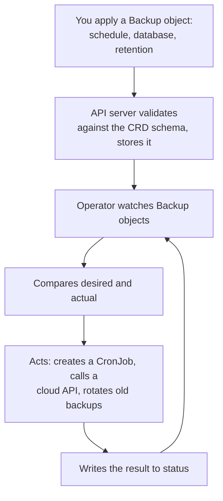
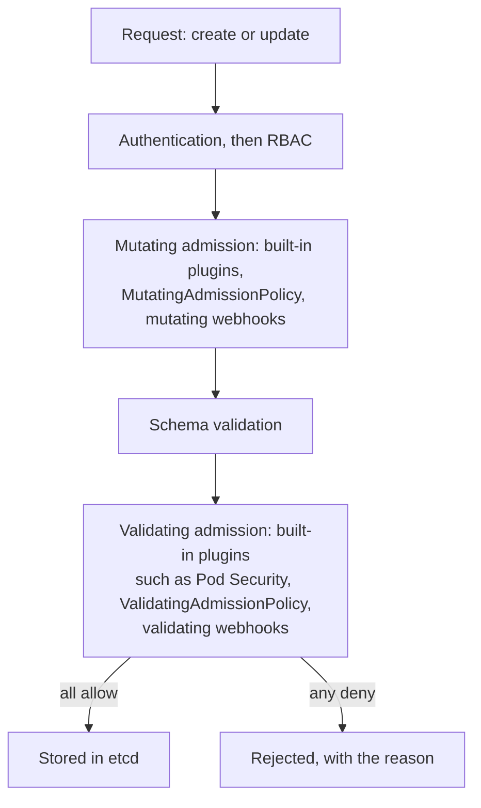

# CRDs, operators and admission webhooks

> **Status: AI draft, 2026-11-16.** Not yet verified by me. Commands and output were run on a local kind cluster (Kubernetes 1.37); no real operator was installed.

## In one line

A CustomResourceDefinition adds a new object type to the Kubernetes API; an operator is a controller that watches those objects and does the work they describe. Admission control is the API server's last checkpoint before storing anything: mutating steps change a request, validating steps accept or reject it, either in-process with CEL policies or by calling an external webhook.

## The plain idea

Kubernetes ships with types such as Pod and Deployment, each with a controller that makes reality match the object ([Architecture and the reconcile loop](architecture.md)). The same machinery is open to anyone:

- **Add a type.** A CRD tells the API server "accept, validate and store objects of kind `Backup`". Now `kubectl get backups` works, with RBAC, watch and everything else, but nothing happens yet.
- **Add a controller for it.** An **operator** is a program, usually running as a Deployment, that watches `Backup` objects and does what they say: schedule the dump, upload it, report the result in `status`. It packages an expert's operational knowledge as code.

The third piece is **admission**: code the API server runs on every create or update, before saving. It can fill in defaults or inject a sidecar (mutating), or refuse objects that break a rule (validating).

## How it works

### The operator pattern



A CRD defines:

| Part | Purpose |
|---|---|
| `group`, `names`, `scope` | API group (`example.com`), kind and plural (`Backup`, `backups`), namespaced or cluster-wide |
| `versions[].schema.openAPIV3Schema` | Field types, required fields, ranges; the API server enforces it |
| `subresources.status` | Separate `status` so users write `spec` and the operator writes `status` |
| `additionalPrinterColumns` | What `kubectl get` shows |
| Several `versions`, with one `storage: true` | Evolve the API; a conversion webhook can translate between versions |

Custom resources you will meet daily:

| Kind | Project | What its controller does |
|---|---|---|
| `Application` | Argo CD | Syncs a Git path into the cluster ([Argo CD architecture](../gitops/argocd-architecture.md)) |
| `NodePool`, `EC2NodeClass` | Karpenter | Launches nodes for pending pods ([Karpenter in depth](../eks/karpenter.md)) |
| `VirtualService`, `DestinationRule` | Istio | Programs the sidecars' routing ([Traffic management](../mesh/traffic-management.md)) |
| `ServiceMonitor`, `PrometheusRule` | Prometheus Operator | Generates scrape and alert config ([Prometheus on Kubernetes](../observability/prometheus-on-kubernetes.md)) |
| `Certificate` | cert-manager | Requests and renews TLS certificates into Secrets |

### Admission control



| Mechanism | Runs where | Use for |
|---|---|---|
| **Built-in admission plugins** | Inside the API server | Defaults and limits: `LimitRanger`, `ResourceQuota`, `PodSecurity` ([Pod security](pod-security.md)) |
| **ValidatingAdmissionPolicy** | Inside the API server, CEL expressions; stable since 1.30 | Simple rules without running any service |
| **MutatingAdmissionPolicy** | Inside the API server, CEL; stable since 1.36 | Simple defaults and changes without a webhook |
| **Validating webhook** | Your HTTPS service, called by the API server | Complex rules; policy engines such as Kyverno and OPA Gatekeeper |
| **Mutating webhook** | Your HTTPS service | Changing objects: Istio sidecar injection, injecting secrets agents |

Webhook settings that decide what happens when things go wrong:

- `failurePolicy: Fail` rejects matching requests if the webhook cannot be reached; `Ignore` lets them through unchecked.
- `namespaceSelector` and `objectSelector` limit which requests are sent at all. Exclude `kube-system` and the webhook's own namespace, or a down webhook can block its own repair.
- `timeoutSeconds` caps how long each call may add to every matching request.
- `sideEffects` and `reinvocationPolicy` matter for dry runs and for mutating webhooks that depend on each other.

## A concrete example

A platform team offers self-service database backups.

1. A `Backup` CRD with a schema: `schedule` and `database` required, `retentionDays` between 1 and 35.
2. An operator Deployment, with RBAC to read `Backup` objects and create CronJobs ([RBAC and service accounts](rbac-and-service-accounts.md)), which creates a CronJob per `Backup` and writes the last result into `status`.
3. A ValidatingAdmissionPolicy refusing Deployments with more than 5 replicas in shared namespaces, without running any webhook.
4. Teams write a ten-line `Backup` object instead of opening a ticket, and `kubectl get backups` shows every schedule.

## Why not just...?

- **...use a ConfigMap and a script instead of a CRD?** A CRD gives schema validation, its own RBAC, `kubectl get` and `explain`, watch events and a status field. A ConfigMap gives none of that.
- **...write a webhook for every rule?** A webhook is a service you must run highly available, with certificates, and every matching request waits on it. A CEL policy runs inside the API server with no extra moving parts; use webhooks for what CEL cannot express.
- **...set every webhook to `failurePolicy: Ignore` to be safe?** Then a security policy silently stops enforcing whenever its service is down. Use `Fail` for policies that must hold, with tight selectors and a highly available webhook; `Ignore` for conveniences.

## Commands to know

A CRD named `backups.example.com` (kind `Backup`, short name `bk`, schema above) and one object:

```console
$ kubectl get backups -n crd-demo
NAME                SCHEDULE    RETENTION
orders-db-nightly   0 2 * * *   7
$ kubectl api-resources --api-group=example.com
NAME      SHORTNAMES   APIVERSION       NAMESPACED   KIND
backups   bk           example.com/v1   true         Backup
```

The schema is enforced by the API server:

```console
$ kubectl apply -n crd-demo -f bad-backup.yaml
The Backup "bad" is invalid:
* spec.retentionDays: Invalid value: 90: spec.retentionDays in body should be less than or equal to 35
* spec.database: Required value
$ kubectl explain backup.spec
...
FIELDS:
  database	<string> -required-
  retentionDays	<integer>
  schedule	<string> -required-
```

A ValidatingAdmissionPolicy with the CEL rule `object.spec.replicas <= 5`, bound to namespaces labelled `admission-demo: "true"`:

```console
$ kubectl create deployment big -n crd-demo --image=busybox:1.36 --replicas=10 -- sleep 3600
error: failed to create deployment: deployments.apps "big" is forbidden: ValidatingAdmissionPolicy 'max-replicas' with binding 'max-replicas-demo' denied request: replicas must be 5 or fewer in this namespace
$ kubectl create deployment small -n crd-demo --image=busybox:1.36 --replicas=2 --dry-run=server -- sleep 3600
deployment.apps/small created (server dry run)
```

A validating webhook for ConfigMaps in that namespace, pointing at a Service that does not exist:

```console
$ kubectl create configmap c1 -n crd-demo --from-literal=k=v
error: failed to create configmap: Internal error occurred: failed calling webhook "check.example.com": failed to call webhook: Post "https://policy-webhook.crd-demo.svc:443/validate?timeout=5s": service "policy-webhook" not found
$ kubectl create configmap c1 -n demo --from-literal=k=v --dry-run=server
configmap/c1 created (server dry run)
```

With `failurePolicy: Fail`, every matching request fails while the webhook is down; a namespace outside its selector is unaffected. After changing it to `Ignore`, the same create succeeded, unchecked.

| Command | What it does |
|---|---|
| `kubectl get crd` | Every custom type installed. |
| `kubectl get validatingwebhookconfigurations,mutatingwebhookconfigurations` | Every webhook the API server calls. |
| `kubectl get validatingadmissionpolicies,validatingadmissionpolicybindings` | In-process CEL policies and where they apply. |
| `kubectl get <cr> -o yaml` | The custom object's `status`, where the operator reports. |
| `kubectl logs -n <ns> deploy/<operator>` | Why the operator did or did not act. |

## How it breaks

| Symptom | Layer | Check | Likely cause |
|---|---|---|---|
| `failed calling webhook ... not found` or a timeout, on many resources | Admission webhook | Webhook configurations, the Service and its endpoints | Webhook pods down, with `failurePolicy: Fail` |
| A cluster add-on cannot restart, blocked by its own webhook | Webhook scope | `namespaceSelector` | Webhook matches its own namespace or `kube-system` |
| Every apply got slower | Webhook latency | `timeoutSeconds`, webhook metrics | Slow or overloaded webhook in the path of every request |
| Custom object created, nothing happens | Operator | Operator logs; `status` | Operator not running, lacks RBAC, or watches another namespace |
| `no matches for kind "X" in version "Y"` | CRD | `kubectl get crd` | CRD not installed yet, or the version was removed |
| Deleting a CRD wiped every object of that kind | CRD lifecycle | Backups | Deleting a CRD deletes all its custom resources |
| Namespace stuck deleting custom objects | Finalizers | Object finalizers | Operator uninstalled before its objects ([Finalizers and deletion](finalizers-and-deletion.md)) |

## Interview questions

**1. What is the difference between a CRD and an operator?**

<details markdown="1">
<summary>Answer</summary>

- A CRD only defines a new API type: the API server stores and validates it.
- An operator is a controller that watches those objects and acts on them.
- A CRD without its operator stores data that nothing acts on.

</details>

**2. Describe the order of admission control.**

<details markdown="1">
<summary>Answer</summary>

- After authentication and authorisation: mutating admission (plugins, mutating policies, mutating webhooks).
- Then schema validation, then validating admission (plugins such as Pod Security, ValidatingAdmissionPolicy, validating webhooks).
- Any validating step can deny; only then is the object stored.

</details>

**3. A webhook's pods crashed and now nobody can create pods. What happened, and how do you recover?**

<details markdown="1">
<summary>Answer</summary>

- The webhook matches pod creation with `failurePolicy: Fail`, so every create fails while it is unreachable.
- If its own pods are also blocked, it cannot recover by itself.
- Short term: patch it to `Ignore` or narrow its selector, or temporarily delete the configuration, then restore the webhook and fix the scope (exclude its namespace and `kube-system`).

</details>

**4. When would you use a ValidatingAdmissionPolicy instead of a webhook?**

<details markdown="1">
<summary>Answer</summary>

- When the rule can be written in CEL from the object itself: field limits, required labels, allowed values.
- It runs inside the API server: no service to run, no certificates, no network call.
- Use a webhook, or a policy engine, when the rule needs external data or complex logic.

</details>

**5. What is the status subresource of a custom resource for?**

<details markdown="1">
<summary>Answer</summary>

- It separates what the user wants (`spec`) from what the controller observed (`status`).
- RBAC can give users `spec` and the operator `status`.
- Spec changes bump `metadata.generation`; status updates do not.

</details>

**6. How does Istio get a sidecar into your pod?**

<details markdown="1">
<summary>Answer</summary>

- A mutating admission webhook matches pod creation in labelled namespaces.
- It adds the proxy container and init settings to the pod spec before it is stored.
- If the webhook is down, pods are created without a sidecar or rejected, depending on its failure policy ([Sidecars and traffic flow](../mesh/sidecars-and-traffic-flow.md)).

</details>

**7. You are about to uninstall an operator. What do you check first?**

<details markdown="1">
<summary>Answer</summary>

- Which custom resources exist, and whether deleting the CRD would delete data you need.
- Finalizers on those objects: remove the objects while the operator still runs, so it cleans up.
- Its webhooks: delete them with the operator, or they keep intercepting requests.

</details>

## Try it

**Step 1.** On a kind cluster, create a tiny CRD.

```bash
cat <<'EOF' | kubectl apply -f -
apiVersion: apiextensions.k8s.io/v1
kind: CustomResourceDefinition
metadata:
  name: notes.example.com
spec:
  group: example.com
  scope: Namespaced
  names: {plural: notes, singular: note, kind: Note}
  versions:
    - name: v1
      served: true
      storage: true
      schema:
        openAPIV3Schema:
          type: object
          properties:
            spec:
              type: object
              required: ["text"]
              properties:
                text: {type: string, maxLength: 20}
EOF
```

**Step 2.** Predict which of these is accepted, then run them.

```bash
kubectl create namespace crd-try
echo '{"apiVersion":"example.com/v1","kind":"Note","metadata":{"name":"a"},"spec":{"text":"hello"}}' | kubectl apply -n crd-try -f -
echo '{"apiVersion":"example.com/v1","kind":"Note","metadata":{"name":"b"},"spec":{"text":"this text is far too long"}}' | kubectl apply -n crd-try -f -
kubectl get notes -n crd-try
```

**Step 3.** Clean up. Deleting the CRD also deletes every `Note`.

```bash
kubectl delete crd notes.example.com
kubectl delete namespace crd-try
```

## Zoom out

CRDs and operators are why so much of the ecosystem (GitOps, autoscaling, mesh, monitoring) installs as "a CRD plus a controller", and why the same debugging steps apply to all of them: the object, its `status`, the controller's logs. Admission is where policy lives: Pod Security, CEL policies and webhooks are the guardrails between `kubectl apply` and etcd ([Hardening and benchmarks](../security/hardening-and-benchmarks.md)).

## Sources

- [Kubernetes documentation: custom resources](https://kubernetes.io/docs/concepts/extend-kubernetes/api-extension/custom-resources/)
- [Kubernetes documentation: extend the API with CustomResourceDefinitions](https://kubernetes.io/docs/tasks/extend-kubernetes/custom-resources/custom-resource-definitions/)
- [Kubernetes documentation: operator pattern](https://kubernetes.io/docs/concepts/extend-kubernetes/operator/)
- [Kubernetes documentation: admission control](https://kubernetes.io/docs/reference/access-authn-authz/admission-controllers/)
- [Kubernetes documentation: dynamic admission control (webhooks)](https://kubernetes.io/docs/reference/access-authn-authz/extensible-admission-controllers/)
- [Kubernetes documentation: ValidatingAdmissionPolicy](https://kubernetes.io/docs/reference/access-authn-authz/validating-admission-policy/)
- [Kubernetes documentation: MutatingAdmissionPolicy](https://kubernetes.io/docs/reference/access-authn-authz/mutating-admission-policy/)
