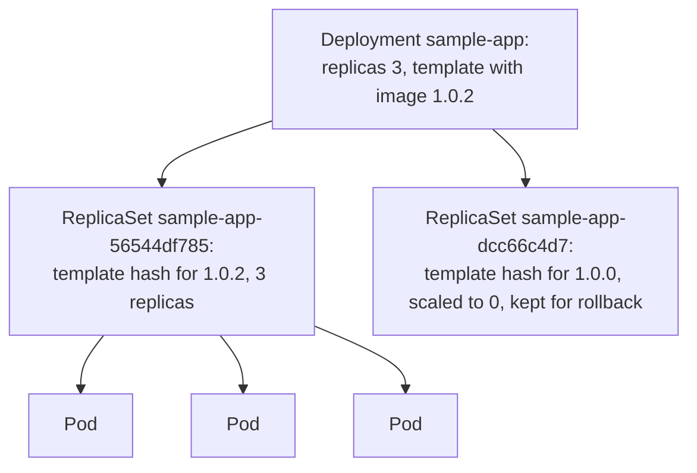
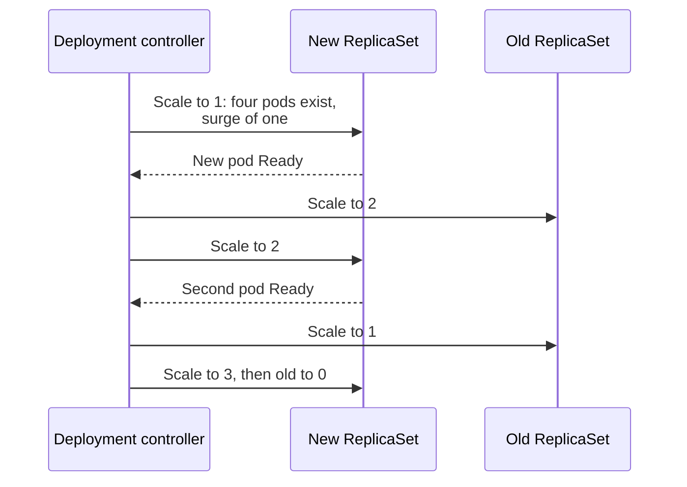

# Deployments and rollouts

> **Status: AI draft, 2026-11-16.** Not yet verified by me. Commands and output were run on a local kind cluster (Kubernetes 1.37); addresses are rewritten to example ranges.

## In one line

A Deployment manages ReplicaSets, which manage pods. Changing the pod template creates a new ReplicaSet, and a rolling update shifts pods from old to new within `maxSurge` and `maxUnavailable`, gated by readiness. A bad version stalls instead of replacing everything, and `rollout undo` or reverting the change in Git goes back.

## The plain idea

Running three copies of an application is easy; changing the version of all three without downtime is the hard part. A **Deployment** does it for you: you change the image in its template, and it brings up new copies and takes down old ones a few at a time, waiting at each step until the new copies say they are ready.

If the new version is broken, the new copies never become ready, so the Deployment stops there with most of the old copies still serving. You lose capacity, not the service. Going back is just pointing the Deployment at the previous template again.

## How it works

### Three objects



- The **ReplicaSet** keeps a set number of identical pods running, matched by labels including a **pod-template-hash**.
- The **Deployment** owns ReplicaSets. Each distinct pod template gets its own ReplicaSet; old ones are scaled to zero but kept (up to `revisionHistoryLimit`, 10 by default) so you can roll back.
- Only changes to `spec.template` start a rollout. Changing `replicas` just scales the current ReplicaSet.

### A rolling update

With three replicas, `maxSurge: 1` and `maxUnavailable: 0`:



| Setting | Meaning | Default |
|---|---|---|
| `maxSurge` | How many pods above `replicas` may exist during the update | 25%, rounded up |
| `maxUnavailable` | How many of `replicas` may be unavailable during the update | 25%, rounded down |
| `minReadySeconds` | How long a new pod must stay ready before it counts as available | 0 |
| `progressDeadlineSeconds` | After this long without progress, the Deployment reports `ProgressDeadlineExceeded` | 600 |

`maxUnavailable: 0` with `maxSurge: 1` never drops below full capacity but needs room for one extra pod. Both cannot be zero.

**Readiness gates everything.** A new pod counts only once its readiness probe passes ([Probes and graceful shutdown](probes-and-graceful-shutdown.md)). Without a readiness probe, a pod is "ready" as soon as its container starts, and a broken version can replace every old pod before anyone notices.

The other strategy, `Recreate`, deletes all old pods before creating new ones: downtime, but never two versions at once. Use it when two versions must not run together, for example around incompatible schema changes. Blue/green and canary releases need more than a Deployment alone ([Deployment strategies](../cicd/deployment-strategies.md)).

### Image pull policy

`imagePullPolicy` decides when the kubelet pulls: `Always` (check the registry every time), `IfNotPresent` (use a cached copy if there is one) or `Never`. The default is `Always` for the `latest` tag and `IfNotPresent` for others. With `IfNotPresent` and a reused tag, nodes keep running whatever they cached first: one more reason to use immutable tags or digests ([Registries and image security](../containers/registries-and-image-security.md)).

## A concrete example

`sample-app` runs version 1.0.2 with three replicas. Someone deploys a tag that does not exist, `9.9.9`.

1. The Deployment creates a new ReplicaSet and, with `maxSurge: 1`, starts one new pod.
2. That pod cannot pull its image: `ImagePullBackOff`. It never becomes ready.
3. With `maxUnavailable: 0`, the controller will not remove any old pod until a new one is ready. All three 1.0.2 pods keep serving.
4. `kubectl rollout status` waits and eventually reports a timeout; after `progressDeadlineSeconds`, the Deployment's `Progressing` condition turns false.
5. `kubectl rollout undo` scales the previous ReplicaSet back as the current one and removes the broken pod. Under GitOps, the right fix is to revert the commit, because an undo done by hand is overwritten by the next sync ([Promotion, rollback and troubleshooting](../gitops/promotion-and-rollback.md)).

## Why not just...?

- **...delete the old pods and let the new ones come up?** Everything is down until the new version is ready, and if the new version is broken, nothing comes back. A rolling update keeps serving throughout and stops at the first failure.
- **...set `maxUnavailable: 100%` to deploy faster?** Every old pod can be removed at once, which is a `Recreate` with extra steps. Size surge and unavailability to your spare capacity and risk appetite.
- **...rely on `kubectl rollout undo` as the rollback plan?** It works for kubectl-managed clusters, but it does not update your files, and GitOps tools revert it. Make rollback a change to the source of truth.

## Commands to know

The Deployment used, with a readiness probe and a conservative strategy:

```yaml
apiVersion: apps/v1
kind: Deployment
metadata:
  name: sample-app
  namespace: demo
spec:
  replicas: 3
  selector:
    matchLabels:
      app: sample-app
  strategy:
    type: RollingUpdate
    rollingUpdate:
      maxSurge: 1
      maxUnavailable: 0
  template:
    metadata:
      labels:
        app: sample-app
    spec:
      containers:
        - name: app
          image: notes-sample-app:1.0.0
          ports:
            - containerPort: 8080
          readinessProbe:
            httpGet:
              path: /healthz
              port: 8080
            periodSeconds: 2
```

Creating it, and what it created:

```console
$ kubectl apply -f deploy.yaml
deployment.apps/sample-app created
$ kubectl rollout status deployment/sample-app -n demo
Waiting for deployment "sample-app" rollout to finish: 0 of 3 updated replicas are available...
Waiting for deployment "sample-app" rollout to finish: 1 of 3 updated replicas are available...
Waiting for deployment "sample-app" rollout to finish: 2 of 3 updated replicas are available...
deployment "sample-app" successfully rolled out
$ kubectl get deploy,rs,pods -n demo
NAME                         READY   UP-TO-DATE   AVAILABLE
deployment.apps/sample-app   3/3     3            3
NAME                                   DESIRED   CURRENT   READY
replicaset.apps/sample-app-dcc66c4d7   3         3         3
NAME                             READY   STATUS
pod/sample-app-dcc66c4d7-2r7f2   1/1     Running
pod/sample-app-dcc66c4d7-m7hk2   1/1     Running
pod/sample-app-dcc66c4d7-w9sg7   1/1     Running
```

Columns trimmed. The ReplicaSet and pod names carry the pod-template hash.

A new version, rolled out one pod at a time:

```console
$ kubectl set image deployment/sample-app app=notes-sample-app:1.0.2 -n demo
$ kubectl rollout status deployment/sample-app -n demo
Waiting for deployment "sample-app" rollout to finish: 1 out of 3 new replicas have been updated...
Waiting for deployment "sample-app" rollout to finish: 2 out of 3 new replicas have been updated...
Waiting for deployment "sample-app" rollout to finish: 1 old replicas are pending termination...
deployment "sample-app" successfully rolled out
$ kubectl rollout history deployment/sample-app -n demo
REVISION  CHANGE-CAUSE
1         <none>
2         <none>
```

A broken version stalls with the old pods still serving:

```console
$ kubectl set image deployment/sample-app app=notes-sample-app:9.9.9 -n demo
$ kubectl get pods -n demo -o custom-columns=NAME:.metadata.name,IMAGE:.spec.containers[0].image,STATUS:.status.containerStatuses[0].state.waiting.reason,READY:.status.containerStatuses[0].ready
NAME                          IMAGE                    STATUS             READY
sample-app-56544df785-c8gp7   notes-sample-app:1.0.2   <none>             true
sample-app-56544df785-h675w   notes-sample-app:1.0.2   <none>             true
sample-app-56544df785-vkd88   notes-sample-app:1.0.2   <none>             true
sample-app-64bbcc89f5-hlhzr   notes-sample-app:9.9.9   ImagePullBackOff   false
$ kubectl rollout status deployment/sample-app -n demo --timeout=5s
error: timed out waiting for the condition
```

Rolling back, and the warning that comes with it:

```console
$ kubectl rollout undo deployment/sample-app -n demo
Warning: resource deployments/sample-app was previously managed with 'kubectl apply'. Rolling back will not update the kubectl.kubernetes.io/last-applied-configuration annotation, which may cause unexpected behavior on future 'kubectl apply' operations. Consider using 'kubectl apply' with your previous configuration file instead.
deployment.apps/sample-app rolled back
$ kubectl get deploy sample-app -n demo -o jsonpath='{.spec.template.spec.containers[0].image}'
notes-sample-app:1.0.2
```

kubectl itself recommends re-applying the previous file: the declared configuration should change, not just the live object.

| Command | What it does |
|---|---|
| `kubectl rollout status deploy/<d>` | Wait for a rollout; non-zero exit on failure or timeout. Good in pipelines. |
| `kubectl rollout history deploy/<d> --revision=2` | The template of one revision. |
| `kubectl rollout undo deploy/<d> --to-revision=1` | Go back to a specific revision. |
| `kubectl rollout pause` and `resume` | Batch several template changes into one rollout. |
| `kubectl rollout restart deploy/<d>` | Replace every pod with the same template, for example to reload a Secret. |
| `kubectl get rs -l app=<label>` | All ReplicaSets of the Deployment, old and new. |

## How it breaks

| Symptom | Layer | Check | Likely cause |
|---|---|---|---|
| Rollout stuck, one new pod not ready | New version | New pod's events and logs | Image pull failure, crash, failing readiness probe |
| `ProgressDeadlineExceeded` | Deployment condition | `kubectl describe deploy` | No progress within the deadline; same causes as above |
| Rollout stuck with all pods healthy | Capacity | Pending new pods; node resources | No room for surge pods, or a PDB blocking ([Disruptions, drains and PDBs](disruptions-and-pdbs.md)) |
| Broken version replaced every pod | Readiness | Is there a readiness probe? Does it test the app? | No probe, or a probe that passes while the app is broken |
| A changed ConfigMap or Secret has no effect | Rollout trigger | Did the pod template change? | Config changes do not start a rollout; restart or use a checksum annotation ([ConfigMaps and Secrets](configmaps-and-secrets.md)) |
| Rollback reverted after a few minutes | Source of truth | Is a GitOps tool managing it? | The sync restored the declared, broken version; revert in Git |
| Errors during every deploy | Shutdown | Termination handling | Pods killed mid-request; see graceful shutdown |

## Interview questions

**1. How does a Deployment perform a rolling update?**

<details markdown="1">
<summary>Answer</summary>

- A template change creates a new ReplicaSet.
- The controller scales the new one up and the old one down, within `maxSurge` and `maxUnavailable`.
- It waits for new pods to be ready (and available for `minReadySeconds`) before continuing.

</details>

**2. What do `maxSurge` and `maxUnavailable` control?**

<details markdown="1">
<summary>Answer</summary>

- `maxSurge`: how many extra pods above the desired count may exist during the update.
- `maxUnavailable`: how many of the desired pods may be unavailable.
- Defaults are 25% each; both cannot be zero.

</details>

**3. What is the relationship between a Deployment, ReplicaSets and pods?**

<details markdown="1">
<summary>Answer</summary>

- A ReplicaSet keeps N identical pods running.
- A Deployment manages ReplicaSets, one per pod-template version, and orchestrates moving between them.
- Old ReplicaSets are kept at zero replicas for rollback.

</details>

**4. You deployed a bad image. What happens, and how do you recover?**

<details markdown="1">
<summary>Answer</summary>

- New pods fail (for example `ImagePullBackOff`) and never become ready, so the rollout stops and old pods keep serving if `maxUnavailable` allows.
- Recover with `kubectl rollout undo`, or by reverting the change in Git under GitOps.
- Then find why CI did not catch it.

</details>

**5. Why is a readiness probe important for rolling updates?**

<details markdown="1">
<summary>Answer</summary>

- The controller only counts a new pod once it is ready.
- Without a probe, a pod is ready as soon as it starts, so a broken version can replace everything.
- The probe should check that the app can actually serve.

</details>

**6. When would you use the `Recreate` strategy?**

<details markdown="1">
<summary>Answer</summary>

- When two versions must never run at the same time, such as incompatible schema or storage formats, or a singleton that holds an exclusive lock.
- It deletes all old pods first, so there is downtime.

</details>

**7. You changed a ConfigMap, but the pods still use the old values. Why, and what do you do?**

<details markdown="1">
<summary>Answer</summary>

- Only changes to the pod template start a rollout; a ConfigMap change does not.
- Environment variables are read at container start; mounted files update eventually.
- Use `kubectl rollout restart`, or a checksum annotation in the template so config changes roll pods automatically.

</details>

## Try it

**Step 1.** Create a Deployment with a readiness probe on a kind cluster.

```bash
kubectl create deployment web --image=nginx:1.27 --replicas=3
kubectl rollout status deployment/web
```

**Step 2.** Deploy a tag that does not exist. Predict how many old pods keep running, then check.

```bash
kubectl set image deployment/web nginx=nginx:9.9.9
sleep 30; kubectl get pods -l app=web
kubectl get rs -l app=web
```

**Step 3.** Roll back and confirm the image.

```bash
kubectl rollout undo deployment/web
kubectl rollout status deployment/web
kubectl get deploy web -o jsonpath='{.spec.template.spec.containers[0].image}{"\n"}'
```

## Zoom out

Deployments are the default way to run stateless services, and the base that GitOps, canary tools and autoscalers build on ([Deployment strategies](../cicd/deployment-strategies.md), [Autoscaling](autoscaling.md)). A safe rollout depends on readiness probes, graceful shutdown and spare capacity together. The principle to carry: a rollout is only as safe as the readiness check that gates it, and rollback belongs in the source of truth.

## Sources

- [Kubernetes documentation: Deployments](https://kubernetes.io/docs/concepts/workloads/controllers/deployment/)
- [Kubernetes documentation: ReplicaSet](https://kubernetes.io/docs/concepts/workloads/controllers/replicaset/)
- [Kubernetes documentation: performing a rolling update](https://kubernetes.io/docs/tutorials/kubernetes-basics/update/update-intro/)
- [Kubernetes documentation: images and pull policy](https://kubernetes.io/docs/concepts/containers/images/)
- [kubectl reference: kubectl rollout](https://kubernetes.io/docs/reference/kubectl/generated/kubectl_rollout/)
