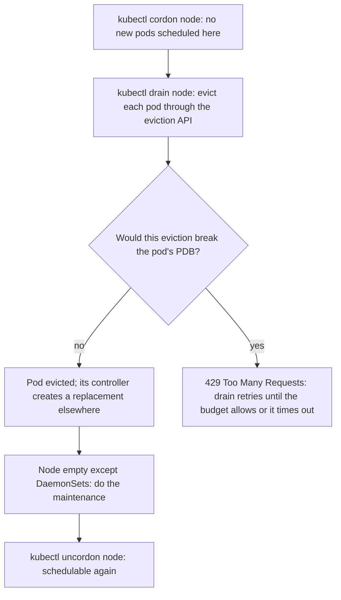

# Disruptions, drains and PDBs

> **Status: AI draft, 2026-11-16.** Not yet verified by me. Commands and output were run on a one-node local kind cluster (Kubernetes 1.37), draining only the demo pods; generated names are shortened.

## In one line

Voluntary disruptions (drains, upgrades, scale-down, autoscaler consolidation) go through the eviction API, which refuses evictions that would break a PodDisruptionBudget; involuntary ones (node crash, OOM, hardware failure) ignore it. A PDB with `minAvailable` or `maxUnavailable` protects availability during maintenance, but a PDB that allows zero disruptions blocks every drain.

## The plain idea

Pods get stopped for two kinds of reasons. Some are accidents: a node loses power, a kernel panics, a process runs out of memory. Nothing can ask permission first. Others are planned: you upgrade nodes, an autoscaler removes an under-used node, someone drains a node for maintenance. For planned stops, Kubernetes can check first whether stopping this pod now would leave too few copies running.

A **PodDisruptionBudget** (PDB) is that rule, written per application: "at least two of my pods must stay up during planned maintenance". Tools that remove pods politely, like `kubectl drain` and node autoscalers, ask before each eviction, and wait when the answer is no.

## How it works

### Voluntary and involuntary

| Voluntary (PDB applies) | Involuntary (PDB does not apply) |
|---|---|
| `kubectl drain` for maintenance | Node hardware or kernel failure |
| Node upgrades and replacement | Node lost from the network |
| Cluster or Karpenter consolidation ([Karpenter in depth](../eks/karpenter.md)) | OOM kill, process crash |
| Evictions through the eviction API | Node-pressure eviction by the kubelet |

Deleting a pod directly or scaling a Deployment down is not checked against PDBs either: only the **eviction API** respects them, and drains and autoscalers use it.

### Cordon, drain, uncordon



- `cordon` marks the node unschedulable (`SchedulingDisabled`); running pods stay.
- `drain` cordons, then evicts pods one by one. DaemonSet pods are skipped with `--ignore-daemonsets`; pods with `emptyDir` data need `--delete-emptydir-data`; bare pods with no controller need `--force`, and are lost.
- `uncordon` reverses the cordon. Pods do not move back on their own.

### Writing a PDB

```yaml
apiVersion: policy/v1
kind: PodDisruptionBudget
metadata:
  name: sample-app
spec:
  maxUnavailable: 1          # or minAvailable: 2 (only one of the two)
  selector:
    matchLabels:
      app: sample-app
```

| Setting | Meaning |
|---|---|
| `minAvailable: 2` | At least two matching pods must stay available. Can be a percentage |
| `maxUnavailable: 1` | At most one matching pod may be unavailable at once. Scales naturally as replicas change |
| `ALLOWED DISRUPTIONS` in `kubectl get pdb` | How many evictions are allowed right now |

Dangerous patterns:

- `minAvailable` equal to `replicas` (or `maxUnavailable: 0`): allowed disruptions is always zero, and every drain hangs.
- A PDB on a single-replica Deployment with `minAvailable: 1`: the same, permanently.
- No PDB on a multi-replica service: a drain may evict all its pods at once, if they happen to sit on the node being drained.

## A concrete example

A two-replica service has a PDB with `minAvailable: 2`. The platform team drains a node for an upgrade.

1. `kubectl drain` cordons the node and starts evicting.
2. The service has 2 healthy pods and must keep 2, so `ALLOWED DISRUPTIONS` is 0. Each eviction is refused: "Cannot evict pod as it would violate the pod's disruption budget".
3. The drain retries until its timeout and fails; the node stays cordoned. Node upgrades stall, and the autoscaler cannot consolidate this node either.
4. The fix is in the budget, not the drain: `maxUnavailable: 1` (or `minAvailable: 1`) lets one pod move at a time, while the other keeps serving. With three replicas, `maxUnavailable: 1` keeps two up during maintenance.
5. After the change, the drain evicts one pod, waits for its replacement to be ready elsewhere, then evicts the next.

## Why not just...?

- **...skip the drain and delete the node?** Every pod on it stops at once, without regard for budgets or graceful handover, which is an outage for any service whose replicas were all there.
- **...set `minAvailable: 100%` to be safe?** Then nothing can ever be evicted voluntarily: upgrades, autoscaler consolidation and drains all block. A PDB should allow progress, slowly.
- **...rely on a PDB to protect against node crashes?** PDBs only govern voluntary evictions. For crashes, spread replicas across nodes and zones ([Scheduling](scheduling.md)) and run enough of them.

## Commands to know

A budget that allows no disruptions:

```console
$ kubectl get pdb pdb-app -n demo
NAME      MIN AVAILABLE   MAX UNAVAILABLE   ALLOWED DISRUPTIONS   AGE
pdb-app   2               N/A               0                     3s
```

A drain blocked by it (only the demo pods were selected for this test):

```console
$ kubectl drain notes-lab-control-plane --pod-selector=app=pdb-app --ignore-daemonsets --delete-emptydir-data --timeout=20s
node/notes-lab-control-plane cordoned
evicting pod demo/pdb-app-<id>
error when evicting pods/"pdb-app-<id>" -n "demo" (will retry after 5s): Cannot evict pod as it would violate the pod's disruption budget.
error: unable to drain node "notes-lab-control-plane" due to error: [error when evicting pods/"pdb-app-<id>" -n "demo": global timeout reached: 20s, ...], continuing command...
$ kubectl get node notes-lab-control-plane
notes-lab-control-plane   Ready,SchedulingDisabled
```

The node stays cordoned after a failed drain.

Relaxing the budget, and undoing the cordon:

```console
$ kubectl patch pdb pdb-app -n demo --type merge -p '{"spec":{"minAvailable":1}}'
$ kubectl get pdb pdb-app -n demo
...   ALLOWED DISRUPTIONS: 1
$ kubectl uncordon notes-lab-control-plane
$ kubectl get node notes-lab-control-plane
notes-lab-control-plane   Ready
```

| Command | What it does |
|---|---|
| `kubectl get pdb -A` | Every budget and its allowed disruptions; look for zeros. |
| `kubectl cordon <n>`, `kubectl uncordon <n>` | Stop and resume scheduling on a node. |
| `kubectl drain <n> --ignore-daemonsets --delete-emptydir-data` | Evict everything except DaemonSets, respecting PDBs. |
| `kubectl drain <n> --dry-run=server` | See what a drain would evict. |
| `kubectl get pods -A -o wide --field-selector spec.nodeName=<n>` | What is running on a node before you drain it. |

## How it breaks

| Symptom | Layer | Check | Likely cause |
|---|---|---|---|
| Drain hangs on one pod | PDB | `kubectl get pdb -A` for 0 allowed | Budget allows no disruptions: `minAvailable` equals replicas, or pods already unhealthy |
| Node upgrade or autoscaler consolidation stuck | PDB | Events on the node; autoscaler logs | Same; or a pod annotated to block disruption |
| Service had an outage during a drain | Missing PDB or placement | Were all replicas on one node? Was there a PDB? | No PDB, or replicas not spread |
| Drain refuses with "cannot delete Pods not managed by a controller" | Bare pods | Pod owners | Bare pod; `--force` deletes it permanently |
| Node left `SchedulingDisabled` after maintenance | Cordon | Node status | Drain failed or someone forgot to uncordon |
| PDB shows 0 allowed although replicas are high | Health | Ready pods matching the selector | Some pods not ready, which uses up the budget |

## Interview questions

**1. What is a PodDisruptionBudget, and what does it protect against?**

<details markdown="1">
<summary>Answer</summary>

- A per-application rule limiting how many of its pods can be voluntarily disrupted at once (`minAvailable` or `maxUnavailable`).
- Enforced through the eviction API used by drains, upgrades and autoscalers.
- It does not protect against involuntary failures such as node crashes.

</details>

**2. What is the difference between voluntary and involuntary disruptions?**

<details markdown="1">
<summary>Answer</summary>

- Voluntary: planned actions like drains, node upgrades, consolidation; they respect PDBs.
- Involuntary: crashes, hardware failures, OOM kills, node-pressure evictions; nothing can ask first.
- Plan for both: PDBs for the first, replicas and spreading for the second.

</details>

**3. A `kubectl drain` hangs. What do you check?**

<details markdown="1">
<summary>Answer</summary>

- `kubectl get pdb -A` for budgets with zero allowed disruptions.
- Whether the affected app's pods are healthy (unhealthy pods use up the budget).
- Bare pods, DaemonSets and emptyDir data, which need flags.

</details>

**4. What is wrong with `minAvailable: 1` on a single-replica Deployment?**

<details markdown="1">
<summary>Answer</summary>

- Allowed disruptions is always zero, so the pod can never be evicted voluntarily.
- Every drain and node upgrade involving that node blocks.
- Run more replicas, or accept the brief disruption without a PDB.

</details>

**5. What do cordon, drain and uncordon do?**

<details markdown="1">
<summary>Answer</summary>

- Cordon: mark a node unschedulable; existing pods keep running.
- Drain: cordon and evict pods (respecting PDBs), so controllers recreate them elsewhere.
- Uncordon: make the node schedulable again; pods do not move back automatically.

</details>

**6. How would you upgrade the nodes of a cluster without downtime?**

<details markdown="1">
<summary>Answer</summary>

- Every service has several replicas spread across nodes and zones, readiness probes and graceful shutdown.
- PDBs that allow one disruption at a time.
- Replace nodes one (or a few) at a time: add capacity, cordon and drain, wait for replacements to be ready, then remove ([EKS upgrades](../eks/upgrades.md)).

</details>

## Try it

*Untested: written from documentation.* Use a kind cluster with at least one worker node, so you can drain without touching the control plane.

**Step 1.** Create a two-replica Deployment and a budget that allows no disruptions.

```bash
kubectl create deployment web --image=nginx:1.27 --replicas=2
kubectl create pdb web --selector=app=web --min-available=2
kubectl get pdb web
```

**Step 2.** Predict what a drain of a worker node running a `web` pod does, then try it with a short timeout.

```bash
NODE=$(kubectl get pods -l app=web -o jsonpath='{.items[0].spec.nodeName}')
kubectl drain $NODE --ignore-daemonsets --delete-emptydir-data --timeout=20s
```

**Step 3.** Allow one disruption, drain again, then uncordon and clean up.

```bash
kubectl patch pdb web --type merge -p '{"spec":{"minAvailable":1}}'
kubectl drain $NODE --ignore-daemonsets --delete-emptydir-data --timeout=60s
kubectl uncordon $NODE
kubectl delete pdb web && kubectl delete deploy web
```

## Zoom out

PDBs are what make node upgrades, autoscaler consolidation and spot interruptions survivable ([EKS upgrades](../eks/upgrades.md), [Karpenter in depth](../eks/karpenter.md)), together with replicas, spreading and graceful shutdown ([Probes and graceful shutdown](probes-and-graceful-shutdown.md)). A budget that is too strict is as harmful as none, because it blocks maintenance. The principle to carry: let maintenance happen one pod at a time, and make sure each pod can be replaced safely.

## Sources

- [Kubernetes documentation: disruptions](https://kubernetes.io/docs/concepts/workloads/pods/disruptions/)
- [Kubernetes documentation: specifying a disruption budget for your application](https://kubernetes.io/docs/tasks/run-application/configure-pdb/)
- [Kubernetes documentation: safely drain a node](https://kubernetes.io/docs/tasks/administer-cluster/safely-drain-node/)
- [Kubernetes documentation: API-initiated eviction](https://kubernetes.io/docs/concepts/scheduling-eviction/api-eviction/)
