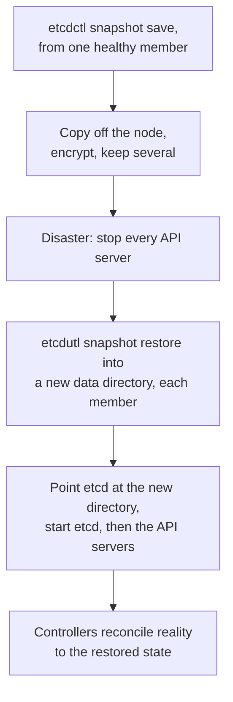
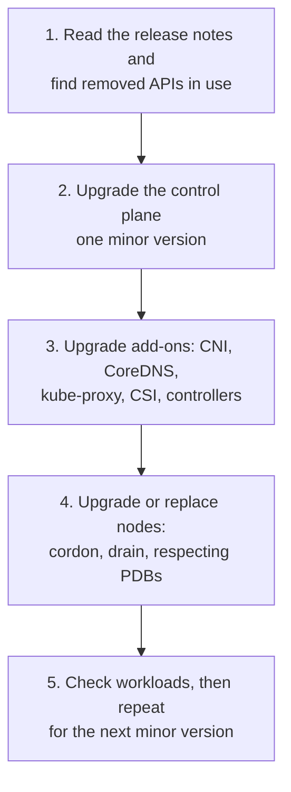

# etcd, backups and cluster upgrades

> **Status: AI draft, 2026-11-16.** Not yet verified by me. The etcd commands were run against the single etcd member of a local kind cluster (Kubernetes 1.37, etcd 3.7.0), with the member ID replaced by a placeholder; the restore and upgrade procedures are from the documentation and were not run.

## In one line

etcd is the only place a Kubernetes cluster stores its state, a replicated key-value store that needs a majority (quorum) of members to accept writes. Back it up with snapshots and also back up workloads and volumes separately. Upgrade one minor version at a time: control plane first, then add-ons, then nodes, within the version skew policy.

## The plain idea

Every object you create (Deployments, Secrets, ConfigMaps) is a key in **etcd**. The API server is the only thing that talks to it; controllers and nodes only talk to the API server ([Architecture and the reconcile loop](architecture.md)). Lose etcd without a backup and the cluster forgets everything it was told to run. The containers keep running for a while, but nothing can be managed.

etcd runs as several copies that agree on every write through the **Raft** protocol. A write counts once a **majority** has it. That majority rule is why clusters use 3 or 5 members: with 3, one can fail; with 5, two.

Upgrades are the other big operational job. Kubernetes releases a new minor version about three times a year and patches only the most recent three, each for about a year. Staying supported means upgrading regularly, in a fixed order.

## How it works

### Quorum

From the etcd FAQ: quorum is `(n/2)+1` (integer division).

| Members | Majority needed | Failures tolerated |
|---|---|---|
| 1 | 1 | 0 |
| 3 | 2 | 1 |
| 4 | 3 | 1 |
| 5 | 3 | 2 |

- An even count adds a machine without adding tolerance, which is why odd counts are used.
- Without quorum, etcd refuses writes: the API server cannot create or change anything. Reads may still work.
- etcd is sensitive to disk latency (every write is synced to disk) and has a storage quota, 2 GB by default. When it is full, writes fail with `mvcc: database space exceeded` until history is compacted, defragmented and the alarm is cleared.

### Keys

Objects are stored under `/registry/<resource>/<namespace>/<name>`, for example `/registry/configmaps/demo/app-config`. Secrets are stored there too, base64-encoded but not encrypted unless encryption at rest is configured on the API server ([ConfigMaps and Secrets](configmaps-and-secrets.md)). A snapshot therefore contains every Secret in the cluster.

### Backup and restore, in outline



- A restore takes the whole cluster back to the moment of the snapshot. Anything created later is gone from the API, even if its containers are still running.
- Restore all members from the same snapshot; never mix.

### What a managed control plane does

On EKS and other managed services, the provider runs etcd and the API servers across several zones, backs them up and patches them ([EKS architecture and node options](../eks/architecture.md)). You cannot reach etcd or restore it. Your job moves up a level:

| Still yours | Why |
|---|---|
| Workload backups | Recreating objects in a new cluster, and data on volumes |
| Upgrades | You choose when; the provider only enforces end of support |
| Add-on versions | CNI, DNS, kube-proxy, CSI drivers, controllers must match the new version |
| Node versions | Managed node groups or Karpenter roll nodes; you trigger and watch it |

### Backing up workloads versus etcd

| | etcd snapshot | Workload backup (for example Velero) | GitOps repository |
|---|---|---|---|
| Contains | Every object, exactly | Selected objects, plus volume snapshots | Desired manifests only |
| Restore scope | Whole cluster, same cluster | A namespace or app, into any cluster | Any cluster |
| Volume data | No | Yes, through snapshots | No |
| Available on managed services | No | Yes | Yes |

Most teams on managed Kubernetes rely on the last two: Git for what should run ([GitOps principles](../gitops/principles.md)), volume or database backups for data ([Backup and DR](../operations/backup-and-dr.md)).

### Version skew and upgrade order

From the version skew policy:

- API servers in one cluster: within one minor version of each other.
- Controller manager and scheduler: not newer than the API server; may be one minor older.
- kubelet and kube-proxy: not newer than the API server; may be up to three minors older.
- kubectl: within one minor version, older or newer.
- The API server must not skip minor versions: 1.35 to 1.37 means 1.35 to 1.36 to 1.37.



Nodes come last because a kubelet may be older than the API server, but never newer. Draining respects PodDisruptionBudgets ([Disruptions and PDBs](disruptions-and-pdbs.md)).

### Finding removed APIs before they bite

Each release can remove deprecated API versions (the deprecation guide lists them). Manifests, Helm charts and operators using a removed version fail after the upgrade.

- The API server counts requests to deprecated APIs in the `apiserver_requested_deprecated_apis` metric, with the release that removes them.
- Scan manifests and charts in Git, not only what the cluster has seen: a yearly job may not have run recently.
- Managed services add their own checks; EKS has upgrade insights ([EKS upgrades](../eks/upgrades.md)).

## A concrete example

A self-managed cluster runs 1.35 and must reach 1.37, the newest supported release.

1. Read the 1.36 and 1.37 release notes; check `apiserver_requested_deprecated_apis` and scan the Git repos for versions those releases remove.
2. Take an etcd snapshot and copy it off the node; confirm workload and database backups are recent.
3. Upgrade the control plane to 1.36. Upgrade add-ons to versions that support 1.36.
4. Upgrade nodes to 1.36 one batch at a time (cordon, drain, upgrade or replace, uncordon).
5. Repeat for 1.37. Kubelets could stay one or two versions behind for a while within the skew policy, but closing the gap keeps the next upgrade simple.

## Why not just...?

- **...skip a version to save time?** The API server must not skip minors: storage migrations and API removals are designed to be crossed one release at a time.
- **...rely on etcd snapshots as the only backup?** A snapshot restores the whole cluster to one moment, includes no volume data, and does not exist on managed services. Keep Git and data backups as well.
- **...run etcd with 2 members for redundancy?** Two members need both for quorum, so losing either stops writes: less available than one member. Use 3 or 5.
- **...stay on an old version because it works?** After end of life there are no security patches, and the eventual upgrade crosses many versions in a row, each with its removed APIs.

## Commands to know

On a kubeadm-style control plane, etcd runs as a static pod and its client certificates are on the node. Each command below also took `--endpoints=https://127.0.0.1:2379 --cacert=/etc/kubernetes/pki/etcd/ca.crt --cert=/etc/kubernetes/pki/etcd/server.crt --key=/etc/kubernetes/pki/etcd/server.key`, shortened to `$TLS` here:

```console
$ kubectl exec -n kube-system etcd-notes-lab-control-plane -- etcdctl $TLS member list -w simple
<member-id>, started, notes-lab-control-plane, https://172.18.0.2:2380, https://172.18.0.2:2379, false
$ kubectl exec -n kube-system etcd-notes-lab-control-plane -- etcdctl $TLS endpoint health
https://127.0.0.1:2379 is healthy: successfully committed proposal: took = 7.743116ms
$ kubectl exec -n kube-system etcd-notes-lab-control-plane -- etcdctl $TLS endpoint status -w simple
https://127.0.0.1:2379, <member-id>, 3.7.0, 3.7.0, 3.5 MB, 2.1 MB, 43%, 2.1 GB, true, false, 2, 7616, 7616, , , false
```

The status fields are: endpoint, ID, version, storage version, DB size, in use, percentage not in use, quota (2 GiB shown as 2.1 GB), is leader, is learner, Raft term, Raft index, applied index, errors.

A snapshot, and its contents:

```console
$ kubectl exec -n kube-system etcd-notes-lab-control-plane -- etcdctl $TLS snapshot save /var/lib/etcd/notes-snap.db
...
Snapshot saved at /var/lib/etcd/notes-snap.db
$ kubectl exec -n kube-system etcd-notes-lab-control-plane -- etcdutl snapshot status /var/lib/etcd/notes-snap.db -w table
┌──────────┬──────────┬────────────┬────────────┬─────────┐
│   HASH   │ REVISION │ TOTAL KEYS │ TOTAL SIZE │ VERSION │
├──────────┼──────────┼────────────┼────────────┼─────────┤
│ <hash>   │     6236 │        724 │     3.5 MB │   3.7.0 │
└──────────┴──────────┴────────────┴────────────┴─────────┘
$ kubectl exec -n kube-system etcd-notes-lab-control-plane -- etcdctl $TLS get /registry/configmaps/demo/app-config --keys-only
/registry/configmaps/demo/app-config
```

Deprecated APIs that clients have used since the API server started:

```console
$ kubectl get --raw /metrics | grep apiserver_requested_deprecated_apis
# HELP apiserver_requested_deprecated_apis [STABLE] Gauge of deprecated APIs that have been requested, broken out by API group, version, resource, subresource, and removed_release.
# TYPE apiserver_requested_deprecated_apis gauge
apiserver_requested_deprecated_apis{group="",removed_release="",resource="endpoints",subresource="",version="v1"} 1
```

Something used the deprecated `v1` Endpoints API (replaced by EndpointSlices); `removed_release` is empty, so no removal is scheduled yet.

| Command | What it does |
|---|---|
| `etcdutl snapshot restore snap.db --data-dir <new-dir>` | Restore into a new data directory (outline in the Kubernetes etcd guide). |
| `etcdctl alarm list` | Shows a raised space quota alarm. |
| `kubectl version` | Client and server versions, to check the skew. |
| `kubectl get nodes` | The kubelet version of every node, in the VERSION column. |
| `kubeadm upgrade plan` | On kubeadm clusters: available versions and component upgrades. |

## How it breaks

| Symptom | Layer | Check | Likely cause |
|---|---|---|---|
| API server errors on every write, reads work | etcd quorum | `endpoint health` on each member | Majority of members down or partitioned |
| `mvcc: database space exceeded` | etcd quota | `endpoint status`, `alarm list` | History not compacted; too many objects or large ones |
| Slow API, leader changes in etcd logs | etcd disk | Disk latency on control plane nodes | Slow or shared disks |
| After an upgrade, `no matches for kind ... in version ...` | Removed API | Deprecation guide | Manifests or charts using a removed API version |
| Nodes `NotReady` after a control plane upgrade | Skew or add-ons | kubelet and CNI versions | Kubelet newer than the API server, or CNI not upgraded |
| Upgrade stuck draining a node | Disruption budget | `kubectl get pdb -A` | PDB allows 0 disruptions ([Disruptions and PDBs](disruptions-and-pdbs.md)) |
| Restore brought back old Secrets and lost new objects | Restore semantics | Snapshot age | Expected: the snapshot is a point in time |

## Interview questions

**1. Why do etcd clusters have an odd number of members?**

<details markdown="1">
<summary>Answer</summary>

- Writes need a majority: `(n/2)+1`.
- 3 members tolerate 1 failure and 4 also tolerate only 1, so the fourth adds cost without tolerance.
- An odd count also guarantees one side of a network split keeps a majority.

</details>

**2. What happens to running pods if etcd loses quorum?**

<details markdown="1">
<summary>Answer</summary>

- Existing containers keep running; the kubelet does not need etcd to keep them alive.
- No changes can be made: no new pods, scaling, rescheduling after a node failure, or config changes.
- Fix quorum first; restore from a snapshot only if members cannot be recovered.

</details>

**3. How do you back up and restore etcd?**

<details markdown="1">
<summary>Answer</summary>

- `etcdctl snapshot save` from one healthy member, with the client certificates; copy it off the node and encrypt it, because it holds every Secret.
- Restore: stop the API servers, `etcdutl snapshot restore` into a new data directory on each member, start etcd, then the API servers.
- Everything after the snapshot is lost from the API.

</details>

**4. What is the correct order for a Kubernetes upgrade?**

<details markdown="1">
<summary>Answer</summary>

- One minor version at a time.
- Control plane first, then add-ons such as CNI, DNS and CSI, then nodes by cordon and drain.
- Kubelets may lag the API server by up to three minors but must never be newer.

</details>

**5. How do you find out whether an upgrade will break any manifests?**

<details markdown="1">
<summary>Answer</summary>

- Read the deprecation guide for the target version's removals.
- Check the `apiserver_requested_deprecated_apis` metric, and scan manifests and Helm charts in Git.
- On a managed service, use its upgrade checks; test in a non-production cluster on the new version first.

</details>

**6. On EKS you cannot reach etcd. How do you back up the cluster?**

<details markdown="1">
<summary>Answer</summary>

- Desired state in Git (GitOps), so a new cluster can be rebuilt.
- A workload backup tool such as Velero for objects and volume snapshots.
- Data in databases backed up by their own service; practise restoring into a new cluster.

</details>

**7. How long is a Kubernetes minor release supported?**

<details markdown="1">
<summary>Answer</summary>

- The project patches the three most recent minor releases.
- Each gets about a year of patch support (1.19 and newer).
- Managed services publish their own, sometimes longer, support windows ([EKS upgrades](../eks/upgrades.md)).

</details>

## Try it

**Step 1.** On a kind cluster, find the etcd pod and check its health. The certificate paths are those of a kind (kubeadm) node.

```bash
kubectl get pods -n kube-system -l component=etcd
POD=$(kubectl get pods -n kube-system -l component=etcd -o name | head -1)
kubectl exec -n kube-system "$POD" -- etcdctl --endpoints=https://127.0.0.1:2379 \
  --cacert=/etc/kubernetes/pki/etcd/ca.crt --cert=/etc/kubernetes/pki/etcd/server.crt \
  --key=/etc/kubernetes/pki/etcd/server.key endpoint status -w table
```

**Step 2.** Predict the key for a ConfigMap named `x` in namespace `default`, then create it and check.

```bash
kubectl create configmap x -n default --from-literal=k=v
kubectl exec -n kube-system "$POD" -- etcdctl --endpoints=https://127.0.0.1:2379 \
  --cacert=/etc/kubernetes/pki/etcd/ca.crt --cert=/etc/kubernetes/pki/etcd/server.crt \
  --key=/etc/kubernetes/pki/etcd/server.key get /registry/configmaps/default/x --keys-only
```

**Step 3.** Compare your client and server versions with the skew policy, then clean up.

```bash
kubectl version
kubectl delete configmap x -n default
```

## Zoom out

etcd is the single source of truth that every controller reconciles towards, so its health and backups are the cluster's health and backups. Upgrades are routine maintenance that stays cheap if done every release and gets expensive when deferred ([Change management](../operations/change-management.md)). On a managed service, etcd becomes the provider's problem, and Git plus data backups become yours.

## Sources

- [etcd documentation: frequently asked questions (quorum, failure tolerance, quota)](https://etcd.io/docs/v3.7/faq/)
- [etcd documentation: disaster recovery](https://etcd.io/docs/v3.7/op-guide/recovery/)
- [Kubernetes documentation: operating etcd clusters for Kubernetes](https://kubernetes.io/docs/tasks/administer-cluster/configure-upgrade-etcd/)
- [Kubernetes: version skew policy](https://kubernetes.io/releases/version-skew-policy/)
- [Kubernetes: releases and support period](https://kubernetes.io/releases/)
- [Kubernetes: the release cycle](https://kubernetes.io/releases/release/)
- [Kubernetes documentation: deprecated API migration guide](https://kubernetes.io/docs/reference/using-api/deprecation-guide/)
- [Kubernetes documentation: upgrading kubeadm clusters](https://kubernetes.io/docs/tasks/administer-cluster/kubeadm/kubeadm-upgrade/)
- [Velero documentation](https://velero.io/docs/v1.19/)
