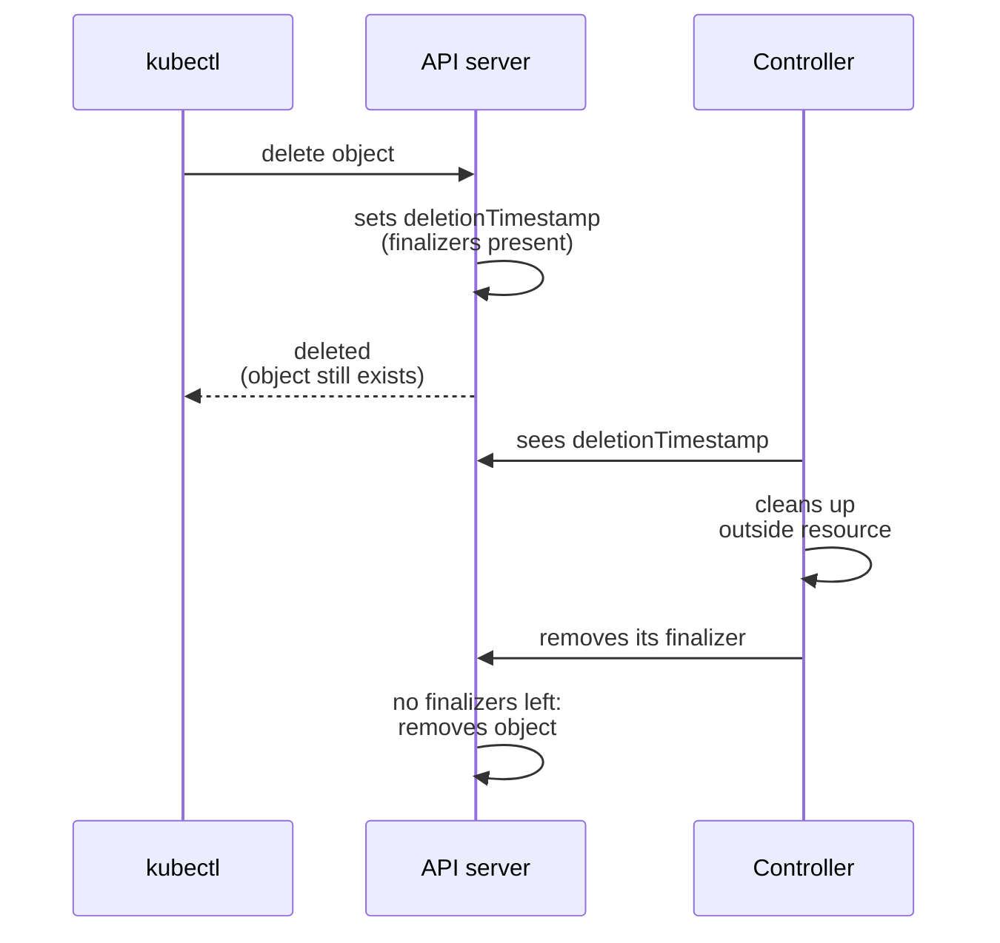
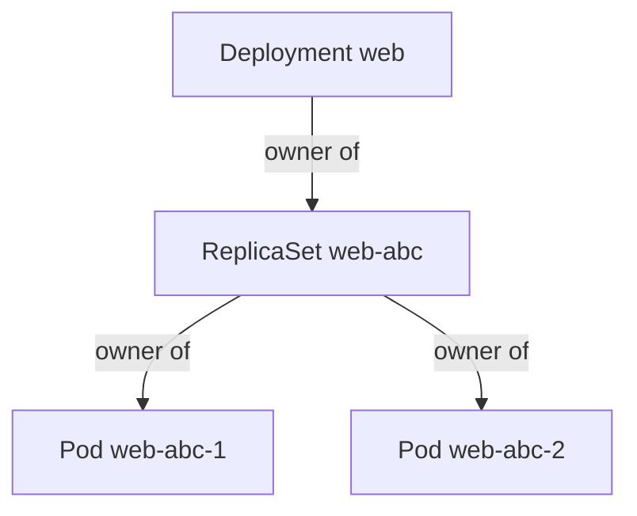

# Finalizers and deletion

> **Status: AI draft, 2026-11-16.** Not yet verified by me. Commands and output were run on a local kind cluster (Kubernetes 1.37); timestamps are replaced with placeholders.

## In one line

Deleting an object with finalizers only marks it (`deletionTimestamp`); it disappears once every controller has finished its cleanup and removed its finalizer. Owned objects (ReplicaSets, pods) are removed by the garbage collector through `ownerReferences`, in the background, in the foreground, or not at all (orphan).

## The plain idea

Some objects stand for something outside themselves: a PVC for a disk, a LoadBalancer Service for a cloud load balancer, an Argo CD Application for everything it deployed. If the object vanished the instant you deleted it, the thing outside would be left behind with nothing pointing to it.

So Kubernetes lets a controller put its name on the object: a **finalizer**, a string in `metadata.finalizers`. Delete then means "start deleting". The object stays, marked with a deletion time, until each controller that put its name there has cleaned up and taken its name off. Only an object with no finalizers left is actually removed.

The second idea is ownership. A Deployment owns its ReplicaSets, which own their pods, recorded in each child's `metadata.ownerReferences`. When an owner is deleted, the **garbage collector** deletes what it owned.

## How it works

### What delete does



- After `deletionTimestamp` is set, the object can no longer be changed except to remove finalizers, and nothing can stop the deletion.
- `kubectl delete` waits for the object to go by default, which is why a stuck finalizer looks like a hung command. `--wait=false` returns at once.

### Finalizers you will meet

| Finalizer | Put there by | Waits for |
|---|---|---|
| `kubernetes.io/pvc-protection` | Kubernetes | No pod uses the PVC any more |
| `kubernetes.io/pv-protection` | Kubernetes | The PV is no longer bound |
| `foregroundDeletion` | The API server, on a foreground delete | All dependants with `blockOwnerDeletion` to be deleted first |
| `kubernetes` (in a namespace's `spec.finalizers`) | Kubernetes | Everything in the namespace to be deleted |
| `service.kubernetes.io/load-balancer-cleanup` | Cloud controller | The cloud load balancer to be deleted |
| Argo CD's resources finalizer | Argo CD | The Application's resources to be deleted ([Deletion and finalizers in Argo CD](../gitops/deletion-and-finalizers.md)) |

Operators add their own: a database operator may wait to take a final backup, a node autoscaler waits to drain a node ([Karpenter in depth](../eks/karpenter.md)).

### Owners and cascading deletion



| `--cascade=` | What happens |
|---|---|
| `background` (default) | The owner is deleted at once; the garbage collector then deletes the dependants |
| `foreground` | The owner gets `deletionTimestamp` and the `foregroundDeletion` finalizer; dependants are deleted first, then the owner |
| `orphan` | Only the owner is deleted; dependants stay, with the ownerReference removed |

Orphaning is how you replace a controller without restarting its pods, for example changing a StatefulSet field that cannot be updated in place ([StatefulSets and DaemonSets](statefulsets-and-daemonsets.md)).

### Why namespaces get stuck

Deleting a namespace sets it to `Terminating`, and the namespace controller deletes every object in it. The namespace goes only when all of them are gone. It stays `Terminating` when:

- an object inside has a finalizer whose controller is gone or failing (uninstalled operator, broken webhook, missing cloud permissions);
- an aggregated API (for example the metrics API) is unavailable, so the controller cannot list every resource type and will not finish (`NamespaceDeletionDiscoveryFailure`).

The namespace's `status.conditions` name the cause.

## A concrete example

An operator was uninstalled before the custom resources it managed, and `kubectl delete namespace team-x` hangs.

1. `kubectl get ns team-x -o jsonpath=...` on the conditions: `NamespaceFinalizersRemaining` names the finalizer and the count.
2. List every namespaced object left in it (command below) and find the ones carrying that finalizer.
3. Ask what the finalizer was protecting. For an operator's resources, that is something outside the cluster: a cloud bucket, a DNS record, a database user.
4. Best fix: reinstall the operator long enough for it to finish cleanup, then uninstall it after the resources are gone. Second best: clean up the outside resource by hand, then remove the finalizer.
5. Never remove the namespace's own `kubernetes` finalizer through the finalize API as a first step: it hides the leftover objects rather than deleting them.

## Why not just...?

- **...remove the finalizer whenever something is stuck?** The finalizer was there to stop a leak. Removing it skips the cleanup: the cloud load balancer, volume or DNS record stays, billed and forgotten. Find out what it protects first.
- **...delete everything by label to clean up faster?** A selector can match far more than you meant: another team's objects with the same `app` label, or objects in every namespace with `-A`. List what matches first, then delete by name ([Labels, selectors and namespaces](labels-selectors-namespaces.md)).
- **...delete the pods to restart them, while keeping the Deployment?** That works, because the ReplicaSet recreates them. Deleting the ReplicaSet also works. Deleting the Deployment with the default cascade removes everything.

## Commands to know

A finalizer holding an object after delete:

```console
$ kubectl create configmap guarded -n demo --from-literal=k=v
$ kubectl patch configmap guarded -n demo --type=merge -p '{"metadata":{"finalizers":["example.com/cleanup-external-resource"]}}'
$ kubectl delete configmap guarded -n demo --wait=false
configmap "guarded" deleted from demo namespace
$ kubectl get configmap guarded -n demo -o jsonpath='deletionTimestamp={.metadata.deletionTimestamp} finalizers={.metadata.finalizers}'
deletionTimestamp=<time> finalizers=["example.com/cleanup-external-resource"]
$ kubectl patch configmap guarded -n demo --type=json -p '[{"op":"remove","path":"/metadata/finalizers"}]'
configmap/guarded patched
$ kubectl get configmap guarded -n demo
Error from server (NotFound): configmaps "guarded" not found
```

"deleted" was printed, yet the object stayed until its finalizer was removed.

A namespace stuck in `Terminating` by one finalizer, and finding the blocker:

```console
$ kubectl get ns stuck-demo
NAME         STATUS        AGE
stuck-demo   Terminating   6s
$ kubectl get ns stuck-demo -o jsonpath='{range .status.conditions[*]}{.type}={.status}: {.message}{"\n"}{end}'
NamespaceDeletionDiscoveryFailure=False: All resources successfully discovered
NamespaceDeletionGroupVersionParsingFailure=False: All legacy kube types successfully parsed
NamespaceDeletionContentFailure=False: All content successfully deleted, may be waiting on finalization
NamespaceContentRemaining=True: Some resources are remaining: configmaps. has 1 resource instances
NamespaceFinalizersRemaining=True: Some content in the namespace has finalizers remaining: example.com/never-removed in 1 resource instances
$ kubectl api-resources --verbs=list --namespaced -o name | xargs -n1 kubectl get -n stuck-demo --ignore-not-found -o name
configmap/blocker
```

Removing that ConfigMap's finalizer let the namespace finish deleting.

Ownership, and a foreground delete in progress:

```console
$ kubectl get rs -n demo -l app=owner-demo -o jsonpath='{.items[0].metadata.ownerReferences[0].kind}/{.items[0].metadata.ownerReferences[0].name}'
Deployment/owner-demo
$ kubectl delete deployment fg -n demo --cascade=foreground --wait=false
$ kubectl get deployment fg -n demo -o jsonpath='{.metadata.finalizers}'
["foregroundDeletion"]
$ kubectl get deployment,rs,pod -n demo -l app=fg
NAME                 READY   UP-TO-DATE   AVAILABLE   AGE
deployment.apps/fg   0/1     0            0           1s

NAME                           DESIRED   CURRENT   READY   AGE
replicaset.apps/fg-867d7f844   1         0         0       1s

NAME                     READY   STATUS        RESTARTS   AGE
pod/fg-867d7f844-x5f5q   1/1     Terminating   0          1s
```

The Deployment is still visible while its pod terminates; it goes last. With `--cascade=orphan` instead, the Deployment went at once and its ReplicaSet and pod kept running, with `ownerReferences` now empty.

| Command | What it does |
|---|---|
| `kubectl get <kind> <name> -o jsonpath='{.metadata.finalizers}'` | Who is holding the object. |
| `kubectl get <kind> -l <selector> -A` | See exactly what a selector matches before any delete. |
| `kubectl delete <kind> <name> --dry-run=server` | The API server's answer without deleting. |
| `kubectl delete ... --wait=false` | Return at once instead of waiting for finalizers. |
| `kubectl delete ... --cascade=orphan` | Delete only the owner. |

## How it breaks

| Symptom | Layer | Check | Likely cause |
|---|---|---|---|
| `kubectl delete` hangs | Finalizer | `metadata.finalizers`, the controller's logs | Controller missing, crashing, or lacking permission for its cleanup |
| Namespace `Terminating` for hours | Namespace content | `status.conditions` | A finalizer on an object inside, or an unavailable aggregated API |
| PVC stuck `Terminating` | `pvc-protection` | Pods using it | A pod (even a completed one) still mounts it |
| Cloud load balancer left after deleting a Service | Skipped cleanup | Finalizer history, cloud console | A finalizer was removed by hand, or the controller lacked permissions |
| ReplicaSets and pods left after deleting a Deployment | Orphan cascade | `ownerReferences` | Deleted with `--cascade=orphan` |
| A label-selector delete removed another team's objects | Selector scope | What `get -l` returns | Labels shared across apps, or `-A` |

## Interview questions

**1. What is a finalizer, and what happens when you delete an object that has one?**

<details markdown="1">
<summary>Answer</summary>

- A string in `metadata.finalizers` that tells the API server a controller must clean up first.
- Delete sets `deletionTimestamp`; the object remains.
- The controller does its cleanup and removes its finalizer; with none left, the object is removed.

</details>

**2. A namespace has been `Terminating` for an hour. How do you investigate?**

<details markdown="1">
<summary>Answer</summary>

- Read the namespace's `status.conditions`: remaining content, remaining finalizers, discovery failures.
- List every namespaced resource left in it and their finalizers.
- Fix the controller or the unavailable API service; remove a finalizer only after handling what it protected.

</details>

**3. Explain background, foreground and orphan cascading deletion.**

<details markdown="1">
<summary>Answer</summary>

- Background: owner deleted now, the garbage collector deletes dependants afterwards. The default.
- Foreground: dependants first, owner last, held by the `foregroundDeletion` finalizer.
- Orphan: only the owner; dependants keep running with their ownerReferences removed.

</details>

**4. What is the risk of removing a finalizer by hand?**

<details markdown="1">
<summary>Answer</summary>

- The cleanup it guarded never runs: cloud load balancers, volumes, DNS records or database users are left behind.
- They keep costing money and may hold data with nothing in the cluster pointing to them.
- Check what the finalizer protects and clean that up, or restore the controller.

</details>

**5. Why might a PVC stay in `Terminating`?**

<details markdown="1">
<summary>Answer</summary>

- `kubernetes.io/pvc-protection` keeps it while any pod uses it.
- Delete or finish the pod, and the PVC goes.
- This protects against deleting a disk under a running database ([Storage](storage.md)).

</details>

**6. How do you replace a StatefulSet's spec field that cannot be changed, without restarting its pods?**

<details markdown="1">
<summary>Answer</summary>

- Delete the StatefulSet with `--cascade=orphan`; the pods keep running.
- Create the new StatefulSet with the same selector; it adopts the existing pods.
- If the pod template changed, the pods then roll according to the update strategy.

</details>

**7. You need to delete all resources labelled `app=old`. How do you do it safely?**

<details markdown="1">
<summary>Answer</summary>

- `kubectl get all,cm,secret,pvc -l app=old -n <ns>` and read the list; never start with `-A`.
- Confirm no other application shares the label.
- Delete by name from that list, or keep the selector but add `--dry-run=server` first and compare.

</details>

## Try it

**Step 1.** On a kind cluster, create a ConfigMap with a finalizer and delete it.

```bash
kubectl create namespace fin-try
kubectl create configmap held -n fin-try --from-literal=k=v
kubectl patch configmap held -n fin-try --type=merge -p '{"metadata":{"finalizers":["example.com/hold"]}}'
kubectl delete configmap held -n fin-try --wait=false
```

**Step 2.** Predict whether it is still there and what has changed, then check.

```bash
kubectl get configmap held -n fin-try -o jsonpath='{.metadata.deletionTimestamp} {.metadata.finalizers}{"\n"}'
```

**Step 3.** Release it, then delete the namespace.

```bash
kubectl patch configmap held -n fin-try --type=json -p '[{"op":"remove","path":"/metadata/finalizers"}]'
kubectl delete namespace fin-try
```

## Zoom out

Finalizers and owner references are how the reconcile loop ([Architecture and the reconcile loop](architecture.md)) handles endings: deletion is a state controllers act on, not an instant. The same pattern runs through GitOps ([Deletion and finalizers in Argo CD](../gitops/deletion-and-finalizers.md)) and node autoscaling. The habit to carry: before any delete, know what it will cascade to and what each finalizer is waiting for.

## Sources

- [Kubernetes documentation: finalizers](https://kubernetes.io/docs/concepts/overview/working-with-objects/finalizers/)
- [Kubernetes documentation: owners and dependents](https://kubernetes.io/docs/concepts/overview/working-with-objects/owners-dependents/)
- [Kubernetes documentation: garbage collection](https://kubernetes.io/docs/concepts/architecture/garbage-collection/)
- [Kubernetes documentation: use cascading deletion in a cluster](https://kubernetes.io/docs/tasks/administer-cluster/use-cascading-deletion/)
- [Kubernetes documentation: namespaces walkthrough](https://kubernetes.io/docs/tasks/administer-cluster/namespaces/)
- [Kubernetes documentation: persistent volumes, storage object in use protection](https://kubernetes.io/docs/concepts/storage/persistent-volumes/#storage-object-in-use-protection)
