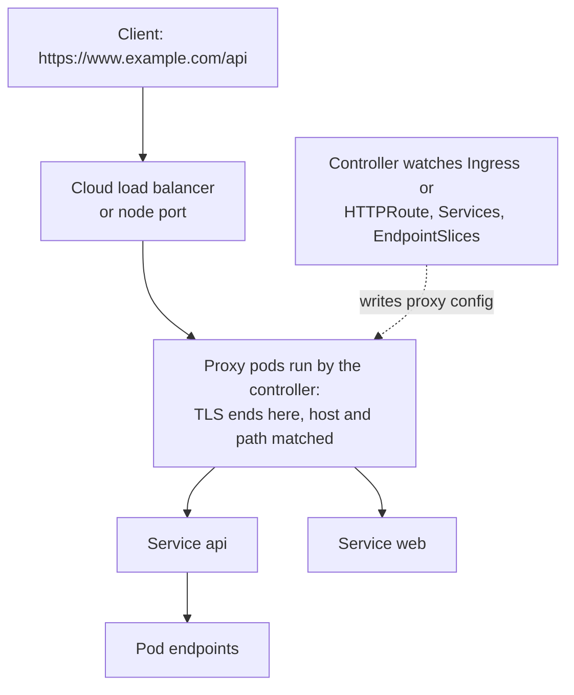
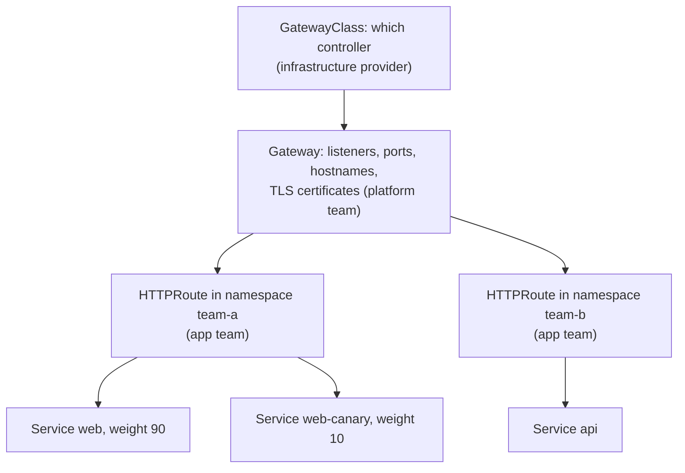

# Ingress and Gateway API

> **Status: AI draft, 2026-11-16.** Not yet verified by me. The Ingress commands were run on a local kind cluster (Kubernetes 1.37) with no ingress controller installed, and pod addresses are rewritten to example ranges; the Gateway API parts are from the documentation and were not run.

## In one line

Ingress and Gateway API describe HTTP routing into the cluster (hostnames, paths, TLS) as Kubernetes objects; a separate controller reads them and configures a real proxy or cloud load balancer. Ingress is frozen and the community ingress-nginx controller was retired in March 2026; Gateway API is the recommended replacement, with separate objects for the platform team and app teams.

## The plain idea

A Service gives a stable address for a set of pods, but it works at layer 4: it forwards connections, it does not read HTTP ([Services and DNS](services-and-dns.md), [Layers and encapsulation](../networking/layers.md)). To send `example.com/api` to one app and `example.com/` to another, and to terminate TLS once at the edge, you need a layer-7 reverse proxy in front of the Services ([Load balancers and proxies](../networking/load-balancers-and-proxies.md)).

Kubernetes splits this into two parts:

- **The rules**, written as API objects: an `Ingress`, or Gateway API's `Gateway` and `HTTPRoute`.
- **A controller** that watches those objects and configures a proxy (an NGINX, Envoy or HAProxy deployment in the cluster) or a cloud load balancer to match.

Without a controller, the rules are just stored text: nothing listens and nothing routes.

## How it works

### The request path



Many controllers send traffic straight to pod IPs from the EndpointSlices, skipping the Service's virtual IP. On AWS, the Load Balancer Controller does the same with an ALB and no in-cluster proxy at all ([AWS Load Balancer Controller](../eks/load-balancer-controller.md)).

### The Ingress object

| Field | Meaning |
|---|---|
| `ingressClassName` | Which controller should handle it. An IngressClass object names the controller. |
| `rules[].host` | Hostname to match (the HTTP `Host` header or TLS SNI). |
| `rules[].http.paths[]` | A `path`, a `pathType` (`Exact`, `Prefix` or `ImplementationSpecific`), and a backend Service and port. |
| `tls[]` | Hostnames and a `secretName` holding the certificate and key, in the same namespace ([TLS and certificates](../networking/tls.md)). |
| `defaultBackend` | Where requests that match no rule go. |

Anything beyond host, path and TLS (redirects, rewrites, timeouts, header changes, canary weights) is done with **controller-specific annotations**, so an Ingress written for one controller rarely works unchanged on another.

### Gateway API

Gateway API is a set of CRDs installed on top of Kubernetes. It splits the Ingress into objects owned by different people:



- **GatewayClass**: the kind of load balancer, and which controller implements it.
- **Gateway**: one actual entry point. Its listeners say which ports, protocols and hostnames it accepts, where its certificates are, and which namespaces' routes may attach (`allowedRoutes`).
- **HTTPRoute**: matches on path, headers, query parameters and method, can redirect, rewrite and change headers, and splits traffic by weight between backends. These are in the standard API, not annotations.
- **GRPCRoute**, **TLSRoute**, **TCPRoute** and **UDPRoute** cover other protocols.
- **ReferenceGrant**: lets a route or Gateway refer to a Service or Secret in another namespace only when that namespace allows it.
- Routes report back in `status.parents[].conditions`: `Accepted` and `ResolvedRefs` say whether the Gateway took the route and whether its backends exist.

### Where things stand

- **The Ingress API is frozen.** It stays generally available and the project has no plans to remove it, but it gets no new features, and the Kubernetes documentation recommends Gateway instead.
- **The community ingress-nginx controller has been retired.** Kubernetes SIG Network announced in November 2025 that best-effort maintenance would end in March 2026, with no further releases, bug fixes or security updates after that. Existing installations keep working, unpatched. This is the controller most people mean by "nginx ingress"; it is a different project from NGINX's own controller.
- Most proxy and cloud vendors implement Gateway API, and some also read Ingress, which eases a gradual move.

| | Ingress | Gateway API |
|---|---|---|
| Status | Frozen, still supported | Actively developed |
| Objects | One object per app | GatewayClass, Gateway, routes, per role |
| Ownership | App team writes everything, including TLS | Platform team owns Gateways; app teams own routes |
| Advanced routing | Controller-specific annotations | Standard fields: header matches, weights, rewrites |
| Protocols | HTTP and HTTPS | HTTP, gRPC, TLS, TCP, UDP |
| Cross-namespace | Not supported | Explicit, with `allowedRoutes` and ReferenceGrant |
| Portability | Low once annotations are used | Higher, with a conformance test suite |

## A concrete example

`sample-app` has a website and an API on `www.example.com`, with a canary of the new version.

- **Platform team**: one Gateway named `public` in namespace `infra`, listening on 443 with the `www.example.com` certificate, allowing routes from namespaces labelled `exposed: "true"`.
- **App team**, in their own namespace:

```yaml
apiVersion: gateway.networking.k8s.io/v1
kind: HTTPRoute
metadata:
  name: sample-app
  namespace: team-a
spec:
  parentRefs:
    - name: public
      namespace: infra
  hostnames: ["www.example.com"]
  rules:
    - matches:
        - path: { type: PathPrefix, value: /api }
      backendRefs:
        - { name: sample-app-api, port: 8080 }
    - backendRefs:
        - { name: sample-app-web, port: 80, weight: 90 }
        - { name: sample-app-web-canary, port: 80, weight: 10 }
```

Moving the canary to 50% is a one-line change the app team can make, without touching the Gateway or its certificate ([Deployment strategies](../cicd/deployment-strategies.md)).

## Why not just...?

- **...give every app a `type: LoadBalancer` Service?** One cloud load balancer per app costs money each, gives you no path or host routing, and spreads TLS certificates across every app. One shared entry point with rules is cheaper and easier to audit.
- **...keep running ingress-nginx, since it still works?** It works, but any vulnerability found from now on stays unfixed, and it sits on the internet edge. Plan the move to a maintained controller, preferably through Gateway API.
- **...switch from Ingress to Gateway API by converting the YAML?** The basic rules translate directly, but every annotation has to be mapped by hand to a Gateway API field or the new controller's own policy objects. Run both side by side and move hostnames one at a time.

## Commands to know

An Ingress created on a cluster with no ingress controller:

```console
$ kubectl create ingress web -n demo --rule="web.example.com/*=web:80" --rule="web.example.com/api*=web:80"
ingress.networking.k8s.io/web created
$ kubectl get ingress web -n demo
NAME   CLASS    HOSTS             ADDRESS   PORTS   AGE
web    <none>   web.example.com             80      1s
$ kubectl get ingressclass
No resources found
$ kubectl describe ingress web -n demo
...
Ingress Class:    <none>
Rules:
  Host             Path  Backends
  ----             ----  --------
  web.example.com
                   /      web:80 (10.244.0.5:80,10.244.0.6:80)
                   /api   web:80 (10.244.0.5:80,10.244.0.6:80)
Events:            <none>
```

The object is valid and `describe` even resolves the backends, but `ADDRESS` stays empty and there are no events, because nothing is watching it. That is the signature of a missing controller or a wrong class. A `/*` in `--rule` becomes `pathType: Prefix`; without it, `Exact`.

Gateway API objects only exist once their CRDs are installed:

```console
$ kubectl api-resources | grep -i gateway || echo "(no gateway resources)"
(no gateway resources)
```

| Command | What it does |
|---|---|
| `kubectl get ingress -A` | Every Ingress, its class and its address. |
| `kubectl get ingressclass` | Installed controllers; one may be marked default. |
| `kubectl get gatewayclass,gateway -A` | Gateway API entry points and whether they are programmed. |
| `kubectl get httproute -A` | Routes and the Gateways they attach to. |
| `kubectl describe httproute <name>` | `Accepted` and `ResolvedRefs` conditions with reasons. |
| `kubectl logs -n <controller-ns> deploy/<controller>` | Why the controller rejected or ignored something. |
| `curl -v --resolve www.example.com:443:<lb-ip> https://www.example.com/api` | Test routing and TLS before DNS points at the load balancer ([`curl -v` line by line](../networking/curl-v-annotated.md)). |

## How it breaks

| Symptom | Layer | Check | Likely cause |
|---|---|---|---|
| `ADDRESS` empty, no events | Controller | `kubectl get ingressclass`; controller pods | No controller, or `ingressClassName` names one that is not installed |
| 404 from the proxy | Routing rules | Host and path in the rule vs the request | `Host` header does not match, or `Exact` where `Prefix` was meant |
| 503 from the proxy | Backends | `kubectl get endpointslices -l kubernetes.io/service-name=<svc>` | Service has no ready pods ([Probes and graceful shutdown](probes-and-graceful-shutdown.md)) |
| Browser shows the controller's default certificate | TLS | `tls.secretName`, Secret namespace | Secret missing, in another namespace, or host not listed under `tls.hosts` |
| HTTPRoute ignored | Attachment | `status.parents` conditions | Wrong `parentRefs`, namespace not allowed by the listener's `allowedRoutes`, or hostname mismatch |
| `ResolvedRefs: False` | Cross-namespace reference | ReferenceGrant in the target namespace | Backend in another namespace without a ReferenceGrant |
| Behaviour changed after a controller migration | Annotations | Old annotations | The new controller ignores the old controller's annotations |

## Interview questions

**1. What is the difference between an Ingress and an ingress controller?**

<details markdown="1">
<summary>Answer</summary>

- The Ingress is an API object: host, path and TLS rules.
- The controller is software that watches Ingresses and configures a proxy or cloud load balancer.
- Without a controller the object does nothing; `ingressClassName` picks which controller handles it.

</details>

**2. Why is Gateway API replacing Ingress?**

<details markdown="1">
<summary>Answer</summary>

- Ingress only standardises host, path and TLS; everything else is non-portable annotations.
- Gateway API standardises header matching, weights, rewrites, and protocols beyond HTTP.
- It separates roles: platform teams own Gateways and certificates, app teams own routes, with explicit cross-namespace permission.

</details>

**3. Name the main Gateway API objects and who typically owns each.**

<details markdown="1">
<summary>Answer</summary>

- GatewayClass: infrastructure provider; which controller.
- Gateway: platform or cluster operators; listeners, ports, TLS, which namespaces may attach.
- HTTPRoute (and other routes): application teams; matches and backends.
- ReferenceGrant: owners of the target namespace, allowing cross-namespace references.

</details>

**4. What happened to ingress-nginx, and what would you do about a cluster still using it?**

<details markdown="1">
<summary>Answer</summary>

- Kubernetes SIG Network retired it: best-effort maintenance ended in March 2026, with no releases or security fixes after.
- Existing installs keep working but stay unpatched at the internet edge.
- Inventory Ingresses and annotations, choose a maintained controller (ideally via Gateway API), run both side by side, move hosts one at a time.

</details>

**5. An Ingress returns 503 for every request. How do you debug it?**

<details markdown="1">
<summary>Answer</summary>

- The proxy is reached and the rule matched, so look at the backend.
- Check the Service's EndpointSlices: no ready endpoints means failing readiness probes or a wrong selector.
- Check the Service port in the rule matches the Service's port, then the controller's logs.

</details>

**6. How would you route 10% of traffic to a new version?**

<details markdown="1">
<summary>Answer</summary>

- Gateway API: two `backendRefs` in an HTTPRoute with weights 90 and 10.
- Ingress: only through controller-specific annotations, or a service mesh ([Traffic management](../mesh/traffic-management.md)).
- Watch error rate and latency per version before raising the weight.

</details>

**7. Why put TLS termination at the ingress layer, and what are the trade-offs?**

<details markdown="1">
<summary>Answer</summary>

- One place to manage certificates and TLS settings; apps speak plain HTTP inside.
- Traffic between proxy and pod is then unencrypted unless re-encrypted or covered by mesh mTLS ([mTLS and authorization](../mesh/mesh-security.md)).
- Certificates live in Secrets, so access to that namespace must be tight.

</details>

## Try it

**Step 1.** On a kind cluster with any Service (here `web` in namespace `demo`), create an Ingress.

```bash
kubectl create ingress try-web -n demo --rule="try.example.com/*=web:80"
```

**Step 2.** Predict the `ADDRESS` and the events, then check. Explain why.

```bash
kubectl get ingress try-web -n demo
kubectl describe ingress try-web -n demo | tail -3
kubectl get ingressclass
```

**Step 3.** Look up what `pathType` values mean, then clean up.

```bash
kubectl explain ingress.spec.rules.http.paths.pathType
kubectl delete ingress try-web -n demo
```

## Zoom out

Ingress and Gateway API are the cluster's version of the reverse proxy ([Nginx as a reverse proxy](../networking/nginx.md)), with the configuration written as API objects that a controller reconciles. On AWS the same objects can drive an ALB directly ([ALB and NLB](../aws-core/load-balancers.md)), and a service mesh extends the same routing ideas to traffic between services ([Why a mesh](../mesh/why-a-mesh.md)).

## Sources

- [Kubernetes documentation: Ingress](https://kubernetes.io/docs/concepts/services-networking/ingress/)
- [Kubernetes documentation: Ingress controllers](https://kubernetes.io/docs/concepts/services-networking/ingress-controllers/)
- [Kubernetes documentation: Gateway API](https://kubernetes.io/docs/concepts/services-networking/gateway/)
- [Gateway API: API overview](https://gateway-api.sigs.k8s.io/docs/concepts/api-overview/)
- [Gateway API: HTTPRoute](https://gateway-api.sigs.k8s.io/reference/api-types/httproute/)
- [Gateway API: ReferenceGrant](https://gateway-api.sigs.k8s.io/reference/api-types/referencegrant/)
- [Gateway API: troubleshooting and status conditions](https://gateway-api.sigs.k8s.io/docs/concepts/troubleshooting/)
- [Kubernetes blog: Ingress NGINX retirement, what you need to know (2025-11-11)](https://kubernetes.io/blog/2025/11/11/ingress-nginx-retirement/)
