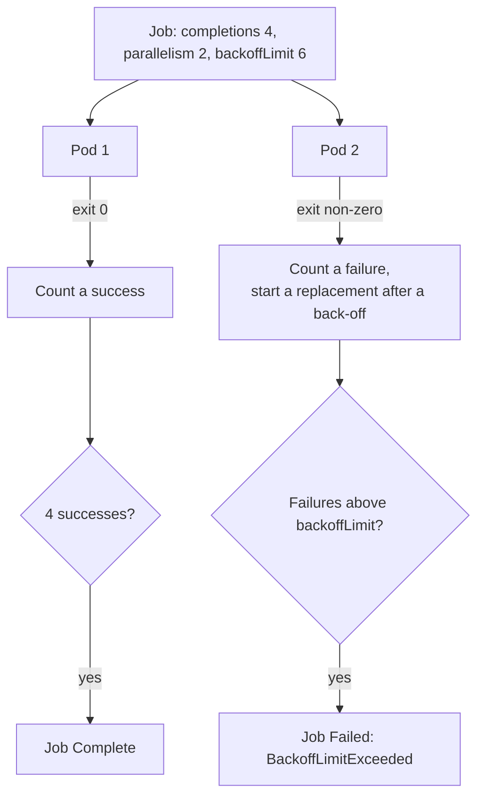

# Jobs and CronJobs

> **Status: AI draft, 2026-11-16.** Not yet verified by me. Commands and output were run on a local kind cluster (Kubernetes 1.37); generated IDs are replaced with placeholders.

## In one line

A Job runs pods until a set number complete successfully, retrying failures up to `backoffLimit` and stopping at `activeDeadlineSeconds`; a CronJob creates a Job on a cron schedule, in a time zone you choose, with a `concurrencyPolicy` for overlapping runs. Make the work idempotent, because retries and duplicate runs will happen.

## The plain idea

Most workloads run forever: a web server should never "finish". Some work should run, finish and stop: a database migration, a nightly report, a batch of images to resize. If a Deployment ran it, Kubernetes would restart it after every successful finish. A **Job** is the controller for finite work: it runs pods until enough of them succeed, retries the ones that fail (up to a limit), and then stops.

A **CronJob** is the cluster's version of cron ([Cron and timers](../linux/cron-and-timers.md)): at each scheduled time it creates a new Job. The same three questions apply as on a server: which time zone, what if a run is missed, and what if a run is still going when the next one is due.

## How it works

### Job



| Field | Meaning | Default |
|---|---|---|
| `completions` | How many pods must succeed | 1 |
| `parallelism` | How many pods may run at once | 1 |
| `backoffLimit` | How many retries before the Job is marked failed | 6 |
| `activeDeadlineSeconds` | Fail the Job after this long, whatever the retries | None |
| `ttlSecondsAfterFinished` | Delete the finished Job and its pods after this long | Keep forever |
| `template.spec.restartPolicy` | `Never` (a failure creates a new pod) or `OnFailure` (the container restarts in the same pod); `Always` is not allowed | Must be set |

Retries back off exponentially. With `restartPolicy: OnFailure`, the failed attempts' logs are lost when the container restarts in place; `Never` keeps each failed pod for inspection. An **indexed** Job (`completionMode: Indexed`) gives each pod an index, so pod 3 of 10 knows to process its own slice of the work.

### CronJob

| Field | Meaning |
|---|---|
| `schedule` | Five-field cron expression |
| `timeZone` | An IANA zone name such as `Asia/Kolkata`; without it, the schedule uses the controller manager's time zone, usually UTC |
| `concurrencyPolicy` | `Allow` (overlapping runs), `Forbid` (skip the new run if the last one is still active), or `Replace` (stop the old run, start the new) |
| `startingDeadlineSeconds` | If a run could not start on time (controller down), start it late only within this window |
| `successfulJobsHistoryLimit`, `failedJobsHistoryLimit` | How many finished Jobs to keep (3 and 1 by default) |
| `suspend` | `true` pauses future runs without deleting the CronJob |

A CronJob can occasionally create two Jobs for one scheduled time, or none, around controller restarts and clock issues. The documentation is explicit that jobs should be **idempotent**: running twice must do no harm.

## A concrete example

A nightly report must run at 02:30 India time, never overlap, and keep a little history.

```yaml
apiVersion: batch/v1
kind: CronJob
metadata:
  name: nightly-report
  namespace: demo
spec:
  schedule: "30 2 * * *"
  timeZone: "Asia/Kolkata"
  concurrencyPolicy: Forbid
  successfulJobsHistoryLimit: 3
  failedJobsHistoryLimit: 1
  jobTemplate:
    spec:
      template:
        spec:
          restartPolicy: OnFailure
          containers:
            - name: report
              image: busybox:1.36
              command: ["sh", "-c", "echo report generated"]
```

1. `timeZone` removes the UTC arithmetic: the schedule means 02:30 in India.
2. `Forbid` skips a run if yesterday's is somehow still going, instead of two copies writing the same report.
3. To test it now, rather than waiting until 02:30, create a Job from its template: `kubectl create job manual-report --from=cronjob/nightly-report`.
4. The report writes to a path that includes the date and overwrites it if run twice, so a duplicate run is harmless.
5. An alert fires if no successful Job has completed in 26 hours, so a silently skipped run is noticed ([Alerting and Alertmanager](../observability/alerting.md)).

## Why not just...?

- **...run batch work as a Deployment?** When the process finishes, the Deployment restarts it, forever. A Job knows "done" from "crashed".
- **...use `restartPolicy: OnFailure` everywhere?** It restarts in the same pod, so you lose the logs of earlier failed attempts, and a pod stuck on a bad node keeps failing there. `Never` with a sensible `backoffLimit` is easier to debug.
- **...set no `backoffLimit` or deadline?** A Job that can never succeed (wrong credentials, missing table) keeps retrying for a long time and hides the failure. Set limits so it fails visibly, and alert on failed Jobs.

## Commands to know

A parallel Job and a failing one:

```console
$ kubectl get pods -n demo -l job-name=batch-ok
batch-ok-<id> Running
batch-ok-<id> Running
$ kubectl wait --for=condition=Complete job/batch-ok -n demo --timeout=60s
job.batch/batch-ok condition met
$ kubectl get job batch-ok -n demo
NAME       STATUS     COMPLETIONS   DURATION   AGE
batch-ok   Complete   4/4           13s        13s
```

Two pods ran at a time (`parallelism: 2`) until four had succeeded.

```console
$ kubectl get job batch-fail -n demo
NAME         STATUS   COMPLETIONS   DURATION   AGE
batch-fail   Failed   0/1           53s        53s
$ kubectl get pods -n demo -l job-name=batch-fail --no-headers | awk '{print $3}' | sort | uniq -c
      3 Error
$ kubectl get job batch-fail -n demo -o jsonpath='{range .status.conditions[*]}{.type}={.status} reason={.reason}{"\n"}{end}'
FailureTarget=True reason=BackoffLimitExceeded
Failed=True reason=BackoffLimitExceeded
```

With `backoffLimit: 2`, the first attempt plus two retries made three failed pods, each kept for its logs because the policy was `Never`.

A CronJob, and running it on demand:

```console
$ kubectl get cronjob nightly-report -n demo
NAME             SCHEDULE     TIMEZONE       SUSPEND   ACTIVE   LAST SCHEDULE   AGE
nightly-report   30 2 * * *   Asia/Kolkata   False     0        <none>          53s
$ kubectl create job manual-report --from=cronjob/nightly-report -n demo
job.batch/manual-report created
$ kubectl logs -n demo job/manual-report
report generated
```

| Command | What it does |
|---|---|
| `kubectl get jobs -n <ns>` | Completions, status and duration. |
| `kubectl logs job/<name>` | Logs of one of the Job's pods. |
| `kubectl describe job <name>` | Events: pods created, failures, deadline. |
| `kubectl patch cronjob <name> -p '{"spec":{"suspend":true}}'` | Pause a CronJob. |
| `kubectl get jobs -n <ns> --sort-by=.status.startTime` | When each run started, to check a schedule. |
| `kubectl delete job <name>` | Delete a Job and, by default, its pods ([Finalizers and deletion](finalizers-and-deletion.md)). |

## How it breaks

| Symptom | Layer | Check | Likely cause |
|---|---|---|---|
| Job `Failed`, `BackoffLimitExceeded` | Application | Logs of the failed pods | The work fails every time: credentials, a missing dependency, a bug |
| Job `Failed`, `DeadlineExceeded` | Deadline | `activeDeadlineSeconds` against real duration | Work takes longer than allowed, or hangs |
| Job never finishes | Pod or sidecar | Pods' states | A process that never exits, or a regular sidecar container that keeps running ([Pods](pods.md)) |
| CronJob ran at the wrong hour | Time zone | `timeZone` field | Schedule interpreted in UTC |
| CronJob run skipped | Concurrency or deadline | `concurrencyPolicy`, `startingDeadlineSeconds`, events | Previous run still active with `Forbid`, or the controller missed the window |
| Thousands of old completed pods | Clean-up | History limits, TTL | No `ttlSecondsAfterFinished`, or Jobs created outside CronJobs with no clean-up |
| The same record processed twice | Idempotency | Job design | A retried or duplicate run repeated work that was not idempotent |

## Interview questions

**1. When do you use a Job instead of a Deployment?**

<details markdown="1">
<summary>Answer</summary>

- For finite work that should run to completion and stop: migrations, batch processing, reports.
- A Deployment restarts processes that exit, even successfully.
- A Job tracks successful completions and retries failures up to a limit.

</details>

**2. What do `completions`, `parallelism` and `backoffLimit` do?**

<details markdown="1">
<summary>Answer</summary>

- `completions`: how many pods must succeed.
- `parallelism`: how many run at the same time.
- `backoffLimit`: how many retries before the Job is marked failed.

</details>

**3. What are the CronJob concurrency policies?**

<details markdown="1">
<summary>Answer</summary>

- `Allow`: runs may overlap.
- `Forbid`: skip a new run while the previous one is active.
- `Replace`: stop the active run and start the new one.

</details>

**4. Why must CronJob work be idempotent?**

<details markdown="1">
<summary>Answer</summary>

- Retries rerun failed work, and the controller can occasionally create two Jobs for one schedule (or none).
- Running twice must not double-charge, double-send or corrupt data.
- Use idempotency keys, upserts, or outputs that are overwritten rather than appended.

</details>

**5. A CronJob scheduled at 02:30 ran at 08:00. Why?**

<details markdown="1">
<summary>Answer</summary>

- The schedule was evaluated in UTC (or the controller's zone), and 02:30 UTC is 08:00 in India.
- Set `timeZone: Asia/Kolkata`, or convert the schedule to UTC.

</details>

**6. How do you test a CronJob without waiting for its schedule?**

<details markdown="1">
<summary>Answer</summary>

- `kubectl create job <name> --from=cronjob/<cronjob>` creates a Job from the CronJob's template immediately.
- Watch it with `kubectl get job` and `kubectl logs job/<name>`.

</details>

**7. A Job with a mesh sidecar never completes. Why, and how do you fix it?**

<details markdown="1">
<summary>Answer</summary>

- The main container finished, but the sidecar, as a regular container, keeps running, so the pod never completes.
- Make it a native sidecar (an init container with `restartPolicy: Always`), which is stopped after the main containers finish.

</details>

## Try it

**Step 1.** On a kind cluster, run a Job that always fails, with `backoffLimit: 2`. Predict how many pods it creates and the Job's final status, then watch.

```bash
kubectl apply -f - <<'EOF'
apiVersion: batch/v1
kind: Job
metadata: { name: always-fails }
spec:
  backoffLimit: 2
  template:
    spec:
      restartPolicy: Never
      containers:
        - name: w
          image: busybox:1.36
          command: ["sh", "-c", "echo trying; exit 1"]
EOF
kubectl get pods -l job-name=always-fails -w
```

Press Ctrl+C after a minute, then run `kubectl get job always-fails`.

**Step 2.** Create a CronJob that runs every minute and trigger it manually as well.

```bash
kubectl create cronjob tick --image=busybox:1.36 --schedule="* * * * *" -- sh -c 'date'
kubectl create job tick-now --from=cronjob/tick
kubectl get jobs -w
```

**Step 3.** Clean up.

```bash
kubectl delete job always-fails tick-now && kubectl delete cronjob tick
```

## Zoom out

Jobs and CronJobs complete the workload controllers ([Deployments and rollouts](deployments-and-rollouts.md), [StatefulSets and DaemonSets](statefulsets-and-daemonsets.md)), and carry the same scheduling questions as cron on a server. In CI/CD they run migrations and test suites; Helm and Argo CD hooks are often Jobs ([Releases, hooks and debugging](../helm/releases-hooks-debugging.md)). The principle to carry: finite work needs limits, a time zone, a concurrency rule, and idempotency.

## Sources

- [Kubernetes documentation: Jobs](https://kubernetes.io/docs/concepts/workloads/controllers/job/)
- [Kubernetes documentation: CronJob](https://kubernetes.io/docs/concepts/workloads/controllers/cron-jobs/)
- [Kubernetes documentation: automatic clean-up for finished Jobs](https://kubernetes.io/docs/concepts/workloads/controllers/ttlafterfinished/)
- [Kubernetes documentation: indexed Jobs for parallel processing](https://kubernetes.io/docs/tasks/job/indexed-parallel-processing-static/)
