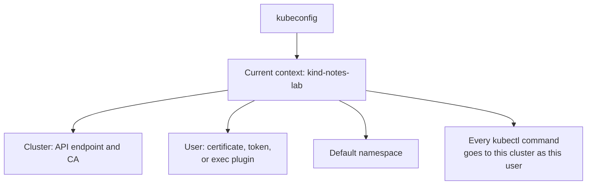

# kubectl fluency

> **Status: AI draft, 2026-11-16.** Not yet verified by me. Commands and output were run on a local kind cluster (Kubernetes 1.37); addresses are rewritten to example ranges.

## In one line

`kubectl` reads and writes API objects for the context and namespace you are pointed at. The daily set is `get`, `describe`, `logs`, `exec`, `apply` and `rollout`; `-o yaml`, `jsonpath` and `custom-columns` shape output; `explain` documents any field; `diff` and `--dry-run=server` preview a change; `kubectl debug` adds a tools container to a running pod.

## The plain idea

Everything in a cluster is an object behind the API server ([Architecture and the reconcile loop](architecture.md)), and `kubectl` is a client for that API. Fluency means three things: always knowing which cluster and namespace you are talking to, finding facts quickly (status, events, logs, a single field), and changing things in a way you can preview and repeat.

Most incidents are diagnosed with five commands in a fixed order: `get` (what state is it in?), `describe` (what happened to it, in events?), `logs` (what did it say?), `logs --previous` (what did it say before it crashed?), and `exec` or `debug` (what does it look like from inside?).

## How it works

### Where kubectl points

`kubectl` reads `~/.kube/config` (or `$KUBECONFIG`). It holds **clusters** (API endpoints and their CA), **users** (credentials or a command that fetches them, such as `aws eks get-token`), and **contexts**, each a cluster plus a user plus a default namespace. One context is current.



The most expensive kubectl mistake is the right command against the wrong cluster. Check the current context before changing anything, and pass `--context` and `-n` explicitly in scripts.

### Reading

| Command | What it gives you |
|---|---|
| `kubectl get pods -n demo -o wide` | Status, restarts, age, node and pod IP |
| `kubectl get deploy,rs,pods -l app=sample-app` | Several types at once, filtered by label ([Labels, selectors and namespaces](labels-selectors-namespaces.md)) |
| `kubectl get pod <p> -o yaml` | The whole object, spec and status |
| `kubectl describe pod <p>` | A readable summary plus the **events**: scheduling, pulls, probe failures, kills |
| `kubectl get events -n demo --sort-by=.lastTimestamp` | Everything that happened in the namespace, in order |
| `kubectl logs <p> [-c container] [-f] [--tail=50] [--since=10m]` | Container output |
| `kubectl logs <p> --previous` | Output of the previous, crashed instance: usually where the error is |
| `kubectl logs -l app=sample-app --prefix` | Logs from every pod matching a label |
| `kubectl explain deployment.spec.strategy` | Built-in documentation for any field, matching your cluster's version |
| `kubectl api-resources` | Every object type, short names, and whether it is namespaced |

### Shaping output

- `-o yaml` or `-o json`: everything.
- `-o jsonpath='{.items[*].metadata.name}'`: specific fields; `range` and `end` iterate.
- `-o custom-columns=NAME:.metadata.name,IP:.status.podIP`: your own table.
- `-o name`: just `kind/name`, ready for piping into another command.
- Or pipe `-o json` into `jq` ([jq and yq](../linux/jq-and-yq.md)).

### Writing

| Command | Use |
|---|---|
| `kubectl apply -f file.yaml` | Declarative create or update. Records what you applied, so later applies can work out what to remove. The normal way. |
| `kubectl diff -f file.yaml` | Show what `apply` would change on the server. Exit code 1 means there are differences. |
| `kubectl apply --dry-run=server -f file.yaml` | Send it through validation and admission without saving. Catches errors that client-side checks miss. |
| `kubectl create deployment web --image=nginx:1.27 --dry-run=client -o yaml` | Generate a starting manifest. |
| `kubectl rollout status`, `history`, `undo`, `restart` | Manage Deployment rollouts ([Deployments and rollouts](deployments-and-rollouts.md)). |
| `kubectl scale`, `kubectl set image`, `kubectl edit`, `kubectl patch` | Imperative changes: useful in an emergency, overwritten by the next apply or GitOps sync. |
| `kubectl delete -f file.yaml` | Delete exactly what the file describes. Never delete by a broad label selector without listing first ([Finalizers and deletion](finalizers-and-deletion.md)). |

### Looking inside

- `kubectl exec -it <p> -- sh` runs a command in an existing container, if the image has a shell.
- `kubectl debug <p> -it --image=busybox:1.36 --target=app` adds an **ephemeral container** to a running pod. With `--target`, it shares the target container's process namespace, so it can see its processes, and it always shares the pod's network. This is how to debug distroless images.
- `kubectl debug node/<node> -it --image=ubuntu` starts a pod on a node with the host's filesystem mounted at `/host`.
- `kubectl port-forward svc/sample-app 8080:80` makes a Service reachable on your laptop, for testing.

## A concrete example

`sample-app` pods restart every few minutes after a deploy.

1. `kubectl get pods -n demo`: `RESTARTS` climbing, status `CrashLoopBackOff` at times.
2. `kubectl describe pod <p> -n demo`: under `Last State`, `Terminated`, `Reason: Error`, `Exit Code: 1`. Events show `Back-off restarting failed container`.
3. `kubectl logs <p> -n demo` shows only the new instance starting. `kubectl logs <p> -n demo --previous` shows the crash: a missing configuration key.
4. `kubectl get deploy sample-app -n demo -o jsonpath='{.spec.template.spec.containers[0].envFrom}'` shows which ConfigMap it reads; `kubectl get cm` confirms the key is absent ([ConfigMaps and Secrets](configmaps-and-secrets.md)).
5. Fix the ConfigMap in Git, let the pipeline apply it, and restart the rollout. Each step used a different command, and each narrowed the problem.

## Why not just...?

- **...use `kubectl edit` to fix things in production?** The change is real but invisible to Git, and the next deploy or GitOps sync reverts it. Fix the source of truth; use imperative commands only to stop the bleeding, then follow up in Git.
- **...rely on the current context?** One terminal pointed at production and another at staging look identical. Show the context in your prompt, and pass `--context` explicitly for anything destructive.
- **...`exec` into pods to debug, every time?** Many production images have no shell. `kubectl debug` with a tools image works for any pod and does not change the original container.

## Commands to know

Contexts:

```console
$ kubectl config get-contexts
CURRENT NAME CLUSTER NAMESPACE
* kind-notes-lab kind-notes-lab
```

Built-in field documentation:

```console
$ kubectl explain deployment.spec.strategy.rollingUpdate.maxSurge
GROUP:      apps
KIND:       Deployment
VERSION:    v1

FIELD: maxSurge <IntOrString>

DESCRIPTION:
    The maximum number of pods that can be scheduled above the desired number of
    pods. Value can be an absolute number (ex: 5) or a percentage of desired
    pods (ex: 10%). This can not be 0 if MaxUnavailable is 0. Absolute number is
    calculated from percentage by rounding up. Defaults to 25%. ...
```

Preview, then apply:

```console
$ kubectl apply -f deploy.yaml --dry-run=server
deployment.apps/sample-app created (server dry run)
$ kubectl diff -f deploy-4-replicas.yaml
-  replicas: 3
+  replicas: 4
```

Output shaped two ways:

```console
$ kubectl get pods -n demo -o custom-columns=NAME:.metadata.name,IP:.status.podIP,READY:.status.containerStatuses[0].ready,RESTARTS:.status.containerStatuses[0].restartCount
NAME                         IP           READY   RESTARTS
sample-app-dcc66c4d7-2r7f2   10.244.0.5   true    0
sample-app-dcc66c4d7-m7hk2   10.244.0.6   true    0
sample-app-dcc66c4d7-w9sg7   10.244.0.7   true    0
$ kubectl get pods -n demo -o jsonpath='{range .items[*]}{.metadata.name}{"\t"}{.status.phase}{"\n"}{end}'
sample-app-56544df785-c8gp7	Running
sample-app-56544df785-h675w	Running
sample-app-56544df785-vkd88	Running
```

Logs from every pod with a label:

```console
$ kubectl logs -n demo -l app=sample-app --prefix --tail=1
[pod/sample-app-<hash>-<id>/app] listening on :8080
[pod/sample-app-<hash>-<id>/app] listening on :8080
[pod/sample-app-<hash>-<id>/app] listening on :8080
```

A debug container in a distroless pod, sharing the app container's processes and network:

```console
$ kubectl debug -n demo <pod> --image=busybox:1.36 --target=app --container=dbg -- sh -c 'ps; wget -qO- localhost:8080/healthz'
$ kubectl logs -n demo <pod> -c dbg
PID   USER     TIME  COMMAND
    1 65532     0:00 /server
   18 root      0:00 sh -c ps; wget -qO- localhost:8080/healthz
   31 root      0:00 ps
ok
```

The app (`/server`, running as the non-root user 65532) is visible as PID 1, and `localhost:8080` reaches it.

`kubectl top` needs metrics-server, which kind does not install:

```console
$ kubectl top pods -n demo
error: Metrics API not available
```

| Command | What it does |
|---|---|
| `kubectl config use-context <name>`, `kubectl config set-context --current --namespace=demo` | Switch cluster, or set the default namespace. |
| `kubectl get all -n demo` | Common workload objects, not literally all types. |
| `kubectl wait --for=condition=Available deploy/sample-app --timeout=60s` | Block until a condition holds: good in scripts. |
| `kubectl auth can-i delete pods -n demo` | Ask whether you are allowed ([RBAC and service accounts](rbac-and-service-accounts.md)). |
| `kubectl get pods -A --field-selector=status.phase!=Running` | Pods in any namespace that are not running. |
| `kubectl rollout restart deploy/sample-app` | Replace all pods gradually, for example to pick up a changed Secret. |

## How it breaks

| Symptom | Layer | Check | Likely cause |
|---|---|---|---|
| A change landed in the wrong cluster | Context | `kubectl config current-context` | Wrong current context |
| `the server doesn't have a resource type` | API discovery | `kubectl api-resources` | CRD not installed, or a typo |
| `error: You must be logged in to the server (Unauthorized)` | Credentials | `kubectl config view --minify` | Expired token or certificate; for EKS, the AWS identity in use ([Cluster access, IRSA and Pod Identity](../eks/access-and-pod-identity.md)) |
| `forbidden: User ... cannot list resource` | RBAC | `kubectl auth can-i ...` | Missing Role or binding |
| `logs` shows nothing useful after a crash | Log instance | `--previous` | Looking at the new instance instead of the crashed one |
| `exec: "sh": executable file not found` | Image | Use `kubectl debug` | Distroless or minimal image |
| `kubectl apply` complains about conflicts or ownership | Field management | Server-side apply field managers | Another tool or controller owns those fields |

## Interview questions

**1. A pod is in `CrashLoopBackOff`. Which kubectl commands do you run, in order?**

<details markdown="1">
<summary>Answer</summary>

- `kubectl get pods` for status and restart count.
- `kubectl describe pod` for the last state, exit code and events.
- `kubectl logs --previous` for the crashed instance's output.
- `kubectl get` the deployment and its ConfigMaps or Secrets if configuration is suspected.

</details>

**2. What is a kubeconfig context?**

<details markdown="1">
<summary>Answer</summary>

- A named combination of a cluster, a user (credentials) and a default namespace.
- The current context decides where every command goes.
- Switching context is switching cluster or identity, so check it before making changes.

</details>

**3. What is the difference between `kubectl apply` and `kubectl create`?**

<details markdown="1">
<summary>Answer</summary>

- `create` makes a new object and fails if it exists.
- `apply` creates or updates declaratively, recording what was applied so later applies can remove dropped fields.
- `apply` suits files kept in Git; `create` suits one-off objects and generating YAML.

</details>

**4. How do you preview a change before applying it?**

<details markdown="1">
<summary>Answer</summary>

- `kubectl diff -f` to see field-level differences against the live object.
- `kubectl apply --dry-run=server` to run validation and admission without saving.
- In GitOps, the controller's diff view does the same.

</details>

**5. How do you debug a container that has no shell?**

<details markdown="1">
<summary>Answer</summary>

- `kubectl debug <pod> -it --image=<tools-image> --target=<container>` adds an ephemeral container.
- It shares the pod's network and, with `--target`, the container's processes.
- For node-level problems, `kubectl debug node/<node>`.

</details>

**6. Why should you be careful with `kubectl edit` and `kubectl scale` in production?**

<details markdown="1">
<summary>Answer</summary>

- They change the live object without changing the source of truth.
- The next apply or GitOps sync reverts them, possibly at a bad moment.
- Use them to stop an incident, then make the same change in Git.

</details>

## Try it

**Step 1.** Create a kind cluster, or use one, and a Deployment.

```bash
kind create cluster --name k-demo
kubectl create deployment web --image=nginx:1.27 --replicas=2
kubectl rollout status deployment/web
```

**Step 2.** Answer each question with one command before checking: which node and IP each pod has; the image of the Deployment; every event in the namespace in time order.

```bash
kubectl get pods -o wide
kubectl get deploy web -o jsonpath='{.spec.template.spec.containers[0].image}{"\n"}'
kubectl get events --sort-by=.lastTimestamp
```

**Step 3.** Debug a pod with an ephemeral container, then delete the cluster.

```bash
kubectl debug $(kubectl get pods -l app=web -o name | head -1) -it --image=busybox:1.36 --target=nginx -- sh -c 'ps; wget -qO- localhost | head -3'
kind delete cluster --name k-demo
```

## Zoom out

Every Kubernetes page uses these commands; the [Troubleshooting playbook](troubleshooting.md) puts them in order for each symptom. Behind them is the API ([Architecture and the reconcile loop](architecture.md)), so the same objects can be read by scripts, CI and GitOps tools. The principle to carry: know your context, read before you write, preview every change, and keep the source of truth in Git.

## Sources

- [Kubernetes documentation: kubectl reference](https://kubernetes.io/docs/reference/kubectl/)
- [Kubernetes documentation: kubectl quick reference](https://kubernetes.io/docs/reference/kubectl/quick-reference/)
- [Kubernetes documentation: organizing cluster access using kubeconfig files](https://kubernetes.io/docs/concepts/configuration/organize-cluster-access-kubeconfig/)
- [Kubernetes documentation: JSONPath support](https://kubernetes.io/docs/reference/kubectl/jsonpath/)
- [Kubernetes documentation: debug running pods with ephemeral containers](https://kubernetes.io/docs/tasks/debug/debug-application/debug-running-pod/)
- [Kubernetes documentation: declarative management with kubectl apply](https://kubernetes.io/docs/tasks/manage-kubernetes-objects/declarative-config/)
