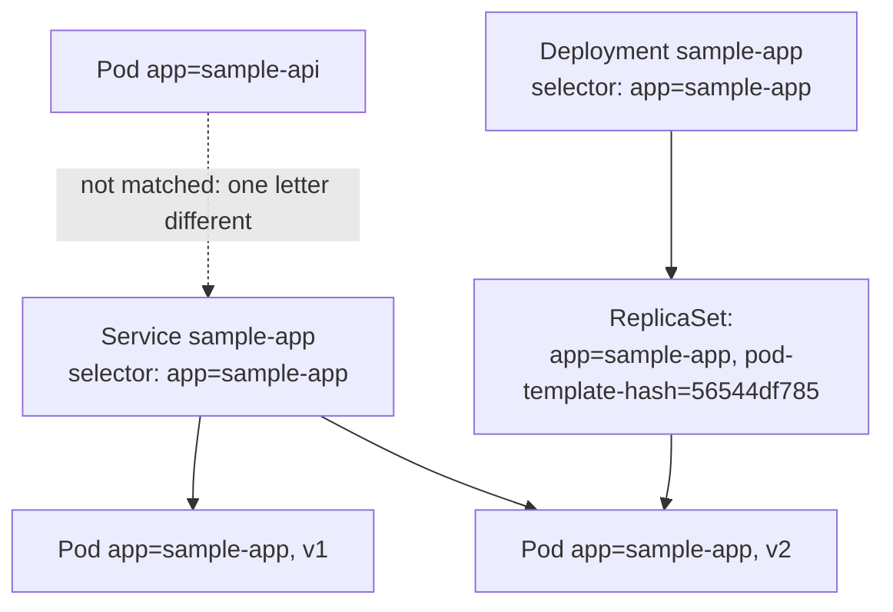

# Labels, selectors and namespaces

> **Status: AI draft, 2026-11-16.** Not yet verified by me. Commands and output were run on a local kind cluster (Kubernetes 1.37); generated IDs are replaced with placeholders.

## In one line

Labels are key-value tags on objects, and selectors are queries over them: Services find their pods, Deployments find their ReplicaSets, and NetworkPolicies find their targets by label, so a wrong or empty selector silently connects the wrong things. Namespaces divide a cluster into named scopes for names, access and quotas, but they are not a security boundary by themselves.

## The plain idea

Kubernetes objects do not point at each other by name very often. A Service does not hold a list of its pods; it holds a question: "every pod labelled `app=sample-app`". Whatever pods answer that question right now are its pods. That loose coupling is what lets pods come and go without anyone updating lists.

The cost is that a typo or an over-broad question connects the wrong things, with no error. A selector that matches nothing gives a Service with no endpoints; one that matches too much sends traffic to pods it never should.

**Namespaces** are folders for objects: names only need to be unique inside one, permissions and quotas can be set per namespace, and teams or environments can each have their own.

## How it works

### Labels and annotations

| | Labels | Annotations |
|---|---|---|
| Purpose | Identify and select objects | Attach information for tools and people |
| Queried by selectors | Yes | No |
| Value limits | Short (63 characters), restricted characters | Large values allowed |
| Examples | `app=sample-app`, `tier=web`, `env=prod` | A build URL, a config checksum, a controller's settings |

The recommended labels use the `app.kubernetes.io/` prefix: `name`, `instance`, `version`, `component`, `part-of`, `managed-by`. Tools such as Helm and dashboards understand them.

### Selectors



| Selector kind | Syntax | Example |
|---|---|---|
| Equality | `key=value`, `key!=value` | `-l app=sample-app,tier=web` (AND) |
| Set-based | `key in (a,b)`, `key notin (a)`, `key`, `!key` | `-l 'env in (staging,prod)'` |

- A **Service** selector is equality-only and picks the pods that receive its traffic ([Services and DNS](services-and-dns.md)).
- A Deployment's `spec.selector` must match its template's labels, and it **cannot be changed** after creation.
- Controllers add their own labels, such as `pod-template-hash` on ReplicaSets and `job-name` on Job pods, so their selectors do not overlap.
- **An empty selector matches everything.** In a NetworkPolicy, `podSelector: {}` means every pod in the namespace. In a `kubectl delete -l` with a mistyped or empty variable, it can mean every object ([Finalizers and deletion](finalizers-and-deletion.md)).

### Namespaces

| Scoped by namespace | Cluster-wide |
|---|---|
| Pods, Deployments, Services, ConfigMaps, Secrets, Roles, ServiceAccounts, PVCs | Nodes, PersistentVolumes, StorageClasses, ClusterRoles, Namespaces themselves, CRDs |

`kubectl api-resources --namespaced=false` lists the cluster-wide kinds. Every cluster starts with `default`, `kube-system` (control plane and add-ons), `kube-public` and `kube-node-lease`.

**Namespaces are not isolation on their own.** By default, pods in any namespace can reach pods in every other namespace, and a ClusterRole can grant access everywhere. Isolation comes from adding RBAC per namespace ([RBAC and service accounts](rbac-and-service-accounts.md)), NetworkPolicies ([Pod networking and NetworkPolicy](pod-networking-and-network-policy.md)) and Pod Security labels ([Pod security](pod-security.md)). For hard isolation between tenants, separate clusters or accounts are stronger.

### Quotas and default limits

- A **ResourceQuota** caps a namespace's totals: number of pods, total CPU and memory requests and limits, number of Services, storage requested. A request that would exceed it is rejected at admission.
- A **LimitRange** sets per-container defaults and bounds. Once a quota covers CPU or memory, every pod must state those values, and a LimitRange's defaults fill them in for pods that do not ([Requests, limits and QoS](resources-and-qos.md)).

## A concrete example

Team A gets a namespace capped at three pods, 1 CPU and 1 GiB of requests, with defaults for containers that do not set resources:

```yaml
apiVersion: v1
kind: ResourceQuota
metadata:
  name: team-a-quota
  namespace: team-a
spec:
  hard:
    pods: "3"
    requests.cpu: "1"
    requests.memory: 1Gi
    limits.memory: 2Gi
---
apiVersion: v1
kind: LimitRange
metadata:
  name: defaults
  namespace: team-a
spec:
  limits:
    - type: Container
      default:
        memory: 256Mi
        cpu: 500m
      defaultRequest:
        memory: 128Mi
        cpu: 100m
```

1. A Deployment asks for five replicas of an image that sets no resources.
2. The LimitRange fills in requests and limits for each container.
3. Three pods are admitted; the quota is then at `pods 3/3`.
4. The ReplicaSet's attempts to create the fourth and fifth pods are rejected with `exceeded quota`, visible in its events, and the Deployment shows `3/5` forever.
5. The fix is a decision, not a retry: raise the quota, lower the replicas, or move the workload.

## Why not just...?

- **...give each Service a list of pod names?** Pods are replaced constantly with new names. A label query always reflects the current set.
- **...use namespaces as the security boundary between teams?** Without RBAC, NetworkPolicy and Pod Security added, a namespace only separates names. Treat it as the place where you attach those controls.
- **...put everything in `default`?** Quotas, RBAC and policies cannot be targeted, names collide, and clean-up means picking objects one by one. One namespace per application or team per environment is a common starting point.

## Commands to know

Labels on pods, including the ones controllers add:

```console
$ kubectl get pods -n demo --show-labels
NAME              ...   LABELS
batch-ok-<id>     ...   batch.kubernetes.io/controller-uid=<uid>,batch.kubernetes.io/job-name=batch-ok,controller-uid=<uid>,job-name=batch-ok
```

Set-based and existence selectors:

```console
$ kubectl get pods -n demo -l 'app in (db, node-agent)'
db-0
node-agent-<id>
$ kubectl get pods -n demo -l 'app,app!=db'
node-agent-<id>
```

`app` alone means "has an `app` label".

A quota stopping a Deployment at three pods, with defaults filled in:

```console
$ kubectl create deployment web -n team-a --image=nginx:1.27 --replicas=5
$ kubectl get deploy web -n team-a
NAME   READY   UP-TO-DATE   AVAILABLE   AGE
web    0/5     3            0           8s
$ kubectl get pod -n team-a -o jsonpath='{.items[0].spec.containers[0].resources}'
{"limits":{"cpu":"500m","memory":"256Mi"},"requests":{"cpu":"100m","memory":"128Mi"}}
$ kubectl describe quota team-a-quota -n team-a
Resource         Used   Hard
--------         ----   ----
limits.memory    768Mi  2Gi
pods             3      3
requests.cpu     300m   1
requests.memory  384Mi  1Gi
$ kubectl get events -n team-a --field-selector reason=FailedCreate
Error creating: pods "web-<id>" is forbidden: exceeded quota: team-a-quota, requested: pods=1, used: pods=3, limited: pods=3
```

The quota error appears in the ReplicaSet's events, not as a failed pod: the extra pods were never created.

| Command | What it does |
|---|---|
| `kubectl label pod <p> tier=web` | Add a label; `tier-` removes it; `--overwrite` changes it. |
| `kubectl get pods -L app,version` | Show chosen labels as columns. |
| `kubectl get all -l app=sample-app` | Everything with that label in the namespace. |
| `kubectl get endpointslices -l kubernetes.io/service-name=<svc>` | Which pod addresses a Service's selector currently matches. |
| `kubectl api-resources --namespaced=false` | Cluster-wide kinds. |
| `kubectl get quota,limitrange -n <ns>` | A namespace's quota and defaults. |

## How it breaks

| Symptom | Layer | Check | Likely cause |
|---|---|---|---|
| Service has no endpoints | Selector | Compare the Service selector with the pod labels exactly | Typo, different label key, or pods not ready |
| Service sends traffic to the wrong pods | Selector too broad | Who matches the selector? | Two apps share a label value |
| `selector does not match template labels` | Deployment spec | The Deployment's selector and template | Mismatched labels in the manifest |
| `field is immutable` when changing a selector | Deployment spec | The change | Selectors cannot change; create a new Deployment |
| Deployment stuck below its replicas, no failing pods | Quota | ReplicaSet events; `describe quota` | `exceeded quota` |
| `must specify limits.memory` | Quota without defaults | LimitRange present? | A quota on limits but no LimitRange defaults |
| A bulk delete removed far too much | Selector | What the selector expanded to | Empty or over-broad selector |

## Interview questions

**1. What is the difference between labels and annotations?**

<details markdown="1">
<summary>Answer</summary>

- Labels are short key-value pairs used to identify and select objects with selectors.
- Annotations hold arbitrary information for tools and people and cannot be selected on.
- Services, Deployments and policies depend on labels; controllers and tools read annotations.

</details>

**2. How does a Service know which pods to send traffic to?**

<details markdown="1">
<summary>Answer</summary>

- Its selector matches pod labels; the EndpointSlice controller keeps the list of matching, ready pod addresses.
- No names are stored, so new pods with matching labels join automatically.
- A typo in the selector or labels gives a Service with no endpoints.

</details>

**3. Are namespaces a security boundary?**

<details markdown="1">
<summary>Answer</summary>

- Not by themselves: by default, pods can reach other namespaces, and cluster-wide roles span them.
- They are where you attach controls: RBAC per namespace, NetworkPolicies, Pod Security labels, quotas.
- For strong tenant isolation, use separate clusters or accounts.

</details>

**4. What do ResourceQuota and LimitRange do?**

<details markdown="1">
<summary>Answer</summary>

- ResourceQuota caps a namespace's totals: pods, CPU and memory requests and limits, storage, object counts.
- LimitRange sets default and minimum or maximum resources per container.
- With a quota on CPU or memory, pods must declare them; a LimitRange supplies defaults.

</details>

**5. A Deployment shows `3/5` and no pods are failing. What do you check?**

<details markdown="1">
<summary>Answer</summary>

- The ReplicaSet's events, for `FailedCreate`, often `exceeded quota`.
- `kubectl describe quota` in the namespace.
- Also pending pods for scheduling problems, if pods were created.

</details>

**6. Why is an empty selector dangerous?**

<details markdown="1">
<summary>Answer</summary>

- An empty selector matches every object of that kind in scope.
- In a NetworkPolicy it targets all pods; in a delete with an unset variable it can delete everything.
- List what a selector matches before acting on it.

</details>

## Try it

**Step 1.** On a kind cluster, create two Deployments and a Service with a typo in its selector.

```bash
kubectl create deployment web --image=nginx:1.27
kubectl create deployment api --image=nginx:1.27
kubectl create service clusterip web --tcp=80:80
kubectl patch service web -p '{"spec":{"selector":{"app":"wbe"}}}'
```

**Step 2.** Predict how many endpoints the Service has, check, then fix the selector and check again.

```bash
kubectl get endpointslices -l kubernetes.io/service-name=web
kubectl patch service web -p '{"spec":{"selector":{"app":"web"}}}'
kubectl get endpointslices -l kubernetes.io/service-name=web
```

**Step 3.** List what an empty-looking selector would match before you would ever delete with it, then clean up.

```bash
SEL=""; kubectl get deploy -l "app${SEL:+=$SEL}"
kubectl delete deploy web api && kubectl delete svc web
```

## Zoom out

Selectors are the glue of Kubernetes: Services, Deployments, NetworkPolicies, PodDisruptionBudgets, affinity rules and monitoring all find their targets with them ([Services and DNS](services-and-dns.md), [Scheduling](scheduling.md), [Disruptions, drains and PDBs](disruptions-and-pdbs.md)). Namespaces are where access, policy and quota attach. The principle to carry: before relying on a selector, especially to delete, look at exactly what it matches.

## Sources

- [Kubernetes documentation: labels and selectors](https://kubernetes.io/docs/concepts/overview/working-with-objects/labels/)
- [Kubernetes documentation: recommended labels](https://kubernetes.io/docs/concepts/overview/working-with-objects/common-labels/)
- [Kubernetes documentation: annotations](https://kubernetes.io/docs/concepts/overview/working-with-objects/annotations/)
- [Kubernetes documentation: namespaces](https://kubernetes.io/docs/concepts/overview/working-with-objects/namespaces/)
- [Kubernetes documentation: resource quotas](https://kubernetes.io/docs/concepts/policy/resource-quotas/)
- [Kubernetes documentation: limit ranges](https://kubernetes.io/docs/concepts/policy/limit-range/)
