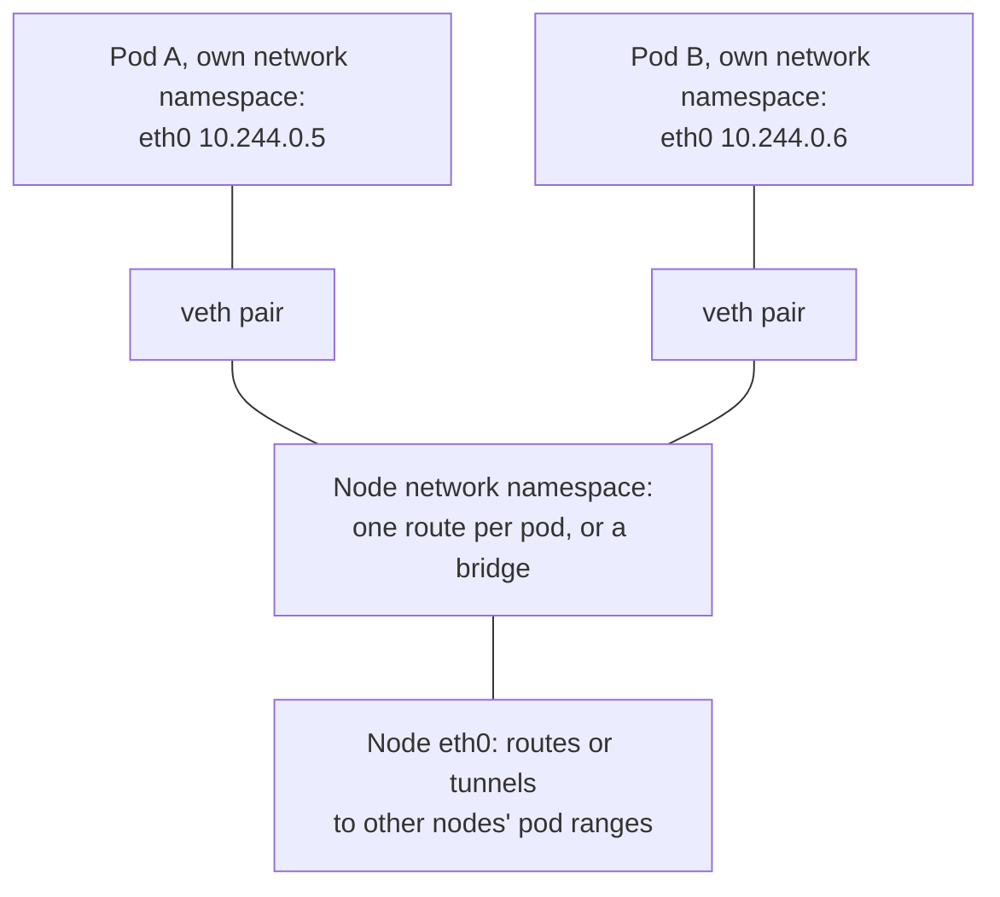

# Pod networking and NetworkPolicy

> **Status: AI draft, 2026-11-16.** Not yet verified by me. Commands and output were run on a local kind cluster (Kubernetes 1.37) whose network plugin enforces NetworkPolicy; addresses and interface names are rewritten or shortened.

## In one line

Every pod gets its own IP and can reach every other pod without NAT; a CNI plugin wires that up. By default all traffic is allowed. NetworkPolicy restricts it, if the CNI enforces it: once a policy selects a pod, only allowed traffic gets through.

## The plain idea

Inside a cluster, Kubernetes promises a flat network: every pod gets a real address, and any pod can reach any other pod by that address, on any node, as if they were all on one big switch. Nobody configures this per pod. A **CNI plugin** (container network interface) does it: when the kubelet starts a pod, it calls the plugin, which creates the pod's network interface, gives it an address and sets up routes.

Flat and open is convenient and risky: a compromised pod can reach every database in the cluster. **NetworkPolicy** is the firewall layer for pods. You describe, with labels, which pods may talk to which, on which ports, and the network plugin enforces it ([Firewalls and connection tracking](../networking/firewalls.md)).

## How it works

### The network model

1. Every pod has its own IP address.
2. Pods can reach all other pods, on any node, without NAT.
3. Agents on a node (kubelet, system daemons) can reach all pods on that node.

The model does not say how. Different plugins use different approaches: routing pod ranges between nodes, overlays that tunnel pod traffic between nodes (VXLAN, Geneve), or, on AWS, giving pods real VPC addresses from the node's network interfaces ([Networking with the VPC CNI](../eks/vpc-cni.md)).

### One node, two pods



- Each pod's network namespace gets one end of a **veth pair** (a virtual cable); the other end sits in the node's namespace. The router lab in [Routing and NAT](../networking/routing-and-nat.md) builds the same thing by hand.
- The node has a route to each local pod (or a bridge joining them), and routes or tunnels to other nodes' pod ranges.
- Pod to Service traffic goes through kube-proxy's rules first ([Services and DNS](services-and-dns.md)).
- Pod to outside traffic is usually source-NATed to the node's address, unless pods have routable addresses.

### NetworkPolicy

A NetworkPolicy selects pods by label and lists allowed traffic:

| Field | Meaning |
|---|---|
| `podSelector` | Which pods in this namespace the policy applies to. `{}` means all of them |
| `policyTypes` | `Ingress`, `Egress`, or both |
| `ingress[].from` | Allowed sources: `podSelector`, `namespaceSelector`, both combined, or `ipBlock` (CIDR) |
| `egress[].to` | Allowed destinations, the same way |
| `ports` | Allowed ports and protocols |

The rules that matter:

- **Default allow.** A pod selected by no policy accepts and sends anything.
- **Once selected, default deny** for the selected direction: only traffic allowed by some policy gets through. Policies add up (a union of allows); there are no deny rules.
- **Replies are allowed automatically**: policies are stateful.
- **Enforcement is the plugin's job.** A cluster whose CNI does not implement NetworkPolicy accepts the objects and silently ignores them. Check that yours enforces before relying on it.
- **Egress policies must allow DNS.** A default-deny egress policy without an allow for port 53 to CoreDNS breaks name resolution for every selected pod.
- `from: [ {namespaceSelector: ...}, {podSelector: ...} ]` (two list items) means "either", while one item with both selectors means "both". This YAML difference is a classic mistake.

A common baseline per namespace: a default-deny for ingress (and, where practical, egress), then narrow allows for each real flow.

## A concrete example

The `web` pods in namespace `demo` should accept traffic only from pods labelled `role=frontend`.

```yaml
apiVersion: networking.k8s.io/v1
kind: NetworkPolicy
metadata:
  name: default-deny-ingress
spec:
  podSelector: {}
  policyTypes: ["Ingress"]
---
apiVersion: networking.k8s.io/v1
kind: NetworkPolicy
metadata:
  name: web-allow-frontend
spec:
  podSelector:
    matchLabels: { app: web }
  policyTypes: ["Ingress"]
  ingress:
    - from:
        - podSelector:
            matchLabels: { role: frontend }
      ports:
        - { protocol: TCP, port: 80 }
```

1. Before any policy, both a plain client pod and a `role=frontend` pod can reach `web`.
2. After the default deny, neither can: every pod in the namespace is selected for ingress, and nothing is allowed.
3. After the allow rule, only the frontend pod gets through.
4. Blocked connections **time out**; the policy drops packets, it does not refuse them.

## Why not just...?

- **...rely on namespaces to separate teams?** Without policies, pods in every namespace can reach each other ([Labels, selectors and namespaces](labels-selectors-namespaces.md)). A namespace-wide default deny plus explicit allows is what isolates them.
- **...block by pod IP addresses?** Pod addresses change constantly. Policies select by labels, which follow the pods.
- **...write a default-deny egress policy and stop there?** DNS, the API server and every dependency stop working for those pods. Add allows for DNS and each real destination, and roll out carefully.

## Commands to know

Reachability of `web` from two pods, at each step:

```text
### before any policy
client   reachable
allowed  reachable
### default deny
client   blocked
allowed  blocked
### allow frontend
client   blocked
allowed  reachable
```

Each line is `kubectl exec -n demo <pod> -- wget -qO- -T 3 web`, reported as reachable or blocked. `allowed` is the pod labelled `role=frontend`.

What a blocked connection looks like, and what a default-deny egress policy does to DNS:

```console
$ kubectl exec -n demo client -- wget -qO- -T 3 web
wget: download timed out
$ kubectl exec -n demo client -- wget -qO- -T 3 web    # after a default-deny egress policy on client
wget: bad address 'web'
$ kubectl get netpol -n demo
NAME                   POD-SELECTOR   AGE
client-deny-egress     run=client     25s
default-deny-ingress   <none>         48s
web-allow-frontend     app=web        36s
```

`bad address` means the name could not even be resolved: the policy blocked the DNS query to CoreDNS.

Pod addresses, and the node's routes to them:

```console
$ kubectl get pods -n demo -o wide
NAME      ...   IP
allowed   ...   10.244.0.8
$ ip route    # on the node
default dev eth0
10.244.0.5 dev veth<id> scope host
10.244.0.6 dev veth<id> scope host
10.244.0.7 dev veth<id> scope host
...
```

One route per local pod, each through its own veth interface.

| Command | What it does |
|---|---|
| `kubectl get networkpolicy -A` | Every policy in the cluster. |
| `kubectl describe networkpolicy <p>` | Its selectors and rules in readable form. |
| `kubectl get pods -o wide` | Pod IPs and nodes. |
| `kubectl run tmp --rm -it --image=busybox:1.36 --labels=role=frontend -- wget -qO- -T 3 <svc>` | Test a flow as a pod with given labels. |
| `kubectl debug node/<n> -it --image=ubuntu` | A shell on a node to look at routes and interfaces. |

## How it breaks

| Symptom | Layer | Check | Likely cause |
|---|---|---|---|
| Connections time out after adding a policy | Policy | Which policies select the destination pod? | Default deny with no allow for this source or port |
| Name resolution fails in some pods | Egress policy | Egress policies selecting them | DNS (port 53 to CoreDNS) not allowed |
| Policy has no effect | CNI | Does the plugin enforce NetworkPolicy? | Plugin without policy support, objects ignored |
| Allow rule too broad, or too narrow | YAML structure | One `from` item with both selectors, or two items | "Both" against "either" confusion |
| Pods get no IP, `ContainerCreating` | CNI | Pod events; CNI pods and logs | Plugin not running, or out of addresses ([Networking with the VPC CNI](../eks/vpc-cni.md)) |
| Cross-node pod traffic fails, same-node works | Routing or overlay | Node routes, tunnel ports, security groups between nodes | Overlay port blocked, or missing routes |

## Interview questions

**1. What is the Kubernetes network model?**

<details markdown="1">
<summary>Answer</summary>

- Every pod gets its own IP.
- Pods can reach all other pods across nodes without NAT.
- Node agents can reach the pods on their node. The CNI plugin implements it.

</details>

**2. What does a CNI plugin do?**

<details markdown="1">
<summary>Answer</summary>

- When a pod starts, it creates the pod's network interface (often a veth pair), assigns an IP, and sets up routes.
- It makes pod ranges reachable between nodes, by routing, overlays or cloud-native addresses.
- Some also enforce NetworkPolicy.

</details>

**3. Explain how NetworkPolicy evaluates traffic.**

<details markdown="1">
<summary>Answer</summary>

- Pods selected by no policy allow all traffic.
- Once a pod is selected for a direction, only traffic allowed by some policy is permitted; allows combine as a union.
- There are no explicit deny rules, and replies to allowed connections are permitted.

</details>

**4. You applied a default-deny egress policy and the application broke completely. Why?**

<details markdown="1">
<summary>Answer</summary>

- All outbound traffic is now blocked, including DNS queries to CoreDNS.
- Names stop resolving, so every outbound call fails.
- Add an egress allow to the DNS pods on UDP and TCP 53, then allow each real dependency.

</details>

**5. A NetworkPolicy seems to do nothing. What do you check?**

<details markdown="1">
<summary>Answer</summary>

- Whether the cluster's CNI enforces NetworkPolicy at all.
- That the policy's `podSelector` and namespace actually match the intended pods.
- That another policy is not already allowing the traffic (allows add up).

</details>

**6. How do you isolate namespaces from each other?**

<details markdown="1">
<summary>Answer</summary>

- A default-deny ingress policy in each namespace.
- Allows that use `namespaceSelector` (and `podSelector`) for the flows that should cross namespaces.
- Combine with RBAC and, for strong isolation, separate clusters.

</details>

## Try it

**Step 1.** On a kind cluster whose CNI enforces policies (recent kind versions do), create a web Deployment and two client pods.

```bash
kubectl create deployment web --image=nginx:1.27 && kubectl expose deployment web --port=80
kubectl run c1 --image=busybox:1.36 -- sleep 3600
kubectl run c2 --image=busybox:1.36 --labels=role=frontend -- sleep 3600
kubectl wait --for=condition=Ready pod/c1 pod/c2
```

**Step 2.** Apply a default deny and an allow for `role=frontend`. Predict which client reaches `web`, then check.

```bash
kubectl apply -f - <<'EOF'
apiVersion: networking.k8s.io/v1
kind: NetworkPolicy
metadata: { name: web-only-frontend }
spec:
  podSelector: { matchLabels: { app: web } }
  policyTypes: ["Ingress"]
  ingress:
    - from: [ { podSelector: { matchLabels: { role: frontend } } } ]
EOF
for p in c1 c2; do kubectl exec $p -- wget -qO- -T 3 web >/dev/null 2>&1 && echo "$p reachable" || echo "$p blocked"; done
```

**Step 3.** Clean up, naming each object.

```bash
kubectl delete networkpolicy web-only-frontend
kubectl delete pod c1 c2 && kubectl delete deploy web && kubectl delete svc web
```

## Zoom out

Pod networking sits between Linux networking ([Routing and NAT](../networking/routing-and-nat.md)) and Services ([Services and DNS](services-and-dns.md)); on EKS the VPC itself carries pod addresses ([Networking with the VPC CNI](../eks/vpc-cni.md)), and meshes add identity-based rules on top ([mTLS and authorization](../mesh/mesh-security.md)). The principle to carry: the default is open, so isolation exists only where a policy, and a plugin that enforces it, says so.

## Sources

- [Kubernetes documentation: cluster networking](https://kubernetes.io/docs/concepts/cluster-administration/networking/)
- [Kubernetes documentation: the Kubernetes network model](https://kubernetes.io/docs/concepts/services-networking/)
- [Kubernetes documentation: Network Policies](https://kubernetes.io/docs/concepts/services-networking/network-policies/)
- [Kubernetes documentation: network plugins](https://kubernetes.io/docs/concepts/extend-kubernetes/compute-storage-net/network-plugins/)
- [CNI specification](https://github.com/containernetworking/cni)
