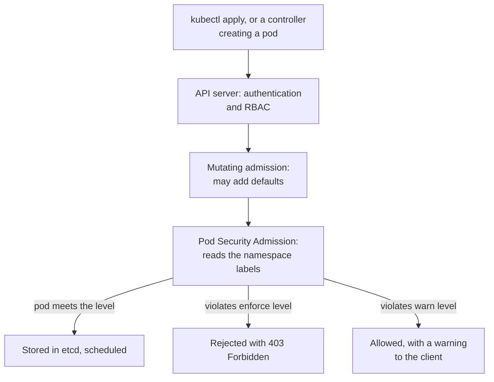

# Pod security

> **Status: AI draft, 2026-11-16.** Not yet verified by me. Commands and output were run on a local kind cluster (Kubernetes 1.37).

## In one line

A pod's `securityContext` decides what its processes may do on the node: which user they run as, whether they can gain privileges, which Linux capabilities and system calls they keep, and whether the root filesystem is writable. Pod Security Admission enforces one of three standard levels (privileged, baseline, restricted) per namespace through labels.

## The plain idea

A container is an ordinary Linux process with a restricted view ([What a container is](../containers/what-is-a-container.md)). If that process runs as root with every capability, a bug in the application or a kernel flaw is a short step from the node, and the node holds every other pod's secrets. Pod security is two things:

- **Settings on the pod** that take power away from the process: run as a normal user, forbid gaining privileges, drop capabilities, filter system calls, make the filesystem read-only.
- **A rule at the door** that refuses pods without those settings. Kubernetes' built-in rule is **Pod Security Admission** (PSA), switched on per namespace with a label.

## How it works

### Where the check happens



PSA runs after RBAC ([RBAC and service accounts](rbac-and-service-accounts.md)): RBAC decides whether you may create pods at all, PSA decides whether this particular pod is safe enough.

### securityContext fields

Set at pod level (applies to every container) or container level (overrides the pod's value for that container).

| Field | What it does | Restricted level requires |
|---|---|---|
| `runAsNonRoot: true` | The kubelet refuses to start the container if it would run as user 0 | Yes |
| `runAsUser`, `runAsGroup` | The uid and primary gid of the process | Not 0 |
| `fsGroup` | Supplementary group added to the processes, and group owner of supported volumes, so a non-root user can write to them | No |
| `allowPrivilegeEscalation: false` | Sets the kernel's `no_new_privs`: a setuid binary cannot raise privileges | Yes |
| `capabilities.drop: ["ALL"]` | Removes root's split-up powers (change file ownership, bind low ports, raw sockets...) | Yes; only `NET_BIND_SERVICE` may be added back |
| `seccompProfile.type: RuntimeDefault` | The runtime's default filter blocks rarely needed, risky system calls | `RuntimeDefault` or `Localhost` |
| `readOnlyRootFilesystem: true` | The image's filesystem cannot be written; writes go to mounted volumes | No, but recommended |
| `privileged: true` | Nearly all protections off: all devices, all capabilities | Forbidden from baseline up |

### The three Pod Security Standards

| Level | For | Blocks (summary) |
|---|---|---|
| **privileged** | System components that need the node: network plugins, storage drivers, node agents | Nothing |
| **baseline** | Most applications, with minimal changes | Privileged containers, host namespaces (`hostNetwork`, `hostPID`, `hostIPC`), `hostPath` volumes, host ports, extra capabilities beyond the default set |
| **restricted** | Applications that can follow current hardening practice | Everything baseline blocks, plus root users, privilege escalation, kept capabilities, missing seccomp, and volume types other than the common safe ones |

### Namespace labels and modes

```yaml
metadata:
  labels:
    pod-security.kubernetes.io/enforce: restricted
    pod-security.kubernetes.io/enforce-version: latest
    pod-security.kubernetes.io/warn: restricted
    pod-security.kubernetes.io/audit: restricted
```

| Mode | Effect of a violation |
|---|---|
| `enforce` | The pod is rejected |
| `warn` | Allowed; the client prints a warning |
| `audit` | Allowed; the API server's audit log records it |

Each mode can use a different level, which is how you tighten safely: `enforce: baseline` with `warn: restricted` shows what would break before you enforce it. `warn` and `audit` also check workload objects (Deployments, Jobs), but **`enforce` only checks pods**, so a non-compliant Deployment is accepted and then its ReplicaSet fails to create pods.

PSA replaced PodSecurityPolicy, which was removed in Kubernetes 1.25. For rules PSA cannot express (allowed registries, required labels), clusters add a policy engine such as Kyverno or OPA Gatekeeper, which run as admission webhooks ([CRDs, operators and admission webhooks](crds-and-operators.md)).

## A concrete example

A team's namespace should run only hardened pods.

1. Label the namespace `warn=restricted` first and watch the warnings during a normal deploy.
2. Fix the manifests: a non-root user (built into the image, [Images and Dockerfiles](../containers/images-and-dockerfiles.md)), drop all capabilities, no privilege escalation, `RuntimeDefault` seccomp, and a read-only root filesystem with an `emptyDir` for scratch files.
3. Check the namespace's existing pods against the new level with a server-side dry run of the label (output under Commands).
4. Add `enforce=restricted`. The node agent in another namespace (it needs host access) stays at `privileged`, and that namespace is locked down by RBAC instead.

A compliant pod:

```yaml
apiVersion: v1
kind: Pod
metadata:
  name: good
  namespace: secure
spec:
  securityContext:
    runAsNonRoot: true
    runAsUser: 1000
    seccompProfile:
      type: RuntimeDefault
  containers:
    - name: app
      image: busybox:1.36
      command: ["sleep", "3600"]
      securityContext:
        allowPrivilegeEscalation: false
        readOnlyRootFilesystem: true
        capabilities:
          drop: ["ALL"]
```

## Why not just...?

- **...rely on the container being isolated?** Containers share the node's kernel. Root in a container is root on the kernel's view of the world, limited only by namespaces, capabilities and seccomp. Every layer you remove makes an escape easier.
- **...set `privileged: true` because something does not work?** It turns off nearly every protection to fix one missing permission. Find the specific capability or volume that is needed and grant only that, in a separate namespace.
- **...enforce restricted on every namespace at once?** System namespaces and node agents legitimately need host access, and existing apps will stop scaling. Use `warn` first, fix, then `enforce`, and keep a privileged namespace for the few that need it.

## Commands to know

The restricted level refusing an ordinary pod:

```console
$ kubectl label namespace secure pod-security.kubernetes.io/enforce=restricted pod-security.kubernetes.io/enforce-version=latest
$ kubectl run bad -n secure --image=nginx:1.27
Error from server (Forbidden): pods "bad" is forbidden: violates PodSecurity "restricted:latest": allowPrivilegeEscalation != false (container "bad" must set securityContext.allowPrivilegeEscalation=false), unrestricted capabilities (container "bad" must set securityContext.capabilities.drop=["ALL"]), runAsNonRoot != true (pod or container "bad" must set securityContext.runAsNonRoot=true), seccompProfile (pod or container "bad" must set securityContext.seccompProfile.type to "RuntimeDefault" or "Localhost")
```

The message lists each field to set. The compliant pod above was admitted, and inside it:

```console
$ kubectl exec -n secure good -- id
uid=1000 gid=0(root) groups=0(root)
$ kubectl exec -n secure good -- touch /x
touch: /x: Read-only file system
```

The group is still 0 because only `runAsUser` was set; add `runAsGroup` to change it.

Warn mode allows the pod and prints what it would violate; baseline refuses a privileged container:

```console
$ kubectl label namespace psa-warn pod-security.kubernetes.io/warn=restricted
$ kubectl run loose -n psa-warn --image=busybox:1.36 --dry-run=server -- sleep 3600
Warning: would violate PodSecurity "restricted:latest": allowPrivilegeEscalation != false (...)
pod/loose created (server dry run)
$ kubectl label namespace psa-warn pod-security.kubernetes.io/enforce=baseline
$ kubectl run priv -n psa-warn ... (a container with privileged: true)
Error from server (Forbidden): pods "priv" is forbidden: violates PodSecurity "baseline:latest": privileged (container "priv" must not set securityContext.privileged=true)
```

What would break if a namespace were made restricted, without changing it:

```console
$ kubectl label --dry-run=server --overwrite namespace demo pod-security.kubernetes.io/enforce=restricted
Warning: existing pods in namespace "demo" violate the new PodSecurity enforce level "restricted:latest"
Warning: allowed (and 11 other pods): allowPrivilegeEscalation != false, unrestricted capabilities, runAsNonRoot != true, seccompProfile
namespace/demo labeled (server dry run)
```

`fsGroup` making a volume writable for a non-root user (`runAsUser: 1000`, `runAsGroup: 3000`, `fsGroup: 2000`, an `emptyDir` at `/data`):

```console
$ kubectl exec -n psa-warn fsgroup-demo -- sh -c 'id; ls -ld /data; touch /data/f; ls -l /data/f; touch /f'
uid=1000 gid=3000 groups=2000,3000
drwxrwsrwx    2 root     2000          4096 <date> /data
-rw-r--r--    1 1000     2000             0 <date> /data/f
touch: /f: Permission denied
```

The volume's group is 2000 with the setgid bit (`s`), so new files inherit group 2000 ([Users, groups and permissions](../linux/permissions.md)). The image's own root directory is still owned by root, so the non-root user cannot write there.

| Command | What it does |
|---|---|
| `kubectl get ns --show-labels` | Which namespaces have which levels. |
| `kubectl get pod <p> -o jsonpath='{.spec.securityContext}'` | The pod-level settings. |
| `kubectl describe rs <rs>` | Events show a PSA rejection when a Deployment's pods are refused. |
| `kubectl exec <p> -- id` | Who the process really runs as. |
| `kubectl exec <p> -- grep Cap /proc/1/status` | The capability sets of the main process. |

## How it breaks

| Symptom | Layer | Check | Likely cause |
|---|---|---|---|
| `kubectl apply` of a Deployment succeeds but no pods appear | Admission, enforce on pods | `kubectl describe rs`, its events | PSA rejects the pods; the Deployment itself is not checked by `enforce` |
| `CreateContainerConfigError`: container has `runAsNonRoot` and image will run as root | Kubelet | Image's `USER` | Image has no non-root user; set `runAsUser` or rebuild the image |
| App crashes: read-only file system | Container settings | Where it writes | `readOnlyRootFilesystem` without an `emptyDir` for `/tmp` or caches |
| Permission denied on a volume | File ownership | `ls -ln` on the mount | Non-root user without `fsGroup`, or a volume type that ignores `fsGroup` |
| Cannot bind port 80 | Capabilities | The port | Non-root without `NET_BIND_SERVICE`; listen on 8080 and map it in the Service |
| A node agent stops starting after a cluster-wide default | Admission level | Namespace labels | System workloads need `privileged`; give them their own namespace |

## Interview questions

**1. What are the three Pod Security Standards levels?**

<details markdown="1">
<summary>Answer</summary>

- privileged: no restrictions, for system components.
- baseline: blocks known privilege escalations: privileged containers, host namespaces, `hostPath`, host ports, extra capabilities.
- restricted: baseline plus non-root, no privilege escalation, drop all capabilities, seccomp required, limited volume types.

</details>

**2. How do you apply Pod Security Admission to a namespace, and what are its modes?**

<details markdown="1">
<summary>Answer</summary>

- Labels `pod-security.kubernetes.io/<mode>: <level>`, optionally pinned with `<mode>-version`.
- `enforce` rejects; `warn` returns a client warning; `audit` writes to the audit log.
- Different levels per mode allow a gradual rollout.

</details>

**3. A Deployment was applied successfully but has zero pods. The namespace enforces restricted. Why?**

<details markdown="1">
<summary>Answer</summary>

- `enforce` checks pods, not Deployments; the ReplicaSet's pod creation is rejected.
- `kubectl describe rs` shows the forbidden message.
- Fix the pod template's securityContext.

</details>

**4. What do `runAsNonRoot`, `allowPrivilegeEscalation: false` and `capabilities.drop: ["ALL"]` each protect against?**

<details markdown="1">
<summary>Answer</summary>

- `runAsNonRoot`: the process is not uid 0, so file and kernel checks treat it as an ordinary user.
- `allowPrivilegeEscalation: false`: setuid binaries cannot raise privileges (`no_new_privs`).
- Dropping capabilities: even a root process loses the specific powers such as changing ownership or raw network access.

</details>

**5. What is `fsGroup` for?**

<details markdown="1">
<summary>Answer</summary>

- Adds a supplementary group to the pod's processes and sets that group on supported volumes.
- Lets a non-root user write to a volume that would otherwise be owned by root.
- On large volumes the recursive ownership change can slow startup; `fsGroupChangePolicy: OnRootMismatch` limits it.

</details>

**6. A vendor's chart needs `privileged: true`. What do you do?**

<details markdown="1">
<summary>Answer</summary>

- Ask what it actually needs: often one capability, host networking or a `hostPath`.
- If it is a genuine node agent, run it in its own namespace labelled privileged, with tight RBAC on who can create pods there.
- Never lower the level of an application namespace to fit it.

</details>

## Try it

**Step 1.** On a kind cluster, create a namespace that warns at restricted and enforces baseline.

```bash
kubectl create namespace psa-try
kubectl label namespace psa-try pod-security.kubernetes.io/enforce=baseline pod-security.kubernetes.io/warn=restricted
```

**Step 2.** Predict which of these is rejected and which only warns, then run them.

```bash
kubectl run plain -n psa-try --image=busybox:1.36 --dry-run=server -- sleep 60
kubectl run hostnet -n psa-try --image=busybox:1.36 --dry-run=server \
  --overrides='{"spec":{"hostNetwork":true}}' -- sleep 60
```

**Step 3.** Clean up.

```bash
kubectl delete namespace psa-try
```

## Zoom out

Pod security is the Kubernetes layer of the same defence in depth as Linux permissions and image hardening ([Users, groups and permissions](../linux/permissions.md), [Registries and image security](../containers/registries-and-image-security.md), [Hardening and benchmarks](../security/hardening-and-benchmarks.md)). RBAC limits who can create pods, PSA limits what those pods may do, and NetworkPolicy limits whom they can reach ([Pod networking and NetworkPolicy](pod-networking-and-network-policy.md)).

## Sources

- [Kubernetes documentation: Pod Security Standards](https://kubernetes.io/docs/concepts/security/pod-security-standards/)
- [Kubernetes documentation: Pod Security Admission](https://kubernetes.io/docs/concepts/security/pod-security-admission/)
- [Kubernetes documentation: configure a security context for a pod or container](https://kubernetes.io/docs/tasks/configure-pod-container/security-context/)
- [Kubernetes documentation: enforce Pod Security Standards with namespace labels](https://kubernetes.io/docs/tasks/configure-pod-container/enforce-standards-namespace-labels/)
- [Linux man page: capabilities(7)](https://man7.org/linux/man-pages/man7/capabilities.7.html)
- [Linux kernel documentation: no_new_privs](https://docs.kernel.org/userspace-api/no_new_privs.html)
