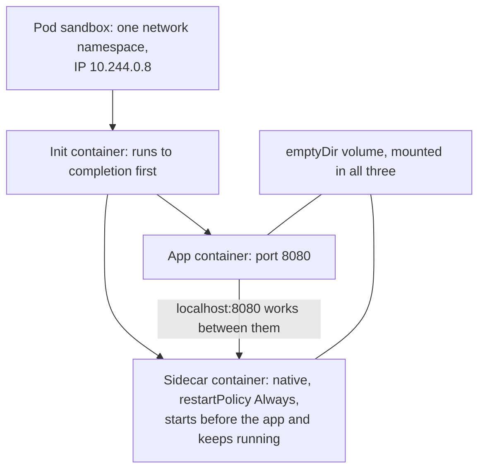

# Pods

> **Status: AI draft, 2026-11-16.** Not yet verified by me. Commands and output were run on a local kind cluster (Kubernetes 1.37); addresses are rewritten to example ranges.

## In one line

A pod is the smallest thing Kubernetes runs: one or more containers that share a network namespace (one IP, one `localhost`) and can share volumes, scheduled together on one node. Init containers run to completion first, sidecars run alongside, and pods are disposable, so you create them through controllers, never by hand.

## The plain idea

Kubernetes does not run containers one by one. It runs **pods**: small groups of containers that always live together on the same machine, share the same network address, and can share files. Most pods have one container. When a second one is needed, it is usually a helper that must sit right next to the main one: a log shipper reading its files, a proxy handling its network traffic, a job that prepares data before it starts.

A pod is also meant to be thrown away. It gets an IP address when it starts and loses it when it ends; if it dies, it is replaced by a new pod with a new name and a new address, not repaired. Anything that should outlive a pod (its data, its address, the decision to keep three copies running) lives in other objects.

## How it works

### What containers in a pod share



| Shared | Not shared by default |
|---|---|
| Network namespace: one IP, one `localhost`, one set of ports | Filesystems: each container has its own image filesystem |
| Volumes declared on the pod (when each container mounts them) | Process namespace (can be enabled with `shareProcessNamespace`) |
| The node, and the pod's lifetime | CPU and memory limits, which are per container |

Because containers share ports, two containers in one pod cannot both listen on 8080.

### Init containers and sidecars

- **Init containers** run one after another, each to completion, before the app containers start. Use them for one-time preparation: waiting for a dependency, rendering configuration, running a migration step, fixing permissions. If one fails, the pod restarts it according to its restart policy; the app never starts until all succeed.
- **Sidecar containers** are, in current Kubernetes, init containers with `restartPolicy: Always`. They start before the app containers, keep running alongside them, are restarted if they exit, and are stopped after the app containers at shutdown. Before this native support existed, sidecars were ordinary containers, and their start and stop order could not be controlled, which caused problems such as Jobs never finishing because a proxy sidecar kept running.

### Lifecycle

| Pod phase | Meaning |
|---|---|
| `Pending` | Accepted, but not all containers are running yet: waiting for scheduling, image pulls, volumes, or init containers |
| `Running` | Bound to a node, at least one container running |
| `Succeeded` | All containers exited 0 and will not restart |
| `Failed` | All containers exited, at least one with an error, and will not restart |
| `Unknown` | The node stopped reporting |

The `STATUS` column in `kubectl get pods` is more detailed than the phase: `Init:0/2`, `ContainerCreating`, `CrashLoopBackOff`, `ImagePullBackOff`, `Terminating`, `Completed`, `Error` ([Troubleshooting playbook](troubleshooting.md)).

Each container has a state (`Waiting`, `Running`, `Terminated`) with a reason and, for terminated containers, an exit code ([Processes and signals](../linux/processes-and-signals.md)).

### Restart policy

`spec.restartPolicy` applies to all the pod's regular containers:

| Policy | Restarts a container that exits... | Used by |
|---|---|---|
| `Always` (default) | Always, even with exit code 0 | Deployments, StatefulSets, DaemonSets |
| `OnFailure` | Only with a non-zero exit code | Jobs |
| `Never` | Never | Jobs, one-off pods |

Repeated restarts back off exponentially, up to a five-minute delay, which is what `CrashLoopBackOff` means: the container keeps failing and the kubelet is waiting before the next try. The restart happens **in place**, on the same node, in the same pod; only controllers create new pods.

### Why pods are created by controllers

A pod you create directly is not recreated if it is deleted, evicted or lost with its node. Controllers (Deployment, StatefulSet, DaemonSet, Job) keep the desired number of pods and replace them ([Deployments and rollouts](deployments-and-rollouts.md), [StatefulSets and DaemonSets](statefulsets-and-daemonsets.md), [Jobs and CronJobs](jobs-and-cronjobs.md)). Write the pod template inside one of those.

## A concrete example

An application writes logs to a file, and the platform's log pipeline only reads stdout ([How Kubernetes logging works](../observability/kubernetes-logging.md)). A pod solves it without changing the application:

1. An init container prepares a shared `emptyDir` volume.
2. A native sidecar (`restartPolicy: Always` in `initContainers`) runs `tail -F` on the log file and prints it to its own stdout, where the node's log agent collects it.
3. The app container writes to the file in the same volume.
4. At shutdown, the app stops first, then the sidecar, so the last lines are not lost.

Pod IPs, ports and the volume are shared, so no extra networking or storage is needed.

## Why not just...?

- **...put the app and its database in one pod?** They would scale together, restart together and be scheduled together, and the database would lose its data with the pod. Use separate workloads, each with its own controller ([StatefulSets and DaemonSets](statefulsets-and-daemonsets.md)).
- **...run several processes in one container with a process manager?** Kubernetes then sees one container: it cannot restart, probe or limit each process separately, and logs mix together. One process per container, several containers per pod when they must be together.
- **...connect to a pod by its IP?** The IP changes whenever the pod is replaced. Use a Service ([Services and DNS](services-and-dns.md)).

## Commands to know

A pod with one init container, one native sidecar and one app container, during and after initialisation:

```console
$ kubectl get pod pod-demo -n demo
NAME       READY   STATUS     RESTARTS   AGE
pod-demo   0/2     Init:0/2   0          1s
$ kubectl get pod pod-demo -n demo
NAME       READY   STATUS    RESTARTS   AGE
pod-demo   2/2     Running   0          10s
```

`Init:0/2` counts the two init containers (the sidecar is one of them). `2/2` then counts the app and the sidecar as running containers.

Each container's state, and their logs:

```console
$ kubectl get pod pod-demo -n demo -o jsonpath='{range .status.initContainerStatuses[*]}{.name}{": "}{.state}{"\n"}{end}'
wait-for-config: {"terminated":{"exitCode":0,"finishedAt":"<time>","reason":"Completed","startedAt":"<time>"}}
log-shipper: {"running":{"startedAt":"<time>"}}
$ kubectl logs pod-demo -n demo -c wait-for-config
preparing
$ kubectl logs pod-demo -n demo -c log-shipper --tail=2
line 2
line 3
```

`-c` picks the container. The sidecar's output is the app's log file.

Two containers, one IP:

```console
$ kubectl exec pod-demo -n demo -c app -- hostname -i
10.244.0.8
$ kubectl exec pod-demo -n demo -c log-shipper -- hostname -i
10.244.0.8
```

A container that keeps exiting with code 1, under the default `Always` policy:

```console
$ kubectl get pod crashy -n demo
NAME     READY   STATUS   RESTARTS      AGE
crashy   0/1     Error    3 (26s ago)   40s
$ kubectl get pod crashy -n demo -o jsonpath='{.status.containerStatuses[0].lastState.terminated.exitCode}'
1
```

Its status alternates between `Error` and `CrashLoopBackOff` as the kubelet backs off between restarts.

With `restartPolicy: Never`, a container that exits stays exited:

```console
$ kubectl get pods once oncefail -n demo
NAME       READY   STATUS      RESTARTS   AGE
once       0/1     Completed   0          6s
oncefail   0/1     Error       0          6s
```

| Command | What it does |
|---|---|
| `kubectl get pod <p> -o wide` | Node and IP. |
| `kubectl describe pod <p>` | Every container's state, last state, exit code, and the events. |
| `kubectl logs <p> -c <container> --previous` | Output of the crashed instance of one container. |
| `kubectl exec -it <p> -c <container> -- sh` | A shell in a specific container. |
| `kubectl run tmp --rm -it --image=busybox:1.36 --restart=Never -- sh` | A throwaway pod for testing from inside the cluster. |

## How it breaks

| Symptom | Layer | Check | Likely cause |
|---|---|---|---|
| Stuck at `Init:0/1` | Init container | `kubectl logs <p> -c <init-container>` | The init step fails or waits forever, often on a dependency |
| `CrashLoopBackOff` | App container | `logs --previous`; exit code in `describe` | The process exits: configuration error, missing dependency, OOM (137) |
| `0/2 Running`, one container not ready | Probes or a sidecar | `describe` for probe failures; each container's state | A readiness probe failing, or a sidecar crashing |
| `bind: address already in use` in logs | Shared network | Ports of each container | Two containers in the pod use the same port |
| A Job's pod never completes | Sidecar | Sidecar type | A regular-container sidecar keeps running; make it a native sidecar |
| Pod gone and not replaced | Ownership | `ownerReferences` | A bare pod with no controller |

## Interview questions

**1. What is a pod, and why does Kubernetes not schedule containers directly?**

<details markdown="1">
<summary>Answer</summary>

- A group of one or more containers that share a network namespace and can share volumes, scheduled together on one node.
- Some processes must be co-located and share `localhost` or files, so the pod is the unit of scheduling.
- Most pods have one container.

</details>

**2. What do containers in the same pod share?**

<details markdown="1">
<summary>Answer</summary>

- One IP address, `localhost` and the port space.
- Volumes declared on the pod, where each container mounts them.
- The node and the pod's lifecycle; not their image filesystems or, by default, their processes.

</details>

**3. What is the difference between an init container and a sidecar container?**

<details markdown="1">
<summary>Answer</summary>

- Init containers run sequentially to completion before the app starts.
- A sidecar (an init container with `restartPolicy: Always`) starts before the app, keeps running alongside it, and stops after it.
- Init for preparation; sidecars for ongoing helpers such as proxies and log shippers.

</details>

**4. What does `CrashLoopBackOff` mean?**

<details markdown="1">
<summary>Answer</summary>

- A container keeps exiting and the kubelet keeps restarting it, waiting longer between attempts.
- It is a symptom, not a cause: read `logs --previous` and the exit code.
- Common causes: bad configuration, missing dependency, failing liveness probe, OOM.

</details>

**5. Why should you not create pods directly in production?**

<details markdown="1">
<summary>Answer</summary>

- A bare pod is not replaced if it is deleted, evicted or its node fails.
- Controllers keep the desired count, handle rollouts and spread replicas.
- Use a Deployment, StatefulSet, DaemonSet or Job with a pod template.

</details>

**6. A pod shows `1/2` ready. How do you find out which container is the problem?**

<details markdown="1">
<summary>Answer</summary>

- `kubectl describe pod` lists each container's state, readiness and probe failures.
- `kubectl logs <pod> -c <container>` for the one that is not ready.
- Check its readiness probe and whether it depends on the other container.

</details>

## Try it

**Step 1.** Create a kind cluster, or use one, and a two-container pod.

```bash
kubectl apply -f - <<'EOF'
apiVersion: v1
kind: Pod
metadata:
  name: duo
spec:
  containers:
    - name: web
      image: nginx:1.27
    - name: probe
      image: busybox:1.36
      command: ["sh", "-c", "while true; do wget -qO- localhost:80 | head -1; sleep 5; done"]
EOF
kubectl get pod duo -w
```

**Step 2.** Predict what the `probe` container prints, and whether both containers report the same IP. Then check.

```bash
kubectl logs duo -c probe --tail=2
kubectl exec duo -c web -- hostname -i
kubectl exec duo -c probe -- hostname -i
```

**Step 3.** Delete the pod and check whether anything recreates it.

```bash
kubectl delete pod duo
kubectl get pods
```

## Zoom out

Pods are the bottom of the workload stack: Deployments, StatefulSets, DaemonSets and Jobs all manage pods, and Services, probes, resources and security settings are all expressed on them ([Probes and graceful shutdown](probes-and-graceful-shutdown.md), [Requests, limits and QoS](resources-and-qos.md), [Pod security](pod-security.md)). Under the hood a pod is a set of Linux namespaces shared by several containers ([What a container is](../containers/what-is-a-container.md)). The principle to carry: treat pods as disposable, and put anything that must last in the objects that manage them.

## Sources

- [Kubernetes documentation: Pods](https://kubernetes.io/docs/concepts/workloads/pods/)
- [Kubernetes documentation: pod lifecycle](https://kubernetes.io/docs/concepts/workloads/pods/pod-lifecycle/)
- [Kubernetes documentation: init containers](https://kubernetes.io/docs/concepts/workloads/pods/init-containers/)
- [Kubernetes documentation: sidecar containers](https://kubernetes.io/docs/concepts/workloads/pods/sidecar-containers/)
- [Kubernetes documentation: share process namespace between containers in a pod](https://kubernetes.io/docs/tasks/configure-pod-container/share-process-namespace/)
