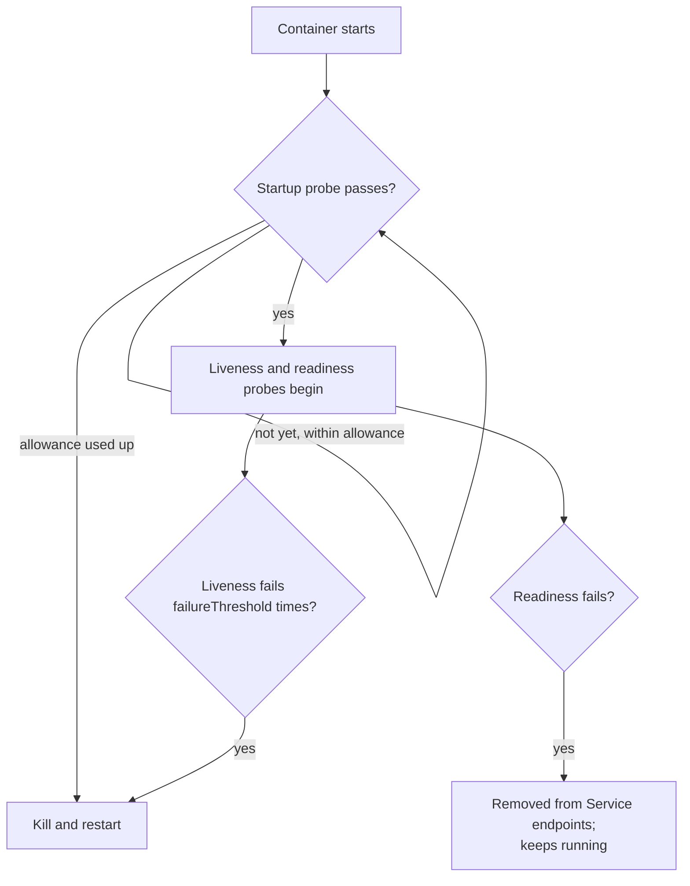
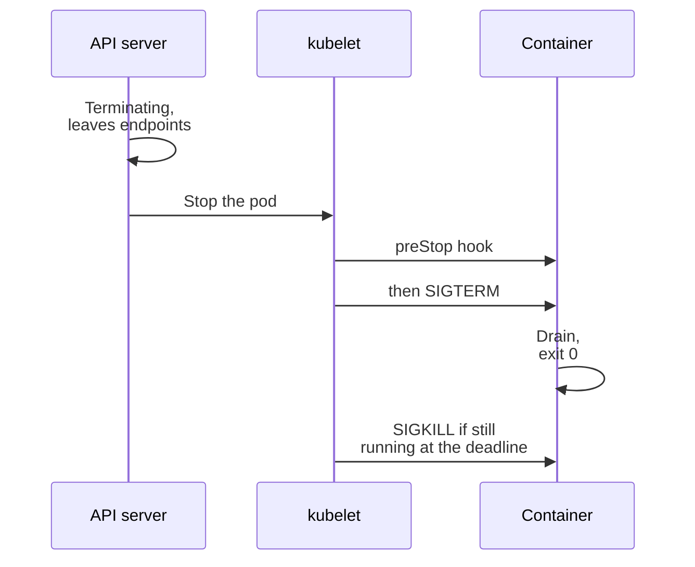

# Probes and graceful shutdown

> **Status: AI draft, 2026-11-16.** Not yet verified by me. Commands and output were run on a local kind cluster (Kubernetes 1.37); addresses are rewritten to example ranges.

## In one line

A readiness probe decides whether a pod receives traffic, a liveness probe decides whether its container is restarted, and a startup probe holds both off until a slow start finishes. On deletion, the kubelet runs `preStop`, sends SIGTERM, waits up to `terminationGracePeriodSeconds`, then sends SIGKILL, while the pod is removed from Service endpoints in parallel.

## The plain idea

Kubernetes cannot see inside your application. It needs to ask two questions, over and over: "can you take requests right now?" and "are you still alive, or stuck?". The answers decide very different actions. "Not ready" means: stop sending traffic, but leave it alone. "Not alive" means: kill it and start again. Confusing the two is a classic way to turn a slow database into a cluster-wide restart storm.

Stopping is the other half. Pods are stopped all the time, by deploys, scale-downs and node maintenance. A pod that is killed in the middle of requests causes errors on every deploy. A pod that stops taking new work, finishes what it has, and then exits causes none.

## How it works

### Three probes

| Probe | Question | On failure | Typical check |
|---|---|---|---|
| **Startup** | Has it finished starting? | Keep waiting until `failureThreshold` is reached, then restart. Liveness and readiness are not run until it passes | The same endpoint as liveness, with a long allowance |
| **Readiness** | Can it serve traffic now? | Removed from Service endpoints. **Not restarted** | `/ready`: can serve, has warmed caches, essential config loaded |
| **Liveness** | Is it stuck beyond self-repair? | Container restarted | `/healthz`: the process responds at all; no dependency checks |

Probe types: `httpGet` (2xx or 3xx is success), `tcpSocket` (the port accepts a connection), `exec` (a command exits 0), and `grpc`. Timing fields: `initialDelaySeconds`, `periodSeconds` (10 by default), `timeoutSeconds` (1), `failureThreshold` (3) and `successThreshold`.



### The classic mistakes

- **A liveness probe that checks dependencies.** The database slows down, every pod's liveness fails, every pod restarts, the restarts add load, and the outage grows. Liveness should only ask "is this process alive?".
- **A liveness probe on a slow starter, without a startup probe.** The app needs 90 seconds to start, liveness kills it at 30, forever: `CrashLoopBackOff` with nothing in the logs. Use a startup probe.
- **No readiness probe.** The pod gets traffic the moment its container starts, before it can serve; rolling updates cannot tell good from broken versions ([Deployments and rollouts](deployments-and-rollouts.md)).
- **The same aggressive settings for both.** A readiness failure is cheap and reversible; a liveness failure restarts the process. Make liveness slower to trigger.

### Termination, step by step



1. The pod is marked `Terminating`. In parallel, the endpoint controllers remove it from Services and load balancers start deregistering it.
2. The kubelet runs the **preStop** hook, if any.
3. Then it sends **SIGTERM** to each container ([Processes and signals](../linux/processes-and-signals.md)).
4. The grace period, `terminationGracePeriodSeconds` (30 by default), covers both the hook and the shutdown. When it runs out, **SIGKILL**.

The race: step 1 and step 3 happen in parallel, and removal from every proxy and load balancer takes a few seconds. If the app exits on SIGTERM instantly, requests still routed to it fail. A short `preStop` sleep (a few seconds) keeps it serving until removal has propagated. Then the app should stop accepting new connections, finish in-flight requests, and exit.

## A concrete example

A Java service shows a burst of `502`s on every deploy, and some pods restart during traffic peaks.

1. The `502`s: pods exit as soon as SIGTERM arrives, while the load balancer is still sending them requests. Add `preStop: sleep 5`, make the app drain on SIGTERM, and set the grace period above the slowest request plus the sleep ([ALB and NLB](../aws-core/load-balancers.md)).
2. The restarts: the liveness probe calls `/health`, which checks the database. During peaks the database slows, liveness times out, and pods restart. Point liveness at a cheap `/livez` that only checks the process; move dependency checks to readiness, with caution.
3. Start-up takes 60 seconds; add a startup probe allowing 2 minutes so liveness does not fire during warm-up.
4. Result: deploys without errors, and peaks without restart storms.

## Why not just...?

- **...use one probe for everything?** Readiness and liveness trigger different actions; one endpoint for both either restarts pods that only needed a breather, or keeps sending traffic to pods that cannot serve.
- **...set a large `initialDelaySeconds` instead of a startup probe?** It delays liveness for every start, including fast ones, and it is still a guess. A startup probe waits exactly as long as needed, up to a limit.
- **...exit immediately on SIGTERM because "Kubernetes will stop sending traffic"?** Removal from endpoints and load balancers is asynchronous. Without a short delay and draining, in-flight and newly routed requests fail.

## Commands to know

A readiness failure removes the pod from its Service, without a restart:

```console
$ kubectl get endpointslices -n demo -l kubernetes.io/service-name=ready-demo -o jsonpath='{range .items[*].endpoints[*]}{.addresses[0]} ready={.conditions.ready}{"\n"}{end}'
10.244.0.9 ready=true
$ kubectl exec -n demo readiness-demo -- rm /tmp/ready
$ kubectl get pod readiness-demo -n demo
NAME             READY   STATUS    RESTARTS   AGE
readiness-demo   0/1     Running   0          19s
$ kubectl get endpointslices -n demo -l kubernetes.io/service-name=ready-demo -o jsonpath='...'
10.244.0.9 ready=false
```

A liveness failure restarts the container:

```console
$ kubectl get events -n demo --field-selector involvedObject.name=liveness-demo
Unhealthy: Liveness probe failed: cat: can't open '/tmp/healthy': No such file or directory
Killing: Container app failed liveness probe, will be restarted
```

A graceful stop with a `preStop` hook and a SIGTERM handler:

```yaml
spec:
  terminationGracePeriodSeconds: 20
  containers:
    - name: app
      image: busybox:1.36
      command: ["sh", "-c", "trap 'echo SIGTERM received, finishing; sleep 3; echo done; exit 0' TERM; echo started; while true; do sleep 1; done"]
      lifecycle:
        preStop:
          exec: { command: ["sh", "-c", "echo preStop running > /proc/1/fd/1; sleep 5"] }
```

```console
$ kubectl delete pod graceful -n demo
# delete took 9s
$ kubectl logs -f graceful -n demo
started
preStop running
SIGTERM received, finishing
done
```

The hook ran first, then SIGTERM; the handler finished cleanly, well inside the 20-second grace period. Without the handler, this shell would have ignored SIGTERM as PID 1 and been killed at 20 seconds ([What a container is](../containers/what-is-a-container.md)).

| Command | What it does |
|---|---|
| `kubectl describe pod <p>` | Probe configuration and recent `Unhealthy` events. |
| `kubectl get events --field-selector reason=Unhealthy` | All probe failures in a namespace. |
| `kubectl get pod <p> -o jsonpath='{.status.containerStatuses[0].lastState}'` | Why the last instance ended. |
| `kubectl delete pod <p> --grace-period=0 --force` | Skip the grace period: emergencies only; the process may still be running on the node. |

## How it breaks

| Symptom | Layer | Check | Likely cause |
|---|---|---|---|
| `CrashLoopBackOff`, logs show a normal start, then nothing | Liveness | `Unhealthy` events | Liveness killing a slow start; add a startup probe |
| Many pods restart together during a dependency slowdown | Liveness design | What the liveness endpoint checks | Liveness depends on a shared dependency |
| `0/1 Running`, never ready | Readiness | `Unhealthy` events; the endpoint by hand | Wrong path or port, slow warm-up, or a dependency check failing |
| Errors on every deploy | Termination | Shutdown handling; `preStop`; grace period | Pods exit before load balancers stop sending traffic |
| Pods take exactly the grace period to stop | SIGTERM | PID 1, signal handling | App ignores SIGTERM or is behind a shell ([Images and Dockerfiles](../containers/images-and-dockerfiles.md)) |
| Probe fails with `context deadline exceeded` | Timeout | `timeoutSeconds` | Probe endpoint slower than 1 second under load |

## Interview questions

**1. What is the difference between liveness, readiness and startup probes?**

<details markdown="1">
<summary>Answer</summary>

- Readiness: can it serve now? Failing removes it from Service endpoints; no restart.
- Liveness: is it stuck? Failing restarts the container.
- Startup: has it finished starting? Until it passes, the other two are held off.

</details>

**2. Why should a liveness probe not check the database?**

<details markdown="1">
<summary>Answer</summary>

- If the database slows or fails, every pod's liveness fails and every pod restarts.
- Restarts do not fix the database and add load, turning a partial problem into an outage.
- Liveness should check only that the process itself works.

</details>

**3. What happens, in order, when a pod is deleted?**

<details markdown="1">
<summary>Answer</summary>

- It is marked Terminating and removed from Service endpoints, in parallel with the next steps.
- The kubelet runs the preStop hook, then sends SIGTERM.
- After `terminationGracePeriodSeconds`, anything still running gets SIGKILL.

</details>

**4. Users see errors during every rolling update. What do you check?**

<details markdown="1">
<summary>Answer</summary>

- Readiness probes on new pods, so traffic only goes to ready pods.
- Shutdown: does the app drain on SIGTERM? Is there a short preStop delay for endpoint removal to propagate?
- The grace period against the longest request; load balancer deregistration delay.

</details>

**5. A slow-starting app keeps restarting with no errors in its logs. Why?**

<details markdown="1">
<summary>Answer</summary>

- The liveness probe starts checking before the app is ready to answer and kills it.
- Add a startup probe with enough `failureThreshold` times `periodSeconds` to cover the start.
- Avoid relying on `initialDelaySeconds` guesses.

</details>

**6. Why add a `preStop` sleep if the app already handles SIGTERM?**

<details markdown="1">
<summary>Answer</summary>

- Endpoint removal and load balancer deregistration happen in parallel with termination, and take a few seconds to spread.
- Without a delay, the app can stop before routers stop sending it traffic.
- A few seconds of `preStop` keeps it serving until removal has propagated.

</details>

## Try it

**Step 1.** On a kind cluster, run a pod whose readiness you can switch off by hand, behind a Service.

```bash
kubectl run rd --image=busybox:1.36 --labels=app=rd --overrides='{"spec":{"containers":[{"name":"rd","image":"busybox:1.36","command":["sh","-c","touch /tmp/ready; sleep 3600"],"readinessProbe":{"exec":{"command":["cat","/tmp/ready"]},"periodSeconds":2}}]}}'
kubectl create service clusterip rd --tcp=80:80
kubectl wait --for=condition=Ready pod/rd
```

**Step 2.** Predict what happens to the pod's status, its restart count and the Service's endpoints when readiness fails, then check.

```bash
kubectl exec rd -- rm /tmp/ready
sleep 6
kubectl get pod rd
kubectl get endpointslices -l kubernetes.io/service-name=rd -o jsonpath='{.items[*].endpoints[*].conditions.ready}{"\n"}'
```

**Step 3.** Clean up.

```bash
kubectl delete pod rd && kubectl delete svc rd
```

## Zoom out

Probes and termination are what make rolling updates, autoscaling and node maintenance invisible to users ([Deployments and rollouts](deployments-and-rollouts.md), [Disruptions, drains and PDBs](disruptions-and-pdbs.md)). They connect directly to load balancer health checks and deregistration outside the cluster ([ALB and NLB](../aws-core/load-balancers.md)). The principle to carry: readiness controls traffic, liveness controls restarts, and every pod must know how to stop gracefully.

## Sources

- [Kubernetes documentation: liveness, readiness and startup probes](https://kubernetes.io/docs/concepts/workloads/pods/probes/)
- [Kubernetes documentation: configure liveness, readiness and startup probes](https://kubernetes.io/docs/tasks/configure-pod-container/configure-liveness-readiness-startup-probes/)
- [Kubernetes documentation: termination of pods](https://kubernetes.io/docs/concepts/workloads/pods/pod-lifecycle/#pod-termination)
- [Kubernetes documentation: container lifecycle hooks](https://kubernetes.io/docs/concepts/containers/container-lifecycle-hooks/)
