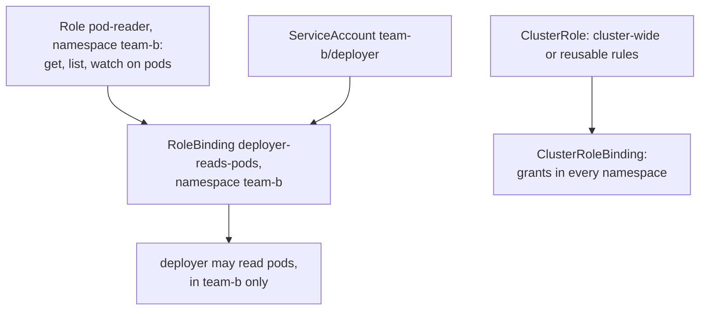

# RBAC and service accounts

> **Status: AI draft, 2026-11-16.** Not yet verified by me. Commands and output were run on a local kind cluster (Kubernetes 1.37).

## In one line

Every API request is authenticated (who: a user, group or service account) and then authorised by RBAC: Roles and ClusterRoles list allowed verbs on resources, and RoleBindings or ClusterRoleBindings grant them to subjects. Pods act as service accounts using short-lived projected tokens; `kubectl auth can-i` answers "is this allowed?" for anyone.

## The plain idea

The API server is the only door to the cluster ([Architecture and the reconcile loop](architecture.md)), and every request through it answers two questions. **Authentication**: who are you? A certificate, a token, or a cloud identity says so. **Authorisation**: are you allowed to do this? Kubernetes' usual answer comes from **RBAC** (role-based access control).

RBAC is two kinds of object. A **Role** is a list of permissions: "may get, list and watch pods". A **RoleBinding** hands a role to someone: "the deployer service account has the pod-reader role in namespace team-b". Nothing is allowed unless some binding grants it, the same default-deny idea as IAM ([IAM policies and how they are evaluated](../aws-core/iam-policies.md)).

## How it works

### Who can make requests

| Subject | What it is | Typical source |
|---|---|---|
| **User** | A human or external tool; Kubernetes stores no user objects | Client certificates, OIDC tokens, cloud IAM mapped into the cluster ([Cluster access, IRSA and Pod Identity](../eks/access-and-pod-identity.md)) |
| **Group** | A set of users | From the same authentication source; `system:authenticated` includes everyone logged in |
| **ServiceAccount** | An in-cluster identity for workloads, namespaced | Created like any object; pods run as one |

### The four RBAC objects



| Object | Scope | Grants |
|---|---|---|
| **Role** | One namespace | Rules for resources in that namespace |
| **ClusterRole** | Cluster | Rules for cluster-scoped resources (nodes, PVs), for all namespaces, or as a reusable template |
| **RoleBinding** | One namespace | A Role, or a ClusterRole limited to this namespace, to subjects |
| **ClusterRoleBinding** | Cluster | A ClusterRole to subjects, in every namespace |

A rule is `apiGroups` (the API group: `""` for core, `apps`, `batch`...), `resources` (`pods`, `deployments`, `pods/log`, `pods/exec`), and `verbs` (`get`, `list`, `watch`, `create`, `update`, `patch`, `delete`, and special ones such as `escalate`, `bind`, `impersonate`). There are no deny rules: permissions only add up.

Built-in ClusterRoles worth knowing: `view` (read most things, not Secrets), `edit` (change most things in a namespace), `admin` (namespace administration including RBAC), `cluster-admin` (everything).

### Service accounts and tokens

- Each namespace has a `default` service account; a pod without `serviceAccountName` uses it.
- The kubelet mounts a **projected token** into the pod: short-lived (an hour by default, rotated automatically), bound to the pod, with an audience. Older clusters used long-lived token Secrets, which never expired.
- `automountServiceAccountToken: false` (on the pod or the service account) stops the token being mounted at all, for pods that never call the API.
- Cloud integrations reuse the same tokens: IRSA and EKS Pod Identity exchange a service account's token for AWS credentials ([Cluster access, IRSA and Pod Identity](../eks/access-and-pod-identity.md)).

### Dangerous permissions

Some verbs are equivalent to much more power than they look:

| Permission | Why it is powerful |
|---|---|
| `get`, `list` on `secrets` | Reads every credential in the namespace |
| `create` on `pods` (or Deployments, Jobs) | Can mount any Secret and any service account in the namespace, and run any image |
| `create` on `pods/exec` | A shell inside other people's containers |
| `escalate`, `bind` on roles | Grant yourself roles you do not hold |
| `impersonate` | Act as another user or service account |
| Anything on nodes, `nodes/proxy`, or `hostPath` volumes via pod creation | Reach the node and everything on it |

## A concrete example

A CI job deploys into namespace `team-b` and also needs to read pods to wait for rollouts. It should not read Secrets or touch other namespaces.

1. Create service account `deployer` in `team-b`.
2. Create a Role with exactly what the job needs (here, reading pods; a real deployer also needs to update Deployments).
3. Bind it with a RoleBinding in `team-b`, not a ClusterRoleBinding.
4. Check, as the service account: reading pods in `team-b` is allowed; deleting them, reading Secrets, and reading pods in `demo` are not.
5. The job authenticates with a short-lived token for that service account (or, better, the cloud identity mapped to it), never a long-lived admin kubeconfig ([Pipeline security](../cicd/pipeline-security.md)).

## Why not just...?

- **...give the CI system `cluster-admin`?** A compromised pipeline then owns the whole cluster, including every Secret. Scope it to the namespaces and verbs it uses.
- **...use the `default` service account for everything?** Any permission granted to `default` goes to every pod in the namespace that does not choose another account. Give each workload its own service account.
- **...rely on "they cannot `get secrets`"?** Anyone who can create pods in the namespace can mount a Secret and read it. Review pod creation rights as carefully as Secret rights.

## Commands to know

A service account, a Role, and a binding:

```console
$ kubectl create serviceaccount deployer -n team-b
$ kubectl create role pod-reader -n team-b --verb=get,list,watch --resource=pods
$ kubectl create rolebinding deployer-reads-pods -n team-b --role=pod-reader --serviceaccount=team-b:deployer
```

Checking permissions as the service account:

```console
$ kubectl auth can-i get pods -n team-b --as=system:serviceaccount:team-b:deployer
yes
$ kubectl auth can-i delete pods -n team-b --as=system:serviceaccount:team-b:deployer
no
$ kubectl auth can-i get pods -n demo --as=system:serviceaccount:team-b:deployer
no
$ kubectl auth can-i get secrets -n team-b --as=system:serviceaccount:team-b:deployer
no
$ kubectl get pods -n demo --as=system:serviceaccount:team-b:deployer
Error from server (Forbidden): pods is forbidden: User "system:serviceaccount:team-b:deployer" cannot list resource "pods" in API group "" in the namespace "demo"
```

`--as` uses impersonation, which your own identity must be allowed to do. The denial message names the user, verb, resource, API group and namespace: everything needed to write the missing rule.

A short-lived token for the service account, decoded:

```console
$ kubectl create token deployer -n team-b --duration=10m
<token>
# its payload, decoded:
{'aud': ['https://kubernetes.default.svc.cluster.local'], 'sub': 'system:serviceaccount:team-b:deployer'} expires in 600 seconds
```

| Command | What it does |
|---|---|
| `kubectl auth can-i --list -n <ns>` | Everything the current identity may do in a namespace. |
| `kubectl auth whoami` | Which user and groups the API server sees for you. |
| `kubectl get rolebindings,clusterrolebindings -A -o wide` | Who is bound to what. |
| `kubectl describe clusterrole edit` | The rules of a built-in role. |
| `kubectl create clusterrolebinding ...` | Grant cluster-wide; rarely what you want for workloads. |

## How it breaks

| Symptom | Layer | Check | Likely cause |
|---|---|---|---|
| `Forbidden: User ... cannot <verb> resource ...` | Authorisation | `kubectl auth can-i ... --as=...` | No Role or binding grants it, or the binding is in another namespace |
| `Unauthorized` | Authentication | Token or certificate validity | Expired or wrong credentials; not an RBAC problem |
| A pod's API calls fail with 403 | Service account | `spec.serviceAccountName`; its bindings | Pod runs as `default`, or the role misses a verb or subresource (`pods/log`) |
| A controller cannot list a CRD | API group | `apiGroups` in the rule | Rule names the core group instead of the CRD's group |
| Someone read Secrets they "should not" | Indirect access | Who can create pods or exec | Pod creation or exec rights |
| A leaked old token still works | Token type | Long-lived token Secrets | Legacy service account token Secret; delete it and use projected tokens |

## Interview questions

**1. What is the difference between a Role and a ClusterRole, and a RoleBinding and a ClusterRoleBinding?**

<details markdown="1">
<summary>Answer</summary>

- A Role holds rules in one namespace; a ClusterRole holds rules cluster-wide or as a reusable template.
- A RoleBinding grants a Role or ClusterRole within one namespace.
- A ClusterRoleBinding grants a ClusterRole across the whole cluster.

</details>

**2. How does a pod authenticate to the API server?**

<details markdown="1">
<summary>Answer</summary>

- It runs as a service account (its namespace's `default` unless set).
- The kubelet mounts a projected, short-lived, audience-bound token that clients send as a bearer token.
- `automountServiceAccountToken: false` disables it for pods that do not need the API.

</details>

**3. How do you check whether a service account can delete pods?**

<details markdown="1">
<summary>Answer</summary>

- `kubectl auth can-i delete pods -n <ns> --as=system:serviceaccount:<ns>:<name>`.
- `--list` shows everything it can do.
- Then read the bindings to see which role granted what.

</details>

**4. Why is `create pods` a sensitive permission?**

<details markdown="1">
<summary>Answer</summary>

- A new pod can mount any Secret and use any service account in the namespace.
- It can run any image and, unless prevented by policy, request host access.
- So pod creation is close to the power of the most privileged service account in that namespace.

</details>

**5. What is the difference between `Unauthorized` and `Forbidden`?**

<details markdown="1">
<summary>Answer</summary>

- `Unauthorized` (401): authentication failed; the API server does not know who you are.
- `Forbidden` (403): you are known, but RBAC does not allow the action.
- Fix credentials for the first, bindings for the second ([HTTP](../networking/http.md)).

</details>

**6. Design RBAC for a team that should manage its own namespace but nothing else.**

<details markdown="1">
<summary>Answer</summary>

- A RoleBinding in their namespace to the built-in `edit` (or `admin`) ClusterRole for their group.
- No ClusterRoleBindings for them; read-only cluster views if needed.
- Separate service accounts per workload with minimal Roles; restrict exec and Secret access where possible.

</details>

## Try it

**Step 1.** On a kind cluster, create a service account with read-only access to pods in one namespace.

```bash
kubectl create namespace rbac-demo
kubectl create serviceaccount viewer -n rbac-demo
kubectl create role pod-viewer -n rbac-demo --verb=get,list --resource=pods
kubectl create rolebinding viewer-binding -n rbac-demo --role=pod-viewer --serviceaccount=rbac-demo:viewer
```

**Step 2.** Predict each answer, then check.

```bash
for q in "list pods -n rbac-demo" "delete pods -n rbac-demo" "list pods -n default" "list secrets -n rbac-demo"; do
  echo "$q: $(kubectl auth can-i $q --as=system:serviceaccount:rbac-demo:viewer)"
done
```

**Step 3.** Clean up.

```bash
kubectl delete namespace rbac-demo
```

## Zoom out

RBAC is "who is allowed?" for the Kubernetes API, alongside Linux permissions and IAM ([Users, groups and permissions](../linux/permissions.md), [IAM policies and how they are evaluated](../aws-core/iam-policies.md)); on EKS the two meet when IAM identities are mapped into the cluster and service accounts get AWS roles ([Cluster access, IRSA and Pod Identity](../eks/access-and-pod-identity.md)). The principle to carry: grant per workload and per namespace, check with `can-i`, and treat pod creation and Secret access as sensitive as admin.

## Sources

- [Kubernetes documentation: using RBAC authorization](https://kubernetes.io/docs/reference/access-authn-authz/rbac/)
- [Kubernetes documentation: service accounts](https://kubernetes.io/docs/concepts/security/service-accounts/)
- [Kubernetes documentation: authenticating](https://kubernetes.io/docs/reference/access-authn-authz/authentication/)
- [Kubernetes documentation: RBAC good practices](https://kubernetes.io/docs/concepts/security/rbac-good-practices/)
- [Kubernetes documentation: configure service accounts for pods](https://kubernetes.io/docs/tasks/configure-pod-container/configure-service-account/)
