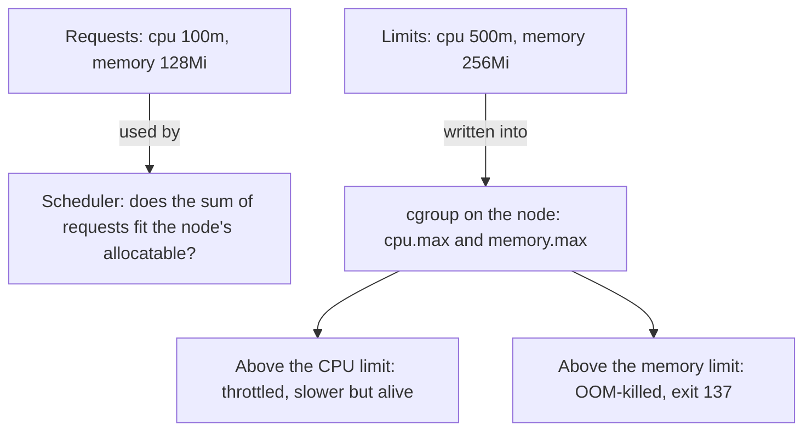

# Requests, limits and QoS

> **Status: AI draft, 2026-11-16.** Not yet verified by me. Commands and output were run on a local kind cluster (Kubernetes 1.37).

## In one line

A request is what the scheduler reserves for a container on a node; a limit is the ceiling the kernel enforces through cgroups. Exceeding a CPU limit throttles the container, exceeding a memory limit gets it OOM-killed (exit 137). Requests and limits together set a pod's QoS class, which decides who is evicted first when a node runs short.

## The plain idea

A node is a box with a fixed amount of CPU and memory. Before placing a pod, the scheduler needs to know how much room it needs, and once placed, the node needs to stop one greedy pod from starving the others. Those are two different numbers.

The **request** is a reservation: "this container needs at least this much". The scheduler only places a pod where the requests still fit, whatever the pods are actually using. The **limit** is a hard ceiling: "never let it use more than this". The two behave very differently for CPU and memory, because CPU can be shared out more slowly, while memory cannot be taken back without killing something.

## How it works

### Units

- **CPU** in cores: `1` is one core, `500m` (millicores) is half a core, `100m` a tenth.
- **Memory** in bytes with suffixes: `128Mi` (mebibytes, powers of 1024) or `128M` (megabytes, powers of 1000). `Mi` and `Gi` are the usual choice.

### Requests, limits and what enforces them



| | Request | Limit |
|---|---|---|
| Used by | The scheduler, when placing the pod | The kernel, while the pod runs ([What a container is](../containers/what-is-a-container.md)) |
| CPU | Also sets the container's share of CPU when the node is busy | Throttling: the container gets at most that much CPU time per period |
| Memory | Reserved for placement; affects eviction order | Exceeding it means the container is OOM-killed ([Memory and the OOM killer](../linux/memory-and-oom.md)) |
| If not set | Defaults to the limit, if a limit is set; otherwise zero | Unlimited (up to the node) |

**Allocatable** is what a node offers to pods: its capacity minus what is reserved for the operating system and the kubelet. The scheduler compares the sum of requests on a node with its allocatable. Actual usage does not matter to the scheduler, so a node can be "full" by requests while mostly idle, or overloaded while its requests look small.

### QoS classes

| Class | Rule | Evicted |
|---|---|---|
| **Guaranteed** | Every container has CPU and memory requests equal to its limits | Last |
| **Burstable** | At least one container has a request or limit, but not Guaranteed | In between, by how far each is above its requests |
| **BestEffort** | No requests or limits at all | First |

When a node runs short of memory, the kubelet **evicts** pods to protect the node, starting with those using the most memory above their requests; BestEffort pods have no requests, so they go first. Separately, if the whole node runs out before the kubelet acts, the kernel's OOM killer picks a process, and QoS also biases that choice.

### Choosing values

- **Set memory requests and limits** for every container, from observed usage plus headroom. Many teams set memory request equal to limit, so placement matches the real ceiling and pods are never OOM-killed for the node's sake.
- **Set CPU requests** from typical usage. **CPU limits** are debated: they protect neighbours but cause throttling, and latency spikes, even when the node has idle CPU. Many teams set CPU requests and leave CPU limits off for latency-sensitive services.
- **Measure** with metrics (`container_memory_working_set_bytes`, CPU usage and throttling counters) rather than guessing ([Prometheus on Kubernetes](../observability/prometheus-on-kubernetes.md)). The Vertical Pod Autoscaler can recommend values ([Autoscaling](autoscaling.md)).
- A **LimitRange** supplies defaults per namespace; a **ResourceQuota** caps totals ([Labels, selectors and namespaces](labels-selectors-namespaces.md)).

## A concrete example

A Java service is OOM-killed about once a day, and its p99 latency is poor even though CPU usage averages 30% of its limit.

1. `kubectl describe pod` shows `Last State: Terminated, Reason: OOMKilled, Exit Code: 137`. Memory limit 1Gi; the JVM heap is set to 1Gi, and the JVM needs memory beyond the heap. Set the heap to about 75% of the limit (`-XX:MaxRAMPercentage=75`), or raise the limit after measuring ([Memory and the OOM killer](../linux/memory-and-oom.md)).
2. Latency: the CPU limit is 1 core. Garbage collection and request bursts use more than that for short moments, so the container is throttled in those moments, even though the average is low. The throttling counters confirm it ([Performance triage](../linux/performance-triage.md)).
3. Raise the CPU request to cover normal load, remove the CPU limit (or raise it well above bursts), and keep the memory limit.
4. The OOM kills stop, and p99 latency drops, without adding nodes.

## Why not just...?

- **...leave requests unset?** Pods become BestEffort: the scheduler packs them blindly, and they are the first to be evicted when a node is short. Autoscalers also rely on requests ([Autoscaling](autoscaling.md)).
- **...set requests far above real use "to be safe"?** Each pod reserves capacity it never uses; nodes fill up by requests while idle, and you pay for more nodes ([Cost optimisation](../operations/cost-optimisation.md)).
- **...set low limits to force efficiency?** Low memory limits cause OOM kills; low CPU limits cause throttling and latency. Limits are safety rails, not targets.

## Commands to know

The three QoS classes from three resource settings:

```console
$ kubectl get pods -n demo qos-guaranteed qos-burstable qos-besteffort -o custom-columns=NAME:.metadata.name,QOS:.status.qosClass
NAME             QOS
qos-guaranteed   Guaranteed
qos-burstable    Burstable
qos-besteffort   BestEffort
```

`qos-guaranteed` set requests equal to limits (100m and 64Mi); `qos-burstable` set requests of 50m and 32Mi with only a 128Mi memory limit; `qos-besteffort` set nothing.

The limits, as the kernel sees them inside the Guaranteed pod:

```console
$ kubectl exec -n demo qos-guaranteed -- sh -c 'cat /sys/fs/cgroup/memory.max /sys/fs/cgroup/cpu.max'
67108864
10000 100000
```

64 MiB, and 10 ms of CPU per 100 ms period: `100m` is a tenth of a core.

A container exceeding its 64Mi memory limit:

```console
$ kubectl get pod oom-demo -n demo
NAME       READY   STATUS      RESTARTS   AGE
oom-demo   0/1     OOMKilled   0          15s
$ kubectl get pod oom-demo -n demo -o jsonpath='{.status.containerStatuses[0].state.terminated.reason} exit={.status.containerStatuses[0].state.terminated.exitCode}'
OOMKilled exit=137
```

Requests the node cannot fit:

```console
$ kubectl get pod too-big -n demo
NAME      READY   STATUS    RESTARTS   AGE
too-big   0/1     Pending   0          15s
$ kubectl get events -n demo --field-selector involvedObject.name=too-big,reason=FailedScheduling
0/1 nodes are available: 1 Insufficient cpu, 1 Insufficient memory. preemption: 0/1 nodes are available: 1 Preemption is not helpful for scheduling.
```

What is reserved on the node, by requests, against what it offers:

```console
$ kubectl describe node notes-lab-control-plane
Allocated resources:
  (Total limits may be over 100 percent, i.e., overcommitted.)
  Resource           Requests     Limits
  --------           --------     ------
  cpu                1400m (11%)  1600m (13%)
  memory             770Mi (5%)   1300Mi (8%)
```

| Command | What it does |
|---|---|
| `kubectl top pods`, `kubectl top nodes` | Current usage; needs metrics-server ([kubectl fluency](kubectl.md)). |
| `kubectl describe node <n>` | Capacity, allocatable, requests and limits per pod. |
| `kubectl get pod <p> -o jsonpath='{.status.qosClass}'` | A pod's QoS class. |
| `kubectl set resources deploy/<d> --requests=cpu=200m,memory=256Mi --limits=memory=256Mi` | Change resources (prefer changing the manifest). |
| `kubectl get events -A --field-selector reason=Evicted` | Pods evicted for node pressure. |

## How it breaks

| Symptom | Layer | Check | Likely cause |
|---|---|---|---|
| `OOMKilled`, exit 137 | Memory limit | Last state; memory metrics against the limit | Limit lower than real use, or a leak |
| `Pending`, `Insufficient cpu` or `memory` | Requests | Node allocatable against requests | Requests too large, or nodes full by requests ([Scheduling](scheduling.md)) |
| High latency, CPU usage below limit | CPU limit | Throttling metrics, `cpu.stat` | Throttling during bursts |
| Pods `Evicted` with `The node was low on resource: memory` | Node pressure | Node conditions; which pods use more than they request | Requests far below real use; BestEffort pods |
| Nodes look full but are idle | Over-requesting | Requests against usage per pod | Requests set far above need |
| Pod rejected: `must specify limits.memory` | Quota | Namespace quota and LimitRange | A quota requires values the pod did not set |

## Interview questions

**1. What is the difference between requests and limits?**

<details markdown="1">
<summary>Answer</summary>

- Requests are what the scheduler reserves when placing the pod, and the CPU share under contention.
- Limits are ceilings enforced by cgroups while it runs.
- The scheduler ignores actual usage and limits; it only sums requests.

</details>

**2. What happens when a container exceeds its CPU limit, and its memory limit?**

<details markdown="1">
<summary>Answer</summary>

- CPU: it is throttled, running slower but not killed.
- Memory: the kernel OOM-kills it; exit code 137 and status `OOMKilled`.
- That is why memory limits must cover real peak usage.

</details>

**3. What are the QoS classes and how are they assigned?**

<details markdown="1">
<summary>Answer</summary>

- Guaranteed: every container has requests equal to limits for CPU and memory.
- Burstable: some requests or limits set, but not Guaranteed.
- BestEffort: none set. Under node pressure BestEffort is evicted first and Guaranteed last.

</details>

**4. A pod is `Pending` with `Insufficient memory`, but the nodes' memory usage is low. Why?**

<details markdown="1">
<summary>Answer</summary>

- The scheduler compares requests, not usage, against allocatable.
- Other pods' requests have reserved the memory, even if unused.
- Right-size requests, or add capacity.

</details>

**5. Should you set CPU limits?**

<details markdown="1">
<summary>Answer</summary>

- They protect neighbours from a runaway container but cause throttling and latency spikes even when the node has spare CPU.
- Many teams set accurate CPU requests and no CPU limit for latency-sensitive services, keeping limits for noisy or untrusted workloads.
- Always set memory limits.

</details>

**6. How do you choose requests and limits for a new service?**

<details markdown="1">
<summary>Answer</summary>

- Run it under realistic load and measure CPU and memory, including peaks.
- Requests near typical use, memory limit above peak with headroom, CPU limit optional.
- Revisit with metrics or VPA recommendations, and watch OOM kills and throttling.

</details>

## Try it

**Step 1.** On a kind cluster, create pods in each QoS class and check what Kubernetes assigned.

```bash
kubectl run g --image=busybox:1.36 --overrides='{"spec":{"containers":[{"name":"g","image":"busybox:1.36","command":["sleep","3600"],"resources":{"requests":{"cpu":"100m","memory":"64Mi"},"limits":{"cpu":"100m","memory":"64Mi"}}}]}}'
kubectl run b --image=busybox:1.36 -- sleep 3600
kubectl get pods g b -o custom-columns=NAME:.metadata.name,QOS:.status.qosClass
```

**Step 2.** Predict the status and exit code of a container that grows past a 32Mi limit, then check.

```bash
kubectl run oom --restart=Never --image=busybox:1.36 --overrides='{"spec":{"containers":[{"name":"oom","image":"busybox:1.36","command":["sh","-c","tail /dev/zero"],"resources":{"limits":{"memory":"32Mi"}}}]}}'
sleep 10; kubectl get pod oom
kubectl get pod oom -o jsonpath='{.status.containerStatuses[0].state.terminated.exitCode}{"\n"}'
```

**Step 3.** Clean up.

```bash
kubectl delete pod g b oom
```

## Zoom out

Requests drive scheduling and autoscaling, limits drive the cgroups that keep pods from hurting each other, and both drive cost ([Scheduling](scheduling.md), [Autoscaling](autoscaling.md), [Cost optimisation](../operations/cost-optimisation.md)). Underneath they are the Linux cgroup files covered in [What a container is](../containers/what-is-a-container.md). The principle to carry: requests are promises to the scheduler, limits are walls for the kernel, and both should come from measurement.

## Sources

- [Kubernetes documentation: resource management for pods and containers](https://kubernetes.io/docs/concepts/configuration/manage-resources-containers/)
- [Kubernetes documentation: pod quality of service classes](https://kubernetes.io/docs/concepts/workloads/pods/pod-qos/)
- [Kubernetes documentation: node-pressure eviction](https://kubernetes.io/docs/concepts/scheduling-eviction/node-pressure-eviction/)
- [Kubernetes documentation: reserve compute resources for system daemons](https://kubernetes.io/docs/tasks/administer-cluster/reserve-compute-resources/)
