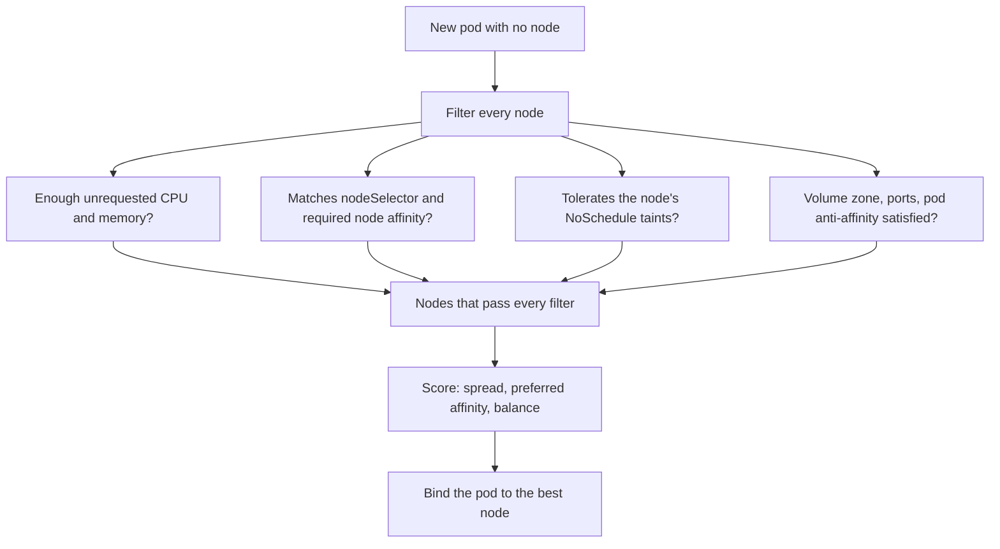

# Scheduling

> **Status: AI draft, 2026-11-16.** Not yet verified by me. Commands and output were run on a one-node local kind cluster (Kubernetes 1.37); multi-node behaviour such as spreading is described from the documentation.

## In one line

The scheduler places each new pod in two steps: filter out nodes that cannot run it (resources, node selectors and affinity, taints without tolerations, volume zones), then score the rest and pick the best. A `Pending` pod's events say exactly which filter rejected each node, and the fix is to change the pod, the nodes or the capacity.

## The plain idea

A new pod is like a guest who needs a hotel room: the right size, on the right floor, not next to certain other guests, and not in a room marked "staff only". The scheduler is the front desk. First it crosses out every room that cannot work at all. Then, among the rooms left, it picks the one that suits best by its scoring rules. If no room survives the first step, the guest waits in the lobby: the pod stays `Pending`, and the reason is written on its events.

Most scheduling work is telling the front desk your constraints clearly: this pod needs a GPU node, these replicas should not share a zone, this node is reserved for batch work.

## How it works

### Filter, then score



If no node passes the filters, the pod stays `Pending` and an event lists the reason per node, for example `0/3 nodes are available: 1 Insufficient memory, 2 node(s) had untolerated taint(s)`. Autoscalers react to such pods by adding nodes ([Node autoscaling: Cluster Autoscaler vs Karpenter](../eks/cluster-autoscaler-vs-karpenter.md)).

### Steering pods towards nodes

| Mechanism | Strength | Example |
|---|---|---|
| `nodeSelector` | Hard: only nodes with all these labels | `disktype: ssd` |
| Node affinity, `requiredDuringSchedulingIgnoredDuringExecution` | Hard, with richer operators (`In`, `NotIn`, `Exists`) | Only `arm64` nodes in two zones |
| Node affinity, `preferredDuringSchedulingIgnoredDuringExecution` | Soft: a scoring preference with a weight | Prefer spot capacity |

"IgnoredDuringExecution" means: if node labels change after the pod is placed, the pod is not moved.

### Pods relative to other pods

| Mechanism | Use |
|---|---|
| **Pod anti-affinity** | Keep replicas of one app off the same node (`topologyKey: kubernetes.io/hostname`) or zone. Required anti-affinity can leave pods Pending if there are not enough nodes. |
| **Pod affinity** | Place a pod near pods it talks to heavily, such as a cache next to its app. |
| **Topology spread constraints** | Spread replicas evenly across zones or nodes, with `maxSkew` (how uneven is allowed) and `whenUnsatisfiable: DoNotSchedule` or `ScheduleAnyway`. Usually the better tool for high availability ([High availability and failure domains](../operations/high-availability.md)). |

### Keeping pods away from nodes: taints and tolerations

A **taint** on a node repels pods: `dedicated=batch:NoSchedule`. Only pods with a matching **toleration** may be scheduled there. Effects:

| Effect | Meaning |
|---|---|
| `NoSchedule` | New pods without the toleration are not placed here |
| `PreferNoSchedule` | Avoid, if possible |
| `NoExecute` | Also evicts running pods that do not tolerate it (optionally after `tolerationSeconds`) |

A toleration only **allows** a pod onto a tainted node; it does not attract it there. To reserve nodes for a workload, combine a taint (keep others out) with node affinity (pull this one in). Kubernetes taints nodes itself for conditions such as `not-ready`, `unreachable` and memory or disk pressure.

### Priority and preemption

A **PriorityClass** gives pods a priority number. When a high-priority pod cannot be placed, the scheduler may **preempt**: evict lower-priority pods from a node to make room. System-critical pods use the built-in `system-cluster-critical` and `system-node-critical` classes. Use priorities sparingly; preemption is real eviction of real workloads.

### Static pods and DaemonSets

The scheduler does not place static pods (the kubelet runs them from files, which is how control-plane pods run on kubeadm clusters). DaemonSet pods go through the scheduler with an affinity that pins each one to its node ([StatefulSets and DaemonSets](statefulsets-and-daemonsets.md)).

## A concrete example

A team wants three replicas of an API spread over three zones, on general-purpose nodes only, and never on the GPU nodes.

```yaml
spec:
  topologySpreadConstraints:
    - maxSkew: 1
      topologyKey: topology.kubernetes.io/zone
      whenUnsatisfiable: DoNotSchedule
      labelSelector:
        matchLabels:
          app: sample-app
  affinity:
    nodeAffinity:
      requiredDuringSchedulingIgnoredDuringExecution:
        nodeSelectorTerms:
          - matchExpressions:
              - key: node-pool
                operator: In
                values: ["general"]
```

1. The GPU nodes carry the taint `nvidia.com/gpu=present:NoSchedule`, so the API pods, with no toleration, are filtered out there anyway.
2. Required node affinity keeps the pods on `node-pool=general` nodes.
3. The spread constraint puts one replica per zone (skew at most 1).
4. When one zone has no free capacity, the third replica stays `Pending` with a message about the spread constraint, and the node autoscaler adds a node in that zone.

## Why not just...?

- **...use `nodeName` to pin pods to nodes?** It bypasses the scheduler entirely: no resource checks, and the pod fails if that node is gone. Use labels and affinity.
- **...use required pod anti-affinity for every app?** With more replicas than nodes, the extra pods can never schedule. Topology spread with a sensible `maxSkew` usually achieves the goal with less risk.
- **...add a toleration and expect the pod to go to the tainted nodes?** A toleration only permits it. Add node affinity to require those nodes.

## Commands to know

Three reasons a pod stays `Pending`, from the events:

```console
$ kubectl get events -n demo --field-selector involvedObject.name=too-big,reason=FailedScheduling
0/1 nodes are available: 1 Insufficient cpu, 1 Insufficient memory. preemption: 0/1 nodes are available: 1 Preemption is not helpful for scheduling.
$ kubectl get events -n demo --field-selector involvedObject.name=wants-ssd,reason=FailedScheduling
0/1 nodes are available: 1 node(s) didn't match Pod's node affinity/selector. preemption: 0/1 nodes are available: 1 Preemption is not helpful for scheduling.
$ kubectl get events -n demo --field-selector involvedObject.name=untolerated,reason=FailedScheduling
0/1 nodes are available: 1 node(s) had untolerated taint(s). preemption: 0/1 nodes are available: 1 Preemption is not helpful for scheduling.
```

Fixing the selector by labelling the node; the pending pod is placed within seconds:

```console
$ kubectl label node notes-lab-control-plane disktype=ssd
$ kubectl get pod wants-ssd -n demo -o wide
NAME        STATUS    NODE
wants-ssd   Running   notes-lab-control-plane
```

A taint keeps out the pod without a toleration and admits the one with it:

```console
$ kubectl taint node notes-lab-control-plane dedicated=batch:NoSchedule
$ kubectl get pods -n demo untolerated tolerated
NAME          READY   STATUS    RESTARTS   AGE
untolerated   0/1     Pending   0          8s
tolerated     1/1     Running   0          8s
$ kubectl taint node notes-lab-control-plane dedicated=batch:NoSchedule-
$ kubectl get pod untolerated -n demo
untolerated   Running
```

The trailing `-` removes the taint, and the waiting pod is scheduled straight away.

| Command | What it does |
|---|---|
| `kubectl get pods --field-selector=status.phase=Pending -A` | Every pending pod in the cluster. |
| `kubectl describe pod <p>` | The `FailedScheduling` event with per-node reasons. |
| `kubectl get nodes --show-labels`, `-L topology.kubernetes.io/zone` | Node labels, such as zone and instance type. |
| `kubectl describe node <n>` | Taints, conditions, allocatable and current requests. |
| `kubectl cordon <n>` | Mark a node unschedulable; existing pods stay ([Disruptions, drains and PDBs](disruptions-and-pdbs.md)). |
| `kubectl get priorityclasses` | Priority classes available. |

## How it breaks

| Symptom | Layer | Check | Likely cause |
|---|---|---|---|
| `Insufficient cpu` or `memory` | Resources | Requests against allocatable | Requests too big, or nodes full by requests ([Requests, limits and QoS](resources-and-qos.md)) |
| `didn't match Pod's node affinity/selector` | Labels | Node labels against the pod's selector or affinity | Missing or misspelled label |
| `had untolerated taint(s)` | Taints | Node taints against pod tolerations | Pod lacks a toleration, or the node is tainted for a condition (not-ready, pressure) |
| `didn't match pod anti-affinity rules` or spread constraint messages | Pod placement rules | Replica count against nodes or zones | Required anti-affinity or strict spread with too few domains |
| `volume node affinity conflict` | Storage | PV's zone against nodes | A zonal volume and no schedulable node in its zone ([Storage](storage.md)) |
| Lower-priority pods suddenly evicted | Preemption | Events for `Preempted` | A higher-priority pod needed room |

## Interview questions

**1. How does the scheduler choose a node for a pod?**

<details markdown="1">
<summary>Answer</summary>

- Filtering: remove nodes that cannot run it (resources, selectors and required affinity, taints, volume and port constraints).
- Scoring: rank the remaining nodes (spreading, preferred affinity, resource balance).
- Bind the pod to the highest-scoring node; if none pass the filters, it stays Pending.

</details>

**2. What is the difference between a taint and node affinity?**

<details markdown="1">
<summary>Answer</summary>

- A taint is on the node and repels pods that do not tolerate it.
- Node affinity is on the pod and attracts it to matching nodes.
- To dedicate nodes, use both: taint to keep others out, affinity to require this workload there.

</details>

**3. A pod is `Pending`. How do you find out why?**

<details markdown="1">
<summary>Answer</summary>

- `kubectl describe pod` and read the `FailedScheduling` event: it lists reasons per node.
- Compare requests with allocatable, selectors and affinity with node labels, tolerations with taints, and volume zones with nodes.
- Check whether an autoscaler is reacting.

</details>

**4. How do you spread replicas across availability zones?**

<details markdown="1">
<summary>Answer</summary>

- Topology spread constraints with `topologyKey: topology.kubernetes.io/zone` and a `maxSkew`.
- Or pod anti-affinity on the zone key, which is coarser.
- Make sure nodes actually exist in each zone, or pods stay Pending with `DoNotSchedule`.

</details>

**5. What do the `NoSchedule`, `PreferNoSchedule` and `NoExecute` taint effects do?**

<details markdown="1">
<summary>Answer</summary>

- `NoSchedule`: new non-tolerating pods are not placed.
- `PreferNoSchedule`: avoid if possible.
- `NoExecute`: also evicts running pods that do not tolerate it, optionally after `tolerationSeconds`.

</details>

**6. What is preemption?**

<details markdown="1">
<summary>Answer</summary>

- When a pod with higher priority cannot be scheduled, the scheduler may evict lower-priority pods to make room.
- Priority comes from a PriorityClass.
- It protects critical workloads but evicts others, so use few priority levels.

</details>

## Try it

**Step 1.** On a kind cluster, create a pod that needs a label no node has. Predict its status and the event message.

```bash
kubectl run picky --image=busybox:1.36 --overrides='{"spec":{"nodeSelector":{"disktype":"ssd"}}}' -- sleep 3600
sleep 5; kubectl get pod picky
kubectl describe pod picky | grep -A2 Events
```

**Step 2.** Label the node and watch the pod get scheduled.

```bash
NODE=$(kubectl get nodes -o jsonpath='{.items[0].metadata.name}')
kubectl label node $NODE disktype=ssd
kubectl get pod picky -o wide
```

**Step 3.** Clean up.

```bash
kubectl delete pod picky && kubectl label node $NODE disktype-
```

## Zoom out

Scheduling joins resources ([Requests, limits and QoS](resources-and-qos.md)), storage topology ([Storage](storage.md)), disruption rules ([Disruptions, drains and PDBs](disruptions-and-pdbs.md)) and node autoscaling ([Karpenter in depth](../eks/karpenter.md)): Karpenter, for instance, reads pending pods' constraints to decide which node to launch. The principle to carry: a Pending pod always says why in its events, so read the filter that failed before changing anything.

## Sources

- [Kubernetes documentation: Kubernetes scheduler](https://kubernetes.io/docs/concepts/scheduling-eviction/kube-scheduler/)
- [Kubernetes documentation: assigning pods to nodes](https://kubernetes.io/docs/concepts/scheduling-eviction/assign-pod-node/)
- [Kubernetes documentation: taints and tolerations](https://kubernetes.io/docs/concepts/scheduling-eviction/taint-and-toleration/)
- [Kubernetes documentation: pod topology spread constraints](https://kubernetes.io/docs/concepts/scheduling-eviction/topology-spread-constraints/)
- [Kubernetes documentation: pod priority and preemption](https://kubernetes.io/docs/concepts/scheduling-eviction/pod-priority-preemption/)
